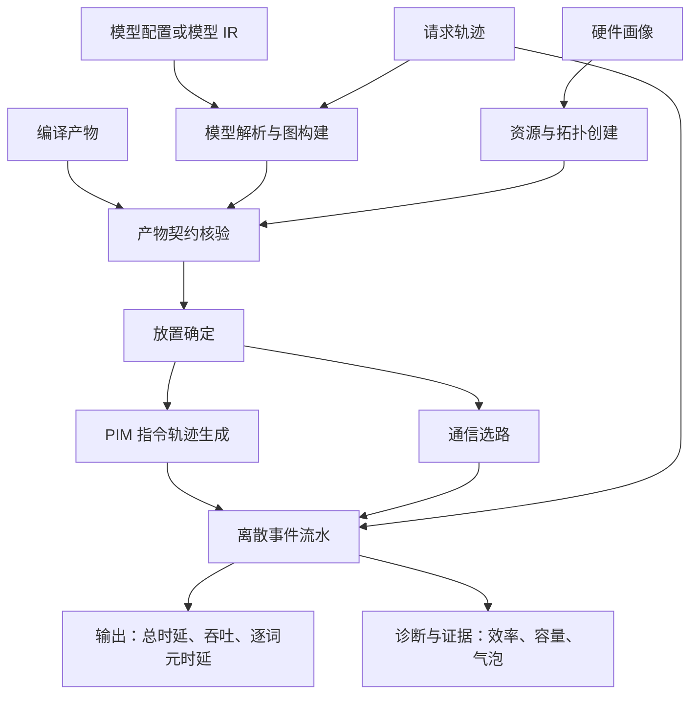
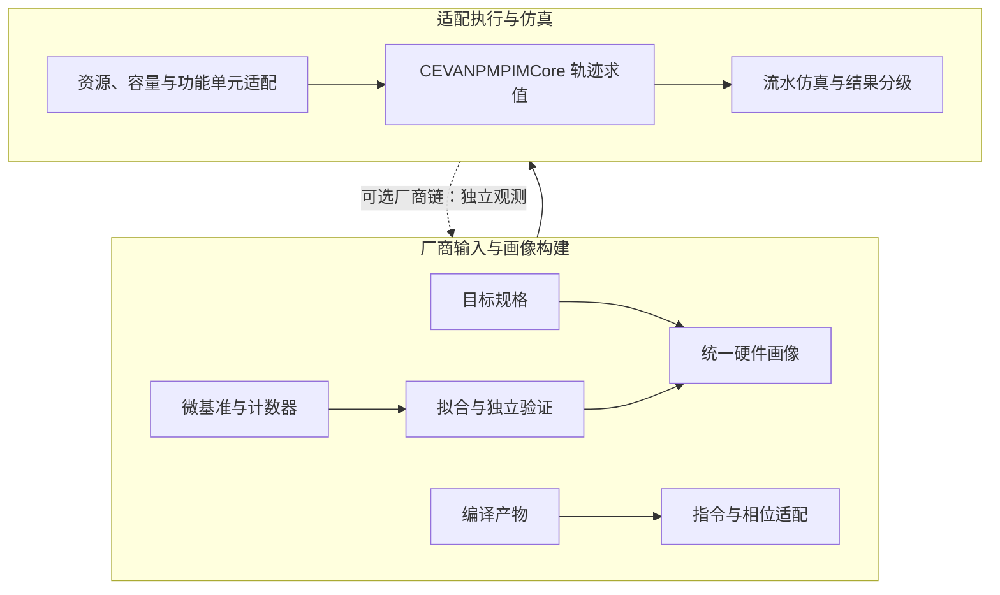
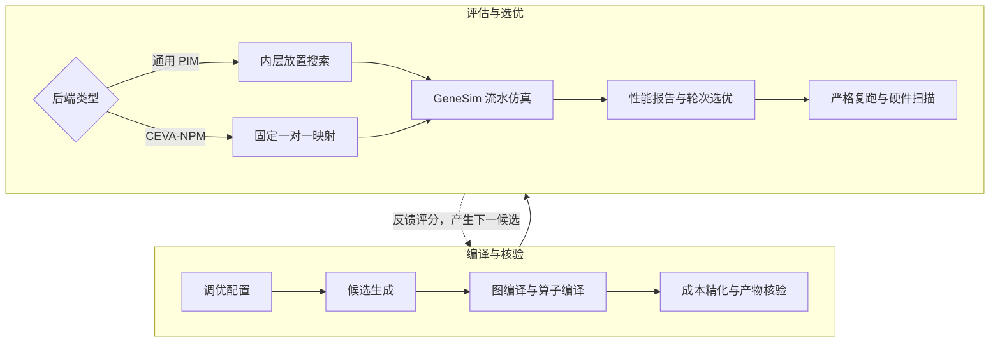

# GeneSim 使用手册

> 版本日期：2026-11-13
> 适用范围：GeneSim、flagos-pim-compiler、FlagTree 当前工作区；重点覆盖 CEVA-NPM 后端、硬件适配、编译调优闭环与结果解释。

## 一、背景与意义

　　大语言模型推理包含大量权重读取、键值缓存访问和中间激活搬运，内存带宽与数据移动开销已经成为影响系统性能的重要因素。存算一体（PIM）架构把部分计算能力部署到存储阵列附近，通过缩短数据移动路径提高有效带宽和能效，为大模型推理提供了新的硬件实现方向。与此同时，模型性能还受到图切分、算子实现、驻留容量、片间通信、请求并发和硬件配置的共同影响，峰值算力只能反映其中一个方面。

　　在流片前，硬件团队需要回答采用多少计算核、配置多大存储容量、选择何种时钟与互连、如何安排计算单元等问题；软件团队需要回答模型怎样切分、算子怎样分块、任务怎样放置、流水怎样组织等问题。这些决策相互耦合：增加核数会提高理论并行度，也会增加通信开销与空闲资源；增大分块会改善局部计算效率，也会加大工作存储压力；改变任务线程数会改变矩阵计算周期，共享搬运通道仍构成约束。仅凭单项峰值指标难以判断端到端收益，硬件与软件需要放在同一评估框架中联合分析。

　　为此，本项目设计并完善 GeneSim，将模型中间表示、请求轨迹、虚拟处理单元、指令轨迹周期模型、链路通信模型和离散事件流水组合在同一框架中，并接入图编译器与 FlagTree 算子编译器，形成“候选配置、图编译、算子编译、仿真评估、结果回填、下一候选”的迭代闭环。模拟器针对给定模型和请求负载，输出端到端时延、吞吐、首词元时延、逐词元时延、计算与访存效率、通信时间、资源利用率、容量占用和流水线气泡等数据，并进一步分解各项硬件参数与编译策略对这些指标的影响。

　　GeneSim 的核心价值是在流片前为大模型推理的 PIM 硬件与软件设计提供可量化、可比较、可追溯的性能数据和设计建议。硬件团队可以据此比较核数、容量、时钟、工作存储、计算单元和链路方案，识别性能瓶颈与资源浪费，确定更有依据的规格组合；编译与系统团队可以据此选择张量并行宽度、流水段数、任务线程数、算子分块和放置策略，使软件优化与目标硬件协同演进。提前发现不合理方案，有助于减少流片后的架构返工、编译适配和重复验证成本，提高研发决策效率。

　　围绕上述价值，GeneSim 面向 4 类核心场景：编译策略选优，比较图切分、任务线程和优化开关；硬件设计探索，分析核数、容量、时钟、工作存储和链路参数；放置与调度研究，搜索满足容量约束的算子资源映射；厂商后端适配，把厂商规格、微基准测量和独立验证数据转换为可追溯的代价模型参数。随着实测数据持续补充，模拟器可以先用于设计空间筛选，再用于校准范围内的性能评估，为厂商的产品规划、架构设计和编译优化提供统一的数据依据。

　　当前端到端编译调优主线支持 Llama-2-7B，模型配置来自 Hugging Face 格式目录，图编译、算子编译、放置导出和仿真共用同一套算子编号。GeneSim 的模型解析入口可读取 Hugging Face、ModelScope 或本地 `config.json`，当前构图逻辑面向 Llama 类解码器。其他模型族可按同一中间表示与产物契约补充构图和算子支持后接入；预测器演示中的小型 GPT-2 配置用于功能验证。

## 二、核心原理

　　GeneSim 旨在解决“如何在执行真实硬件之前，估计给定模型、请求负载和编译映射在目标异构系统上的端到端行为”这一问题。它采用模型与负载分离、计算与通信分离、静态编译与动态形状结合的方法：模型中间表示描述算什么，请求轨迹描述何时以及以何种序列长度执行，硬件画像描述可以用哪些资源，指令轨迹和链路公式描述各项服务需要多久，离散事件调度最后计算这些服务在依赖与争用条件下如何重叠。其意义在于既保留系统级并行和排队效应，又能通过硬件参数校准逐步逼近目标设备。

　　为实现上述目标，需要解决 3 个关键子问题。第 1 个问题是模型结构、运行形状和硬件资源如何统一表达；第 2 个问题是单算子计算、访存和跨设备传输如何计时；第 3 个问题是多个请求与多个算子如何在共享资源上形成端到端时间。针对第 1 个问题，GeneSim 使用模型、请求和流水阶段 3 种中间表示，并以符号维描述预填充与解码形状。针对第 2 个问题，采用参数化指令轨迹、周期成本表和通信链路表，并将厂商编译产物转换为统一计时输入。针对第 3 个问题，采用事件驱动流水，把依赖完成、资源占用和链路排队转化为按时间排序的事件。

### 2.1 整体框架与处理流程

　　GeneSim 的整体流程是“输入模型与请求、加载硬件画像、生成或读取编译产物、确定放置、计算服务时间、执行事件流水、输出报告”。整体框架如图 1 所示，图中同时给出输入、主要部件和输出之间的处理关系。



　　首先，模型解析器读取模型配置并生成模型中间表示，请求生成器生成与模型相互独立的请求轨迹。然后，配置系统创建虚拟处理单元和通信拓扑，调度器读取固定放置或构造初始放置，并检查容量与产物身份。其次，PIM 算子依据算子编译产物生成参数化指令轨迹，通信模块依据源和目的资源选择链路。最后，事件调度器执行全部请求的前向步骤，输出端到端指标、瓶颈分项和可追溯的运行证据。

### 2.2 模型、请求与阶段中间表示

　　模型中间表示把模型结构和运行负载解耦。`Tq` 表示本次前向的查询长度，`Tp` 表示本次前向前已经存在的历史长度，`Tp+Tq` 表示本次注意力计算看到的键值长度。预填充阶段通常一次处理多个查询词元，解码阶段通常每次只处理一个查询词元，因此同一模型无需为每个序列长度重新构图，运行时再求解符号系数即可。

　　模型级字段和日志中常见结构参数的含义如下表所示。`num_parameters` 是完整模型参数个数，日志中以十进制十亿为单位显示；`parameter_bytes` 是进入图模型的参数字节数，两者分别描述参数个数和字节规模，应分开使用。`subgraphs` 通常按解码层分组，用于流水阶段构造和层块移动，与算子依赖图分工不同。

| 字段 | 含义 |
| --- | --- |
| `model_id` | 模型标识，通常来自模型配置中的名称或路径 |
| `num_layers` | 解码层数量，Llama-2-7B 为 32 |
| `num_heads` | 查询注意力头数量，Llama-2-7B 为 32 |
| `head_dim` | 每个注意力头的维度，Llama-2-7B 为 128 |
| `hidden_size` | 隐藏维宽度，Llama-2-7B 为 4096 |
| `operators` / `dependencies` | 算子列表及其数据依赖列表 |
| `subgraphs` | 可选算子分组，通常一组对应一个解码层 |
| `parameter_bytes` / `num_parameters` | 图模型参数字节数 / 完整参数个数 |

　　算子级字段决定“算什么、算多大、放在哪里”。其中 `flops` 与 `data_bytes` 是静态估计，`flops_coeffs` 与 `data_bytes_coeffs` 则允许按 `Tq`、`Tp` 及其乘积在运行时求解。`local_input_shapes` 和 `local_output_shapes` 保存图编译后的本地分片形状，`kernel_tile_size` 保存算子编译得到的实际分块；这些本地字段优先用于执行计时，但原全局形状仍保留模型语义。

| 字段 | 含义 |
| --- | --- |
| `op_id` / `op_type` | 算子唯一编号 / 算子类型，跨图编译和仿真必须一致 |
| `input_shapes` / `output_shapes` | 全局输入与输出形状，维度可以是整数或符号项 |
| `flops` / `data_bytes` | 静态浮点运算量与数据访问量 |
| `flops_coeffs` / `data_bytes_coeffs` | 随运行形状变化的运算量与字节系数 |
| `arith_intensity` | 算术强度，即运算量除以数据访问量 |
| `semantic_role` | 投影等算子的语义身份，用于跨阶段匹配 |
| `attached_pu_id` / `vpu_id` / `node_id` | PIM 处理单元、虚拟处理单元和节点放置编号，负值表示尚未分配 |
| `local_input_shapes` / `local_output_shapes` | 单台逻辑处理单元上的实际分片形状 |
| `kernel_tile_size` | 算子编译器确定的输出分块，优先于模板默认值 |
| `source_name` / `mram_traffic_bytes` | 成本附加数据中的来源名称与代表性搬运字节，启用成本覆盖时才生效 |

　　依赖字段进一步区分数据的生命周期。`always_bytes_coeffs` 表示每次前向都会发生的传输，`first_use_bytes_coeffs` 表示首次使用时的额外传输，`resident_bytes_coeffs` 表示需要驻留并参与容量核算的字节。`first_use_scope=model` 通常对应模型级首次使用，`first_use_scope=request` 对应每个请求的首次使用。当前正式链路采用权重预部署口径，模型权重首次加载不计入运行时间，首词元时延采用权重已经就位的计时边界。

　　请求中间表示独立描述工作负载。`output_length` 在预填充请求中包含预填充后产生的首个输出词元，因此 10 次后续解码对应 `output_length=11`；对于仅解码请求，输出长度就等于解码步数。`arrival_time_ns` 决定请求进入事件队列的先后顺序，`num_requests` 表示观测窗口中的请求数，与解码步数相互独立。版本 3 请求格式还保存填充后的执行查询长度和初始键值长度，预填充请求的有效提示长度仍以输入词元个数为准，避免把填充形状误当成有效词元数。

| 字段 | 含义 |
| --- | --- |
| `request_id` | 请求唯一标识 |
| `input_tokens` | 输入词元编号序列；预填充请求中其长度是有效提示长度 |
| `output_length` | 需要产生的输出词元数，预填充请求包含首个输出词元 |
| `arrival_time_ns` | 请求到达时刻，单位为纳秒 |
| `is_prefill` | 是否从预填充阶段开始；否则从已有键值状态继续解码 |
| `seq_len` | 请求当前序列长度，需要与形状绑定字段一致 |
| `prompt` | 原始提示文本；合成或固定轨迹可以没有该文本 |
| `padded_query_length` | 预填充请求填充后首次前向实际执行的查询长度；仅解码请求或旧轨迹无此值 |
| `initial_kv_length` | 请求开始前已经存在的键值长度 |

　　阶段中间表示在算子图之上提供流水视图。`Stage` 保存阶段编号、算子集合和层集合，`StageEdge` 保存跨阶段依赖，`StageGraph` 汇总阶段与算子到阶段的映射。它主要用于阶段气泡、利用率和负载不均衡分析，不替代底层算子依赖，也不直接改变单算子的服务时间。

### 2.3 计算、访存与容量计时原理

　　对内置指令轨迹方式，单个算子实例的服务时间由总周期乘以时钟周期得到，即 `T_i=C_i×τ`。这里的 `C_i` 已包含本次调用的计算、控制和访存周期，`τ` 由 `pim.clock_period_ns` 换算为秒。`C_i` 可以进一步分解为 `C_comp,i+C_mem,i`，访存时间仅用于统计拆分，总服务时间仍按 `C_i×τ` 计算。

　　批量读写分别采用“固定基值加字节斜率”的线性关系：`C_LOADN=c_LN0+B×c_LN1×z`，`C_STOREN=c_ST0+B×c_ST1×z`。其中 `B` 是本次指令搬运字节数，`z` 是权重、键值或激活所在区间的倍率，固定启动成本不乘区间倍率。大批量搬运按 `max_bulk_transfer_bytes` 分段，每段都计算一次固定基值，因此分段上限会同时改变指令条数和访存成本。

　　由读写斜率可以反推理想峰值带宽 `W_peak=1/(min(c_LN1,c_ST1)×τ)`。实际访存效率是理想访存时间与实际访存时间之比，实际值还受到固定启动成本和区间倍率影响。当前模型对同一 PIM 算子内部的计算与本地直接内存访问按指令顺序累加，不模拟双缓冲或预取重叠；跨算子的计算与通信重叠则由事件流水体现。

　　参数化轨迹使静态编译与动态形状能够结合。矩阵乘按每个输出分别使用 `ceil(K/mac_width)` 计算抽象工作单元，非整除尾量不会合并丢失；大工作量通过混合进制循环或 CEVA 长循环表达，不截断实际计算量。CEVA 相位轨迹还保存逐张量轴绑定，运行时按真实预填充或解码形状重建工作量并解析求值，避免对整条静态轨迹重复缩放。

　　矩阵成本路径还考虑任务线程并行度。分块矩阵乘的有效并行度取 `min(num_tasklets,M)`，整算子相位矩阵乘按输出分块行数取 `min(num_tasklets,ceil(M/tile_m))`，并且只缩放计算周期，共享直接内存访问周期和搬运字节保持原值。向量、视图等算子不按任务线程数缩放。提高任务线程数的收益由矩阵行数、分块数和访存瓶颈共同决定，应结合实际并行度和分项周期评估。

　　容量用于判定放置合法性。单个 TensorPU 的可用容量按“每簇物理字节数减系统预留，再按簇内 TensorPU 数整除”得到；模型常驻量与并发请求峰值占用之和不得超过该限额。簇级容量还要汇总同簇各 TensorPU 的模型常驻量与请求占用。容量超限时，仿真在放置检查阶段终止并报告溢出明细。

### 2.4 通信与离散事件流水

　　单段链路的传输服务时间为 `T_link=λ+B/W`，其中 `λ` 是基础延迟，`B` 是传输字节数，`W=bandwidth_gbps×10^9/8` 是字节带宽。主机中转由源到主机、主机到目的 2 段链路以及可配置的中转固定开销组成。全双工链路按方向分别排队，半双工链路共享队列；跨 PIM 设备的传输还会占用源和目的设备的外部端口。链路服务时间与排队时间分开统计，分析通信响应时需要同时查看这 2 类指标。

　　事件流水从请求到达开始，依次处理请求到达、算子完成和传输完成事件。算子只有在其全部依赖满足后才进入就绪状态，计算资源和通信资源只有在空闲时才能派发新任务。由此，不同算子的计算与通信可以重叠，同一资源上的任务则串行竞争。端到端总时延是从最早请求到达到最晚请求完成的联合墙钟区间，与各算子、访存和通信分项的累计口径不同。

　　这一计时方式解释了报告中常见的数值关系：累计访存服务时间可能大于端到端总时延，通信排队可能大于无争用时的传输服务时间，物理资源利用率与阶段气泡比例采用各自的统计分母。分析候选方案时应先比较 `total_time_s`，再结合通信、访存、主机编排和容量分项定位原因，避免用分项之和反推总时延。

### 2.5 可选预测器的作用边界

　　GeneSim 提供图神经网络预测器，用于在通用放置搜索中以较低成本筛选候选。它根据已放置算子图、请求、资源和阶段特征预测总时间与若干效率比例，但最终排名仍应通过流水仿真重放。`system_efficiency_utility` 目标要求搜索与验证都使用 `pipeline`；CEVA 正式评估不启用预测器，也不启用内层放置搜索。没有已训练检查点和独立误差证据时，不应把预测器结果当作硬件性能结论。

## 三、硬件适配

　　GeneSim 适配硬件的初衷，是把厂商提供的资源规模、存储容量、指令或相位成本和通信能力转化为统一、可核验的模拟输入，使更换后端时不必重写模型与调度主流程。适配不仅是增加一个设备名称，还必须同时回答资源如何映射、容量如何核算、工作量如何缩放、计时参数来自哪里，以及结果可以在多大范围内解释。

　　本项目从 4 个层面开展适配：资源框架层把物理核映射为虚拟处理资源，指令与相位层把算子编译产物映射为抽象工作量，软件开发包语义层把厂商功能单元和数据搬运转换为可校准的周期表，证据层把规格、实测、拟合和假设分别登记。整体适配关系如图 2 所示。



　　图 2 中的实线是 GeneSim 的模型预测路径，虚线是可选的厂商观测路径。后者提供独立测量与推理对拍证据，不替代 GeneSim 的事件流水。下面依次说明资源、计时、通信、校准和软件开发包语义适配方法。

### 3.1 资源框架与字节容量适配

　　CEVA 场景采用整核等效模型：1 个服务器节点对应 1 个节点抽象，1 个 CEVA 阵列对应 1 台 PIM 设备，1 个 ClusterPU 加其中唯一的 TensorPU 表示 1 个 NPM 核的调度资源。`engines_per_core` 记录物理引擎数量，4 引擎目标按 1 个整核调度槽建模，物理引擎并行收益由整核等效成本反映。该抽象与当前编译产物的整算子粒度一致，避免引入缺乏调度证据的核内并发和容量均分。

　　逻辑 DPU 与物理核通过 `dpu_to_cluster` 显式一对一映射，每个逻辑 DPU 独占 1 个物理核。CEVA 正式场景关闭图形处理器资源与计算，中央处理器只承接模型出入口、张量并行归约和合成中转等主机编排节点。报告中的“配置核数、实际创建核数、实际使用核数、空闲核数、物理引擎数、模拟调度槽数”含义不同，应分别解读。

　　容量统一使用整数字节。`ceva.local_memory_bytes` 是 CEVA 每核物理容量的真源，`ceva.sys_reserve_bytes` 是系统预留，`pim.cluster_memory_capacity_gb` 是按 `2^30` 换算出的展示与兼容字段，三者必须一致。当前标称每核 8 GB 按 8,000,000,000 字节假设，8 GiB 则对应 8,589,934,592 字节；字节口径确认前，容量结论保留该假设。图编译预算、放置附加数据和 GeneSim 容量校验都从同一物理量与预留派生，保持同源配置。

　　5 份 CEVA YAML 场景位于 `genesim/conf/`，分别覆盖单核、64 核、128 核以及 4 引擎、1 引擎目标。调优使用的画像位于 `flagos-pim-compiler/contracts/profiles/`，它进一步把同一参数集转换为图编译硬件配置、内存预算、固定映射输入和 GeneSim 覆盖值。直接运行模拟器时修改 YAML，运行编译调优时修改 JSON 画像，避免同时维护两套互相覆盖的输入。

### 3.2 指令、相位与计时参数适配

　　资源映射确定后，还需要让算子工作量随真实形状变化。分块矩阵乘产物主要描述 `tt.dot`、显式数据搬运和循环结构，整算子相位产物主要描述整算子及其相位声明。相位中的矩阵乘、归一化、归约、逐元素计算、量化、查表和搬运分别映射到抽象功能单元，再换算成 MAC、REDUCE、MUL、QUANT、LUT 等抽象指令。`nmu` 对应矩阵乘工作，`vpu` 与 `pooling` 对应归约类工作，`fpsu` 与 `combiner` 对应逐元素工作，`kantor` 对应量化工作，`activation` 对应查表激活，`dma` 只计算数据搬运而不虚构计算。

　　CEVA-NPM 分派到 `CEVANPMPIMCore`，该核心固定使用严格的内置轨迹求值，AttAcc 与 DRAMsim3 不参与该后端的计时。正式评估要求周期表覆盖轨迹实际使用的全部原语，缺失计算节点轨迹时立即失败并指出缺失编号。融合吸收节点必须具有明确宿主与融合证据，纯视图或合成通信节点也必须按登记的语义处理。

　　主要计时参数及调整方法如下表所示。数值属于当前 64 核 4 引擎画像的工程默认值或假设值，实测推荐值以校准结果为准。`multipliers` 用于峰值算力与计算效率，固定放置的轨迹时延由实际周期表决定；`adders` 当前作为保留字段，正式调优空间不开放该字段。

| 参数 | 当前示例值 | 意义与调整方法 |
| --- | --- | --- |
| `pim.clock_period_ns` | 0.63 | 周期到秒的换算；按确认时钟域调整，变化同时影响计算与访存 |
| `pim.tensor_pu_config.multipliers` | 4 | 峰值算力与效率估算；按整核、精度和作用域确认 |
| `LOADN` / `STOREN` | 12 / 10 | 批量读写的固定启动周期；用不同尺寸读写微基准拟合 |
| `LOADN_PER_BYTE` / `STOREN_PER_BYTE` | 0.125 / 0.1 | 每字节读写周期；用读写斜率拟合并推导理想峰值带宽 |
| `MAC` 及其他计算原语 | MAC=1，其余见画像 | 每抽象工作单元的周期；先固定工作量口径再分别校准 |
| `zone_cycle_factors` | 权重 1、键值 2、激活 2 | 区间访存倍率；须不小于 1 且为 0.5 的整数倍，当前数值是待测假设 |
| `tile_size` / `chunk_size` | 32 / 16 | 模板路径分块；实际编译产物中的分块优先 |
| `mac_width` | 8 | 矩阵乘抽象计量宽度；固定口径后拟合单价，与厂商标称 MAC 总数采用不同口径 |
| `max_bulk_transfer_bytes` | 16320 | 当前轨迹分段上限；CEVA SysDMA 硬件上限需按厂商规格另行确认 |
| `bytes_per_element` | 2 | 当前 FP16 联调口径；混合精度必须按操作数物理布局，不开放独立搜索 |
| `use_long_loop_counts` | true | CEVA 大工作量长循环编码开关；编码成本仍需校准 |
| `cpu_model` | 见画像 | 主机基础延迟、峰值算力与带宽；用于出入口和归约等主机节点 |

　　请求形状由请求轨迹决定，`default_past_length`、`default_query_length` 和 `use_runtime_shapes` 作为保留字段。`latency_hiding` 中的双缓冲、预取与合并设置尚未进入当前计时路径，`comm_overlap` 也不决定当前流水的跨算子重叠方式。正式调优空间只开放实际生效的参数。

### 3.3 通信与主机模型适配

　　通信适配需要把真实互连转换为链路表。每条链路配置源域、目的域、带宽、基础延迟、全双工标志以及簇内或跨簇范围。`direct` 表示同设备跨簇直连，必须提供对应的跨簇链路；`host_relay` 表示经主机中转，需要同时计算 2 段链路和 `host_relay_overhead_ns`。CEVA 当前共享链路模型是抽象假设，并未还原厂商完整拓扑，因此多核通信结果应与独立通信测量分开验证。

　　纯 PIM 场景保留必要的主机编排。`MODEL_INPUT` 和 `MODEL_OUTPUT` 负责模型出入口，`ALL_REDUCE` 负责张量并行数值归约，`COLLECTIVE_RELAY` 是合成通信中转，其中合成中转不重复计算主机服务成本。`cpu_model.base_latency_us`、`peak_flops` 和 `peak_bandwidth_gbs` 决定这些主机节点的服务时间，必须与厂商计数器的计时边界一致。厂商 `full_execution` 若包含主机查表、最大值选择或控制循环，比较时应统一起止边界并单列这些主机开销。

### 3.4 硬件参数拟合与独立验证

　　参数拟合的基本原则是“先固定工作量口径，再拟合成本；训练与留出分离；只写回有测量依据的字段”。计算、直接内存访问、主机和通信样本都应覆盖预填充与解码的代表形状，并记录目标型号、核数、引擎数、执行范围、数据类型布局、编译产物、相位、单位和观测来源。训练集与留出集按完整测点身份互斥划分，更改样本名称不会改变测点身份。

　　DMA 拟合使用“传输次数乘固定基值，加总字节数乘每字节周期”的形式，读写方向分别处理，样本单位使用周期；纳秒观测需要先按已确认时钟换算。计算样本按真实算子与产物相位归属到具体周期字段，单个矩阵乘测点仅用于校准其覆盖的算子与相位。主机样本对应主机算子类型，通信样本对应链路名称。未测字段保留原值和原来源，已测字段依据实际拟合结果更新来源。

　　留出集使用冻结参数重新预测，按“预填充或解码 × 计算、DMA、主机或通信”分组报告带符号误差和绝对相对误差。绝对相对误差定义为 `abs(observed-predicted)/observed`，统计量包括中位数、最近秩第九十百分位数和最大值。合格阈值由用户或技术负责人给出，代码不虚构统一阈值；报告状态只有全部证据和阈值都满足时才为 `passed`，否则为 `report_only`。

　　校准入口如下所示。`observations.jsonl` 是逐点观测，`artifacts.json` 登记本轮真实产物路径与摘要，`package.json` 绑定模型中间表示、放置、请求和成本附加数据，`scope.json` 声明目标、精度、成本模型、请求边界与形状范围，`thresholds.json` 保存用户阈值。只有 `passed` 才允许通过 `--profile-out` 写回新画像，其他状态返回非零并拒绝写回。

```bash
cd /data/fjg/flagOS/flagos-pim-compiler
source "$(python3 -c 'import json; print(json.load(open("paths.json"))["pytorch_env_script"])')"
python scripts/calibrate_profile.py \
    --samples observations.jsonl \
    --training-dataset calib --validation-dataset heldout \
    --profile contracts/profiles/ceva_64core_4e.json \
    --simulation-summary test-results/tune-quick/sim/<sim_key>/attempt-*/results/summary.json \
    --thresholds thresholds.json \
    --package package.json \
    --artifacts artifacts.json \
    --scope scope.json \
    --profile-out /tmp/profile_calibrated.json \
    --out /tmp/calibration_report.json
```

　　要让结果升级为 `validated_in_scope`，验证报告必须采用 schema 11 格式，绑定本轮真实流水仿真及其运行清单，训练与留出证据可复算，参数来源为甲方确认、CEVA 实测或拟合，并且时钟、核数、目标、精度、成本模型、通信和形状均在适用范围内。将报告路径写入调优配置的 `calibration.validation_report` 后，模拟器才会在运行前消费该证据。微基准拟合用于校准具体成本字段，端到端已验证结论还需要完整的产物、请求边界和独立观测证据。

### 3.5 软件开发包语义适配与边界

　　本项目的“软件开发包适配”包含 3 种不同语义，使用时必须区分。第 1 种是 GeneSim 的抽象指令与相位模型，它把厂商功能单元、数据搬运和同步行为折算成周期成本，用于性能预测；第 2 种是 FlagTree 与图编译器产生 PIM MLIR、GML、运行时二进制和执行计划的编译链接口；第 3 种是厂商提供的编译器、运行库和仿真器，用于生成 Registry、完成 DDR 布局并执行独立推理对拍。三者通过产物和测量数据衔接，GeneSim 内部采用抽象成本模型完成计时。

　　图编译器仓中的 `backend/dpu_sdk.py` 是厂商 DPU 接口的 NumPy 数值镜像，覆盖设备分配、数据传输、程序装载与启动等语义，主要用于逐元素数值对齐。该模块面向通用 DPU 数值验证，当前不包含 CEVA 软件开发包调用和硬件时延；`backend/hal_vendor.py` 保留真实厂商执行后端的接入位置。NumPy 对拍用于验证数值语义，CEVA 周期模型需要结合目标硬件测量与独立验证进行校准。

　　从拟合方法看，软件开发包接口与模拟概念的对应关系如下表所示。该表说明的是应提取哪些硬件测量与成本参数，不表示 NumPy 镜像本身具有这些真实时序。

| 接口语义 | 代表接口 | 拟合到模拟器的对象 |
| --- | --- | --- |
| 设备与分组分配 | `dpu_alloc`、`dpu_alloc_ranks` | 设备数、核或簇层级、逻辑到物理资源映射 |
| 主机与设备间搬运 | `dpu_copy_to`、`dpu_copy_from`、`dpu_push_xfer`、`dpu_broadcast_to` | DMA 方向、字节数、固定启动周期、每字节周期与区间倍率 |
| 程序装载 | `dpu_load` | 本轮算子编译产物、指令轨迹及其内容身份 |
| 启动与同步 | `dpu_launch`、`dpu_sync` | 算子服务时间、同步原语周期和事件完成时刻 |
| 状态与日志 | `dpu_status`、`dpu_log_read` | 功能正确性与故障诊断，不作为性能计时依据 |

　　`CEVANPMPIMCore` 承担整核等效成本估算，厂商指令级仿真由厂商提供的编译与运行环境承担。当前模型重点描述整核工作量、共享链路和事件流水，引擎级跨作业重叠、完整缓存行为、算子内部计算与搬运重叠、W4A8 物理布局、分阶段混合精度成本和完整多核互连属于后续细化范围。真实指令执行与词元结果可通过厂商环境核对，编译或硬件候选的快速比较则使用 GeneSim 并标记其结果成熟度。

## 四、编译调优

　　为了在庞大的软硬件组合中找到满足容量约束且性能更优的方案，本项目在单次 GeneSim 链路之上开发了编译调优闭环。它把图策略、算子参数、编译优化开关和硬件画像组成外层候选，在通用 PIM 下还可叠加内层放置搜索；每个候选都真实执行图编译、算子编译、成本精化和流水仿真，再把性能数据交回搜索器。该闭环用于缩短人工试错过程，并为硬件厂商提供可追溯的配置比较依据。

### 4.1 调优目标与总体框架

　　好的编译调优策略需要同时满足 4 点。首先，硬件配置必须统一拟合，图编译、算子编译和仿真共享同一硬件画像；其次，搜索空间要覆盖图切分、算子并行、优化开关和关键硬件字段；再次，搜索算法要在候选质量与评估成本之间取得平衡，并支持预算、续跑和失败隔离；最后，评估模型必须真实消费本轮编译产物，输出可复现、可解释的性能与证据。基础版编译调优框架如图 3 所示。



　　具体而言，首先由统一配置生成候选，并为其计算编译键与仿真键。然后，图编译器按候选确定切分、本地形状、内存规划和初始映射，算子编译器再按同一画像生成 PIM MLIR 和实际分块。其次，成本精化使用本地分片与融合信息，仿真前核对画像、策略、工具链和全部产物摘要。最后，GeneSim 输出最终流水结果，搜索器依据 `total_time_s` 排名并继续迭代；最优候选还可严格重编重跑或进入硬件扫描。

### 4.2 单一画像、内容键与产物契约

　　编译调优使用 `HardwareProfile` 作为唯一硬件真源。编译相关字段形成编译画像摘要，完整画像另形成仿真摘要：设备、核数、容量、工作存储和对齐变化会触发重编；时钟、周期和链路变化通常只需重仿真。`compile_key` 还覆盖模型、原始中间表示、请求窗口、图策略、任务线程、优化开关、编译源码和工具内容，`sim_key` 进一步覆盖完整画像、请求轨迹、放置策略、基础配置和 GeneSim 源码。输出目录只影响产物存放位置，语义键由文件内容及其配置身份决定。

　　每个候选的编译产物先在独立目录生成，完整后原子发布。放置附加数据记录硬件 5 元组、编译目标、策略、映射、优化开关、工具链、逐算子 PIM MLIR 路径与摘要，仿真配置再绑定编译键、模型、请求和最终映射。正式调优要求 `scheduler.require_compiler_pimir=true` 与 `scheduler.use_compiler_local_shapes=true`，正式结果只接受本轮编译产物轨迹，模板与未知来源轨迹会在严格检查中被拒绝；被融合吸收的节点必须能追溯到合法宿主。

　　这种契约保证“仿真的是本轮编译和调优结果”。通用 PIM 的内层放置搜索只调整资源映射，编译器确定的切分、本地形状和内核保持不变；融合宿主与吸收节点作为原子单元处理，张量并行子节点保持原有顺序。搜索与最终重放从同一干净展开图重建集合通信和中转节点，避免沿用旧端点或重复计费。

### 4.3 图策略、算子参数与优化开关

　　图策略由 `space.strategy.num_dpus` 和 `space.strategy.num_stages` 决定。前者是逻辑 DPU 数，必须是 2 的幂且不超过画像物理簇总数；后者是流水段数，必须整除 DPU 数。张量并行宽度不单独配置，而是 `TP=num_dpus/num_stages`，同样必须是 2 的幂。层数还要能被流水段数均分，注意力头数、键值头数、中间维和词表大小都要能被张量并行宽度整除。先用 `--dry-run` 检查这些约束，可以提前排除非法组合。

　　`space.op.num_tasklets` 控制每台 DPU 的任务线程数，通常取 1、2、4、8。该值进入各类算子编译产物和缓存身份，并通过矩阵算子的有效并行度影响计算周期。它与 CEVA 的物理引擎数分别配置；任务线程收益只作用于当前支持的矩阵计算，访存与向量算子不按其缩放。

　　编译优化开关位于顶层 `optimization`，默认全部开启。`constant_fold` 控制常量折叠，`cse` 控制上游与 PIM 公共子表达式消除，`dce` 控制死代码消除，`loop_tiling` 控制按工作存储预算分块。激活融合、相位展开与契约校验是目标格式硬要求，始终保持启用。`space.optimization` 每次选择 1 个开关扩展为候选维度，其余开关继承顶层值；当前推荐使用 `cse` 做对照，关闭 `loop_tiling` 会使本地形状推导缺少输出分块信息。

　　4 位开关标记的顺序固定为 `constant_fold、cse、dce、loop_tiling`，例如 `opt=1011` 表示只关闭 `cse`。某些负载上没有可消除的公共子表达式，开关两侧的 PIM MLIR 与分数可能相同，各候选仍按各自的编译键与审计记录独立保存。

### 4.4 硬件调优字段与重编规则

　　硬件层通过 `space.hardware.fields` 开放 20 个字段。字段值使用显式离散列表，连续区间由用户给出采样点；每个字段的多个取值会与其他层形成笛卡尔积，因此应先固定大部分维度，再逐个增加硬件维度。

| 类别 | 可搜索字段 | 调整含义 |
| --- | --- | --- |
| 资源层级 | `num_pim_devices`、`clusters_per_device`、`tensors_per_cluster` | 设备、每设备簇和每簇处理单元数量；影响物理资源上限与映射 |
| 容量与编译预算 | `cluster_memory_bytes`、`sys_reserve_bytes`、`wram_bytes_per_dpu`、`dma_align` | 物理容量、系统预留、工作存储和直接内存访问对齐；需重新编译 |
| 时钟与峰值 | `clock_period_ns`、`multipliers` | 时间尺度和峰值估算；时钟通常只重仿真 |
| 周期与区间 | `cycle_costs`、`zone_cycle_factors` | 原语周期和权重、键值、激活区间倍率；通常只重仿真 |
| 模板计量 | `tile_size`、`mac_width`、`chunk_size`、`max_bulk_transfer_bytes`、`use_long_loop_counts` | 模板分块、抽象计算宽度、搬运分段和循环编码 |
| 通信 | `inter_cluster_communication`、`host_relay_overhead_ns`、`links` | 跨簇路由、主机中转开销和链路参数；通常只重仿真 |
| 主机 | `cpu_model` | 主机基础延迟、算力和带宽 |

　　重编规则由参数语义自动决定。核数、容量、工作存储、对齐和编译目标变化必须重新生成图与算子产物；只改时钟、周期、链路或主机模型时可以复用编译产物，但必须使用新的仿真键。扫描到没有实测证据的新硬件值时，对应参数来源标记为假设，并依据新取值对应的证据重新评估结果成熟度。

### 4.5 搜索算法、预算与内层放置

　　小空间使用 `enumerate` 按稳定顺序完整枚举，大空间可使用模拟退火、遗传算法或禁忌搜索。`search.max_evaluations` 控制外层候选评估数并包含基线，`search.max_proposals` 控制提案数，`search.max_time_s` 限制发起新评估的墙钟预算，零表示不限。墙钟耗尽后允许正在执行的候选完成，不会强杀当前编译或仿真。`search.layer_weights` 决定随机算法提案各层的相对概率，若要搜索优化开关，还需显式给出 `optimization` 正权重。

| 算法 | 主要参数及默认值 | 调优建议 |
| --- | --- | --- |
| 模拟退火 | `initial_temperature_ratio=0.05`、`minimum_temperature_ratio=1e-4`、`cooling_rate=0.90`、`steps_per_temperature=4`、`patience=null`、`min_improvement=0` | 适合逐步探索邻域；增大评估预算或耐心值可扩大搜索 |
| 遗传算法 | `population_size=16`、`elite_size=2`、`tournament_size=3`、`crossover_rate=0.80`、`mutation_rate=0.20`、`stagnation_generations=20`、`min_improvement=0` | 适合组合多个父代字段；种群越大，每代成本越高 |
| 禁忌搜索 | `neighborhood_size=8`、`tabu_tenure=5`、`stagnation_iterations=30`、`aspiration=true`、`min_improvement=0` | 适合在局部邻域内强化搜索；邻域越大，单次迭代评估越多 |

　　内层放置搜索仅用于通用 PIM，配置在 `placement` 段。`evaluation_backend` 可以选择 `pipeline` 或有检查点的 `predictor`，`validation_backend` 必须为 `pipeline`；`objective_metric` 可为 `total_time_s` 或 `system_efficiency_utility`，后者要求搜索与验证都使用流水仿真。内层预算与外层预算分别记账，日志中的 `evaluations` 是内层搜索评估数，`final_backend_evaluations` 是最终后端执行数，固定映射通常为 0 次搜索加 1 次最终执行。

　　内层支持 3 种随机算法和 8 类移动。`op_relocate` 搬迁单算子，`op_swap` 交换算子，`connected_segment_relocate` 搬迁连续段，`attention_branch_relocate` 搬迁注意力分支，`kv_group_pack_or_spread` 集中或分散键值组，`layer_block_relocate` 搬迁层块，`layer_boundary_shift` 移动层边界，`pim_rebalance_or_swap` 在 PIM 内再平衡或交换。移动权重只表示抽样倾向，实际覆盖以搜索日志、各类移动的合法提案数和最终映射为准。

### 4.6 调优结果与输出参数

　　调优输出目录同时保存人类可读摘要、逐轮日志、最优候选和全部产物。阅读顺序建议是先查看 `summary.md` 的候选排序和停止原因，再查看 `best.json` 的完整候选与复现命令，随后进入对应仿真目录检查 `results/summary.json` 的效率、通信和容量，最后按需核对 `rounds.jsonl`、`artifacts.json`、`run_manifest.json` 与 `completion.json` 的证据链。

| 文件或字段 | 意义 |
| --- | --- |
| `effective_config.yaml` | 合并命令行覆盖后的唯一生效配置，后续续跑和复现以其为准 |
| `rounds.jsonl` | 每个候选一行，记录状态、分数、完整状态、缓存、指标、耗时和失败原因 |
| `responses.jsonl` | 按调用序号保存的提交日志，是断点续跑的对账依据 |
| `best.json` | 最优成功候选、输入身份、编译与仿真键、最终映射和严格复现命令 |
| `summary.md` | 候选排序、最优值、停止原因、逻辑与实际评估数、真实搜索覆盖 |
| `score` | 外层排序分数，当前取最终流水仿真的 `total_time_s`，越小越好 |
| `status` | `success` 表示成功，`invalid` 表示候选不合法，`error` 表示执行失败 |
| `compile_key` / `sim_key` | 编译产物身份 / 仿真输入身份，用于隔离缓存与候选目录 |
| `compile_cache_hit` / `sim_cache_hit` | 是否复用完整编译产物 / 是否复用完整仿真结果 |
| `elapsed_s` / `search_elapsed_s` | 候选实际墙钟耗时 / 内层搜索耗时，与模型预测时延分别记录 |
| `result_maturity` | 结果证据等级，为 `model_prediction` 或 `validated_in_scope` |
| `search_coverage` | 新流水评估、缓存命中、新后端执行、最终映射重放及 `real_search` 判定 |
| `reproduce` | 严格重编并重跑最优候选的命令 |

　　候选编号由图策略、DPU 数、任务线程、优化开关、画像名称和画像短摘要组成。例如 `tp4_pp2_dpu8_tl4_opt1011_...` 表示张量并行 4、流水 2 段、8 台 DPU、4 个任务线程并关闭 `cse`。相同分数按候选编号稳定排序，仅在存在成功候选时生成 `best.json`，全部候选失败时命令返回非零。

　　编译缓存位于 `cache/compile/<compile_key>/attempt-*/`，保存切分计划、已放置中间表示、放置附加数据、精化中间表示、成本附加数据、PIM MLIR 和产物清单。仿真结果位于 `sim/<sim_key>/<attempt>/`，保存生效配置、画像契约、运行清单、最终放置、指令轨迹、结果和完成清单。`fast` 只复用通过完整性校验的产物，`strict` 强制新编译与新仿真并保留旧目录；严格复现的 `1e-9` 相对容差只证明确定性，不证明硬件精度。

### 4.7 硬件扫描与厂商建议

　　硬件扫描以成功 `best.json` 为基线，要求模型、请求、基线画像和历史键保持一致。`sweep.fields` 给出逐字段取值，`core_policy=fixed_dpus` 固定逻辑 DPU 数，`use_all_clusters` 则随物理簇数调整 DPU 数。`knee_improvement_threshold` 用于识别相邻资源翻倍后改善不足的拐点，Pareto 资源轴可以是总物理容量或物理核数，默认均按时延与资源最小化比较。

　　扫描输出包括 `sweep.jsonl`、`sensitivity.json`、`pareto.csv`、`pareto.svg` 和 `report.md`。`sweep.jsonl` 保存每个点的原始结果与非法原因，`sensitivity.json` 给出时延差分、单位变化和连续参数弹性，`pareto.csv/svg` 给出不被其他候选同时支配的前沿点，`report.md` 汇总固定项、重编项、扫描范围、参数来源和成熟度。相关性分析用于发现候选方向，因果判断还需要控制变量与实测验证；性能与资源的联合比较应限定在同一负载、来源和成熟度组内。

## 五、使用说明

　　为了便于实际使用，本章依次介绍模拟器安装、硬件配置、功能测试、编译调优和日志解读。首次使用建议先完成环境与单元测试，再运行单次全链路，确认输入和工具链后启动 16 个候选的一键调优。

### 5.1 模拟器安装

　　安装的目标是准备图编译器、算子编译器、模拟器、模型配置和统一站点路径。推荐使用 Ubuntu 22.04 或 24.04 的 x86_64 环境，完整 FlagTree 与 PyTorch 安装约需 36 GB 磁盘，Llama-2-7B 权重约需 26 GB；纯 CPU 机器可以完成图编译、PIM MLIR 生成与内置仿真，NVIDIA GPU 用于需要实际执行 Triton 内核的成本测量。安装过程不需要 root，Git、构建工具、CMake、curl 等系统命令应预先可用。

　　首先安装算子编译与模型运行依赖。以下命令在希望存放 `flagOS-installers`、`flagOS-installed` 和 2 个源码仓的父目录执行；低内存机器可降低 `MAX_JOBS`，纯 CPU 机器必须保留 `--torch-cpu`。已有模型权重时通过 `--model-path` 指定，避免重复下载需要授权的模型。

```bash
git clone https://github.com/jingge815/flagOS-installers.git
cd flagOS-installers

bash 0-install-flagtree.sh
bash 1-install-flaggems.sh
bash 2-install-pytorch.sh --torch-cpu
bash 3-install-model-inference.sh --torch-cpu \
    --model-path /path/Llama-2-7b-hf --skip-inference
```

　　随后准备图编译器与厂商交付的 GeneSim 源码，并安装模拟器依赖。`--skip-attacc` 适合当前内置轨迹和 CEVA 路径；使用 HBM-PIM 原生后端时保留 AttAcc 安装。需要图神经网络预测器时追加 `--predictor`，需要 UPMEM 校准时追加 `--upmem_checker`，网络较慢时先增大 `UV_HTTP_TIMEOUT`。

```bash
cd /path
git clone https://github.com/jingge815/flagos-pim-compiler.git
# 将厂商交付的 GeneSim 源码放置于 /path/genesim

cd /path/genesim
export UV_HTTP_TIMEOUT=600
./install.sh --skip-attacc --torch-cpu
```

　　安装完成后，在图编译器根目录维护 `paths.json`。前 4 项是编译调优必需项，GML 2 项用于参考产物校验，CEVA 3 项用于可选厂商链路。环境变量可用同名大写键覆盖文件配置，正式调优会记录并核对运行环境，运行期间应保持配置稳定。

```json
{
  "pytorch_env_script": "/path/flagOS-installed/pytorch/env-pytorch.sh",
  "llama2_7b_model_dir": "/path/Llama-2-7b-hf",
  "flagtree_prefix": "/path/flagOS-installed/flagTree",
  "genesim_root": "/path/genesim",
  "gml_reference_dir": "/path/gml-reference",
  "gml_llama2_reference_dir": "/path/gml-reference/model_layers_0_decode_v2/parser_output/tvmgen_default_nprm_main_0/runtime_files",
  "ceva_workspace": "/path/ceva",
  "ceva_reference_dir": "/path/ceva-reference/GMLs",
  "ceva_embedding": "/path/ceva-reference/embed_torch.pth"
}
```

　　GML 参考产物和厂商软件开发包需要按交付包单独准备。只运行 GeneSim 功能测试与编译调优时，后 5 项可以留空；需要 GML 回归时，将甲方参考包解压到 2 个 GML 目录；需要厂商链路时，按交付环境准备 CEVA 工作区与参考文件。模型权重目录应包含完整配置和权重，模型解析阶段按配置在元设备上统计参数规模。

　　最后激活环境并检查路径。每个新终端都要重新执行激活命令；`PIM_COMPILER_ROOT` 供成本精化定位图编译器。检查脚本若能列出实际路径，且模型目录包含 `config.json`，即完成基础安装。

```bash
cd /path/flagos-pim-compiler
source "$(python3 -c 'import json; print(json.load(open("paths.json"))["pytorch_env_script"])')"
export PATH="$HOME/.local/bin:$PATH"
export PIM_COMPILER_ROOT="$PWD"
python -c 'from genesim_bridge.paths import describe; print(describe())'
python -c 'import json, os; p=json.load(open("paths.json")); print(os.path.isfile(os.path.join(p["llama2_7b_model_dir"], "config.json")))'
```

### 5.2 硬件配置

　　硬件配置的目标是让编译预算、资源映射和仿真计时来自同一画像。直接运行 GeneSim 时，复制并修改 `genesim/conf/` 中对应场景，至少核对 `system.pim_type`、资源层级、`ceva.local_memory_bytes`、`ceva.sys_reserve_bytes`、时钟、周期表、链路、主机模型、模型与请求路径、放置附加数据和 `ceva.parameter_sources`。CEVA 正式运行还必须保持 `pipeline` 仿真后端、严格 PIM MLIR、编译器本地形状和一对一映射；直接运行时设置 `autotune.enabled=false`，CEVA 编译调优时设置 `placement.enabled=false`。

　　运行编译调优时，应复制 `contracts/profiles/ceva_64core_4e.json` 形成新画像，再通过调优 YAML 的 `profile.path` 引用。资源、容量和工作存储按真实规格调整，周期与链路按微基准拟合，`parameter_sources` 逐项记录 `origin`、`evidence`、`unit` 和 `scope`。来源可取值包括 `customer`、`ceva_measured`、`fitted`、`assumption` 和 `unconfirmed`；前 3 类具备升级为范围内已验证的资格，结果升级还需要完整的独立报告。

　　修改后可先做结构检查。该命令不创建资源，也不证明输入产物与性能参数已经齐备；它主要用于发现层级、类型、单位和配置契约错误。正式运行仍需模型中间表示、请求轨迹和全部编译产物。

```bash
cd /path/genesim
uv run python src/main.py --config conf/ceva_64core_4e.yaml --dry-run
```

　　当前 `genesim/run.sh` 的实际默认配置是 `conf/ceva_64core_4e.yaml`，帮助文本中的旧默认说明不作为执行依据。需要通用画像时，应显式执行 `./run.sh --config conf/sim.yaml`，不要依赖无参数命令的默认场景。

### 5.3 功能测试

　　完成安装和配置后，先运行单元测试，再运行模型级仿真。GeneSim 全量测试覆盖模拟器、预测器和已安装子工具，只测试模拟器时使用 `sim` 目标。图编译器的快速回归排除耗时较长的 Llama-2-7B 组，最终交付前再单独执行该组。

```bash
cd /path/genesim
source /path/flagOS-installed/pytorch/env-pytorch.sh
export PATH="$HOME/.local/bin:$PATH"
./run.sh --test
./run.sh --test sim

cd /path/flagos-pim-compiler
source "$(python3 -c 'import json; print(json.load(open("paths.json"))["pytorch_env_script"])')"
python -m pytest tests/ -q -k "not llama2_7b"
# 最终验收时另跑：
python -m pytest tests/ -q -k "llama2_7b"
```

　　单元测试通过后，用下述单次全链路验证“模型解析、固定映射、图编译、算子编译、成本精化、仿真”是否真正连通。该入口会自动生成放置附加数据并校验轨迹来源，比手工拼接输入更适合首次验收。慢速验证可加 `--max-requests 1`，`--skip-simulation` 仅用于编译链检查，性能验收需要完整执行仿真。

```bash
cd /path/flagos-pim-compiler
source "$(python3 -c 'import json; print(json.load(open("paths.json"))["pytorch_env_script"])')"
python scripts/run_full_pipeline.py --num-stages 4
# 可选：只观察一个请求，减少仿真时间
python scripts/run_full_pipeline.py --num-stages 4 --max-requests 1
```

　　如果还要分步理解 GeneSim 的输入，可在上述全链路已经生成放置附加数据后执行以下命令。第 1 组命令生成原始模型中间表示和 10 个合成请求，第 2 组命令分别生成 TTIR 对照与最终 PIM MLIR 成本产物，最后按 CEVA 场景运行。`--fusion-from` 用于继承图编译的融合清单，避免被吸收激活重复计费。

```bash
cd /path/genesim
source /path/flagOS-installed/pytorch/env-pytorch.sh
export PATH="$HOME/.local/bin:$PATH"
export PIM_COMPILER_ROOT=/path/flagos-pim-compiler

python scripts/model_parser.py \
  --model_name /path/Llama-2-7b-hf \
  --output models/llama2_7b.ir

./run.sh --trace --synthetic --seed 0 --num_requests 10 \
  --output traces/llama2_7b.trace

python scripts/refine_ir_with_flagtree.py \
  --ir models/llama2_7b.ir \
  --out-ir models/llama2_7b_flagtree.ir \
  --sidecar models/llama2_7b_flagtree_extensions.json \
  --seq-len 128 --ir-level ttir

python scripts/refine_ir_with_flagtree.py \
  --ir models/llama2_7b.ir \
  --out-ir models/llama2_7b_pimir.ir \
  --sidecar models/llama2_7b_pimir_extensions.json \
  --seq-len 128 --ir-level pimir \
  --fusion-from models/llama2_7b_tp2_pp4_placement.json

./run.sh --config conf/ceva_64core_4e.yaml
```

　　纯 CPU 环境采用只编译、不执行内核的 `oplevel` 精化档位，因此第二次精化应把 `--ir-level pimir` 改为 `--ir-level oplevel`。`ttir` 用于对照，`pimir` 或 `oplevel` 产物用于后续仿真；成本附加数据在 `scheduler.cost_sidecar_file` 显式配置后生效。直接运行共享 `results/` 与 `pim_traces/` 的多个仿真会相互覆盖，应串行执行；调优入口则为每个候选使用独立目录。

　　合成轨迹的关键参数也可按需调整：`--num_requests` 控制请求数，`--avg_input_len` 与 `--avg_output_len` 控制平均长度，`--synthetic_arrival_interval_ns` 控制平均到达间隔，`--input_dist` 与 `--output_dist` 选择指数或均匀分布，`--decode_ratio` 控制仅解码请求比例，`--seed` 固定随机序列。固定形状实验使用 `--fixed --input_len ... --output_len ... --is_prefill ...`，其到达时刻可用 `--fixed_arrival_time_ns` 统一设置。

### 5.4 一键式编译调优与性能报告

　　编译调优先从配置开始。默认 `examples/tune/quick.yaml` 使用 CEVA 64 核画像、1 个真实请求和 4 个搜索维度：DPU 数取 4 与 8，流水段数取 2 与 4，任务线程数取 4 与 8，`cse` 取开与关，共 16 个候选。调优前可只检查组合，正式执行则依次完成图编译、算子编译、成本精化、流水仿真和报告输出。

　　推荐使用一键脚本。脚本先从 `paths.json` 激活环境，再执行候选检查，最后启动完整调优。第二个参数用于隔离本次输出，避免与已有响应日志冲突。

```bash
cd /path/flagos-pim-compiler
scripts/tune_oneclick.sh examples/tune/quick.yaml test-results/genesim-quick
```

　　等价的手工命令如下。`--dry-run` 不加载完整权重、不编译也不仿真；正式入口会生成或复用完整产物，并把命令行覆盖合并回 `effective_config.yaml`。

```bash
cd /path/flagos-pim-compiler
source "$(python3 -c 'import json; print(json.load(open("paths.json"))["pytorch_env_script"])')"
python scripts/tune_pipeline.py \
  --config examples/tune/quick.yaml \
  --output-dir test-results/genesim-quick --dry-run
python scripts/tune_pipeline.py \
  --config examples/tune/quick.yaml \
  --output-dir test-results/genesim-quick
```

　　需要缩小空间时，复制配置并只保留目标字段的一个取值，其余维度再按需展开。`--max-evaluations` 限制外层候选数，`--max-time-s` 限制发起新评估的墙钟时间，`--algorithm` 可改为 `simulated_annealing`、`genetic_algorithm` 或 `tabu_search`，`--profile` 可切换画像。已有日志时，只有原配置、输入、源码、工具和环境保持一致并增加 `--resume` 才能续跑；修改搜索内容应换输出目录。

```bash
python scripts/tune_pipeline.py \
  --config examples/tune/strategy.yaml \
  --algorithm tabu_search --max-evaluations 4 --max-time-s 3600 \
  --output-dir test-results/genesim-strategy-tabu

python scripts/tune_pipeline.py \
  --config examples/tune/quick.yaml \
  --output-dir test-results/genesim-quick --resume
```

　　通用 PIM 策略搜索会同时启用内层放置。比较不同算法时应分别使用干净输出目录，使每种算法都产生独立的搜索证据；缓存命中结果用于验证复现一致性。摘要中的 `real_search=true` 要求本次调用有实际候选、至少 1 次新流水评估和至少 1 次最终映射重放；纯续跑或纯缓存命中时为假。

　　调优结束后，使用下述命令严格复跑最优候选或按历史顺序重放整轮。严格复跑会强制重编并新建仿真尝试目录，再比较 `total_time_s`；续跑只回放已提交响应，不会重新执行已完成候选。

```bash
python scripts/tune_pipeline.py \
  --evaluate-candidate test-results/genesim-quick/best.json \
  --cache-mode strict
python scripts/tune_pipeline.py \
  --replay-rounds --output-dir test-results/genesim-quick
```

　　需要硬件敏感性时，以同一负载得到的最优候选为基线执行扫描。扫描会按字段自动决定重编或只重仿真，并输出敏感性、拐点和 Pareto 前沿。

```bash
python scripts/tune_sweep.py \
  --config examples/tune/hardware_sweep.yaml \
  --best test-results/genesim-quick/best.json \
  --output-dir test-results/genesim-sweep
```

　　性能报告首先查看 `test-results/genesim-quick/summary.md`，再用 `best.json` 中的 `paths` 定位最优仿真目录。报告中的总时延是模型值，候选实际耗时是本次编译与仿真的墙钟开销，二者分别记录。对外引用结果时应同时给出模型、请求轨迹、硬件画像、候选状态、实际计时后端、结果成熟度和产物摘要，以完整证据支撑性能结论。

### 5.5 输出日志与结果参数解释

　　GeneSim 文本摘要由运行信息、性能指标、资源与容量、模型信息和逐请求上下文组成。以下按日志或摘要中的英文标识解释其含义。`pipeline_simulator` 表示结果来自离散事件流水，`predictor_surrogate` 表示来自代理模型；`pim_native_backend` 进一步说明 PIM 算子采用原生库或内置轨迹，CEVA 固定采用内置 `pim_trace`，其 `native=false` 对应该后端的正常内置计时方式。

| 日志或摘要字段 | 含义与阅读注意事项 |
| --- | --- |
| `Simulation backend` / `result_producer` | 使用的评估后端与实际结果生产者，正式性能结论应来自流水仿真 |
| `Completed requests` / `completed_requests` | 已完成的请求数，应与本次请求窗口一致 |
| `Processed tokens` / `processed_tokens` | 提示词元数（含填充位置）加输出词元数，用于总词元吞吐计算，不等于前向调用次数 |
| `Total time` / `total_time_s` | 最早请求到达到最晚请求完成的联合模拟时延，是外层调优排序指标 |
| `Average request time` | 各请求从到达到完成的平均时间，包含排队与资源争用 |
| `Request throughput` | 完成请求数除以总时延 |
| `Token throughput` / `throughput_tokens_per_s` | `processed_tokens/total_time_s`，包含提示与输出词元 |
| `throughput_prompt_tokens_per_s` | 提示词元数（含填充位置）除以总时延 |
| `throughput_output_tokens_per_s` | 输出词元数除以总时延 |
| `average_ttft_s`、`p50_ttft_s`、`p95_ttft_s` | 首词元时延的均值、中位数和第九十五百分位数；当前不含权重冷加载 |
| `average_mean_tpot_s` 等 | 先求每个请求解码词元的平均时延，再对有效请求统计均值或分位数 |
| `Objective` | 当前优化目标、方向和数值；总时延目标为最小化 |
| `Physical-resource utilization` | 物理计算资源在联合时间区间内的利用情况，不等于模型浮点利用率 |
| `Physical-resource internal idle ratio` | 物理资源内部空闲比例，与阶段诊断指标的分母不同 |
| `Reporting-Stage internal bubble ratio` | 报告阶段内部气泡，仅作诊断，不直接等于端到端性能损失 |
| `Internal bubble breakdown` | 内部气泡进一步拆为依赖阻塞与资源等待 2 部分 |
| `Stage underfill ratio` | 阶段容量未被充分利用的比例，常用于判断流水段或资源是否过宽 |
| `Average request Stage imbalance` | 请求在各阶段间的负载不均衡程度 |
| `Cumulative communication time` / `communication_time_s` | 各方向链路的传输服务时间累计，排队等待另列，墙钟区间由事件流水确定 |
| `Communication service ratio` | 传输服务时间占累计算子服务时间与传输服务时间的比例，分母为累计算子服务时间与传输服务时间 |
| `Cumulative local-memory service time` | 算子执行区间内本地访存服务需求累计，可能大于总时延 |
| `Local-memory service ratio` | 本地访存服务需求占累计算子服务时间与传输服务时间的比例 |
| `Host orchestration service time` | CEVA 主机出入口与归约等编排节点的服务时间，合成中转不重复计费 |
| `PIM resident-memory limits` | 每簇与每 TensorPU 的可用常驻容量，单位分别为 GiB 与 MiB |
| `Peak TensorPU resident-memory utilization` | 最大常驻字节占单 TensorPU 限额的比例，`fits=True` 表示未超容量 |
| `Autotune` | 内层搜索评估数、最终后端执行数、停止原因和目标相对改善 |
| `result_schema_version` | 结果口径版本，当前流水结果为 `pipeline_cost_v12` |
| `result_maturity` | 结果证据等级；假设参数时通常为 `model_prediction` |
| `run_manifest` | 运行清单文件名，用于追踪输入、配置、工具链和 PIM MLIR 摘要 |

　　模型与资源上下文中的 `Model ID` 是模型标识，`HF repository page` 是配置对应的模型仓库页，本地未知来源显示 `N/A`；`Parameters: 6.74B` 表示约 67.4 亿个参数，`B` 按十进制十亿计。`Layers / heads / hidden size` 分别是解码层数、查询头数和隐藏维，`Head dim` 是单头维度。`PIM devices / ClusterPU / TensorPU` 是配置创建的资源规模，实际参与计算的资源以执行放置为准；CEVA 运行日志另给出实际使用与空闲核数。`Simulated output tokens` 是本次仿真实际生成的输出词元总数，缺失时显示 `N/A`。

　　逐请求上下文中的 `trace type` 可为 `dataset`、`synthetic`、`fixed` 或 `unknown`（`requests` 是本次轨迹的请求数，`ID` 是请求编号），`input_tokens` 是输入词元个数（预填充请求中即有效提示长度），`token_preview` 只展示前 8 个词元编号。`prompt=N/A` 表示合成轨迹没有自然语言提示或旧轨迹未记录，属于输入信息说明。`output_tokens` 是配置的输出长度（日志括号内同时给出 `output_length`），`finish` 是相对最早到达的完成时刻，`ttft` 是首词元时延（仅解码请求没有预填充阶段，显示 `N/A`），`mean_tpot` 是该请求解码词元的平均时延；预填充请求只有 1 个输出词元时没有后续解码样本，因此 `mean_tpot` 显示 `N/A`。

　　除文本摘要外，结果目录还提供更细粒度的文件。`communication_metrics.json` 中的 `total_queue_wait_time_s` 是排队等待，`total_actual_response_time_s` 是服务与排队之和；`memory_metrics.json` 给出理想与实际访存时间；`efficiency_metrics.json` 给出模型浮点利用率、通信效率和访存效率；`pim_capacity_metrics.json` 给出逐 TensorPU 与逐簇的模型、请求、常驻和溢出字节。

| 文件 | 主要内容 |
| --- | --- |
| `summary.json` | 端到端总时延、吞吐、首词元与逐词元指标、效率、容量、后端和成熟度 |
| `request_metrics.json` | 每个请求的完成时刻、首词元时延、解码时延和阶段不均衡 |
| `stage_metrics.json` / `stage_graph.json` | 阶段忙闲、气泡、欠填充和阶段依赖 |
| `pu_metrics.json` / `device_utilization.csv` | 处理单元利用率、负载失衡、忙碌与服务时间 |
| `communication_metrics.json` / `communication_trace.csv` | 链路字节、服务、排队、利用率及可选逐次传输 |
| `memory_metrics.json` / `efficiency_metrics.json` | 访存需求、理想下界及 3 类效率事实 |
| `pim_capacity_metrics.json` | 容量限额、模型与请求常驻、利用率和溢出明细 |
| `autotune_metrics.json` | 内层算法、目标、搜索次数、最终执行和停止原因 |
| `timeline.json` | 可选逐算子与逐传输时间线，需要显式开启记录 |
| `run_manifest.json` | 配置、模型、请求、放置、成本和工具链的内容身份 |
| `effective_placement.json` | 最终执行算子到节点、虚拟处理单元和 PIM 的映射 |
| `completion.json` | 仿真完成协议与必需产物摘要，快速缓存据此判断是否可复用 |

## 六、结论

　　本文围绕 GeneSim 在流片前为 PIM 大模型推理提供性能数据与设计依据这一目标，介绍了模型、请求和硬件资源的统一表达，指令轨迹、链路与离散事件流水的计时原理，CEVA 后端的资源、容量、相位与软件开发包语义适配，以及搜索空间、图编译、算子编译、仿真评估和结果反馈组成的编译调优闭环；同时给出了环境安装、硬件配置、功能测试、一键调优和日志解读方法，为硬件规格比较、编译策略选择与后续实测校准提供统一的使用参考。
