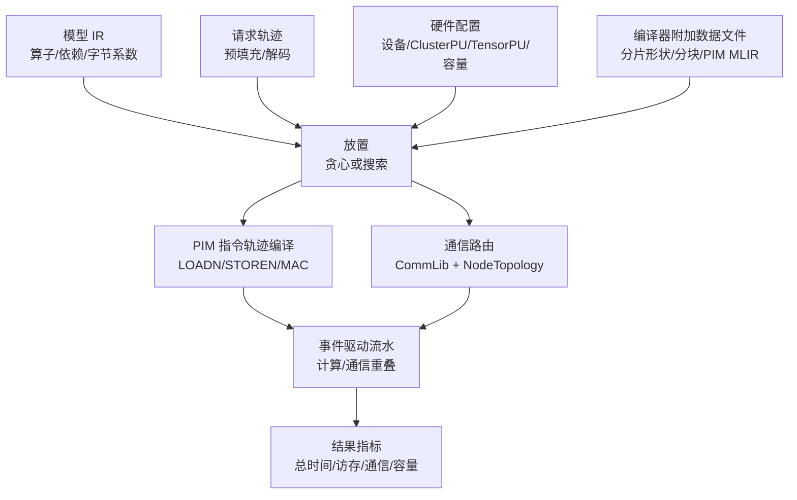

# 代价模型设计与配置说明

> 　　日期：2026-11-06；范围：flagos-pim-compiler、GeneSim、FlagTree 当前代码；计时说明以 pipeline 流水仿真路径为准。

## 摘要

　　存算一体系统的性能评估涉及计算、访存、片间通信、容量约束等因素，代价模型的质量直接决定编译器切分、PU 映射和硬件配置能否被正确比较。为此，本文设计 GeneSim 模拟器的“指令轨迹驱动 + 链路表抽象 + 事件驱动流水”代价模型，把 PIM 计算与本地访存、片间通信和容量约束统一到一次仿真中。下文介绍总体设计原理、放置模式、配置方法、参数清单与使用说明，为后续硬件适配和参数调优提供依据。

## 一、总体设计原理

　　总体设计逻辑是 PIM 算子按编译出的指令轨迹逐条累加周期，再用“基值 + 字节数 × 每字节周期 × 区间倍数”描述本地访存成本；片间通信按“基础延迟 + 字节数/链路带宽”计算，并按 VPU 层级选路、按物理端口排队；容量按 ClusterPU/TensorPU 常驻内存做硬校验；放置策略在已有负载、计算时间和通信时延之间做权衡。模型覆盖计算、访存、并行度、片间通信和容量约束。

　　在这一设计逻辑下，GeneSim 首先把硬件抽象为计算、存储和互连三类资源。每个 TensorPU、GPU 或 CPU 都是独占计算资源，决定算子能够在哪些位置执行。每个 TensorPU 及其所属 ClusterPU 都有常驻容量限额，决定一种放置是否合法。片间互连则抽象为链路表，每条链路具有带宽和基础延迟，决定数据传输的服务时间。由此，计算资源回答“在哪里执行”，存储资源回答“能否放下”，互连资源回答“数据需要多久到达”。

　　容量、切分和放置在这三类资源之上形成先后衔接的约束与决策。切分决定每个 DPU 的本地张量形状，进而影响指令轨迹的循环次数和搬运字节数。放置把算子和数据分配到具体计算资源，并据此确定通信路径。容量校验再检查模型常驻量和请求占用是否超过对应资源的限额。只有容量校验通过的放置，才能用于后续性能评估。

　　PIM 算子在执行前已经编译成指令轨迹，轨迹长度、循环结构和每条 DMA 指令的搬运量由编译产物确定，运行时再绑定具体形状。权重在推理开始前已经部署，首次加载不计入运行时间。执行过程中，同一 TensorPU 上的算子串行执行，不同 TensorPU 可以并行。同一逻辑链路队列中的传输串行，全双工链路按方向分别排队。跨 PIM 设备的传输同时占用源设备和目的设备的外部端口。不同算子的计算和通信则按照依赖关系及资源可用性重叠执行。

　　在上述抽象下，仿真的最终目标是求出全部请求的最晚完成时刻。设 R 为请求集合，A_r 为请求 r 的到达时刻，F_r 为该请求完成全部前向步骤的时刻，则端到端总时延为：

```text
A_0 = min_{r ∈ R} A_r
T_total = max_{r ∈ R} F_r - A_0
```

　　其中，A_0 是最早请求到达时刻，T_total 的单位为秒。仿真内部把 A_0 归一化为 0，因此代码中的 max_finish_time(request) 就是最后请求完成时刻与最早请求到达时刻之差。F_r 由算子依赖、算子服务时间、传输服务时间和资源排队共同决定，所以 T_total 不是各算子时延的简单相加。下面先定义单个算子的服务时间，再说明传输服务时间，二者最终由事件调度组合成各请求的完成时刻。

　　算子服务时间 T_i 是算子实例 i 从开始占用指定计算资源到释放该资源的时长，不包括依赖等待、计算资源排队和输入传输时间。对于内置指令轨迹计时路径，PIM 算子的服务时间由总周期换算得到：

```text
T_i = C_i × τ
```

　　其中，C_i 是算子实例 i 按运行时形状展开后的总周期，τ 是 pim.clock_period_ns 换算出的时钟周期，单位为秒，T_i 的单位也为秒。这里的算子实例对应某个请求的一次具体前向调用，而不是模型中的一条静态算子定义。因此，C_i 既不是静态指令条数，也不是整个请求的端到端周期。

　　静态指令轨迹通过循环和运行时重复适配不同形状。对参数化算子，运行时根据算子类型，将本地张量形状与分块宽度换算为循环次数。例如，GEMM 将本地输出宽度除以分块宽度并向上取整，把结果绑定为分块循环次数。查询维度包含多行时，运行时还会按相应行数重复执行完整轨迹。C_i 汇总本次调用全部循环迭代和轨迹重复产生的周期，因此能够随本地分片和运行时形状变化。

　　在内置计时路径中，总周期进一步分为计算周期和访存周期：

```text
C_i = C_comp,i + C_mem,i
```

　　其中，C_comp,i 是计算、控制等非访存指令的周期之和，C_mem,i 是全部访存指令的周期之和。由于 C_i 已经包含本次调用的全部指令成本，T_i 就是这个算子实例在内置模型中的完整服务时间，而不是在计算时间之外再额外叠加一次访存时间。

　　访存周期先按本次调用的全部访存指令求和，再根据不同指令类型细化：

```text
C_mem,i = Σ_{j ∈ M_i} C_mem,j
```

　　其中，M_i 是算子实例 i 展开后的访存指令集合，C_mem,j 是其中第 j 条访存指令的周期。对于批量 LOADN 和 STOREN 指令，周期分别按以下线性关系计算：

```text
C_LOADN,j  = c_LN0 + B_j × c_LN1 × z_j
C_STOREN,j = c_ST0 + B_j × c_ST1 × z_j
```

　　其中，B_j 是第 j 条指令搬运的字节数，c_LN0 和 c_ST0 分别是批量读、批量写的固定基值，c_LN1 和 c_ST1 分别是对应的每字节周期，z_j 是该指令的区间倍数。z_j 由指令的 src2 字段编码，src2=2z_j。权重的区间倍数为 1，KV、激活和输出的区间倍数为 2，未识别的操作数身份按激活处理。src2=0 表示未编码区间，此时按 1 倍计算。标量 LOAD 和 STORE 指令直接从周期表取得固定周期，其中对零寄存器的读不计为访存。由此可以看出，整个算子的访存量不能只代入一次批量搬运公式，而必须沿展开后的指令轨迹逐条累加。

　　上述每字节周期还决定了本地内存的峰值带宽。代码取读、写每字节周期中的较小值，定义最快的理想传输能力：

```text
W_peak = 1 / (min(c_LN1, c_ST1) × τ)
```

　　其中，W_peak 的单位为字节/秒。它是带宽上界，对应的访存时间是理想下界，不包含每条指令的固定基值和区间倍数。小批量搬运更容易受到固定基值影响，KV 和激活则受到区间倍数影响。PIM MLIR 生成路径以及 GEMM、GEMV 模板还会按 pim.compile.max_bulk_transfer_bytes 拆分大批量搬运，每条分段指令都计入一次固定基值。因此，实际等效带宽通常低于 W_peak，实际访存时间通常高于理想下界。

　　为了量化这一差距，内置计时路径按访存周期占总周期的比例，从 T_i 中拆分出用于统计的访存时间，并用总访存字节数计算理想访存时间：

```text
T_mem,i = T_i × min(1, C_mem,i / C_i)      （C_i > 0）
T_ideal,i = B_i / W_peak
```

　　其中，T_mem,i 是算子实例 i 的实际访存时间统计值，T_ideal,i 是按峰值带宽计算的理想访存时间，B_i 是同一指令轨迹口径下的总访存字节数，包含循环和轨迹重复造成的多次访问。T_mem,i 已经包含在 T_i 中，只用于效率统计，不能再作为一段额外时间加入事件流水。

　　实际访存时间与峰值带宽均为正时，代码检查 T_ideal,i 是否超过 T_mem,i。如果差值超出浮点容差，说明实际访存时间低于配置峰值带宽对应的理想下界，仿真直接报错；校验通过后，取二者较小值作为理想下界。memory_efficiency 等于累计理想访存时间与累计实际访存时间之比，即 ΣT_ideal,i / ΣT_mem,i；累计实际访存时间为零时取 1。该指标汇总所有已执行算子的访存数据，异构仿真还包含 GPU、CPU 后端的相应统计，单个算子的比值只用于诊断。

　　上述周期表和周期公式只适用于内置指令轨迹计时路径，原生后端采用另一条计时路径。DRAMsim3 是 GeneSim 为 DIMM-PIM 接入的原生内存与存内计算模拟器，其接口返回周期数，GeneSim 再按 pim.clock_period_ns 换算为秒。AttAcc 是 GeneSim 为 HBM-PIM 接入的原生模拟器，底层使用 Ramulator2，其接口直接返回时延。两条原生路径都直接给出一次算子调用的 T_i，因此本节周期表不用于重算或调整其内部计时模型。

　　原生后端只返回总时延时，当前实现仍按 Python 指令轨迹中的访存周期比例拆分总时延。这种拆分是代理指标，不是原生后端逐级统计得到的访存时间。原生后端不可用时，代码可以回退到内置指令轨迹计时路径，此时才使用本节周期表，因此评估时应核实实际启用的后端。

　　得到算子服务时间后，还需要计算连接各算子的传输服务时间。设一次传输经过链路 ℓ，其独占该段链路时的服务时间为：

```text
T_link,ℓ = λ_ℓ + B / W_ℓ
W_ℓ = bandwidth_gbps × 10^9 / 8
```

　　其中，λ_ℓ 是链路 ℓ 的基础延迟，单位为秒；B 是本次传输的字节数；W_ℓ 是链路带宽，单位为字节/秒；bandwidth_gbps 是配置中的链路带宽，单位为吉比特/秒。链路由两端 VPU 的 node_id、pim_device_id、cluster_id 和 inter_cluster_mode 选择。共享传输按请求、前向步骤、张量标识、源 VPU 和目的存储位置去重。HOST 中转由两段链路的时延和固定 100 ns 中转开销组成，不能只按单段链路公式计算。

　　单段链路公式不包含资源争用产生的等待。链路和物理端口的排队时间由事件调度单独累计，再与传输服务时间共同决定通信完成时刻。通信效率据此定义为：

```text
E_comm = T_service / (T_service + T_queue)
```

　　其中，T_service 是所有传输的服务时间之和，T_queue 是所有传输的排队时间之和；两者之和为零时，通信效率取 1。不同算子的计算和通信可以重叠，但在内置周期模型中，同一 PIM 算子内部的计算与本地 DMA 按指令轨迹累加，不建模双缓冲或预取重叠。

　　只有满足容量约束的放置才能进入上述事件流水。容量是合法性约束，不作为一项时延加入 T_total，其硬校验条件为：

```text
M_model,p + M_request,p ≤ M_TensorPU
Σ_p M_model,p + M_request,cluster ≤ M_ClusterPU
```

　　其中，M_model,p 是 TensorPU p 上去重后的模型常驻量。M_request,p 按各请求生命周期内的占用峰值计算，取其中最大的 k 个相加，k 为请求总数与准入上限 scheduler.max_inflight_requests 中的较小值。簇级校验先将同一请求在簇内各 TensorPU 上的占用相加，再取最大的 k 个请求占用之和，得到 M_request,cluster，因此它不一定等于各 TensorPU 独立峰值之和。第二式的求和范围为同一 ClusterPU 内的所有 TensorPU。M_TensorPU 和 M_ClusterPU 分别是单 TensorPU 和 ClusterPU 的容量限额，单位均为字节。这是基于并发上限的容量核算，并非事件时间线上的瞬时内存测量；任一限额被超过时，validate_tensor_pu_capacity 直接报错。

　　将上述部分组合起来，总体评估流程如下：模型 IR 和请求轨迹进入放置阶段，放置阶段结合硬件配置和编译器附加数据文件确定算子的 VPU 映射。随后，PIM 算子编译成指令轨迹，通信按 NodeTopology 和 CommLib 选路，计算和通信在事件队列中重叠执行。最终输出总时间、访存、通信和容量指标，如图 1 所示。



　　图 1　GeneSim 代价模型的总体评估流程

　　图 1 中的指令轨迹和放置输入由 GeneSim 与编译器共同决定。图编译器提供本地分片形状，让每个 DPU 的 GEMM 按本地宽度计算。FlagTree 的 pim-tile-to-budget 提供实际分块 kernel_tile_n，并与 PIM MLIR 中的搬运和循环结构共同决定指令轨迹规模。pimir_path 指定 GeneSim 生成指令轨迹所依据的 PIM MLIR。placed_mram_bytes 用于和容量检查交叉核对单个 DPU 的 MRAM 占用。交叉核对发现超限或切分不一致时，当前实现只告警；真正的常驻容量硬校验仍由 validate_tensor_pu_capacity 执行。

　　接入编译产物时，还要区分放置附加数据文件和成本附加数据文件。scheduler.compiler_placement_file 提供算子放置、分片、kernel_tile_n、pimir_path、区间和集合通信信息，决定图 1 中的放置与指令轨迹输入。scheduler.cost_sidecar_file 提供 source_name、mram_traffic_bytes 和算子编译测量信息，只有显式配置后才生效。mram_traffic_bytes 当前取预填充和解码代表测量值中的较大者，不是随阶段变化的完整曲线。该值可以覆盖运行时算子的 data_bytes，但已有 PIM 指令轨迹的计时和访存字节仍从指令轨迹计算，因此两类文件不能互相替代。

　　指令轨迹来源还受严格模式控制。放置附加数据文件顶层 requires_pimir 为真时会自动启用严格模式。其他情况下，scheduler.require_compiler_pimir 默认为假，声明的 PIM MLIR 读取失败会退回手写模板，严格模式则直接报错。严格模式只禁止已声明路径读取失败后的回退，未声明 pimir_path 的算子仍可使用手写模板。正式评估应核对指令轨迹的实际来源，避免把模板计时误认为编译产物计时。

## 二、两种放置模式

　　第一节给出了固定放置下的计时方法，本节进一步说明如何得到放置结果。本项目支持贪心自适应放置和搜索式调优放置两种模式。前者按拓扑顺序直接构造一个合法解，后者以该解为起点继续搜索。两种模式共用放置合法性检查，最佳搜索放置最终还会独立重放验证，区别主要在于候选放置的产生方式。

　　贪心模式是默认模式，对应 autotune.enabled=false。它先按层把算子分成“注意力前、注意力、注意力后”的放置单元，再按拓扑序逐个分配。每个单元都在合法资源中计算“该资源已有服务负载 + 当前单元服务时间 + 当前单元的输入通信及输出到主机的通信时延”，并选择评分最小的资源。评分相同时，算法参考前一个连续分配的 PIM 放置单元，在 PIM 候选资源中依次优先选择同簇内的其他 TensorPU、同一 TensorPU、同设备的其他簇和其他 PIM 设备。

　　需要特别区分的是，贪心评分中的“当前单元服务时间”只是放置阶段的粗估，不是第一节由指令轨迹得到的 T_i。PIM 粗估采用 max(flops/peak_flops, data_bytes/peak_bandwidth)，并为每个算子的每次前向计算增加 22 个时钟周期的启动开销。其中，flops 是估算的浮点运算量，peak_flops 是峰值算力，data_bytes 是数据字节数，peak_bandwidth 是峰值带宽。峰值算力按 2 × multipliers / τ 估算，multipliers 是单个 TensorPU 的乘法器数量，该估算未计入 MAC 周期。峰值带宽只使用 LOADN_PER_BYTE，不含指令轨迹分块和区间倍数。这个粗估只用于比较候选资源，最终时间仍由事件流水按指令轨迹计算。

　　因此，贪心模式的优点是速度快、结果可解释，可以直接作为搜索的初始解。其局限在于只进行单次遍历，没有回溯和全局最优保证，而且通信代价只计算静态链路时延，不包含队列争用。

　　搜索式调优放置对应 autotune.enabled=true。它以贪心结果为初始解，用模拟退火、遗传算法或禁忌搜索在放置状态空间中迭代。搜索动作共 8 类，包括算子搬迁、算子交换、连通段搬迁、注意力分支搬迁、KV 组集中或分散放置、层块搬迁、层边界移动，以及 PIM 内部再平衡或交换。这些动作只改变已有算子的资源映射，不改变编译器已经确定的张量切分。

　　主配置的默认搜索目标是 system_efficiency_utility，计算、通信和访存的默认权重分别为 0.50、0.25 和 0.25。该目标是三类效率的加权几何平均，提高通信权重表示提高通信效率在搜索目标中的比重，不等同于直接缩短端到端时延。当前 system_efficiency_utility 需要完整的计算、通信和访存效率数据，因此 autotune.evaluation_backend 和 autotune.validation_backend 都必须使用 pipeline，不能使用 predictor 为该目标评分。

　　搜索模式有机会改进贪心结果，适合开展放置策略对比和通信优化，但需要更多次仿真评估，并受 max_evaluations 预算限制。其搜索空间是逐算子放置，不能直接调整“一个算子切分到多台 DPU”的张量并行（TP）宽度，TP 仍由编译器附加数据文件决定。选择放置模式时，应先明确是评估给定编译映射，还是在固定切分下寻找新的资源映射。

## 三、代价模型的配置方法

　　明确计时原理和放置方式后，还需要把目标硬件与编译产物转换为一致的配置。代价模型的配置分为六个相互衔接的部分：硬件层级与容量、PIM 周期成本、编译分块与字节口径、片间通信链路、调度与放置、校准与输出。前两部分确定计算资源和时间尺度，第三部分确定指令轨迹的循环次数和 DMA 字节，第四部分确定跨片传输时间，第五部分确定算子和数据的放置位置，第六部分负责校准和验证。建议按这一顺序配置，使后面的决策始终建立在前面的资源边界和计时口径之上。

　　首先配置硬件层级与容量，把目标硬件映射成 PIM 设备、ClusterPU、TensorPU 三层。先按物理设备划分确定 ClusterPU 数，再按每簇内部执行单元数确定 TensorPU 数。容量按 ClusterPU 配置，软件自动除以 TensorPU 数并向下取整，得到每个 TensorPU 的字节限额。由于放置超过限额会直接报错，容量必须在运行仿真前核对。

　　接入图编译器放置附加数据文件时，一个逻辑 DPU 映射到一个 ClusterPU，段内算子在该 ClusterPU 的 TensorPU 之间轮转，而不是将整个逻辑 DPU 固定到单个 TensorPU。dpu_to_cluster 应显式给出逻辑 DPU 到 ClusterPU 的映射，缺失时才退回取模换算。system.pim_type 只选择底层后端，不影响容量和层级映射。选择 DIMM-PIM 原生后端时，还需配置 system.dramsim3_config。

　　硬件层级确定后，第二步配置 PIM 周期成本。pim.clock_period_ns 把周期换算成秒，pim.pim_trace_cycle_costs 给出每条 LOADN、STOREN 的基值和每字节周期，以及 MAC 和其他原语的周期。配置项填写的是每字节周期，内存带宽由第一节公式反推，不直接填写带宽数。区间倍数 1/2/2 写在代码里，不能通过 YAML 修改，其中权重按 1 倍计算，KV 和激活按 2 倍计算。

　　周期表应优先用目标硬件的微基准校准，没有实测数据时才使用工程默认值。pim.tensor_pu_config.multipliers 参与放置粗估和计算效率的峰值算力计算，但不直接改变固定放置下的指令轨迹时延。pim.tensor_pu_config.adders 当前没有读取点，不能把它作为有效调优参数。

　　第三步配置编译分块与字节口径，使指令轨迹的循环次数和 DMA 字节与编译产物一致。这里需要分别选择分块参数和指令轨迹来源，两者不能相互替代。默认启用 scheduler.use_compiler_local_shapes 时，GEMM 优先使用放置附加数据文件的 kernel_tile_n，未提供时才使用 pim.compile.tile_size。GEMV 使用 pim.compile.tile_size，SOFTMAX、GELU、SILU、RMSNORM 使用 pim.compile.chunk_size。

　　在指令轨迹来源方面，放置附加数据文件给出可读取的 pimir_path，且算子没有被融合吸收时，GeneSim 按 PIM MLIR 生成指令轨迹。未提供路径时使用手写模板；路径已提供但读取失败时，由严格模式决定报错还是退回模板。分块参数用于模板生成和运行时循环绑定。使用 PIM MLIR 时，指令体的分块与搬运结构来自编译产物，配置应与该产物保持一致。

　　当前流水仿真直接按请求轨迹绑定预填充和解码形状。pim.compile.use_runtime_shapes、default_past_length 和 default_query_length 虽保留在配置中，但未被当前运行路径读取，修改它们不能覆盖请求形状。FlagTree 的 WRAM、MRAM、DMA 参数通过 PIMHardwareConfig 或 FLAGTREE_PIM_* 传入，属于算子编译侧的输入，不能用 GeneSim 的容量字段替代。

　　第四步配置片间通信链路，把目标互连抽象成链路表。每条链路需要配置带宽、基础延迟、是否全双工（is_full_duplex，默认 true），以及 intra_cluster_only 或 inter_cluster_only 的范围限制。路由规则由代码固定，不需要在 YAML 里编写。配置时应先确定 HOST、GPU、PIM 等域，以及簇内、同设备跨簇和跨设备通信分别使用哪些链路，再填写对应的带宽和延迟。

　　路由选择必须与链路表配套核对。同节点跨 PIM 设备优先使用不带簇范围限制的普通 PIM 到 PIM 链路，没有这类链路时走 HOST 中转。同设备跨簇是否直连由 pim.inter_cluster_communication 决定：direct 使用跨簇直连链路，host_relay 经主机中转。direct 模式缺少对应链路时不会自动改走主机中转，同设备跨簇的主机中转在流水仿真中按半双工资源排队。配置完成后，还应通过事件调度输出的链路排队、忙碌时间、等待时间和利用率，检查链路表是否符合实际拓扑。

　　第五步配置调度与放置。默认贪心模式不需要额外配置；需要搜索时，启用 autotune.enabled，并设置 objective_weights 和 max_evaluations。搜索会改变初始放置，因此评估编译器给定的固定映射时，应保持 autotune.enabled=false。纯 PIM 仿真还需关闭 GPU 和 CPU 计算。

　　放置附加数据文件是连接图编译和仿真的关键。它给出 dpu_id、shards 和 dpu_to_cluster，GeneSim 在初始放置时按文件中已声明的条目分配算子。未配置该文件时使用自适应放置，文件不存在时会告警并按未提供处理。pim.supported_ops 与已注册指令轨迹编译器的交集决定普通放置路径允许使用的 PIM 算子，自适应初始放置仅允许其中的注意力类算子进入 PIM。其他算子可以由放置附加数据文件指定进入 PIM，也可以在初始放置合法的前提下由搜索移动。编译器指定的算子可以绕过类型白名单，但仍必须有对应的指令轨迹编译实现。

　　最后配置校准与输出，把参数拟合和仿真验证串起来。先用目标硬件的微基准生成基准测量数据，再用 calibrate.py 拟合周期表，并把输出的参数片段合入对应硬件配置。随后运行仿真，用汇总、访存、通信、容量四组指标核对结果。校准输出只是参数片段，不是完整仿真配置，不能直接替代主配置。

　　校准与验证必须使用一致且可追溯的口径。硬件、精度或内核实现变化后，应重新校准周期成本；链路参数则按互连实测单独更新，不同硬件的配置不能混用。拟合形状和独立验证形状应分开，不能用同一批数据同时拟合和验证。

## 四、参数清单与使用说明

　　第三节说明了配置顺序，本节将其映射到具体配置项。参数清单按层级、容量、周期、分块、通信、放置和输出七类组织。表 1 的“默认值”优先取主配置 genesim/conf/sim.yaml 的显式值；主配置未显式列出的项标注为代码缺省值，需结合 genesim/src/config_loader.py 和对应模块的配置读取代码核对。“调整方式”一列给出对应的校准或覆盖方式，UPMEM 校准配置的取值在第五节单独说明。容量字段 pim.cluster_memory_capacity_gb 的单位是 GiB（1024^3 字节），硬件标称 8 GB 时要按实际字节数换算。

　　表 1　代价模型主要参数及调整方式

| 模块 | 参数 | 默认值 | 作用 | 调整方式 |
| --- | --- | --- | --- | --- |
| 层级 | system.num_pim_devices | 8 | PIM 设备数 | 按目标设备划分 |
| 层级 | pim.clusters_per_device | 8 | 每个设备的 ClusterPU 数 | 按目标设备划分 |
| 层级 | pim.tensors_per_cluster | 16 | 每个 ClusterPU 的 TensorPU 数 | 按簇内执行单元数 |
| 层级 | system.pim_type | HBM-PIM | DIMM-PIM / HBM-PIM 后端 | 按目标硬件 |
| 层级 | system.dramsim3_config | 见 YAML | DIMM-PIM 的 DRAMsim3 配置 | 按目标内存 |
| 容量 | pim.cluster_memory_capacity_gb | 8.0 | 每个 ClusterPU 的容量（GiB） | 按实际字节数换算 |
| 周期 | pim.clock_period_ns | 0.63 | 时钟周期（纳秒）；用于周期与秒的换算及峰值估算 | 按目标主频 |
| 周期 | pim.tensor_pu_config.multipliers | 4 | 峰值算力估算 | 按硬件 |
| 周期 | pim.pim_trace_cycle_costs.LOADN 和 LOADN_PER_BYTE | 12 / 0.125 | 批量读固定周期/每字节周期 | DMA 标定 |
| 周期 | pim.pim_trace_cycle_costs.STOREN 和 STOREN_PER_BYTE | 10 / 0.1 | 批量写固定周期/每字节周期 | DMA 标定 |
| 周期 | pim.pim_trace_cycle_costs.MAC | 1 | 每条 MAC 指令的周期 | GEMM 标定 |
| 分块 | pim.compile.tile_size | 32 | GEMM、GEMV 默认分块 | GEMM 优先使用编译器分块 |
| 分块 | pim.compile.mac_width | 8 | MAC 向量宽度 | 按硬件 |
| 分块 | pim.compile.chunk_size | 16 | SOFTMAX/GELU/SILU/RMSNORM 分块 | 按硬件 |
| 分块 | pim.compile.use_runtime_shapes | true | 保留字段；当前流水路径未读取 | 不能用于切换运行形状 |
| 分块 | pim.compile.default_past_length | 2048 | 保留字段；当前流水路径未读取 | 历史长度由请求轨迹决定 |
| 分块 | pim.compile.default_query_length | 1 | 保留字段；当前流水路径未读取 | 查询长度由请求轨迹决定 |
| 分块 | pim.compile.max_bulk_transfer_bytes | 16320 | 批量搬运分段上限（字节） | 用于 PIM MLIR 路径及 GEMM、GEMV 模板 |
| 分块 | pim.compile.bytes_per_element | 2 | 标量访存统计、接受该参数的模板及部分形状换算的元素字节数 | 与模型数据类型一致 |
| 通信 | comm_config.links[*].bandwidth_gbps | 见 YAML | 链路带宽，单位为吉比特/秒 | 按硬件 |
| 通信 | comm_config.links[*].latency_base_ns | 见 YAML | 基础延迟（纳秒） | 按硬件 |
| 通信 | pim.inter_cluster_communication | direct（主配置） | 同设备跨簇直连或经主机中转 | 具备对应跨簇直连链路时使用 direct |
| 放置 | scheduler.compiler_placement_file | 空（代码缺省值） | 放置附加数据文件 | 由导出脚本生成并显式配置 |
| 放置 | scheduler.use_compiler_local_shapes | true（代码缺省值） | 读取编译器本地分片形状与分块参数 | 评估编译器切分结果时保持 true |
| 放置 | scheduler.cost_sidecar_file | 空（代码缺省值） | 成本附加数据文件 | 由成本精化脚本生成并显式配置 |
| 放置 | scheduler.require_compiler_pimir | false | 已声明 PIM MLIR 路径读取失败时是否禁止回退 | 正式评估建议 true |
| 放置 | scheduler.simulation_backend | pipeline | 流水仿真/预测模型 | 正式性能评估用 pipeline |
| 放置 | pim.supported_ops | 见 YAML | 普通放置路径的 PIM 算子白名单 | 还须有对应编译实现 |
| 放置 | scheduler.max_inflight_requests | 128 | 同时准入的请求数上限 | 按并发需求 |
| 放置 | autotune.enabled | false | 是否搜索放置 | 需要搜索调优时启用 |
| 放置 | autotune.objective_weights | 0.5/0.25/0.25 | 计算/通信/访存权重 | 按搜索目标调整 |
| 放置 | autotune.max_evaluations | 200 | 搜索评估预算，包含基线，不含最终重放 | 按评估开销设置 |
| 输出 | output.results_dir | results | 结果目录 | 按需 |
| 输出 | scheduler.pipeline_record_timeline | false（代码缺省值） | 记录逐算子/逐传输时间线 | 需要时间线时启用 |
| 输出 | scheduler.pipeline_record_communication_trace | false（代码缺省值） | 记录逐次传输 | 需要通信轨迹时启用 |

　　为新硬件配置模型时，可以按表 1 逐项落实第三节的顺序。首先确定层级和容量：按目标设备划分设置 system.num_pim_devices 和 pim.clusters_per_device，按每簇容量设置 pim.cluster_memory_capacity_gb，按簇内执行单元数设置 pim.tensors_per_cluster。然后确定周期成本：pim.clock_period_ns 按目标主频换算填写，pim.pim_trace_cycle_costs 下的 LOADN、STOREN 基值和每字节周期用目标硬件微基准校准，MAC 用 GEMM 微基准校准。

　　对于其余原语，GEMV、SOFTMAX、GELU、SILU、RMSNORM 及套件覆盖的原语用 pim-ops 套件校准，其他原语需补充相应微基准。分块优先使用放置附加数据文件中的实际 kernel_tile_n 和 pimir_path，没有这些产物时才使用 pim.compile 中的默认分块参数。通信则按目标链路填写 comm_config.links 的 bandwidth_gbps、latency_base_ns 和范围限制字段。

　　完成硬件参数配置后，最后准备模型 IR、请求轨迹和放置附加数据文件，并按需配置成本附加数据文件。选择贪心或搜索模式运行仿真后，应检查汇总、访存、通信、容量四组指标。不同场景的配置重点见表 2，其中多设备项目只是配置构造示例，不代表已经完成对应硬件的实测或性能验证。

　　表 2　典型评估场景的配置与核对重点

| 场景 | 关键配置 | 运行方式 | 核对指标 |
| --- | --- | --- | --- |
| UPMEM 单 DPU 校准 | 用 tools/upmem_checker/conf/sim.yaml；1 设备、1 ClusterPU、1 TensorPU、64 MiB、2.5 ns | 在 tools/upmem_checker 下按 README.md 用 ./run.sh --generate --suite 选择套件，并以 ./run.sh --calibrate --method 选择对应拟合方法；按方法提供测量文件等必需参数 | 拟合参数、独立验证形状的误差及 *.validation.json 报告 |
| 7B 单设备容量核验示例 | system.num_pim_devices=1、pim.clusters_per_device=1、pim.tensors_per_cluster=16、pim.cluster_memory_capacity_gb=8.0、compute_config.gpu_compute=false、compute_config.cpu_compute=false；放置采用 TP1、PP1，模型 IR 与编译产物一致 | 先核验容量；两字节权重的完整 7B 模型无法仅驻留于 8 GiB，不应将此示例作为可运行的纯 PIM 性能方案 | 容量超限错误；容量通过后再分析性能指标 |
| 64 或 128 个簇的抽象目标机 | 64 个簇用 8 设备 × 8 簇，128 个簇用 16 设备 × 8 簇；每簇 8 GiB | 用带 dpu_to_cluster 的放置附加数据文件，运行流水仿真 | 各簇的容量、communication_metrics.links 的 bytes/queue_wait_time_s |
| 放置调优 | autotune.enabled=true，设置 objective_weights 和 max_evaluations | 先运行贪心基线，再启用搜索 | summary.total_time_s、communication_metrics.total_bytes、efficiency_metrics |
| 带宽或容量敏感性 | 调整 pim.pim_trace_cycle_costs 的 LOADN_PER_BYTE、STOREN_PER_BYTE，或 pim.clock_period_ns、pim.cluster_memory_capacity_gb | 固定其他输入分别评估；修改时钟周期会同时影响计算和访存 | memory_metrics.memory_efficiency、pim_capacity_metrics.max_utilization、max_cluster_utilization |

　　以表 2 的 7B 单设备容量核验为例，先将 system.num_pim_devices 和 pim.clusters_per_device 设为 1，将 pim.tensors_per_cluster 设为 16，并将 pim.cluster_memory_capacity_gb 设为 8.0。随后将 compute_config.gpu_compute 和 compute_config.cpu_compute 设为 false，构造纯 PIM 核验条件。

　　编译与模型输入必须保持一致。scheduler.compiler_placement_file 指向 TP1、PP1 的放置附加数据文件，model.ir_path 指向与编译产物一致的模型 IR。pim.clock_period_ns 和 pim.pim_trace_cycle_costs 使用目标硬件校准值，comm_config.links 配置主机与 PIM 之间以及簇内的实际带宽和基础延迟。

　　这套 8 GiB 配置不足以容纳两字节权重的完整 7B 模型，其目的只是说明容量约束，不能据此给出纯 PIM 性能结论。如果容量超限，应根据模型常驻量、请求占用和每个 TensorPU 的限额调整容量或切分方案，并同步重新生成编译产物。此时仿真会直接报错，而不是正常输出一份 fits=false 的性能结果。容量校验通过后，再检查 memory_metrics.memory_efficiency 和 communication_metrics.links 中的 queue_wait_time_s，进入性能分析。

## 五、配置模式

　　本文对照的两套 GeneSim 配置分别服务于模型级系统评估和单算子硬件校准。主配置回答的问题是：在给定的多设备抽象目标机上，切分、放置和通信如何影响模型级性能。UPMEM 配置回答的问题是：内置周期参数能否复现单个物理 DPU 的微基准测量。两类问题对应不同的硬件规模、参数来源和验证方法，因此两套配置需要分别维护。

　　主配置 genesim/conf/sim.yaml 描述一台抽象的多 DPU 目标机，规模是 8 设备 × 8 ClusterPU × 16 TensorPU，每个 ClusterPU 8 GiB，时钟为 0.63 ns。它用于模型级权衡、放置策略对比和编译器链路验证。其周期成本是工程默认值或目标假设值，未绑定到某一颗芯片的实测值，不能直接解释为具体芯片的实测性能。

　　UPMEM 配置 genesim/tools/upmem_checker/conf/sim.yaml 描述单个物理 UPMEM DPU，规模是 1 设备 × 1 ClusterPU × 1 TensorPU，容量为 64 MiB，频率为 400 MHz。它用于微基准校准和模型验证。其中，主要算子周期参数来自现有实物校准，部分基础指令仍保留默认值，链路表中的数值也不能视为已由单 DPU 算子微基准校准。本文未重新进行硬件测量。

　　UPMEM 的 GEMM 校准针对 16 位整数输入、32 位整数累加和 16 个任务线程。MAC 参数是该内核映射到抽象指令后的等效周期，不能直接代表 FP16 硬件指令时延。两套配置的规模、时钟、容量、周期成本和链路均不同，不能混用。tools/upmem_checker/README.md 也明确要求每种硬件单独校准、单独维护配置。主要差异见表 3。

　　表 3　主配置与 UPMEM 校准配置的差异

| 项 | 主配置 genesim/conf/sim.yaml | UPMEM genesim/tools/upmem_checker/conf/sim.yaml |
| --- | --- | --- |
| 定位 | 抽象多 DPU 目标机 | 单个物理 DPU 校准 |
| 规模 | 8×8×16 = 1024 TensorPU | 1×1×1 |
| 容量 | 8 GiB/ClusterPU | 64 MiB/DPU |
| 时钟 | 0.63 ns | 2.5 ns |
| 读斜率对应带宽 | 12.70 GB/s | 709.85 MB/s |
| 写斜率对应带宽 | 15.87 GB/s | 716.44 MB/s |
| 批量搬运配置上限 | 16320 B | 2048 B |
| 链路 | 9 条，含主机、GPU、簇内及同设备跨簇链路 | 3 条，HOST 往返及 P2P |
| 用途 | 模型级权衡 | 校准与验证 |

　　表 3 的斜率对应带宽只反映每字节周期，尚未计入固定基值。UPMEM 的 2048 B 单条搬运还需计入 LOADN、STOREN 固定周期，按当前配置及区间倍数 z=1 计算，等效带宽约为 602.87 MB/s（读）和 612.53 MB/s（写），低于表中的斜率对应带宽。这一差异正对应第一节从峰值带宽到实际搬运成本的关系。这里的带宽均按十进制字节/秒换算。

## 六、当前实现边界

　　第一节至第五节给出了模型的原理和配置方法，但这些公式并不意味着所有硬件细节都已被精确建模。当前模型可以在上述假设下评估计算、访存、通信和容量，使用评估结论时应同时说明以下实现边界。

1. 　　内存地址交织当前不参与流水仿真计时。InterleavingMapper 的初始化保留在旧后端初始化方法中，当前流水执行路径不调用该方法。带宽来自 LOADN、STOREN 的每字节周期，不来自地址交织。
2. 　　区间倍数 1/2/2 是代码中的固定假设值，不能解释为适用于所有硬件的实测结论。
3. 　　内置指令轨迹周期模型不对同一算子内部的 DMA 与计算进行重叠建模，而是逐条累加指令周期。scheduler.latency_hiding 中的双缓冲、预取深度和合并阈值当前没有进入计时路径，scheduler.comm_overlap 也没有参与当前流水执行路径。跨算子的计算与通信重叠由事件流水体现。
4. 　　默认是 GPU+PIM 异构配置。纯 PIM 需要关闭 GPU 和 CPU 计算，并用完整、合法的放置附加数据文件将非注意力算子分配到 PIM，同时满足编译支持与容量约束。
5. 　　权重按 warm_predeployed 模式预部署，首次加载不计入运行时间，因此不能直接代表冷启动首词元时延（TTFT）。weight_deployment.mappings 的记录不能代替放置附加数据文件或自适应放置来决定算子实际位置。
6. 　　原生后端只返回算子总时延时，访存与计算时间的拆分仍借用 Python 指令轨迹比例，属于代理指标。启用原生库不等于其配置已经与目标芯片对齐。
7. 　　成本附加数据文件中的 mram_traffic_bytes 取预填充、解码代表测量值的较大者，不能解释为逐阶段精确流量曲线。只生成该文件而不配置 scheduler.cost_sidecar_file，也不会改变仿真输入。
8. 　　scheduler.execution_microbatch_size 当前只能为 1，不支持跨请求张量批处理。trace.num_requests 是观测窗口内的请求总数，并发上限由 scheduler.max_inflight_requests 控制，实际并发还受请求到达时间与执行进度影响。

　　除上述计时和调度边界外，编译器与仿真器的容量口径也必须对齐。图编译器 scripts/export_pp_placement.py 的 HwBudget 当前是 4 GiB，而 GeneSim 主配置的 ClusterPU 容量是 8 GiB，给出容量结论前必须统一两者。放置附加数据文件中的 placed_mram_bytes 交叉核对目前只告警，不能替代 GeneSim 的常驻容量硬校验。

## 七、评估方法

　　明确模型边界后，即可按统一输入开展端到端评估。以下以 GeneSim 默认配置为入口，先激活环境并进入 GeneSim 仓库，再依次生成模型 IR、请求轨迹、TTIR 和 PIM MLIR 成本附加数据文件，最后运行默认仿真。

　　以下命令假定 GeneSim 已完成安装，uv 和仓库的 .venv 可用，模型与 FlagTree 路径已按图编译器的 paths.json 配置，示例中的绝对路径需与交付环境一致。执行成本提取前，应确认 PIM_COMPILER_ROOT 指向图编译器仓库；未设置时，脚本会按常见的相对布局探测。

```bash
# 1. 激活环境
source /data/fjg/flagOS/flagOS-installed/pytorch/env-pytorch.sh
export PATH="$HOME/.local/bin:$PATH"

# 2. 进入 GeneSim 仓库
cd /data/fjg/flagOS/genesim

# 3. 生成模型 IR
python scripts/model_parser.py \
  --model_name /data/fjg/flagOS/flagOS-installed/model-inference/models/Llama-2-7b-hf \
  --output models/llama2_7b.ir

# 4. 生成请求轨迹
./run.sh --trace --synthetic --seed 0 --num_requests 10 --output traces/llama2_7b.trace

# 5. 成本提取：先基于 TTIR 生成对照结果，再基于 PIM MLIR 生成精化结果
python scripts/refine_ir_with_flagtree.py \
  --ir models/llama2_7b.ir \
  --out-ir models/llama2_7b_flagtree.ir \
  --sidecar models/llama2_7b_flagtree_extensions.json \
  --seq-len 128 --ir-level ttir

python scripts/refine_ir_with_flagtree.py \
  --ir models/llama2_7b.ir \
  --out-ir models/llama2_7b_pimir.ir \
  --sidecar models/llama2_7b_pimir_extensions.json \
  --seq-len 128 --ir-level pimir

# 6. 运行默认仿真
./run.sh
```

　　默认配置 conf/sim.yaml 指向 models/llama2_7b_pimir.ir 和 traces/llama2_7b.trace，因此第 6 步直接使用第 5 步生成的模型 IR 和第 4 步生成的请求轨迹。

## 八、代码索引

　　为便于核对本文的公式、配置口径和实现边界，表 4 列出各项结论对应的源码位置。

　　表 4　文档结论与源码位置对照

| 内容 | 代码位置 |
| --- | --- |
| 配置取值 | genesim/conf/sim.yaml；genesim/tools/upmem_checker/conf/sim.yaml；genesim/src/config_loader.py |
| 硬件层级 | genesim/src/vpu/factory.py:154-208,253-278 |
| 容量换算与硬校验 | genesim/src/pim/capacity.py:21-118,379-617 |
| PIM 周期公式 | genesim/src/pim/pim_trace_loader.py:247-338 |
| 原生后端计时与回退 | genesim/src/pim/pim_core.py:186-219,311-328 |
| 区间倍数 | genesim/src/pim/pim_isa.py:168-190 |
| 访存时间拆分 | genesim/src/vpu/vpu.py:290-337,366-394 |
| 运行形状绑定 | genesim/src/scheduler/gene_sim_scheduler.py:247-295,6021-6035 |
| 通信延迟公式与 HOST 中转 | genesim/src/backend/comm_lib.py:36-51,186-217 |
| 通信路由 | genesim/src/node/node.py:77-200 |
| 链路端口排队 | genesim/src/scheduler/gene_sim_scheduler.py:5383-5526,6711-6855 |
| 放置代价 | genesim/src/scheduler/gene_sim_scheduler.py:3305-3418,3992-4151 |
| 两类编译器附加数据文件 | genesim/src/scheduler/gene_sim_scheduler.py:440-548,638-789 |
| 编译器放置导出 | flagos-pim-compiler/genesim_bridge/placement_export.py:447-641 |
| FlagTree 分块 | FlagTree/lib/Dialect/TritonPIM/Transforms/TileToBudget.cpp:1520-1700 |
| 校准命令入口 | genesim/scripts/calibrate.py:1381-1494 |
| 结果文件写出 | genesim/src/main.py:329-348 |
