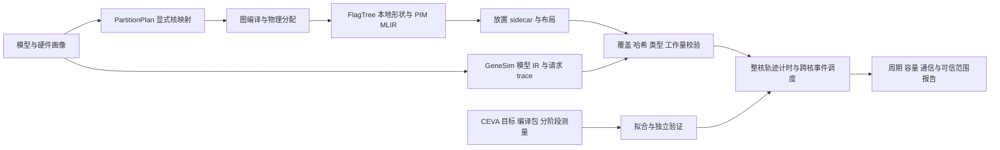

# 技术设计：GeneSim 对齐 CEVA 多核硬件与性能模型

> 文档编号：design-ceva-genesim-hw-align-20261106  
> 创建及校对日期：2026-11-06  
> 关联需求：[request-ceva-genesim-hw-align-20261106.md](request-ceva-genesim-hw-align-20261106.md)  
> 状态：待实施。本文新增配置键、接口和命令参数均是设计，不表示当前代码已支持。

S/G/F/C 的路径定义同需求文档。核对基线：S `34481fe`，G `f918586`，F 源码 `0d7273bac`。G `paths.json` 的 `flagtree_prefix` 指向安装目录，实际构建工具也要记录路径和指纹，源码提交号不能代替已安装二进制版本。

## 一、设计结论

先建立**整核等效模型**：1 个服务器 Node、1 个阵列 device、N 个 ClusterPU，每簇 1 个 TensorPU；N 为 1、64 或 128。物理 engine 数 E=4/1 记录在 CEVA 画像中，单作业成本按完整 NPM 核拟合。4e 内部并行由编译产物及整核测量体现，GeneSim 不再额外除以 E，也不提供 E 份独立整算子并发。

这修正了旧稿“ClusterPU=NPM 核、TensorPU=engine”的直接映射。当前 S `gene_sim_scheduler.py:4031-4110` 按核绑定 DPU 后，将**整算子**轮转到簇内 TensorPU；`factory.py:253-275` 为每个 TensorPU 创建独立 PIMVPU。该机制没有 GC 对同一算子的 engine 切分和同步信息，直接设 4 会同时引入不实并发、核内通信和容量均分。整核模型是首期可检验的近似，不保证捕获真实核内跨作业重叠；需要更细精度时，须依据 engine 调度证据扩展，不能只改资源数。

实施分三条线：硬件配置与资源合法性、编译产物与计时工作量、同边界校准与多核预测。W4A8 数据流和工作量缺口是性能验收前置项；FP16 联调通过不能替代它。

## 二、现状与修改依据

| 当前代码 | 实际行为 | 设计处理 |
| --- | --- | --- |
| S `conf/sim.yaml`、`config_loader.py::DEFAULTS` | 默认 GPU+PIM；缺省合并会补入通用成本 | 独立 CEVA 文件，保留原始字段来源，显式验证关键参数。 |
| S `vpu/factory.py::create_vpus_and_topology` | `nodes` 可优先于扁平 `system` 创建资源；`gpus` 列表也能覆盖 GPU 数量 | CEVA 首期限定单 Node 扁平入口，拒绝冲突资源配置；检查实际资源。 |
| S `pim/capacity.py::resolve_pim_capacity_limits` | 容量按 GiB 换算后除以 TensorPU 数 | 每核一个 TensorPU 复用现有容量算法，按精确字节统一预算。 |
| G `scripts/export_pp_placement.py:143-160` | 4 GiB `HwBudget`、64 KiB WRAM、FP16、本地代表分片产物 | 增加预算输入；补必要的物理布局/分片输入，不把通用预算认作 CEVA 规格。 |
| S `scheduler::_operator_pimir` | 未声明路径直接返回 None；严格开关不保证全量覆盖 | 增加执行节点分类和产物覆盖检查，加载时核验内容哈希。 |
| S `pim/pimir_trace.py::compile_phase_chain` | 每相一条计算原语，立即数字节截断至 14 位；求值器按 opcode 常数计时 | 按工作量生成循环/次数或有效整核成本，先通过形状缩放测试再拟合。 |
| S `pim/pim_isa.py::zone_scale*` | 倍率以 `src2=round(2×factor)` 编码 | 明确倍率量化约束，不能声称可无损配置任意实数。 |
| S `node/node.py`、Scheduler `link_resource_keys` | 同设备跨簇共用设备级链路键，方向按编号排序；不是任意网络拓扑 | 首期只声明均匀共享链路假设；实际拓扑不同则改路由/端口模型。 |
| S `backend/comm_lib.py::_host_relay` | 两段链路成本外固定加 100 ns | CEVA 中转开销需有来源并配置化，不能漏进未知默认值。 |
| S `main.py:786-789` | `--dry-run` 校验后立即返回，不创建资源 | 保留配置检查含义；资源清点必须通过工厂测试或实际运行验证。 |
| G `opcompiler_bridge/driver.py::_make_ttir` | 常规 GEMM 请求只接受 FP16/FP32 | 不能据此断言 FlagTree 整体不支持量化；另有整算子路径需核对接入。 |

F `TileToBudget.cpp::tileWholeMatmuls` 已处理 `pim.matmul` 与分组反量化属性，G 的 CEVA 分支也已有 GML/FlagTree 产物。应优先复用这些产物，补齐到 GeneSim 的映射和计时消费，不重新实现一套量化编译器。

## 三、配置与资源模型

### 3.1 配置组合及来源

准备单核 4e 校准配置、64/128 核 4e 预测配置和 64/128 核 1e 产品配置；1e 可另建单核校准输入。先完成 64 核联调，不删除 128 核范围。场景文件由同一份已解析画像生成完整 YAML；现有加载器没有任意 YAML 继承语义，不把“基础 YAML + 成本 YAML”描述成可自动合并的命令。

下面只是**结构片段**，8 GB 暂按十进制假设，缺少性能参数及输入文件，不可直接执行仿真：

```yaml
system: {num_cpus: 1, num_gpus: 0, num_pim_devices: 1, pim_type: CEVA-NPM}
compute_config: {cpu_compute: false, gpu_compute: false, pim_compute: true}
pim:
  clusters_per_device: 64       # 单核校准为 1；128 核场景为 128
  tensors_per_cluster: 1        # 整核调度槽，4e/1e 均为 1
  cluster_memory_capacity_gb: 7.450580596923828  # 8,000,000,000 B
scheduler:
  simulation_backend: pipeline
  require_compiler_pimir: true
  use_compiler_local_shapes: true
  max_inflight_requests: 1      # 单请求校准；系统并发测试另建场景
  execution_microbatch_size: 1
autotune: {enabled: false}
ceva:                          # 新增命名空间
  execution_scope: npm_core
  engines_per_core: 4
  target_name: m32k_vpu500_dtcm64_8m_1024k_4e
  local_memory_bytes: 8000000000
```

1e 不能仅改 `engines_per_core` 后沿用 4e 成本；目标、产物、成本表和校准范围必须匹配。目标型号未知时允许输出结构检查，预测场景必须明确所有假设。物理 engine 数为 N×E，模拟调度槽数始终为 N；例如 64 核 4e 是 256 个物理 engine、64 个模拟槽。

`ceva.parameter_sources` 按参数路径记录 `origin/evidence/unit/scope`，来源为 `customer/ceva_measured/fitted/assumption/unconfirmed`。同一结构还记录目标文件摘要、时钟域和标定数据指纹，不再引入一个可能与来源台账矛盾的 `clock_origin`。关键字段包括容量字节、engine 数、时钟、计算/DMA 成本、分块预算、链路和中转开销。正式运行拒绝缺失或未确认且未显式声明假设的值。

主要配置项的处理如下。未获得证据的性能参数不在文档中编造“CEVA 推荐数值”。

| 配置项 | 当前主配置 | CEVA 处理 |
| --- | --- | --- |
| `system.num_pim_devices` / `pim.clusters_per_device` / `pim.tensors_per_cluster` | 8 / 8 / 16 | 首期 1 / N / 1；N=1、64、128，E=4/1 另记。 |
| `pim.cluster_memory_capacity_gb` | 8.0，实际 GiB | 按确认的每核字节数换算，并与 G 预算一致。 |
| `pim.clock_period_ns` | 0.63 ns | 等待时钟域确认；假设值只能用于注明假设的系统预测。 |
| `pim.tensor_pu_config.multipliers` | 4 | 整核峰值及放置评分参数，按精度/作用域确认；不能替代轨迹校准。 |
| `pim.compile.tile_size` / `chunk_size` | 32 / 16 | 实际编译分块优先；缺省值只用于有记录的联调路径。 |
| `pim.compile.mac_width` | 8 | 固定并解释抽象计量粒度后拟合单价，不照抄 32K/8K MAC。 |
| `pim.compile.bytes_per_element` | 2 | FP16 联调适用；正式混合精度按每个操作数的物理布局计量。 |
| `pim.compile.max_bulk_transfer_bytes` | 16320 B | 保持 trace 编码合法，并对照实际 DMA 分段；TDF 的 256-bit SysDMA 宽度不能直接换成可持续带宽。 |
| `pim.pim_trace_cycle_costs.LOADN/LOADN_PER_BYTE` | 12 / 0.125 | 分别为 cycles/次、cycles/B，按读测量拟合。 |
| `pim.pim_trace_cycle_costs.STOREN/STOREN_PER_BYTE` | 10 / 0.1 | 同上，按写测量独立拟合。 |
| `pim.pim_trace_cycle_costs.MAC` 及其他原语 | MAC=1，部分原语为占位成本 | 先修正工作量，再按整核目标/精度/阶段校准；检查所有实际使用原语的来源。 |
| `pim.inter_cluster_communication` / `comm_config.links` | direct；含主机、GPU、簇内/跨簇通用带宽 | 去掉 GPU，采用有依据的路由、带宽、延迟及共享范围；未知时显式假设。 |
| `scheduler.compiler_placement_file` / `cost_sidecar_file` | 未配置 | 放置必需；成本文件使用时显式绑定，二者不可互换。 |

### 3.2 校验阶段

保持 `GeneSimConfig.validate()` 默认执行仿真校验；新增可选 `mode="structure"`，由 `main.py --dry-run` 调用。结构模式检查层级、类型、单位和显式字段，不构造依赖数值时钟/链路的后端，不宣称已完成资源清点。未知值可为空但不得流入 `float(None)` 或通用默认合并。

仿真模式在创建 Scheduler 前验证：纯 PIM、单 Node、一个 device、`tensors_per_cluster=1`、有限正时钟、完整有来源成本、可路由链路、必需输入路径。支持 `assumption` 仅表示允许预测，不表示校准通过。运行后从实际 VPU 列表核对核数和 GPU=0，并报告 idle 核，不能只回显 YAML。

### 3.3 显式 DPU 映射与切分

复用 `contracts/partition_plan.py::PartitionPlan` 和 sidecar 的 `dpu_to_cluster`。CEVA 分支要求所有参与计算的 DPU 有合法 `(device_id, cluster_id)`，不同物理 DPU 映射不同核；对未覆盖、负数、越界及意外重映射报错。首期禁用自动放置搜索，避免破坏已校准的编译放置。

S `export_fixed_pu_mapping.py` 现有策略会尝试把同段 TP DPU 合并到一个 ClusterPU，必须为 CEVA 整核模式改为一对一，不能原样复用输出。核数增加后必须重新生成计划和本地分片，且检查切分维度可整除。Llama2-7B 的 32 层不能构成 64/128 个非空纯 PP 段；可以使用合法 TP×PP 组合或明确只使用部分核，具体组合由真实编译结果验证。

## 四、容量与物理数据链

### 4.1 容量预算

以整数 `local_memory_bytes` 为画像真源，生成现有 GiB 字段并检查 `int(value×2³⁰)` 与真源一致。用户未确认前，8,000,000,000 B 或 8×2³⁰ B 都必须标注假设，不能静默选择后声称符合甲方规格。

G `export_pp_placement.py` 增加 `--mram-bytes`，缺省 8,000,000,000 B、系统预留 0（CEVA 64 核 4e 画像；其他场景显式覆盖）；同值传给 `HwBudget.mram_bytes` 和 `PIMHardwareConfig.mram_bytes_per_dpu`。保留并导出 `sys_reserve_bytes`，报告物理总量、预留、可用量。S 同口径从可用量中核验常驻及请求占用，预留不得漏计或计两次。WRAM、DMA 对齐、tasklet 数是编译预算，必须单独说明与 CEVA L1/L2/engine 的映射，不能将 64 KiB 或 16 tasklet 当成甲方硬件事实。

一核一槽时原有 TensorPU/ClusterPU 上限相同，因此删去旧稿首期 `cluster_shared` 模式和跨 engine 去重算法。若以后展开 engine，必须根据分配地址、分片及生命周期建立共享存储身份，不能只按相同 tensor 名去重。

### 4.2 数据类型必须进入消费路径

sidecar 新增可选、带版本的物理布局描述；通用 version 3 仍可读取，CEVA 严格模式要求新字段。每个实际张量/分片记录逻辑精度、存储类型、打包方式、形状、字节数、scale/bias、布局来源及作用存储层级。用结构化类型定义这些跨仓字段，不靠一个顶层 `physical_profile=W4A8` 标签推导全部字节。

| 数据 | 生产者 | 消费者及要求 |
| --- | --- | --- |
| 权重/scale/KV 常驻量 | G 编译分配及物理布局 | S `Dependency.resident_bytes_coeffs`、`first_use_scope/tensor_id` → `capacity.py`；同核复用有唯一身份，不同分片不能误去重。 |
| 跨核传输字节 | G 分片及重分布边 | S `always_bytes_coeffs/first_use_bytes_coeffs` 和 TP 展开/collectives；保留量化辅助数据。 |
| 核内 DMA 字节 | 实际 PIM MLIR 与分块/存储布局 | `pimir_trace.py` → LOADN/STOREN；分别核对各输入输出，不以单一全局元素宽度覆盖混合精度。 |
| 工作集与临时区 | G 内存规划、F `placed_mram_bytes` 等 | 做上界及分配台账核对；按生命周期处理复用，不能对所有算子 `placed_mram_bytes` 求和。 |

`G/contracts/gml_quant.py` 的一字节 int4 只证明 GML 权重文件的布局。GC 打包后的 Registry/DDR 与核内数据可能不同，模型必须注明采用哪个层级并以对应证据校验。只添加布局元数据却继续沿用 FP16 依赖边的容量/通信系数，不算完成。

## 五、计时模型适配

### 5.1 明确内置后端

在 `pim_core.py` 中抽出已有 PIMTrace 求值逻辑为内置核心，并在 `pim_backend.py` 与 `create_pim_core()` 中增加 `CEVA-NPM` 分派，保持原后端行为。CEVA 不尝试加载 AttAcc/DRAMsim3，缺失 trace 直接报错，不返回零。完整的融合吸收或视图 trace 可按已声明语义为空计算，不能误当作文件缺失。

复用已有后端缓存及 runtime loop 接口，不另建调度器。结果记录实际后端和估算模式；这仍是校准的性能模型，不是 CEVA 指令级仿真器。

### 5.2 先保证工作量缩放

分块 `tt.dot` 路径已有 `tile_m/tile_n/tile_k`、循环数和 `mac_groups(mac_width)`。核对这些值与实际编译产物后固定抽象粒度，再拟合周期；避免同时任意调整 `mac_width` 和 MAC 单价导致不可辨识。峰值字段使用整核作用域，MAC 一次按几次 FLOP 统计必须统一。

整算子/相位路径是本期必须修改的部分。当前 `PhaseStep` 只有输入/输出字节及单元信息，`compile_phase_chain()` 对大矩阵和小矩阵都只发一条 MAC，`pim_trace_loader.py` 又不使用计算指令的字节立即数来缩放成本。应扩展现有相位结构，保留完整形状、操作类型、精度、元素/组数和归约工作量：

- Matmul 按 M、N、K、实际 tile、量化分组及有效整核吞吐生成工作量；不能仅用输出字节数估算 K 方向工作。
- 动态量化、softmax、归约、激活分别按元素/组及归约长度计量，并包含融合中真实执行的相位。
- 通过现有循环/重复机制编码完整工作量；超过立即数范围时分段或用长循环，不截断实际计算量。runtime Tq/Tp 绑定与静态循环不可重复缩放。
- 纯视图不引入伪计算，真实拷贝或布局转换按实际字节计费；TP 数值归约保留相应工作量。

若相同 opcode 在 FP16/W4A8 或不同相位中的计量单位不同，应按实际执行节点选择对应有效成本表，在后端缓存与 `execute_profile()` 中一致使用；成本表标明“每抽象工作单元”含义。避免新增任意算子插件框架，先覆盖目标链路实际出现的原语。未知原语或工作量不支持时显式失败。

### 5.3 DMA 与区间倍率

当前公式为 `cycles = 固定启动成本 + bytes × 每字节周期 × zone_factor`，固定成本不乘区间倍率。拟合读写分别进行，包含不同尺寸、方向、存储区间、对齐和可持续带宽；`max_bulk_transfer_bytes=16320` 是当前 trace 分段上限，不能直接当作 CEVA SysDMA 硬件上限。

首期将 `pim.zone_cycle_factors` 注入 `zone_scale*`、`compile_from_pimir()`、`compile_phase_chain()`，并加入 compile signature。继续使用 src2 编码时，要求倍率有限、≥1、为 0.5 的整数倍，且 `2×factor≤4095`；拒绝静默舍入。该限制来自现有编码和访存峰值下界校验，不是硬件规律。拟合需要更细粒度或各区独立启动成本时，改为区间标识加浮点成本表，并同步求值/统计/缓存及格式版本，不能只增 YAML 键。

本地 DMA 与计算当前串行相加，没有算子内部重叠。先按这种模型校准并报告有效参数；DMA 微基准与整核端到端若不能同时解释，不得靠负成本消除差异，应补充有证据的重叠或阶段模型。逐相中间值是否真的出入 DDR 也需核对，不能把 IR 中每个相位输入输出都认定为外存流量。

### 5.4 时钟和结果单位

原事件引擎以秒运行，保留内部数值接口。若已确认 NPM 周期、控制器计数器与配置时钟的换算关系，可输出秒级时延和吞吐，规格确认或测量确认均有效。不能仅因 `origin` 不是 `ceva_measured` 就拒绝经甲方确认的规格时钟。

未知物理时钟时分两类结果：单算子 PIMTrace 可以直接输出原始模型周期；包含 ns 延迟、Gbit/s 带宽、请求到达时间的系统仿真必须有显式假设时钟，`total_time_s×1e9/clock_period_ns` 只能命名为模型周期。改变假设时钟会改变计算与通信比例，不能将这种系统周期与硬件计数器直接比较。

输出边界统一处理 `summary.json`、请求/通信指标、时间线和文本摘要：未知物理时钟不发布貌似实测的秒级或 tokens/s 数字。内部原始数据若保留须放在明确标注的调试输出中；不能只给 summary 置 null 而其他报告泄露无标签的秒级结论。此处会改变 CEVA 结果字段可空性，消费方和格式化逻辑同步适配，通用场景不变。

## 六、通信及争用边界

首期整核资源只有一个 TensorPU，同核算子间不走人工 engine 链路；核内访问已由算子模型覆盖。跨核保留 direct 或 host_relay，HOST↔PIM 用于必要 I/O/中转。带宽换算为 `bytes_per_second = bandwidth_gbps×10⁹/8`。

现有同设备跨簇队列键为 `("PIM_INTER", node_id, device_id)`，全双工方向按源/目标编号排序。这是共享总线式抽象，不是每对核独享链路或完整交换网络。配置中为 direct 放一条明确跨簇链路，仅在采用该共享假设时有效；不能通过放多条同类链接获得真正拓扑，因为现有查找只取首条。

甲方给出点对点、交换机或共享存储拓扑后，按真实源/目标端口和共享瓶颈修改 `NodeTopology`、通信服务和 Scheduler 的资源键。HOST relay 的两段服务及共享端口也要分别验证；新增中转开销配置，缺省 100 ns 仅保留给旧配置。多核共享 DDR 若未建模，则报告这一限制，并对总带宽做敏感性/上界核查，不能用每核相同 LOADN 周期宣称已反映跨核争用。

结果复用现有 `communication_metrics.links` 的字节、服务、排队指标，并记录路由/共享资源依据。共享链路累计繁忙时间不等于端到端关键路径；不能将所有核的计算/通信累计时间直接相加作为总时延。

## 七、编译链、校准与输出

### 7.1 完整产物链



用户给出的 `model_parser.py`、synthetic trace 和两次 `refine_ir_with_flagtree.py` 命令保留为输入准备。它们不自动生成完整图放置，`--seq-len 128` 也不设置 CEVA 请求。补充以下步骤：

1. 从画像生成显式核映射和合法 TP/PP 计划，G `export_pp_placement.py --partition-plan ... --measure-kernel-tiles` 真正编译本地形状；实施后加 `--mram-bytes`。FP16 联调沿用该路径。
2. W4A8 复用 G CEVA 编译产物，建立算子/相位到 GeneSim op_id、分片、prefill/decode 的映射，并扩展实际缺失的导出和 S 工作量消费；编译器路径是否需修改由覆盖清单决定，不能预先承诺只改两个导出文件。
3. 生成完整场景，显式指向 IR、trace、placement 和使用的 cost sidecar，禁止继续运行默认 `./run.sh` 后误认已加载 CEVA 配置。
4. 在 TP 展开/融合后校验执行节点覆盖，验证读取文件的 SHA256 与声明一致、形状/布局/硬件目标匹配；有 PIM MLIR 但不支持其工作量语义时仍失败。合成通信、融合吸收、视图及主机节点分别列出归属与成本来源。

当前 G `run_full_pipeline.py` 两种 backend 是独立分支。CEVA 分支成功不证明 GeneSim 已消费相同 W4A8 产物。优先复用该脚本的产物新鲜度和 trace 来源检查，补齐本设计的配置传递与语义检查，不另建重复流程。常规验证不运行 `run_ceva_pipeline.sh --run-name ours_e2e --decode-steps 10`。

### 7.2 校准边界与样本

先扩展现有 `S/scripts/calibrate.py`、`pim_op_calibration.py` 的输入适配和报告，复用 DMA 的 `count×base + bytes×per_byte` 拟合；仅当入口确有独立职责时再增加 CEVA 薄入口，不新建平行的拟合框架。

样本至少记录目标/TDF、包/GML/Registry 摘要、编译版本、核数/engine 数、计数器时钟域、算子/相位、逻辑与物理形状、精度/布局、循环工作量、DMA 字节、观测 cycles 和拟合/验证分组。固定 trace 粒度后拟合非负参数；检查特征可辨识性，例如固定倍率基准再拟合区间斜率，不能仅靠一组全模型周期拟合多项成本。

拟合与验证按工作负载/形状分组隔离，不将同一测点的重复运行拆到两边。两包可在可证明内核和边界一致时讨论复用硬件参数，但测量和验证报告分开，禁止平均两个 full 周期。来源文件的哈希应纳入校准画像。

C 现有 `prompt/full_execution`：厂商 954872915/1150814443，自研 1028315650/1234494102。所列子阶段之和分别为 1150356351、1233983028，残差 458092、511074 cycles。C `llama2_npm_app.cpp` 显示 full 从 prompt 开始到最后 LUT 后，加载/初始化不在此窗口。主机 argmax/LUT、循环及计时开销单列；纯 PIM 若没有这些项，比较 NPM 子阶段，不声称 full 对齐。

C `ours_e2e/results/verdict.txt` 已证实 10 decode、11 输出及 token 分叉告警；GeneSim 对照使用一个 prefill 请求、`output_length=11`，分别保存有效 token 长度、编译 padding 形状和初始 KV。`seq_len` 单字段若无法表达有效长度与执行长度的差异，扩展请求/形状绑定；在适配完成前不能用 128 或有效 token 数直接替代 CEVA 执行形状。10 请求的 synthetic trace 用于系统负载测试，不用于与此单请求周期直接比较。

### 7.3 结果成熟度

报告至少给出 `structural_only`、`model_prediction`、`validated_in_scope` 三类状态，最后一类由程序根据产物、参数来源、独立验证结果和校准范围派生。核数/engine 数相同不足以判定在范围内，还要匹配包/内核、数据类型、形状范围、计时边界、时钟域及通信模型。

输出逐点预测/实测、带符号误差、绝对相对误差、median/p90/max；没有双方确认的误差阈值时只报告，不判“性能达标”。保存输入与解析配置摘要、实际资源、使用核数、后端、未建模项及参数来源，复用已有运行来源记录。

有效时钟及边界齐全后才发布 TTFT、逐 token decode、端到端时延、tokens/s、容量与通信指标。明确并发准入、到达时间、排队、warm/cold 和吞吐统计窗口；`max_inflight_requests` 是并发请求上限，`execution_microbatch_size=1` 不是真正张量合批。

## 八、实施顺序与文件范围

| 阶段 | 主要文件/接口 | 退出条件 |
| --- | --- | --- |
| A：结构与预算 | S `conf/`、`config_loader.py`、`main.py`、`pim_backend.py`、`pim_core.py`；G `export_pp_placement.py` | 1/64/128 核整核资源可创建，4e/1e 元数据分离，GPU=0，后端确定，预算按字节一致。 |
| B：映射与产物 | S `export_fixed_pu_mapping.py`、Scheduler；G `contracts/`、`placement_export.py`、现有 CEVA 导出与流程脚本按缺口调整 | 明确一对一映射；FP16 链路可验证；W4A8 产物覆盖与布局无缺项。 |
| C：工作量及物理字节 | S `pimir_trace.py`、`pim_isa.py`、`pim_trace_loader.py`、`vpu.py`、Scheduler/IR；G/F 实际缺失的形状/布局导出 | M/N/K、元素数、Tq/Tp 缩放正确，DMA/容量/通信按同一布局计量，无静默截断。 |
| D：校准及通信 | S 现有校准脚本、`comm_lib.py`、Scheduler；路由/端口按甲方拓扑修改 | 单核独立验证报告可复现；通信共享范围明确；1e 与多核无证据时仅预测。 |
| E：完整评估与兼容 | S/G/F 受影响测试、报告消费方 | 完整 Llama2-7B 编译链与匹配请求闭环；64/128 核实际使用量可解释；通用/UPMEM 不回归。 |

不预设全量文件清单只需两处 G 修改，也不强行要求新增共享容量框架。数据契约变化时先搜索全部生产者/消费者，同步缓存版本和测试；默认兼容行为须保留。

## 九、验证方案及本轮核查

### 9.1 实施后的必要验证

| 类别 | 必验内容 |
| --- | --- |
| 配置/资源 | 1/64/128 核×4e/1e；物理 engine 数与模拟槽分开；冲突 `nodes/gpus` 拒绝；未知时钟结构检查通过、正式运行拒绝。资源测试实际调用工厂，不能只 dry-run。 |
| 映射 | 缺失/越界/重复映射失败；64/128 核合法 TP/PP；实际使用核数与计划一致；不发生四倍隐式并发。 |
| 容量 | 精确字节边界、系统预留、scale/KV、不同并发、同核复用/不同分片；单算子工作集不被无条件累计。 |
| 产物 | 路径存在但哈希不符、旧 IR 编号、FP16 冒充 W4A8、不同 shard/phase 缺产物均失败；融合/视图/通信例外有明确依据。 |
| 工作量 | 固定 M/N 加倍 K 后 MAC 工作量正确；加倍元素/组数后相位成本合理增长；超过 14 位规模不截断；runtime 形状不重复计数。 |
| DMA | 混合 dtype 与 scale 字节对账；区间倍率改变成本和缓存签名；不支持的倍率拒绝；已吸收融合不重复搬运。 |
| 通信 | 独立/共享路径并发对照、全/半双工、HOST 两段及中转开销、集合通信；无路由失败，合法零成本视图区别于漏计。 |
| 校准 | 形状隔离、非负/可辨识拟合、两包分报告、控制器残差、10 decode=11 输出、未知物理时钟不发布无标签秒级结果。 |
| 兼容 | S `./run.sh --test sim`；G 改动对应 pytest；F 如改 pass 则跑对应 MLIR 测试；默认通用/UPMEM 结果不回归。 |

完整模型验收前可用小形状、小层数和已有计数验证接线；报告明确层数、decode 和覆盖范围，不将它们写成完整性能验收。真实 W4A8 产物缺失或误差不达标时如实报告阻塞项。

### 9.2 本轮实际完成的核查

本轮为文档校对，未修改或执行上述待实施接口。只读核对 S 的配置、资源工厂、放置/TP、trace、容量、路由及输出代码，G 的导出/量化契约和两条流程，F 的分块实现，以及 C 的 TDF、runner、性能计数和 verdict；用轻量计算复核 GB/GiB 换算、两包子阶段总和与残差。未运行大模型编译、GeneSim 端到端仿真、CEVA 全流程或回归测试，不能据此声称目标配置已通过验收。

另直接调用现有容量和相位 trace 函数做了两项轻量验证：`8.0 GiB / 4 TensorPU` 得到每槽 2,147,483,648 B；十进制 8 GB/单槽得到 8,000,000,000 B。对单个 `nmu` 相位将输入和输出分别从 1024 B 增至 65536 B，配置 `MAC=100、SYNC=0`，访存量从 2048 B 增至 131072 B，计算成本却均为 100 cycles（浮点容差核对）。该结果验证了工作量缩放缺口，不是 CEVA 性能测量。文档本地链接和代码围栏也已检查。

本次修订重点是撤销未经确认的范围收敛、修正 engine 调度与容量单位、补齐计时工作量和物理字节消费路径，并使校准边界与完整链路验收可执行。剩余硬件输入及验收阈值见需求文档第五节。
