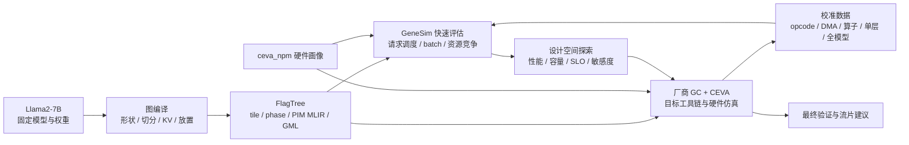

# 流片前 Llama2-7B 多 batch 并发评估与 CEVA-GeneSim 对齐需求和技术设计

> 文档编号：design-ceva-genesim-pre-to-evaluation-kimi-20261105  
> 创建日期：2026-11-05  
> 关联项目：flagos-pim-compiler、FlagTree、genesim、CEVA 工作区  
> 关联文档：`request-ceva-llama2-7b-20261028.md`、`techdoc-ceva-llama2-7b-20261104.md`、`design-ir-cost-20261012.md`  
> 文档状态：需求与设计方案，未实施；文中“现有”表示已核对源码或已有运行产物，“建议/目标/拟”表示待开发能力  
> TO 定义：本文中的 TO 均指芯片流片，不是首 token、超时或其他性能术语

## 一、执行摘要

甲方需要在流片前看清并调优多 batch 并发对 Llama2-7B 推理性能的整体影响。最终可信锚点是 CEVA 硬件仿真器；短期内，为了快速扫描架构参数、编译策略和调度策略，需要使用 genesim 建立与 CEVA 对齐的评估模型。

本方案的核心判断是：

1. **先对齐结构，再校准参数，最后开展 batch 扫描。** 不能只把 genesim 的时钟、MAC 数或某个全局倍率改成 CEVA 数值，就把结果用于流片决策。当前两者在硬件层级、数据类型、算子编译产物、存储层级、DMA/计算重叠和执行边界上均有差异。
2. **CEVA 是最终验证依据，genesim 是可校准的快速模型。** 已有 CEVA 单核运行可校准单请求、单核和已覆盖形状；它不能自动证明多请求、多 engine 竞争、多核或真正张量 batch 的预测正确。
3. **“多请求并发”与“真正张量 batch”必须分开。** genesim 已支持多请求连续准入，但 `execution_microbatch_size` 只能为 1。前者主要反映排队与资源争用，后者才会改变 GEMM 的 M 维、权重复用、KV 容量和 tile 选择。不能用前者代替后者。
4. **第一批工作不是直接扫 batch，而是冻结可比基线并建立参数来源和误差体系。** 任何缺少成本来源、容量检查、版本指纹或验证误差的性能数字，都不得进入流片建议。
5. **模型误差必须小于准备区分的方案差异。** 若两个设计只差 5%，而模型在对应工作负载上有 ±20% 的不确定度，就不能宣称二者有明确优劣。全模型总周期拟合一致，也不等于算子、存储或并发趋势正确。
6. **最终交付不是单个“最优 batch”，而是带可信度的设计结论。** 包括吞吐—时延曲线、满足时延目标的有效吞吐、容量墙、资源瓶颈、参数敏感度、适用边界，以及需要回 CEVA 复核的关键候选。

推荐路线为：

```text
冻结 CEVA 单核 B=1 基线
  → 独立 ceva_npm 硬件画像
  → CEVA 时间线与 DMA/计算重叠分析
  → DMA、GEMM/GEMV、attention、逐层和全模型分级校准
  → 固定编译产物的多请求并发基线
  → 真正张量 batch 的编译与成本闭环
  → 动态合批、共享带宽和多核探索
  → 关键候选回 CEVA 硬件仿真器复核
  → 输出流片前架构建议及不确定度
```

## 二、背景与问题定义

### 2.1 已有基础

当前已初步打通以下链路：

```text
Llama-2-7b-hf
  → 图编译器生成模型 IR、切分和放置信息
  → FlagTree/FlagGems 生成算子产物与 PIM MLIR
  → 成本精化 IR 和 sidecar
  → genesim 生成 PIM trace 并执行系统仿真
  → 输出 token 数、吞吐、TTFT、TPOT 等指标
```

CEVA 方向也已形成另一条链路：

```text
图编译器和 FlagTree
  → 65 张 GML 与配套 bin
  → 厂商 GC 分配 4 个 engine、规划 L1/L2、生成 Registry
  → 厂商 runner 和 CEVA 硬件仿真器
  → prefill、decode、lm_head、argmax 的性能计数与运行结果
```

两条链路的职责不同：CEVA 链路是目标工具链和校准真值来源；genesim 链路用于低成本、可重复的设计空间探索。不能用 genesim 跑通替代 CEVA 验收，也不能因为 CEVA 单点运行完成，就默认 genesim 的趋势已经可信。

### 2.2 需要回答的芯片问题

本设计最终需要回答：

- 在固定 prompt/output 分布和时延目标下，并发请求数与真正执行 batch 各是多少时，输出 token 有效吞吐最高？
- batch 增大后，收益来自权重读取复用、engine 利用率提高，还是仅来自更多请求排队？代价是 TTFT、TPOT、KV 容量还是 DDR/L2 争用？
- prefill、decode 和混合负载的瓶颈是否不同？同一个 batch 策略能否同时满足两类阶段？
- 4 个 engine 是否被厂商 GC 的相位划分有效利用？计算、DMA 和引擎间共享存储是否重叠？
- L1/L2/DDR 容量和带宽、本地 tile 存储、MAC/VPU 宽度、engine 数中，哪个参数对目标负载最敏感？
- W4A8 目标数值路径下，权重复用和 KV 增长形成的最优 batch 区间在哪里？
- 多核扩展是否有价值，还是会被权重复制、KV 分布、互连和共享 DDR 抵消？
- 哪些结论已被 CEVA 数据支持，哪些只是 genesim 外推，必须在流片前补测？

### 2.3 客观性原则

所有实验必须遵守：

- 同一比较中的模型、权重、量化、prompt/output、warm/cold、计时边界、硬件画像和代码版本一致；
- 参数有来源，拟合参数与实测参数分开，未知参数不填“看起来合理”的值；
- 训练形状与验证形状分离，不能用同一批数据既拟合又证明准确；
- 容量不足、成本缺失、模板回退、精度路径不一致或仿真未完成时，结果无效，不得仍给性能排名；
- 绝对性能、相对趋势和外推预测分栏报告；
- 任何“更优”结论必须同时给出差值和模型不确定度。

## 三、范围、优先级与非目标

### 3.1 需求清单

| 编号 | 优先级 | 需求 | 验收结果 |
| --- | --- | --- | --- |
| R0 | P0 | 建立可复现评估契约 | 每次运行有硬件、负载、编译产物、软件和校准版本指纹 |
| R1 | P0 | 冻结 CEVA 单核 B=1 可比基线 | prefill/decode/lm_head/argmax 边界一致，warm/cold 明确 |
| R2 | P0 | 建立独立 `ceva_npm` 画像 | 不覆盖 generic PIM；参数含来源、单位、作用域和不确定度 |
| R3 | P0 | 校准基础成本与相位时间 | DMA、GEMM/GEMV、attention、单层、全模型有独立验证误差 |
| R4 | P0 | 正确报告现有多请求并发 | 扫描连续准入窗口，明确其不是张量 batch |
| R5 | P1 | 支持真正张量 batch | M 维进入图、算子编译和 genesim；权重与 KV 账目正确 |
| R6 | P1 | 建立共享资源和重叠模型 | engine、DMA、L2/DDR 不再各自无条件独享满带宽 |
| R7 | P1 | 支持 prefill/decode 分离与混合负载 | 输出 SLO 下 goodput、P50/P95、容量墙和瓶颈 |
| R8 | P1 | 开展架构和编译联合优化 | 扫描 batch、tile、存储、带宽、engine 和调度策略 |
| R9 | P1 | 回到 CEVA 验证关键候选 | 至少覆盖基线和准备推荐的少量代表点 |
| R10 | P2 | 多核和动态连续合批探索 | 明确标注为模型预测；无实测时不得承诺绝对性能 |
| R11 | P2 | 功耗/面积代理 | 只有获得可信系数后开展，不从性能模型虚构 PPA 结论 |

### 3.2 本阶段包含

- Llama2-7B 的 prefill、decode、lm_head、argmax 计时边界核对；
- CEVA 单 NPM 核、4 engine 的画像与校准；
- 图编译、算子编译、genesim 三侧 batch 语义和成本来源贯通；
- closed batch、等长请求的先行验证，再扩展变长和动态合批；
- 单请求、多请求、多 batch 的性能、容量、利用率与误差报告；
- 面向流片决策的敏感性分析，而不是只给一条吞吐曲线。

### 3.3 非目标与边界

- 不把当前 genesim 默认 HBM-PIM 配置直接改名为 CEVA；
- 不承诺在未取得目标时钟、带宽和存储语义前给出绝对秒级性能；
- 不用厂商已标记不准确的并行仿真结果作为多核真值；
- 不在第一阶段实现完整生产级 continuous batching、抢占、分页 KV 或变长 ragged attention；
- 不把 CEVA 的 ±20% 性能告警阈值解释为模型已经验证的误差；
- 不在缺少功耗和面积实测系数时输出确定性的能耗或面积结论；
- 不用一个全模型全局倍率掩盖分层误差。

## 四、术语与统一语义

### 4.1 四种“并发”

| 名称 | 定义 | 是否改变单个 GEMM 的 M | 主要用途 |
| --- | --- | --- | --- |
| 请求级并发 | 多个请求驻留并竞争资源，每次 forward 仍逐请求执行 | 否 | 排队、资源争用、尾延迟 |
| 张量 batch | 多个请求的 token 合并为一次算子调用 | 是 | 权重复用、提高算术强度、改变 tile |
| 空间并行 | 不同 engine/核同时执行不同相位或请求 | 不一定 | 提高资源利用率，引入共享资源竞争 |
| 流水 micro-batch | 不同 PP stage 同时处理不同 micro-batch | 不一定 | 减少流水气泡 |

报告中不得只写“batch=8”而不说明是驻留请求数、执行批大小，还是 PP micro-batch 数。

### 4.2 请求与 batch 组

建议统一以下概念：

- `request_id`：一个完整推理请求，包含 prompt 和输出长度；
- `arrival_time`：请求进入系统的时间；
- `admission_time`：请求获得驻留槽位的时间；
- `first_token_time`：第一个输出 token 完成的时间；
- `max_inflight_requests`：最大驻留请求数，即连续准入窗口；
- `execution_batch_size`：一次设备 forward 实际合并的请求数；
- `BatchGroup`：同一 phase、同一图和兼容形状请求形成的执行批；
- `m_tokens`：本批次算子的实际 M 维；
- `valid_len[i]`：第 i 个请求独立的有效 KV 长度。

初期 closed batch 采用同时到达、等 prompt、等输出、同 phase 整组执行。动态合批后再允许不同到达时间和不同 KV 长度。

### 4.3 prefill 与 decode 的 M

- 等长 prefill：若采用 padding，`M = B × S`；报告实际有效 token 和 padding token，不能只报有效吞吐而隐藏无效计算。
- ragged prefill：`M = ΣS_i`，attention 仍需保留每个请求边界；该能力放在后续阶段。
- decode：`M = B_active`，每个请求保留自己的 `valid_len` 和 KV 槽位。
- 不允许把 decode 的 `Tq` 从 1 改成 B 后仍逐次重放含权重 DMA 的 M=1 trace，并称为真正 batch。

### 4.4 性能边界

每次运行必须声明：

- `warm_predeployed`：权重已在设备，权重预部署不计入运行时间；
- `cold_start`：权重加载、首次初始化、缓存准备中哪些项计入必须明确；
- `prompt` 是否包含 tokenizer、embedding 和输入 DMA；
- 是否包含 lm_head、采样/argmax、输出回传；
- decode 的 TPOT 是否包含每步 lm_head/argmax；
- 主机和 CEVA 仿真器之间的非设备开销是否排除。

当前 genesim 默认是 warm、权重预部署且运行时权重传输时间为 0，见 `genesim/src/scheduler/gene_sim_scheduler.py:5822-5829`。该结果不能直接解释为冷启动 TTFT。

## 五、现状核查与差距

### 5.1 硬件组织不一致

| 项 | genesim 当前默认 | 图编译器当前默认 | CEVA 目标路径 |
| --- | --- | --- | --- |
| 顶层设备 | 8 PIM device | 8 DPU | 1 NPM 核，TP=1 |
| 核内并行 | 每 device 8 Cluster × 16 TensorPU | 每 DPU 16 tasklet | 4 engine，每 engine 1 VPU |
| 本地存储 | cluster/TensorPU 抽象容量 | 每 DPU 64 KiB WRAM | L1 1 MB；其他本地存储语义待厂商配置复核 |
| 共享存储 | 无与 CEVA 等价的完整 L1/L2 模型 | 每 DPU 8 GiB MRAM | 共享 L2 8 MB |
| 外部存储 | PIM 抽象与通信链路 | MRAM | DDR 约 3983 MB |
| 数值 | 成本探针主要 FP16 | PIM 契约按 FP16 路径 | W4A8，权重 int4/int8，激活 int8/FP16 混合 |
| 执行产物 | PIM MLIR → PIM trace | 执行蓝图与 kernel | GML 相位 → GC → Registry → runner |

依据：`genesim/conf/sim.yaml:7-18,58-103`、`contracts/op_contract.py:55-62`、`docs/request-ceva-llama2-7b-20261028.md:14-26`、`contracts/gml_quant.py:57-67`。

结论：1 个图编译 DPU 可在层级上近似映射为 1 个 NPM 核，4 个 engine 可映射为 4 个执行资源，但这只是资源拓扑映射，不代表指令、带宽或周期已等价。特别是 DTCM、WRAM、L1 的名称和作用域不能在未核实前直接等同。

### 5.2 多请求已支持，真正 batch 未支持

genesim 的 `scheduler.max_inflight_requests` 会在请求完成后补充新请求，属于连续准入；`trace.num_requests` 只是观测请求总数，不是并发度。另一方面，`genesim/src/scheduler/gene_sim_scheduler.py:5243-5254` 对 `execution_microbatch_size != 1` 直接抛出异常，明确说明跨请求张量 batch 未实现。

图编译侧也固定 batch=1：

- `runtime/compile.py:73-83` 导出 `[1, seq]` 输入；
- `runtime/executor.py` 的 decode 状态是单序列；
- `memory/kv_layout.py` 的 KV 公式没有 batch 槽；
- `genesim_bridge/placement_export.py:157-164` 固定用 M=1 编译 linear；
- 成本代表点主要只有 `Tq/Tp`，没有独立 batch 维。

因此当前可立即开展的是“固定编译产物、改变驻留窗口”的实验；真正 batch 必须重新编译 M>1 的算子并重建 KV、DMA 和执行语义。

### 5.3 当前成本模型不能表达全部目标特征

1. PIM trace 对 DMA 采用 `base + bytes × per_byte`，并逐指令累加，见 `genesim/src/pim/pim_trace_loader.py:300-330`。它适合拟合单 kernel 总成本，但简单相加不自动代表真实 DMA/计算重叠。
2. 直接把总和改成 `max(compute, memory)` 也不可信，因为真实重叠取决于相位依赖、双缓冲、引擎分配和共享带宽。
3. `double_buffer`、`prefetch_depth`、`coalesce_threshold` 虽有配置默认值，但当前 Python 计时路径没有消费它们，不能宣称这些优化已经生效。
4. `comm_overlap` 的配置存在不等于当前 pipeline 执行路径已实现相应重叠。
5. `GELU/SILU/RSQRT` 等周期仍标为 placeholder，见 `genesim/conf/sim.yaml:132-134`。
6. 权重/KV/激活的 1/2/2 访存倍率没有目标硬件实测依据，见 `docs/design-ir-cost-20261012.md:264-265`。
7. 多 engine 并发若各自按独享峰值成本计时，可能产生超过物理 DDR/L2 峰值的聚合流量。

### 5.4 现有对比点口径不一致

- 全流程成本精化代表点固定为 `seq_len=128`，见 `scripts/run_full_pipeline.py:72-75`；CEVA 当前运行使用自己的固定 prompt/prefill 配置，不能直接比较端到端周期。
- CEVA 是 W4A8 相位执行，genesim 成本主要来自 FP16 PIM MLIR；容量、流量、相位数量和 batch 收益不是同一口径。
- CEVA 单独统计 lm_head 和 argmax，genesim trace 预设输出长度；二者是否包含输出头必须显式对齐。
- CEVA 厂商包和自研包是两种编译实现，周期不同，不应混成一个“真值”或取平均。

已有锚点示例：

| 运行包 | prompt | full_execution | 来源 |
| --- | ---: | ---: | --- |
| 厂商基线 | 954872915 cycles | 1150814443 cycles | `/data/fjg/ceva/baseline/results/performance_counters.txt` |
| 自研包 | 1028315650 cycles | 1234494102 cycles | `/data/fjg/ceva/runs/ours_e2e/run/performance_counters.txt` |

这些数值证明已有分层校准材料，不证明 genesim 当前误差，也不代表秒级性能；转换为秒必须取得同一次运行的有效时钟口径。

## 六、总体架构设计

### 6.1 双环验证架构



内环是“genesim 预测—CEVA 抽样—误差回写”的校准环；外环是“候选设计—CEVA 复核—架构建议”的决策环。校准数据必须带版本，硬件或 GC 改变后不得无条件复用。

### 6.2 四级模型成熟度

| 等级 | 能力 | 可以支持的结论 | 不可以支持的结论 |
| --- | --- | --- | --- |
| M0：账目一致 | 真实 PIM MLIR、形状、字节、容量和来源完整 | 编译策略的相对账目比较 | CEVA 绝对性能 |
| M1：单请求校准 | 单 engine/单算子/单层/全模型 B=1 有 held-out 验证 | 已覆盖域内的单核性能预测 | 多请求竞争和多核扩展 |
| M2：单核并发校准 | 4 engine、DMA 重叠和共享带宽经时间线验证 | 单核多请求/多 batch 趋势与部分绝对预测 | 多核互连 |
| M3：多核校准 | 互连、权重复制和多核调度有实测 | 多核设计定型 | 超出验证域的无条件外推 |

每份报告必须标注成熟度。当前工作应从 M0/M1 开始，不能直接以 M3 的口径汇报。

## 七、CEVA 硬件画像与参数治理

### 7.1 独立 profile

保留现有 generic PIM 配置，新增独立 `ceva_npm` profile；UPMEM checker 的配置也继续保持独立。`genesim/tools/upmem_checker/README.md:90-98` 已明确禁止把一种硬件的校准时钟和容量直接复制到另一目标，本方案沿用这一原则。

建议的逻辑结构如下，仅为 schema 示例，不表示未知值已经取得：

```yaml
profile_name: ceva_npm
profile_version: 1
target:
  npm_cores: 1
  engines_per_core: 4
  vpus_per_engine: 1
clock:
  core_hz: null                 # 未核实前禁止由周期换算秒
  source: null
memory:
  l1_bytes: 1048576             # 已有目标配置记录；每 engine/每核作用域和版本仍需复核
  l2_bytes_shared: 8388608
  ddr_bytes_per_core: null      # 3983 MB 的单位和可用净容量需复核
  local_tile_store_bytes: null  # 不在未核实前写成 WRAM=64 KiB
bandwidth:
  ddr_bytes_per_cycle: null
  l2_bytes_per_cycle: null
  l1_bytes_per_cycle: null
execution:
  overlap_model: measured_timeline
  gc_engine_mapping: vendor_generated
numerics:
  mode: W4A8
  physical_weight_bytes_from_bundle: true
validation:
  allowed_error_by_level: {}
  calibration_dataset: null
  heldout_dataset: null
```

`null` 在严格模式下表示不能输出依赖该参数的绝对结论，而不是自动使用 generic PIM 默认值。

### 7.2 参数来源分级

每个参数除数值外，还要记录：

| 字段 | 含义 |
| --- | --- |
| `value/unit/scope` | 数值、单位及每 engine/每核/全系统作用域 |
| `kind` | `documented`、`measured`、`fitted`、`assumed` |
| `source` | 配置文件、性能日志、微基准或拟合数据集 |
| `hardware_version` | NPM 配置、固件、仿真器版本 |
| `toolchain_version` | GC、FlagTree、图编译器版本 |
| `uncertainty` | 测量波动、拟合区间或假设范围 |
| `valid_domain` | 适用 dtype、M/N/K、序列长度和并发范围 |

四类参数的使用规则：

- **文档给定**：容量、engine 数等可作为结构初值，但仍需绑定具体版本；
- **微基准实测**：DMA 固定成本、每字节成本、有效计算吞吐等优先使用；
- **拟合有效参数**：例如某抽象 MAC 指令的残差周期，只代表该 kernel 映射，不解释成裸硬件指令延迟；
- **假设参数**：只能做敏感性分析，结果必须标注“假设驱动”。

### 7.3 容量必须按物理产物计算

不能只用理论位宽估算。当前 CEVA 契约中 int4 权重是一字节存一个值而非半字节打包，见 `contracts/gml_quant.py:30-34`。因此权重容量、DMA 字节和带宽消耗应优先从实际 GML/bin、Registry、DDR map 读取，并包括 scale、LUT、对齐和运行时缓冲。

KV 的逻辑下界为：

```text
KV_bytes = 2 × layers × B × max_valid_len × kv_heads × head_dim × physical_element_bytes
```

实际容量还要考虑布局对齐、双缓冲、临时张量和每核可用净 DDR。dtype 必须来自目标路径，不能统一假定 2 字节。

任何超出容量的 `(B, seq)` 组合必须报告“不可运行”，不能通过地址回绕或忽略 KV 得到吞吐数字。

## 八、成本与计时模型设计

### 8.1 现有单算子成本保留为可校准入口

当前 PIM MLIR → trace 的路径能让真实 tile、循环和 DMA 进入成本，应继续保留。严格模式要求：

- 每个成本项可追溯到 `op_id + phase + M + local_shape + dtype + pimir_sha256`；
- sidecar 指向的 PIM MLIR 必须存在，禁止静默退回手写模板；
- prefill 不得只复用 M=1 decode 产物并重放；
- 融合算子的吸收节点不得重复计费；
- 指令周期、访存周期和字节数可分别导出；
- 0 成本、空 trace 和缺失字段必须显式解释。

建议成本键为：

```text
CostKey = (model_revision, op_role, phase, m_tokens,
           local_M, local_N, local_K, weight_dtype, activation_dtype,
           hardware_profile, tile_m, tile_n, tile_k, fusion_signature)
```

### 8.2 DMA 模型

先用 CEVA 微基准或从可隔离相位中提取不同传输大小、方向和存储区间的数据，拟合：

```text
C_dma(direction, src, dst, bytes, alignment)
  = transfer_count × C_base + bytes × C_per_byte + C_sync
```

要求：

- 固定成本与每字节成本分开；
- 大区间的突发、对齐、切包和同步成本可辨识时再扩展，不预先堆参数；
- 训练传输尺寸与验证尺寸分离；
- 残差随 bytes 若仍明显相关，说明模型结构缺失，不能仅接受拟合优度；
- DMA 与计算是否重叠由时间线决定，不在单条 DMA 公式里提前假定。

### 8.3 GEMM/GEMV 与真正 batch

对 linear 至少覆盖 Llama2-7B 的 N/K 组合和 M=1、2、4、8、16 等代表点。成本必须来自对应 M 的实际 kernel 或经过验证的分块模型：

```text
权重流量：按实际 N/K tile 和 batch 内复用次数计算
激活流量：随 M 和 tile 调度变化
输出流量：随 M 增长
计算量：随有效 M 增长，padding 单独计无效计算
本地容量：由 A/B/累加器/scale/双缓冲等实际占用共同约束
```

真正 batch 的主要收益不是“执行 B 次后平均一下”，而是同一执行批内减少权重重复搬运并改变计算/访存比。若实际 CEVA kernel 不能复用权重，模型也不能强行赋予理想复用收益；应分别报告“当前 kernel”与“理想优化上限”。

### 8.4 attention 与逐相位模型

attention 不能只按 GEMM 公式替代，需要保留：

- Q/K/V 形状、head 数和本地分片；
- 每请求独立 KV 长度；
- score、softmax、context、RoPE、mask、转置和 KV 更新；
- prefill 的查询行与 decode 的单行差异；
- KV 读写流量随 batch 和历史长度增长；
- W4A8 路径中的量化、反量化、LUT 和 FP16 阶段。

CEVA 的相位是重要校准单元。每个相位至少记录输入/输出字节、执行 engine、开始/结束周期、纯执行周期和总占用周期，避免只按高层算子名匹配。

### 8.5 从串行成本到资源时间线

目标事件语义为：

```text
ready_i   = max(所有依赖完成时间, 数据就绪时间)
start_i   ≥ ready_i，并等待 engine、DMA、存储端口等资源
finish_i  = start_i + service_i
service_i 由实测/kernel 成本及共享资源竞争共同决定
```

短期可保留“校准后的单算子总周期”用于单请求 M1 模型；进入多 engine 和 batch 后，必须引入资源时间线。需要区分：

- 同一 engine 内计算与 DMA 是否可重叠；
- 不同 engine 是否共享 L2 端口和 DDR 带宽；
- 相位间是否只有依赖约束，还是还有 GC 生成的同步；
- 通信、KV 更新和输出回传使用哪个资源；
- 共享资源服务是串行、固定分区还是随并发公平分配。

不得预设“全串行”或“完美重叠”。应从 CEVA `CycleEstimation.csv` 的 `Unit Name、Task ID、Start Cycle、End Cycle、Pure Cycles Num、Total Cycles` 提取真实区间，计算资源 busy 区间并集、重叠比例、空闲段和关键路径。

该文件约 3186 万行，解析器应流式处理、按运行和相位聚合，不能一次性载入内存。厂商包和自研包分别生成统计，避免把两种实现混拟合。

### 8.6 周期、秒与全模型边界

```text
T_seconds = C_cycles / effective_clock_hz
```

只有周期和有效时钟来自同一硬件配置、同一计时域时才允许换算。全模型周期不能总是直接等于各相位周期之和；若存在重叠，应以开始/结束时间线求 makespan。主机 runner、lm_head、argmax、采样和输出回传按统一边界纳入或排除，并在结果中标识。

## 九、多请求与真正 batch 功能设计

### 9.1 阶段 A：现有多请求连续准入基线

这一阶段不改编译产物，只改变 `max_inflight_requests`，用于隔离排队和资源竞争：

- 固定模型、PIM MLIR、sidecar、prompt/output 和 warm/cold；
- 扫描驻留窗口 1、2、4、8、16；
- 请求总数要明显大于最大窗口，10 请求只用于冒烟，不用于稳定 P95；
- 分别运行 prefill 主导、decode 主导和混合负载；
- 输出驻留数、执行批大小恒为 1、准入排队时间、资源利用率和 TTFT/TPOT；
- 报告标题必须写“请求级并发，未合批”。

该阶段可以回答当前执行模型下并发争用问题，不能回答权重 batch 复用收益。

### 9.2 阶段 B：closed batch 成本闭环

先支持等长、同 phase、整组进入和整组退出的 batch：

- prefill 使用 B 个等长 prompt；
- decode 每步 M=B，所有槽位同步前进一步；
- 每个请求保留独立 KV 区域和 `valid_len`；
- 每个目标 M 重新运行算子编译和容量检查；
- 输出真实执行 batch、padding 比例和每请求公平性。

这一阶段优先建立性能与容量正确性，不追求生产级调度。

### 9.3 阶段 C：图编译与运行时完整支持

图编译器需要：

- 导出 `[B,S]` 与 `[B,1]`，不再在 `runtime/compile.py` 固定第一维为 1；
- KV 规划增加 batch 槽，每槽独立有效长度和地址；
- `DecodeState`、执行计划、mask、position_ids、logits 和采样按槽位处理；
- NumpyBackend 与 PyTorch 在 B>1 下做数值对齐；
- 容量规划包含 batch 后激活、KV 和临时缓冲增长；
- batch 维默认不切分，跨 engine/核的空间映射另作明确策略。

FlagTree 需要：

- 接受 M=B 和 prefill 的实际 M；
- tile 搜索使用目标本地存储预算；
- 输出 tile M/N/K、物理流量和容量元数据；
- 保证尾块和 mask 正确；
- 不为追求理论权重复用而生成目标硬件不能执行的调度。

genesim 需要：

- 引入 BatchGroup 调度项，而不是把请求数简单乘到 trace repetitions；
- 按 CostKey 选择对应 M 的 PIM MLIR/成本；
- 维护每请求 KV 长度和输出进度；
- 将批任务映射到 engine 和共享资源；
- 输出每批组成、M、等待原因和资源占用。

### 9.4 阶段 D：动态连续合批

在 closed batch 校准后，再增加：

- 同 phase、同图、兼容长度请求的动态成组；
- 最大 batch、最大等待时间和 token 预算三种约束；
- 变长 prefill 的 padding 或 ragged 表示；
- decode 请求完成后的槽位释放与新请求补位；
- prefill 优先、decode 优先和混合策略；
- 长 prompt 对 decode TPOT 的干扰；
- 公平性与队头阻塞。

调度优化目标不是单一吞吐最大，而是在 TTFT/TPOT SLO 约束下最大化输出 goodput，并报告 P95 与公平性。

## 十、指标与实验设计

### 10.1 统一指标

| 类别 | 指标 | 口径 |
| --- | --- | --- |
| token | prompt/output/total tokens | 输入、输出分开；padding 不记有效 token |
| 请求 | completed/admitted/rejected | 完成数不能大于实际完整运行数 |
| 吞吐 | req/s、output tokens/s、prompt tokens/s | 分母为统一系统墙钟，不以设备 busy 时间代替 |
| 首 token | TTFT P50/P95 | 从 arrival 到第一个输出 token 完成 |
| 排队 | admission queue delay | `admission_time - arrival_time` |
| prefill 服务 | prefill service time | 从实际 prefill 开始到首 token 完成，边界含输出头与否需一致 |
| decode | TPOT、inter-token latency P50/P95 | 输出数大于 1 时计算；说明是否含 lm_head/argmax |
| 端到端 | E2E latency P50/P95 | 从 arrival 到请求完整结束 |
| 有效吞吐 | SLO goodput | 单位时间内满足 TTFT/TPOT/E2E SLO 的完成请求或输出 token |
| 资源 | engine/DMA busy、DDR/L2 带宽 | busy 用区间并集，带宽用实际字节/墙钟 |
| 容量 | 权重/KV/激活/临时缓冲 | 物理产物口径，超限硬失败 |
| 质量 | 误差和置信区间 | 按算子、层、全模型和负载域分别报告 |

TTFT 推荐分解为：

```text
TTFT = 准入前排队 + 准入后调度等待 + prefill 服务时间
```

若系统还有其他主机开销，单列，不塞入设备 prefill 周期。

### 10.2 固定基线

所有性能对比先冻结：

- Llama-2-7b-hf 的具体权重与自研/厂商浮点基线；
- W4A8 目标数值路径及真实 bin 布局；
- 单 NPM、4 engine、TP=1、PP=1；
- 相同 prompt、输出长度、KV 初始状态和贪心解码；
- 相同 prefill/decode/lm_head/argmax 边界；
- warm 或 cold，不混用；
- 图编译器、FlagTree、GC、固件、CEVA 仿真器、genesim 版本；
- 同一硬件画像和校准数据版本。

### 10.3 实验矩阵

| 实验 | 自变量 | 固定项 | 目的 |
| --- | --- | --- | --- |
| E0 可复现性 | 同配置重复运行 | 全部 | 确认确定性和测量波动 |
| E1 请求并发 | 驻留窗口 1/2/4/8/16 | 执行 B=1、编译产物 | 隔离排队与争用 |
| E2 closed batch | 执行 B=1/2/4/8/16 | 等长请求、硬件画像 | 观察权重复用和 KV 容量墙 |
| E3 序列长度 | prompt/KV 128/512/1024/2048 | batch 策略 | 区分 prefill 与 decode 瓶颈 |
| E4 输出长度 | 1/16/64/128 | prompt 与 batch | 分离 TTFT 和稳态 TPOT |
| E5 调度 | prefill/decode 优先、混排 | 同一到达 trace | 优化 SLO goodput |
| E6 编译 | tile、融合、放置 | 同一硬件和 trace | 判断编译策略收益 |
| E7 架构 | engine、L1/L2、DDR 带宽、本地存储 | 同一编译语义 | 参数敏感度与瓶颈 |
| E8 多核 | 核数、互连、权重复制策略 | 单核模型已校准 | 探索性扩展预测 |

正式扫描前先用小矩阵做冒烟；每个拟合维度都保留未参与拟合的验证点。对多因素实验可先采用部分因子设计筛主效应，再对关键交互做完整矩阵，避免无目的地全组合运行。

### 10.4 到达负载

至少包含：

- closed load：固定数量请求同时到达，便于分析硬件极限；
- open loop：按固定到达率或泊松到达，观察排队稳定性；
- burst：短时突发，观察 TTFT 尾延迟；
- mixed：不同 prompt/output 比例，观察 prefill 对 decode 的干扰。

到达率扫描要覆盖欠载、膝点和过载。过载时只报告平均吞吐会掩盖排队，必须同时报告完成数、P95 和未完成作业数。

## 十一、校准、验证与误差门槛

### 11.1 校准阶梯

顺序固定为：

```text
DMA/同步
  → GEMM/GEMV（M/N/K、dtype、tile）
  → attention 与元素/量化相位
  → 单层 prefill/decode
  → 全模型 prefill/decode/lm_head/argmax
  → 单核多请求与多 batch
  → 多核（有实测后）
```

下层残差未解释前，不用上层全局倍率把它吸收。例如 DMA 字节模型错误，不应通过调整 MAC 周期让全模型总数碰巧一致。

### 11.2 训练与 held-out 验证

复用 UPMEM checker 已采用的方法：一组形状拟合，不相交的大输出或其他形状集合只做预测验证，见 `genesim/tools/upmem_checker/README.md:55-88`。

CEVA 侧建议：

- DMA：小/中/大传输尺寸交错划分训练与验证；
- linear：训练覆盖部分 M/N/K，验证保留未见 M 和 Llama2 的大 N/K；
- attention：训练与验证使用不同 KV 长度和 query 长度；
- batch：若用 B=1/4/16 拟合，可用 B=2/8 验证，但不能只验证插值后再宣称可外推 B=32；
- 全模型：至少保留一组未参与任何参数拟合的 prompt/output 组合。

每个参数要检查可辨识性。两个参数始终同时变化、只能拟合其和时，不应分别宣称测得。

### 11.3 误差定义

对每个验证点报告：

```text
signed_error   = (predicted - measured) / measured
absolute_error = abs(predicted - measured) / measured
```

汇总 median、p90、max、样本数和按 phase 的误差分布，同时保留逐点表。除了总周期，还比较：

- DMA 字节和传输次数；
- 各相位周期占比；
- 随 M、N、K、KV 长度和 batch 的斜率；
- 资源 busy 与重叠比例；
- 吞吐/时延曲线方向及膝点位置。

### 11.4 两级验收门槛

**模型可用门槛**是项目启动时的工程目标，可在取得首轮 CEVA 数据后由双方确认。建议初始目标为：DMA 与主要 linear 的 held-out 中位绝对误差不高于 10%，单层和全模型已覆盖域内不高于 20%，且没有未解释的相位级系统性偏差。该数值不是现有能力声明，也不是永久合格线。

**设计决策门槛**更严格：

```text
方案 A 与 B 的可区分性
  必须大于两者预测误差的合成不确定度和重复运行波动
```

- 准备比较 5% 的架构差异时，对应验证域误差必须明显小于 5%，或能通过同一偏差的受控差分实验证明排名稳定；
- 误差 ±20% 时不得对相差 5% 的方案排名；
- 超出校准域时只给敏感性区间，不给确定排名；
- 多核和无 CEVA 实测的 batch 只能标为模型预测。

### 11.5 厂商包与自研包分开校准

厂商包与自研包的 prompt、decode 和 full_execution 周期不同，说明编译产物本身会改变性能。校准必须选择目标：

- 要评估自研编译器，就以自研 GML/bin、对应 Registry 和运行日志为主；
- 厂商包可用于隔离硬件基准和交叉检查；
- 两者差异应归因到相位、DMA、调度或数值路径，不用平均周期构造“CEVA 真值”。

## 十二、评估产物与可追溯设计

### 12.1 结果指纹

每次运行至少保存：

```json
{
  "schema_version": 1,
  "profile": {"name": "ceva_npm", "sha256": "...", "maturity": "M1"},
  "model": {"name": "Llama-2-7b-hf", "weights_sha256": "...", "numerics": "W4A8"},
  "software": {
    "graph_compiler": {"commit": "...", "dirty_diff_sha256": "..."},
    "flagtree": {"commit": "...", "dirty_diff_sha256": "..."},
    "genesim": {"commit": "...", "dirty_diff_sha256": "..."},
    "gc_firmware_simulator": "..."
  },
  "inputs": {
    "ir_sha256": "...",
    "pimir_manifest_sha256": "...",
    "sidecar_sha256": "...",
    "trace_sha256": "...",
    "gml_bundle_sha256": "...",
    "registry_sha256": "..."
  },
  "calibration": {"dataset_sha256": "...", "heldout_dataset_sha256": "..."},
  "boundary": {"warm": true, "lm_head": true, "argmax": true},
  "validity": {"complete": true, "capacity_ok": true, "fallback_count": 0}
}
```

只有指纹中比较相关字段一致的结果才能直接做差分。硬件画像或校准集改变时，旧结果保留但标记不可直接比较。

### 12.2 逐算子成本清单

建议 manifest 每条记录包含：

```json
{
  "op_id": 4,
  "op_role": "q_proj",
  "phase": "decode",
  "request_batch": 8,
  "m_tokens": 8,
  "local_shape": [8, 4096],
  "weight_dtype": "int4",
  "activation_dtype": "int8",
  "pimir_path": "...",
  "pimir_sha256": "...",
  "tile_m": 8,
  "tile_n": 512,
  "tile_k": 32,
  "compute_cycles": 0,
  "memory_cycles": 0,
  "memory_bytes": 0,
  "cost_kind": "measured_or_fitted",
  "calibration_version": "..."
}
```

字段值示例中的 tile 和周期不是推荐配置，正式结果必须由实际编译与校准填写。

### 12.3 无效结果规则

出现以下任一情况，`validity.complete=false`，不进入排名：

- PIM MLIR 缺失或回退模板；
- 目标形状、dtype 或 M 与成本产物不一致；
- KV/权重/激活超容量；
- CEVA 未完成全层或规定 decode 步数；
- 用较短 token 前缀冒充完整运行；
- 未知参数被默认 generic PIM 值替代；
- GPU/CPU 意外参与但未纳入统一边界；
- 周期转秒缺少有效时钟；
- 拟合点被当作独立验证点；
- 多请求并发被误标为执行 batch。

## 十三、流片前设计空间探索与报告

### 13.1 优化变量

在模型达到相应成熟度后，按以下顺序扫描：

1. 执行 batch、最大驻留请求数、最大合批等待时间；
2. linear/attention tile 和融合策略；
3. KV 布局、权重驻留和预取策略；
4. engine 数与相位映射；
5. L1/L2/本地 tile 存储容量和 DDR/L2 带宽；
6. prefill/decode 调度策略；
7. 多核数量、权重复制和互连。

硬件变量和编译变量要联合检查。例如增加 engine 后，原 GC 相位不能利用新增资源，则理论资源增加不等于性能提升；增大本地存储后，也必须重新跑 tile 搜索，而不是只改容量数字。

### 13.2 必出图表

- output tokens/s、req/s 随请求并发与执行 batch 的曲线；
- TTFT/TPOT P50/P95 随 batch 的曲线；
- SLO goodput 随到达率曲线及稳定膝点；
- prefill/decode 分开和混合负载对比；
- 权重、KV、激活和总容量随 `(B, seq)` 的热力图；
- engine、DMA、L2/DDR 的 busy/带宽时间线；
- batch 前后每输出 token 权重字节数；
- 参数敏感度排序和关键交互；
- 性能—容量或性能—硬件成本 Pareto 前沿；
- genesim 预测与 CEVA 实测的逐层/全模型误差图。

### 13.3 结论模板

每条流片建议按以下格式输出：

```text
结论：在[负载与 SLO]下，[候选设计]相对[基线]的[指标]变化为[区间]。
证据：CEVA 实测点[列表]；genesim held-out 误差[列表]；成熟度[M0-M3]。
原因：[权重复用 / 带宽 / 容量 / 调度 / 相位重叠]。
适用范围：[batch、prompt、KV、dtype、硬件版本]。
风险：未实测项、外推范围和可能反转结论的参数。
建议：采用/不采用/需补哪个 CEVA 实验后再定。
```

没有误差和适用范围的“性能提升 X%”不作为正式结论。

## 十四、模块改动建议

以下均为拟改动位置，实施前需按当时源码重新核对，不代表本文件已完成代码修改。

### 14.1 flagos-pim-compiler

| 模块 | 建议改动 |
| --- | --- |
| `contracts/op_contract.py` | 保持 generic 默认；增加目标硬件画像输入，不把 CEVA 值写死为全局默认 |
| `runtime/compile.py` | 增加 batch 形状导出和 phase/M 元数据 |
| `runtime/executor.py` | per-slot decode 状态与 B>1 数值执行 |
| `memory/kv_layout.py`、`mem_planner.py` | batch KV、物理容量和独立 valid_len |
| `genesim_bridge/placement_export.py` | 取消所有 linear 固定 M=1 的代表点假设；按 phase/M 编译 |
| `genesim_bridge/op_classify.py`、`cost_extractor.py` | CostKey 增加 batch、dtype 和目标 profile |
| `genesim_bridge/ir_cost.py` | 保留真实字节/tile 对账，输出可追溯成本字段 |
| `scripts/run_full_pipeline.py` | 统一 profile、负载、batch、严格模式和指纹入口 |
| `tests/` | B=1 回归、B>1 数值、KV 容量、成本来源和不同 M 编译测试 |

### 14.2 FlagTree

| 模块 | 建议改动 |
| --- | --- |
| PIM tile/to-budget 相关 pass | M>1 的真实分块、本地容量和尾块处理 |
| PIM MLIR/phase 导出 | 保留 M、dtype、tile、融合和物理流量语义 |
| GML/CEVA 相位路径 | 与厂商 GC 可执行的 batch 能力对齐，不虚构硬件优化 |
| lit/算子测试 | M=1 不变，M>1 形状、容量和权重复用账目测试 |

### 14.3 genesim

| 模块 | 建议改动 |
| --- | --- |
| `conf/` | 新增独立 `ceva_npm` profile 和负载画像 |
| `src/ir/model_ir.py` | 表示执行 batch 或 BatchGroup 的 M 语义 |
| `src/scheduler/gene_sim_scheduler.py` | 保留连续准入；新增 closed/dynamic 合批和容量约束 |
| `src/pim/pim_compiler.py`、`src/backend/pim_backend.py` | 不再通过简单 repetitions 冒充真正 batch |
| `src/pim/pim_trace_loader.py` | 输出分项成本，接入经校准的 DMA/相位模型 |
| VPU/engine 执行路径 | 按实际 tile_m 和批 kernel 执行，不重复搬权重 |
| 共享资源模型 | engine、DMA、L2/DDR 时间线和竞争 |
| 结果输出 | 请求分解指标、BatchGroup、成熟度、指纹和误差 |
| 校准工具 | CEVA 性能计数和 CycleEstimation 流式导入、held-out 验证 |

### 14.4 CEVA 工作区

- 增加可重复的单层/单相位/代表形状运行入口，优先复用厂商工具；
- 保存性能计数、时间线、硬件配置、GC/Registry 和自研包摘要；
- 对基线和少量候选点复核，不要求每个 genesim 扫描点都跑耗时完整仿真；
- 原始厂商目录继续保持只读，所有实验在工作区完成；
- 多核并行仿真在厂商确认可信前不作为校准真值。

## 十五、分阶段实施与验收

### P0：冻结基线和评估契约

**工作**：统一 B=1、W4A8、单核 4 engine、prompt/output、warm/cold、lm_head/argmax 边界；新增 profile/schema 和结果指纹；整理已有 CEVA 周期。

**验收**：同一输入可复现；不同 seq=128 精化结果不直接与 CEVA 当前 prefill 比；所有参数有来源；缺项可见。

### P1：单请求结构对齐和基础校准

**工作**：解析 CEVA 时间线；校准 DMA、linear、attention 和主要相位；建立 held-out；完成单层和全模型 B=1 对比。

**验收**：B=1 旧路径无回归；逐层误差可解释；全模型不是只靠全局倍率拟合；报告模型成熟度和验证域。

### P2：现有请求级并发基线

**工作**：固定编译产物，扫描驻留窗口和到达负载；补 TTFT 分解、P95、资源 busy 和 SLO goodput。

**验收**：明确执行 batch=1；请求总数和驻留窗口不混淆；过载与未完成请求可见；不宣称权重复用收益。

### P3：真正 closed batch 全链路

**工作**：图、KV、FlagTree、PIM MLIR、genesim BatchGroup 贯通；先等长 prefill/decode，再扫 B 和 seq。

**验收**：B>1 NumpyBackend 对 PyTorch 数值对齐；每 M 成本来源真实；KV 容量正确；权重/token 变化与 kernel 账目一致；至少一个 B>1 CEVA 锚点，若目标工具链不支持则明确标为未验证预测。

### P4：共享资源、动态合批与联合优化

**工作**：4 engine、DMA、L2/DDR 竞争；动态合批和 prefill/decode 混排；联合扫描编译与硬件参数。

**验收**：共享带宽不能无条件超峰值；调度结果满足依赖；SLO goodput 和公平性完整；关键候选有 CEVA 复核计划。

### P5：多核探索和流片建议

**工作**：建立多核与互连假设区间，扫描核数、复制和链路；汇总所有已验证/未验证结论。

**验收**：多核全部标为模型预测直至有可信实测；输出推荐区间、敏感度、误差、风险和流片前补测清单。

## 十六、测试与验证要求

### 16.1 单元测试

- profile 单位、作用域、未知参数严格失败；
- B=1 成本与旧版一致；
- M>1 不使用简单 Tq repetitions 代替；
- KV 字节随 B 和 valid_len 正确增长；
- 权重物理字节与实际 bin 一致；
- DMA 拟合不在 held-out 上重新训练；
- 容量超限、PIM MLIR 缺失、dtype 不匹配均失败；
- TTFT、TPOT、goodput 用手算小例验证；
- 共享资源忙碌区间和重叠计算用手算时间线验证。

### 16.2 集成测试

- 小模型 B=1/2/4 与 PyTorch 数值对齐；
- Llama2-7B 每个目标 M 都能导出真实成本清单；
- prefill、decode、lm_head、argmax 全链路完成；
- genesim 请求完成数、token 数和吞吐公式对账；
- 同一指纹复现，同一输入改变任一项会改变指纹；
- CEVA 自研包和厂商包分别归档，不混用 Registry。

### 16.3 硬件验证

- 单算子/单层优先，减少完整 CEVA 运行成本；
- 全模型至少覆盖基线和准备推荐的代表点；
- 记录实际完成 decode 步数，缩减运行不得报告为完整 10 步；
- CEVA 的数值告警与性能模型误差分开处理；
- 未达到误差门槛时，先修结构或补测，不通过扩大“合格阈值”交付。

本文档本身仅为设计新增，未运行代码测试、完整编译或仿真；上述均为后续实施验收要求。

## 十七、风险与应对

| 风险 | 后果 | 应对 |
| --- | --- | --- |
| 只拟合全模型总周期 | 总算术正确、分层趋势错误 | 强制分层残差和 held-out，禁止全局倍率收口 |
| 把并发窗口当张量 batch | 漏掉权重复用，误导最优 batch | 指标分开，BatchGroup 和真实 M 贯通 |
| FP16 成本用于 W4A8 决策 | 容量、流量、相位和收益均偏差 | 使用物理 bin/GML/CEVA 相位校准 |
| 简单相加或完美 max 模拟重叠 | 多 engine 性能失真 | 从 CycleEstimation 时间线建立资源模型 |
| 时钟或带宽未知仍报秒 | 形成虚假绝对性能 | 未知时只报 cycles 和相对值，严格模式禁止换算 |
| CEVA 并行仿真不准 | 多核真值不可靠 | 多核仅敏感性预测，推动可信实测锚点 |
| GML/GC 不支持目标 batch | 理想 kernel 无法硬件复核 | 分开报告当前硬件路径与理想上限，先确认接口 |
| 厂商与自研产物混用 | 校准对象漂移 | 按 bundle/Registry/软件指纹分别管理 |
| 大时间线文件处理成本过高 | 校准流程难重复 | 流式解析、聚合中间表、保存摘要和来源 |
| 扫描组合爆炸 | 流片前来不及收敛 | 分层校准、部分因子筛选、只复核关键候选 |
| 只追求吞吐 | TTFT/TPOT 或公平性恶化 | 以 SLO goodput 和 Pareto 为目标 |

## 十八、待甲方或实测确认的问题

### 18.1 阻塞绝对性能的问题

1. 目标 NPM 配置的有效时钟及性能计数器所属时钟域；
2. DDR、L2、L1 的峰值和可持续带宽、端口数、读写共享关系；
3. 本地 tile 存储的准确名称、容量、作用域和双缓冲能力；
4. 4 engine 的 VPU/MAC 数据通路、W4A8 有效吞吐和同步开销；
5. DMA 与计算、不同 engine 之间允许的重叠和竞争规则；
6. CEVA runner 的计时是否含主机、采样、输出 DMA 等边界。

### 18.2 阻塞多 batch 硬件验证的问题

1. 当前 GML、GC、Registry 和 runner 是否支持 B>1，支持的是等长 padding 还是变长 batch；
2. KV cache 的多槽位布局和 `line_idx` 如何扩展；
3. 多请求由同一 runner 内调度还是多实例执行；
4. 厂商并行仿真“不准确”的具体范围和是否已有可信单核多 engine 时间线；
5. 多核互连、DDR 共享、权重复制和 AllGather/mailbox 的实际参数。

### 18.3 阻塞业务目标的问题

1. TTFT、TPOT、E2E 的 SLO 及统计分位；
2. 线上 prompt/output 长度和到达率分布；
3. 更关注单请求时延、单核吞吐还是整机吞吐；
4. warm 稳态与冷启动哪个是主要验收场景；
5. 可接受的容量、功耗和面积约束。

这些问题不阻塞 P0 的账目和时间线整理，但未知项必须保留为区间或空值，不得自行假定后隐藏。

## 十九、建议的立即执行顺序

1. **冻结一次自研 CEVA 单核运行清单**：模型、W4A8、prompt/output、65 图、Registry、GC/固件/仿真器版本、性能计数和时间线一一对应。
2. **写 CEVA 时间线提取器**：先回答 prompt/decode 中各 engine 和 DMA 的 busy、重叠、空闲与主要相位，不先调 genesim 数字。
3. **建立 `ceva_npm` profile 和参数台账**：已知、实测、拟合、假设四类分开；所有未知项列出负责人和补测方法。
4. **完成 B=1 分层校准**：先 DMA 和 linear，再 attention、单层和全模型；保留 held-out，不用全模型倍率收口。
5. **跑现有请求级并发实验**：只改变驻留窗口，输出排队和资源竞争基线，并明确“未合批”。
6. **实现 closed batch 的 M 维贯通**：优先 decode M=B，再处理等长 prefill；同时完成 KV 容量与数值验证。
7. **以 SLO goodput 做联合调优**：扫描 batch、tile、存储和调度，关键候选回 CEVA 验证。
8. **最后开展多核外推**：给区间和风险，不把未校准多核数字写成芯片承诺。

## 二十、最终交付验收

项目完成不以“genesim 能跑 batch=16”为判据，而以满足以下条件为判据：

- CEVA 单核基线与 genesim 在同一模型、数值、形状和边界下完成分层对比；
- 参数来源、成本来源、版本指纹和无效结果规则完整；
- 请求级并发与张量 batch 的结果分别报告；
- B>1 的图、KV、算子编译和 genesim 成本语义一致，数值路径有 PyTorch 对齐；
- 主要算子、单层和全模型均有未参与拟合的验证误差；
- 多 engine、DMA 和共享带宽模型有目标时间线依据；
- 吞吐、TTFT、TPOT、P95、SLO goodput、容量墙和瓶颈图表完整；
- 架构建议的差值大于可区分性门槛，或明确写为无法区分；
- 关键推荐点回到 CEVA 硬件仿真器验证；
- 多核、未覆盖 batch 和其他外推均标注“模型预测”，没有冒充实测；
- 最终形成“采用什么、为什么、在哪些负载下成立、还需补什么证据”的流片前决策报告。

---

## 附录 A：现有入口与目标入口的区别

当前已有入口可用于建立基线，例如：

```bash
source /data/fjg/flagOS/flagOS-installed/pytorch/env-pytorch.sh
export PATH="$HOME/.local/bin:$PATH"

python scripts/run_full_pipeline.py --num-stages 4
```

本文建议未来增加统一硬件/负载/batch/profile 参数，但类似下面的命令是**目标接口示例，不是当前已支持命令**：

```bash
python scripts/run_full_pipeline.py \
  --hardware-profile ceva_npm \
  --workload llama2_7b_decode_closed \
  --execution-batch 1,2,4,8 \
  --max-inflight-requests 1,2,4,8 \
  --strict-provenance \
  --strict-capacity
```

实施时应优先复用现有参数和结果结构，避免另建一套与当前 `sim.yaml`、sidecar 和 `summary.json` 漂移的配置体系。

## 附录 B：关键源码与数据索引

| 内容 | 位置 |
| --- | --- |
| genesim 默认硬件和周期成本 | `genesim/conf/sim.yaml` |
| 多请求连续准入与 microbatch 限制 | `genesim/src/scheduler/gene_sim_scheduler.py:5231-5259` |
| warm 权重预部署边界 | `genesim/src/scheduler/gene_sim_scheduler.py:5822-5829` |
| PIM trace DMA 累加 | `genesim/src/pim/pim_trace_loader.py:300-330` |
| M=1 linear 编译代表点 | `genesim_bridge/placement_export.py:157-164` |
| 图导出固定第一维 | `runtime/compile.py:73-83` |
| generic PIM 默认硬件 | `contracts/op_contract.py:55-62` |
| CEVA W4A8 物理类型和 int4 存储 | `contracts/gml_quant.py:30-34,57-67` |
| CEVA 单核/4 engine/存储边界 | `docs/request-ceva-llama2-7b-20261028.md:14-26` |
| CEVA 全流程现状 | `docs/techdoc-ceva-llama2-7b-20261104.md` |
| 成本倍率待实测说明 | `docs/design-ir-cost-20261012.md:264-265` |
| UPMEM 独立校准与 held-out 方法 | `genesim/tools/upmem_checker/README.md:45-98` |
| 厂商 CEVA 性能计数 | `/data/fjg/ceva/baseline/results/performance_counters.txt` |
| 自研 CEVA 性能计数 | `/data/fjg/ceva/runs/ours_e2e/run/performance_counters.txt` |
| CEVA 时间线 | `/data/fjg/ceva/baseline/results/CycleEstimation.csv` |
