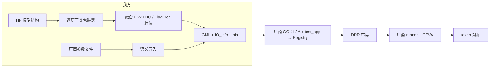

# 技术设计文档：自研 GML 接入 CEVA 的 Llama2 7B 全流程推理

> 文档编号：design-ceva-llama2-7b-20261028
> 创建日期：2026-10-28
> 关联需求文档：[request-ceva-llama2-7b-20261028](request-ceva-llama2-7b-20261028.md)
> 关联项目：flagos-pim-compiler、FlagTree、genesim、CEVA 工作区
> 本轮为只读核查与设计；未运行 GC、测试或仿真，目标代码尚未实施。

## 一、设计概述

### 1.1 需求背景回顾

我方 GML 出口目前只覆盖单层 decode，CEVA 运行用的仍是厂商 Registry。本期要做三件事：

- 由我方生成全部 65 张子图的 GML 和 bin，权重数值导入自厂商；
- 经厂商 GC 编译、厂商 runner 执行，跑完 32 层推理；
- 输出 token 与厂商基线逐个一致。

### 1.2 设计目标

- 图、相位、布局由我方生成，权重和静态常量按语义导入厂商字节。
- 先用单层独立运行对齐，再扩到全模型。
- 默认跑 10 步。过慢时可记录原因后缩减，但至少要完成全模型 1 步，token 判据不放宽。

### 1.3 设计范围

- 包含：
  - 三类子图导出、厂商参数导入、runner 接口对齐；
  - 删除旧 `prepare_out` 支线；
  - 工作区 GC 接线、单层独立运行、严格验收。
- 不包含：
  - 自研量化复现厂商数值；
  - 多核并行、替换厂商 GC/runner/仿真器；
  - 修改 `runtime/executor.py`。

## 二、现状基线

路径前缀沿用需求文档，未加前缀的默认指本仓。

### 2.1 层级与分工

| 层级 | 我方 / GeneSim | CEVA |
| --- | --- | --- |
| 多芯片 | 多 DPU 经 Host 中转，TP/PP 切分（`graph/strategy.py`） | `vbu_npm_system` 最多 8 核，本期不用 |
| 单芯片 | 1 个 DPU，约等于 GeneSim 1 个 ClusterPU（`contracts/partition_plan.py:57`） | 1 个 NPM 核：L2 8MB、L1 1MB、DDR 3983MB |
| 核内并行 | 16 TensorPU / tasklet，由 FlagTree 切分 | 4 个 engine，各配 1 个 VPU，由厂商 GC/L2A 切分 |
| 层内编排 | 编排器 + 内核 | 厂商 GC 按 GML 的边排序，写进 Registry（如 `R/decode/model_layers_0_decode_v2/l2a_output/.../dumps/ini_files/net.ini`） |
| 层间编排 | `runtime/executor.py` | 厂商 runner `C/src/llama_runner/src/llama2_npm.cpp` |

CEVA 链路中我方只交付 GML、IO_info 和 bin。`runtime/executor.py` 保留，用于 NumpyBackend 对齐和 GeneSim 评估。`orchestrator/` 是旧版模拟厂商后端的支线，予以删除。



### 2.2 已核实状态

| 状态 | 证据 |
| --- | --- |
| 导出图不带真实缓存 | `runtime/compile.py:59` 传 `use_cache=False`；decode 只是 `:216` 的单 token 导出 |
| CLI 默认只导 decode 块 | `scripts/export_gml.py:626` 默认 `decode_block_only=True`；`:640` 设 `max_seq=1024` |
| GML 几何假设单 token | `gml_bridge/from_fx.py:970` 只要维度含 4096 就开启重写；`:434` 输出 `1x1x1xS` |
| KV 插入只认首层 | `graph/kv_dma_pass.py:101` 只取 `ropes[1]`；`:113` 找到首个 V 就退出 |
| 权重是自行量化的 | `gml_bridge/export.py:807` 调 `quantize_weight`；`runtime_files.py:149` 用随机 KV 占位 |
| 厂商权重经过旋转与折叠 | 见下方列表，比对了第 0、17 层 |
| int4 权重布局相反 | 厂商 `weight_buffer` 按「输入维 × 输出维」存（第 0、17 层 7 个投影都验证），`weight_sf` 按「输出维 × 输入维/128」存；我方 `runtime_files.py:73` 按 HF 的「输出 × 输入」写 |
| prefill 不能套用单行归约 | `contracts/gml_quant.py:172` 把整个 numel 当作 attention 组宽；`phase_data.py:254` 把 Softmax 输入展平后归约 |
| LUT 是占位表 | `contracts/gml_lut.py:124` |
| FlagTree 已参与，但信息不完整 | `opcompiler_bridge/phase_plan.py:240` 丢弃了 `_reads`；`oplevel_emitter.py:291` 只覆盖带融合的矩阵乘 |
| 厂商阶段版本不同 | prompt/head 的 GML `:3` 为 `26.8.0`，decode 为 `19.2.0`；本仓 `contracts/gml_quant.py:23` 是 `19.2.0` |
| 输出头是特殊量化路径 | 厂商 head GML `:58,67,71,116`：fixed2float、int8 权重、fixed_point NMU、final RMSNorm |
| 我方参考与厂商一致 | `paths.json` 的 `gml_llama2_reference_dir` 与 `R/decode/model_layers_0_decode_v2` 的 GML、IO_info 逐字节相同 |
| 当前运行不编译 GML | `C/env.sh:22` 指向厂商目录；DDR 工具 `llama2_ddr_manager.py:299` 直接查找 Registry |
| GC 成败不能只看退出码 | `V/python/nprm_backend/GC_offline_json.py:457` 不检查返回值；逐图状态在报告的 `models` 数组里（`utils/logging_utils.py:306`） |
| 对拍可能放行不完整结果 | `C/scripts/verify_run.py:137` 可以 SKIP；`:139` 只按较短长度比较 |

厂商权重与 HF 基础版 `Llama-2-7b-hf` 的关系（R 为带符号的 4096 维 Walsh-Hadamard 矩阵除以 64）：

- 厂商 embedding = HF embedding × R，残差 4.7e-5。
- RMSNorm 权重全为 127 × 1/127，即 γ 已折进下游投影。
- q/k/gate/up ≈ (W·diag(γ))·R，down ≈ Rᵀ·W，余弦约 0.993。
- v/o 另有逐头变换，Wo·Wv 的余弦为 0.986。
- 用 absmax/8 重新量化，码值只有 78% 一致。

### 2.3 runner 接口与运行时语义

runner 不读执行计划，而是按名字给 GML 接口绑定地址：

| 阶段 | runner 绑定的名字（`llama2_npm.cpp`） |
| --- | --- |
| prefill（`:127–136`） | `nprm_0_i0`、`nprm_0_i164`、`tvmgen_default_nprm_main_0_output_0/1/2` |
| decode（`:39–52`） | `nprm_0_i0`、`nprm_0_i9`（cos）、`nprm_0_i10`（sin）、`nprm_0_i15`（mask）、`self_attn_Reshape_qidx4_params_22_cos_value_buffer`、`..._sin_value_buffer`、`key_cache_out`、`value_cache_out`、`tvmgen_default_nprm_main_0_output_0` |
| lm_head（`:86–87`） | `nprm_0_i0`、`tvmgen_default_nprm_main_0_output_0` |

- KV 原地更新：decode 输入 `nprm_0_i3`（K）和 `nprm_0_i1`（V）经 `KV_Cache_DMA` 输出 `key_cache_out` / `value_cache_out`，两端共用 runner 给的同一块第 i 层 cache。厂商单层配置 `gc_test/llama2_test/04_dsp_standalone_run/dsp_standalone.ini` 也没有 i3/i1，直接用 i3 的初值装载 `key_cache_out`。
- 位置：`nprm_0_i4` 标为 `L2A_ignore`，实际写入行由 `executeSubgraph(..., line_idx)` 传入（`llama2_npm.cpp:64`）。
- `line_idx`：`index.bin` 存最后一个 prompt token 的位置，本例为 5。prefill 结束后取输出第 5 行送 lm_head（`llama2_npm_app.cpp:318,343`），decode 从位置 6 开始循环（`:394–400`）。日志里的 `step 6` 指位置，不是步数。cos/sin/mask 每个位置偏移 8192 字节。
- 层间：prefill 和 decode 每层执行完都交换 hidden 的输入/输出地址。prompt 结束后 runner 取最后有效行，所以图内不需要再做取行。

### 2.4 资源基线

数据来自厂商 `processing_*.log` 和 `du`，我方机器上尚未实测：

| 子图 | GC 耗时 | parser_output | GC 中间产物 | Registry |
| --- | --- | --- | --- | --- |
| prefill，每层 | 约 2341 秒 | 1.9G | 约 16G | 157M |
| decode，每层 | 约 25 秒 | 0.3G | 约 0.7G | 102M |
| lm_head | 约 6 秒 | — | — | 126M |

- 65 图串行编译约 21 小时。
- CEVA 跑 1 步实测 4h42m（`C/runs/20261028_oneclick/notes.md`），其中 prefill 约占 98% 的 cycles。
- `/data` 剩余 554G。

### 2.5 旧版 prepare_out 生成链

`scripts/export_gml.py:706` 的 `--orchestrate` 调用 `_run_orchestrator`，由 `orchestrator/` 九个模块完成层展开、发号、L2 分配、net.ini 与 txt 渲染，没有调用厂商 L2A。厂商在 `-u 16` 模式下由 `V/python/nprm_backend/utils/build_utils.py:858` 调用 L2A，自己生成 net.ini（`processors.py:154`），并不需要我方提供 prepare_out。

## 三、总体设计

### 3.1 总体设计概述

CEVA 模式下逐层导出 prefill 和 decode，并单独导出 norm+head。结构和相位由我方计算图、融合以及 FlagTree 生成。权重、scale、LUT 和静态常量按「算子语义 + 字段」从厂商同名子图导入原始字节，用我方节点号重新命名。动态缓冲只按尺寸分配。

### 3.2 与现有逻辑的衔接

`scripts/export_gml.py::main` 在加载模型前按 `--ceva-reference` 分派到 CEVA 模式：

- `--ceva-reference <R 目录>`：厂商 65 图根目录，只读；
- `--stage {all,prefill,decode,lm_head}`、`--layer-index N`：调试用，默认 `all`；
- 旧开关 `--orchestrate` 在 parse 之后直接报错退出。

```python
# gml_bridge/ceva.py：一张子图的导出顺序
def export_ceva_graph(model, spec, out_dir):
    gm = export_ceva_subgraph(model, spec)          # 三类包装器 → FX 图
    report = fuse_for_gml(gm, graph_spec=spec)
    phases = phase_source_from_graph(gm)            # FlagTree 必跑
    artifact = serialize_gml(gm, report, phase_source=phases, graph_spec=spec,
                             slots=spec.slots, hardware=None)
    files = write_runtime_files(artifact, out_dir, gm=gm)   # 导入绑定 + 动态缓冲
    fill_weight_hashes(artifact, files)
    write_artifact(artifact, out_dir)
```

CEVA 模式不调用 `_placed_widths_of`，以免默认 8 DPU 的放置反馈改写物理类型。FlagTree 与绑定的属性有冲突时直接失败。

输出目录与厂商结构一致，GC 可以直接使用：

```text
<bundle>/bundle.json
<bundle>/prompt/model_layers_<i>_prompt_v2/parser_output/tvmgen_default_nprm_main_0/runtime_files/
<bundle>/decode/model_layers_<i>_decode_v2/parser_output/tvmgen_default_nprm_main_0/runtime_files/
<bundle>/llama_lm_head/parser_output/tvmgen_default_nprm_main_0/runtime_files/
    relay2gml_graph.gml、IO_info.txt、*.bin
```

`bundle.json` 是内部来源清单，记录每张图每个文件的大小、SHA256 和来源，不属于厂商输入。

### 3.3 模块划分与职责边界

| 模块 | 职责 |
| --- | --- |
| 新增 `contracts/ceva.py` | 三个 dataclass：图、I/O、导入文件绑定；只做契约，不读文件 |
| 新增 `gml_bridge/ceva.py` | 解析厂商子图，建立语义绑定；三类包装器；逐图导出；生成清单 |
| 现有 graph / GML 模块 | 真实计算图、融合、格式、bin 写盘；不启动厂商程序 |
| 现有 FlagTree B 路 | 相位展开与数值模式校验 |
| 新增 `C/scripts/compile_gml.sh` | 复制我方图到运行目录，调用 GC，严格检查报告，清理中间产物 |
| 新增 `C/scripts/standalone_layer.sh` | 单层独立运行，输出 hidden/K/V，与厂商同层比对 |
| 现有 CEVA 脚本 | 输入、DDR、仿真、判定；`GMLS` 可指向我方编译结果 |

GeneSim 只在共享 IR 解析失败时修改 `S/src/pim/pimir_trace.py`。

## 四、模块详细设计

### 4.1 我方生成全部 bin（对应需求点：P0-1、P0-3｜现有代码位置：`gml_bridge/export.py:807`、`quant/weights.py`｜改动类型：新增、修改｜2026-11-01 替换原「厂商参数整字节导入」）

**功能点**：GML 引用的每个 bin 都由我方编译器写出；厂商产物只提供浮点 checkpoint 与 runner 契约。
**原因**：交付要求 bin 来自图编译、算子编译。厂商的旋转与 norm 折叠我方复现不了，但它的量化权重反量化后就是一份合法的浮点 checkpoint。
**代码对比**：

```python
# 原有（10-31）
shutil.copyfile(vendor_dir / theirs, out_dir / ours)        # 整字节复制
# 目标
load_vendor_checkpoint(model, reference_root)               # 反量化成浮点装进模型
calibration = calibrate_model(model)                        # KV 与静态入口 scale
write_runtime_files(artifact, out_dir, gm=gm, scales=...)   # 我方量化、相位、LUT、定标
```

**解决思路**（规则取自厂商 relay2gml 与量化器源码，逐族对照过）：

| 族 | 生成规则 | 与厂商比对 |
| --- | --- | --- |
| int4 权重 / scale | 每组 scale = max(正峰/7, 负峰/8)；码值按「输入维 × 输出维」落盘，scale 按「输出维 × 输入维/128」 | 码值 99.998%、scale 99.99% 相同 |
| 次正规倍数 | 最小 scale 低于 fp16 正规下限时整张乘 2^ceil(log2(tiny/min))，FPSU 除回 | 第 0 层 q×2、v×4，与厂商一致 |
| 输出头权重 | int8 per-tensor，scale = absmax/128 | 码值 100% 相同 |
| 定点 FPSU | 因子编成 int16 mul + 右移，取不溢出的最大右移；fixed2float 因子 = 输入 scale × 权重 scale | KV DMA 得 16384/14，与厂商相同 |
| LUT | `contracts/pwla.py` 复刻厂商 PWLA 拟合 | 5 种表逐字节相同 |
| KV scale | 整模型跑固定标定语料，|x| 的 99.999% 分位 / 128；输入走 runner 同源的已旋转 embedding | 第 0 层 0.0471/0.00241，厂商 0.0459/0.00261 |
| 静态 int8 入口 | 在输出头子图上实跑 final norm 的输入，同一分位规则 | 0.0310，厂商 0.0302 |
| prefill cos/sin | 图里的常量表直接落盘，sin 还原为硬件编码（后半维取反） | — |
| 其余定标与常量 | 原有写盘器的规则（DQ 四相、Softmax 五相逐行归约、RoPE 子块、eps 等） | 第 0 层三图 145/209、140/199、19/33 族逐字节相同，其余只差标定值 |

- 尺寸必须与厂商同名文件一致（GC 按尺寸分配）；内容不要求一致。
- 清单 `bundle.json` 每个文件标 `generated` 并记摘要。`verify_gml_artifact.py --ceva-manifest` 做四项检查，任一不满足即失败：来源全部是 generated；尺寸与摘要与落盘一致；GML 引用集、落盘集、登记集三者相等；每个 bin 与参考图同节点同字段文件尺寸相同。另外 `complete=true` 的包必须覆盖参考目录全部子图，且每张图的 `generation_digest` 等于包级摘要（不能混用不同生成口径）。
- embedding 不在图内，由厂商 InputBinCreator 生成（已旋转），与 checkpoint 同源。

### 4.2 逐层三类导出（对应需求点：P0-2｜现有代码位置：`runtime/compile.py:54`｜改动类型：新增）

**功能点**：生成 32+32+1 张真实计算图。
**原因**：原入口不带缓存，KV pass 只识别首层。
**代码对比**：

```python
# 原有
self.model(input_ids=input_ids, use_cache=False, ...).logits
# 目标：三个包装器的张量签名
prefill(hidden, mask) -> (hidden_out, key, value)
decode(hidden, cos, sin, key, position, mask, value) -> (hidden_out, key_out, value_out)
head(hidden) -> model.lm_head(model.model.norm(hidden))
```

**解决思路**：

- 包装真实的 `model.model.layers[i]`：输入 norm → QKV → RoPE → SDPA（显式 mask，scale=head_dim⁻⁰·⁵）→ o_proj → 残差 → 后 norm → MLP → 残差。
- HF 浮点权重只用来验证拓扑和形状，数值以导入为准。

### 4.3 prefill 几何和归约（对应需求点：P0-2、P0-3｜现有代码位置：`contracts/gml_quant.py:169`、`gml_bridge/phase_data.py:254`｜改动类型：修改）

**功能点**：按查询长度 T=1024 处理 prefill。
**原因**：现有形状和 Softmax 只适合单行。
**代码对比**：

```python
# 原有
if is_attention_scores:
    return numel
maximum = float(np.float16(flat.max()))
# 目标
group_size = row_width if is_attention_scores else 128
x = source.reshape(-1, row_width)
maximum = x.max(axis=-1, keepdims=True).astype(np.float16)
```

**解决思路**：

- 每个头的 QK/Softmax 为 `[T,S]`，PV 为 `[T,head_dim]`；DQ attention 的组宽为 S，组数为 T。
- Softmax 的 phase0/2/3 各有 T 个值。旧默认（`row_width=None`）行为不变。
- 编码已抽查过：厂商 prompt layer0 GML `:858` head0 的 phase0/2/3 分别为 4096/4096/2048 字节。

### 4.4 KV 原地更新（对应需求点：P0-2、P0-3｜现有代码位置：`graph/kv_dma_pass.py:79`｜改动类型：修改）

**功能点**：decode 每层输出完整的 K/V cache，只改写 `line_idx` 那一行。
**原因**：原 alias 载体不能表达真实读写，且只认首层。
**代码对比**：

```python
# 原有
graph.call_function(torch.ops.aten.alias.default, (anchor,))
# 目标：包装器逻辑，降级后每层映射为两个 KV_Cache_DMA
pos = cache_position[2, 0, 0, 0].to(torch.long).reshape(1)
key_out = torch.index_copy(key_cache, 2, pos, new_key)
value_out = torch.index_copy(value_cache, 2, pos, new_value)
```

**解决思路**：

- 降级后的拓扑与厂商一致：`nprm_0_i3 → KV_Cache_DMA → key_cache_out`，V 侧对应 `nprm_0_i1 → value_cache_out`。
- `nprm_0_i4` 标为 `L2A_ignore`。
- prefill 直接输出 K/V，不插入 DMA。
- K 的量化融进 `Llama2Activation`，V 的量化融进 v_proj，DMA 只负责更新。

### 4.5 RoPE 的 sin 编码（对应需求点：P0-3｜现有代码位置：`graph/fuse_rope.py:56`｜改动类型：修改）

**功能点**：正确使用厂商的 sin 数据（后半维已取反）。
**原因**：标准 rotate_half 会造成符号重复处理。
**代码对比**：

```python
# 原有匹配
cat([neg(x[..., d // 2:]), x[..., :d // 2]], -1)
# 目标：decode 包装器先还原为 HF 编码
sin_hf = (sin * sign_half).reshape(1, 1, head_dim)  # 前半 +1，后半 -1
q, k = apply_rotary_pos_emb(q, k, cos_hf, sin_hf)
```

**解决思路**：融合时吸收这个固定的符号转换，GML 直接绑定原始 sin，保证硬件只处理一次。

### 4.6 I/O 与 runner 接口契约（对应需求点：P0-3｜现有代码位置：`gml_bridge/export.py:388`｜改动类型：修改）

**功能点**：接口名、槽号、形状、dtype 和 sf 与 runner 及厂商 IO_info 一致。
**原因**：runner 按名字绑定地址，名字或形状不对时 GC 可能照样编过，但运行会出错。
**代码对比**：

```python
# 原有
entries.sort(key=lambda n: n.node_id)
# 目标
entries.sort(key=lambda n: spec.io_for(n).index)
```

**解决思路**：每张图的 I/O 契约从厂商同名子图的 `IO_info.txt` 读出（下表），并对 §2.3 中 runner 用到的全部名字做静态检查，包括 decode 的两个 `*_value_buffer` 内部缓冲名。

| 阶段 | 输入 | 输出 |
| --- | --- | --- |
| prefill | 0:i0 `[1,1024,4096]` fp16；1:i164 `[1,1,1024,1024]` fp16 | 0:hidden；1/2:K/V `[1,32,1024,128]` int8 |
| decode | 0:i0 `[1,1,4096]`；1:i9 / 2:i10 `[1,1,1,128]` fp16；3:i3 K；4:i4 `[3,1,32,1]` int16；5:i15 `[1,1,1,1024]` fp16；6:i1 V | 0:hidden；1:`key_cache_out`；2:`value_cache_out` |
| lm_head | 0:i0 `[1,1,4096]` fp16 | 0:logits `[1,1,32000]` fp16 |

IO 的 size 为元素数，KV 的 sf 取自厂商（K 0.04589387，V 0.00261151，以第 0 层为例）。

### 4.7 动态缓冲（对应需求点：P0-3｜现有代码位置：`gml_bridge/runtime_files.py:149,448`｜改动类型：修改）

**功能点**：运行时产生的数据只按尺寸分配。
**原因**：随机或标定样本不代表实际计算。
**解决思路**：

- 中间激活、动态 scale 和 cache 由生产者写入，或由 runner 提供。
- 文件按声明尺寸写零（`gml_bridge/ceva.py:runtime_buffer_names` 按字段判定：数据缓冲、相位输入输出缓冲、RoPE 乘积、MatMul 权重通路、DQ 的逐组 `output_sf` 与相位 Kantor scale、Softmax 的 `Bias_buffer_phase_1` 与 `Scaling_buffer_phase_4` 运行时落点），清单角色仍为 `generated`（11-01 起清单只允许 generated）。
- 写盘器内部的标定样本只用来推 DQ/Softmax 的固定相位常量（如 1/256、0.5、LUT），不写进运行时缓冲。
- LUT、FPSU 常量、静态标定 scale（KV cache、输出头入口）与 prefill cos/sin 常量表按 4.1 生成，不清零。
- 我方自检不对这些占位内容做数值判断。

### 4.8 输出头固定量化（对应需求点：P0-2、P0-3｜现有代码位置：`gml_bridge/from_fx.py:1398`｜改动类型：修改）

**功能点**：导出 int8 静态量化的输出头。
**原因**：普通 Gemm 被统一标成了动态量化。
**代码对比**：

```python
# 原有
fields["use_dynamic_quantization"] = 1
# 目标：lm_head 的显式数值模式
fields.pop("use_dynamic_quantization", None)
fields.update(weight_buffer_dtype="int8", nmu_mode="fixed_point",
              fpsu_mode=phase_plan.fpsu_mode_name)
```

**解决思路**：

- final norm 输出静态 int8，head 不插 DQ。
- 版本号和字段集合对齐厂商 head GML（`26.8.0`）。
- FPSU 的 Scaling/Bias/PS 字节走导入，不能按样本解释成数学乘数。

### 4.9 FlagTree 保留新数值模式（对应需求点：P0-3｜现有代码位置：`F/lib/Dialect/TritonPIM/IR/Dialect.cpp:563`、`F/lib/Dialect/TritonPIM/Transforms/ExpandPhases.cpp:561`｜改动类型：修改）

**功能点**：允许 int8 模型权重和显式 FPSU 模式。
**原因**：Dialect 校验只允许 int4；`stampMatmul` 会把 FPSU 无条件覆盖为 2。
**代码对比**：

```cpp
// 原有：Dialect.cpp:563 限定 ModelWeight 为 4 位；ExpandPhases.cpp:561
setFpsuSpec(op, 2);
// 目标：位宽允许 4/8；已有显式配置时不覆盖（拟新增判断）
if (!op.getFpsuSpec()) setFpsuSpec(op, 2);
```

**解决思路**：

- `PIMAttrDefs.td` 的 FPSU 枚举追加 `fixed2float`，旧序号保持不变。
- `Ops.cpp:471` 的 `MatmulOp::verify` 校验配套条件。
- EmitC 遇到新模式明确报错，旧路径回归不变。

### 4.10 相位读写关系（对应需求点：P0-3｜现有代码位置：`opcompiler_bridge/phase_plan.py:240`｜改动类型：修改）

**功能点**：保留算子相位间的依赖。
**原因**：解析后丢弃了 reads，无法核对跨相输入。
**代码对比**：

```python
# 原有
for index, phase_bytes, unit, consecutive, _reads in specs:
# 目标
for index, phase_bytes, unit, consecutive, reads in specs:
    current.phases.append(Phase(index=index, reads=tuple(reads), ...))
```

**解决思路**：`Phase` 增加 `reads` 字段，默认为空元组，校验 DQ 与 Softmax 的跨相 scale/bias。

### 4.11 工作区 GC 接线与单层独立运行（对应需求点：P0-4｜现有代码位置：`C/run_all.sh:155`、`C/env.sh:22`｜改动类型：新增、修改）

**功能点**：编译我方子图，可单层验证，可全模型运行。
**原因**：原流程直接使用厂商 Registry。
**代码对比**：

```bash
# 原有
step_ddr() { bash $SCRIPTS/06_ddr_memory.sh; }
# 目标
step_ddr() {
    if [ -n "$GML_BUNDLE" ]; then bash "$SCRIPTS/compile_gml.sh" || return 1; fi
    bash "$SCRIPTS/06_ddr_memory.sh"
}
```

**解决思路**：

- `compile_gml.sh <bundle> [图名...]`：
  - 把指定子图复制到 `RUN_DIR/gmls`，不使用软链或硬链。
  - 用厂商环境调用 GC：

    ```bash
    python3 -m nprm_backend.GC_offline_json -d "$RUN_DIR/gmls/<stage>/<图>" \
      -hw "$TARGETS_PATH/NPRM/$HW_TARGET" -l 3 -u 16 --json-output <报告>
    ```

  - 逐图检查报告，见 4.12。
  - 编完删除 `l2a_output` 和 `test_app_outputs` 中除 `SubgraphRegistry*.bin` 以外的文件，只保留日志。
- 并行路数：按「剩余磁盘 ÷ 18G」与实测内存取较小值，不超过 4。
- `run_all.sh --gml-bundle <目录>` 启用新模式，此时 `GMLS=$RUN_DIR/gmls`；旧模式不变。新模式与 `-r` 互斥。
- `standalone_layer.sh <图目录> <输入目录> <输出目录> <厂商同层输出目录>`（第四个参数必填）：
  - 参照厂商 `gc_test/llama2_test/03、04`，在工作区复制 `vbu_npm_system/dsp_app` 后构建，不在原目录构建。
  - 按我方图生成 `dsp_standalone.ini`，buffer 名取自 2.3 的契约。
  - 运行后输出 hidden、K、V。
  - 对厂商同层执行同一流程，逐字节比较。数值不等时报告首个差异的位置和误差。

### 4.12 GC 严格判定（对应需求点：P0-4｜现有代码位置：`V/python/nprm_backend/GC_offline_json.py:457`｜改动类型：新增包装）

**功能点**：阻止失败或过期的产物进入仿真。
**原因**：GC 返回 0 不代表每张图都成功。
**解决思路**：以下条件全部满足才通过：

- 退出码为 0；
- 报告 `models` 数组中每张图的 `status=success`，且图集合与请求一致；
- 每张图都有新生成的 `SubgraphRegistry.bin`，修改时间晚于本次开始；
- Registry 与 GML 的摘要已记入清单。

### 4.13 全量 token 验收（对应需求点：P0-5｜现有代码位置：`C/scripts/verify_run.py:137,139`｜改动类型：修改）

**功能点**：逐 token 严格对拍。
**原因**：参考过短或被 SKIP 时仍可能得到 PASS。
**代码对比**：

```python
# 原有
n = min(len(tokens), len(ref))
ok = n > 0 and tokens[:n] == ref[:n]
# 目标
ok = bool(tokens) and len(ref) >= len(tokens) and tokens == ref[:len(tokens)]
```

**解决思路**：

- 新模式下 prompt 不同直接 FAIL，不再 SKIP。
- 入口和判定器都要求请求步数至少为 1；缺少有效步数直接 FAIL。token 数应为 1+步数，EOS 必须唯一且位于末尾，允许因此正常提前结束。
- 告警档只适用于完整自研生成包，全部登记文件必须为 `generated` 且没有厂商文件来源；判定器还核对包清单与 DDR 成功标记。厂商模式及历史导入 bin 使用严格档，不能借告警档放宽。
- DDR map 中的 Registry 路径必须全部指向本次 `RUN_DIR/gmls`。

### 4.14 删除自研 prepare_out 生成链（对应需求点：P0-4｜现有代码位置：`scripts/export_gml.py:706`｜改动类型：删除、修改）

**功能点**：移除旧支线。
**原因**：它重复了厂商后端的职责。
**代码对比**：

```python
# 原有
if args.orchestrate:
    _run_orchestrator(artifact, phase_source, args.out_dir, log,
                      decode_block_only=args.decode_block_only)
# 目标：parse 后、加载模型前
if args.orchestrate:
    parser.error("prepare_out 已交由厂商 GC/L2A 生成，请移除 --orchestrate")
```

**解决思路**：

- 删除 `_run_orchestrator` 及其专用辅助函数、`orchestrator/`、`scripts/diff_prepare_out.py` 以及对应专用测试。
- 保留 `--use-opcompiler` 和共享函数。

## 五、改动汇总

### 5.1 文件级改动清单

按实施阶段分组（阶段定义见六）。标为「新增」的文件目前都不存在。

| 阶段 | 文件路径 | 改动类型 | 内容 |
| --- | --- | --- | --- |
| A | `scripts/export_gml.py` | 修改、删除 | CEVA 分派；删除 `_run_orchestrator` 及专用辅助；旧开关报错 |
| A | `orchestrator/*.py`（9 个）、`scripts/diff_prepare_out.py`、`tests/test_{orchestrator,diff_prepare_out,layer_fields,stride_parity}.py` | 删除 | 旧支线 |
| A | `contracts/mem_layout.py`、`tests/test_{mem_layout,export_gml_cli,no_bypass,unified_ir_contract}.py` | 修改 | 删除 L2 专用部分，保留 `align_up`、`row_major_strides`、`check_elem_strides`；去掉旧模块引用 |
| A | `contracts/ceva.py`、`gml_bridge/ceva.py` | 新增 | 契约、厂商解析、导入、decode 包装器 |
| A | `gml_bridge/export.py`、`runtime_files.py` | 修改 | 动态缓冲、I/O 排序；11-01 起承担全部 bin 写盘（定点 FPSU、静态入口 scale、常量表、厂商布局） |
| A | `quant/weights.py`、`quant/calibration.py`（11-01） | 修改、新增 | 厂商口径的权重量化与次正规倍数；整模型标定 |
| A | `graph/kv_dma_pass.py`、`graph/fuse_rope.py` | 修改 | 逐层 KV 原地更新、sin 编码 |
| A | `opcompiler_bridge/phase_plan.py`、`phase_source.py` | 修改 | reads 字段 |
| A | `C/scripts/compile_gml.sh`、`C/scripts/standalone_layer.sh` | 新增 | GC 接线、单层运行 |
| B | `gml_bridge/from_fx.py`、`opcompiler_bridge/oplevel_emitter.py`、`oplevel_kernel.py` | 修改 | head 静态 int8 与 FPSU |
| B | `F/include/triton/Dialect/TritonPIM/IR/PIMAttrDefs.td`、`F/lib/Dialect/TritonPIM/IR/{Dialect,Ops}.cpp`、`F/lib/Dialect/TritonPIM/Transforms/{ExpandPhases,LowerPIMToEmitC}.cpp` | 修改 | int8 模型权重、fixed2float |
| C | `contracts/gml_quant.py`、`graph/quant_pass.py`、`gml_bridge/phase_data.py` | 修改 | prefill 按行分组与归约 |
| D | `C/env.sh`、`C/run_all.sh`、`C/scripts/06_ddr_memory.sh`、`C/scripts/verify_run.py` | 修改 | 新模式、严格判定 |
| 各阶段 | `scripts/verify_gml_artifact.py`、§7 测试文件 | 修改、新增 | 契约感知校验 |

runtime、默认模型、GeneSim 和安装脚本不在预定改动范围内。旧文档 `docs/prepare_out-*.md` 开头标注「自研生成职责已废止」。

### 5.2 新增/修改的数据结构

新增类型放在 `contracts/ceva.py`，全部为 `@dataclass(frozen=True)`：

```python
class CevaIoBinding:
    direction: Literal["input", "output"]
    index: int                      # IO_info 中的槽号
    name: str                       # 如 nprm_0_i3、tvmgen_default_nprm_main_0_output_1
    label: str | None               # runner 用的别名，如 key_cache_out；无则 None
    shape: tuple[int, ...]
    dtype: str
    sf: float

class CevaGraphSpec:
    stage: Literal["prefill", "decode", "lm_head"]
    layer_id: int | None            # lm_head 为 None
    query_tokens: int               # prefill=1024，decode/head=1
    slots: CompileSlots
    version: str                    # 26.8.0 或 19.2.0，取自厂商同名 GML
    io: tuple[CevaIoBinding, ...]
    runtime_dir: Path               # 厂商同名子图目录，只用于核对结构与 runner 契约

    def io_for(self, name: str) -> CevaIoBinding: ...

# quant/calibration.py（11-01 新增）
class ActivationScales:             # 一张子图的静态 scale：key、value、static_input{FX 节点名: scale}
class LlamaCalibration:             # 整模型标定：每层 (K, V) scale、输出头的标定输入
```

现有类型扩展如下：

| 类型 | 变化 | 兼容语义 |
| --- | --- | --- |
| `GmlArtifact`（`gml_bridge/export.py:39`） | 增加 `graph_spec: CevaGraphSpec \| None = None` | 为 None 时完全沿用旧导出 |
| `Phase`（`opcompiler_bridge/phase_plan.py:143`） | 增加 `reads: tuple[int, ...] = ()` | 兼容手工构造 |
| `PhasePlan` | 增加 `fpsu_mode_name: str \| None = None` | 旧整数卡值继续可用 |
| `RopeMatch`（`contracts/ir_payloads.py:35`） | 增加 `sin_encoding: str = "standard"` | 旧标准 RoPE 不变 |
| `SoftmaxPhases` | phase0/2/3 允许为逐行数组 | `row_width=None` 时仍返回标量 |

`bundle.json` 字段：`schema_version`、`reference_root`、`compiler_revision`、`opcompiler_revision`、`generation_digest`、`graphs[]`（`stage`、`layer_id`、`directory`、`generation_digest`、`files[]`，每个文件含 `path`、`size_bytes`、`sha256`、`role`、`source`/null）、`complete`。`role` 只允许 `generated`（bin 全部由我方生成，见 4.1）。

每张图记录实际生成时的 `generation_digest`。`complete=true` 要求覆盖参考目录全部子图，且每张图的摘要等于包级摘要；局部续导也逐图核对，任一未重导图的摘要不同即拒绝。`opcompiler_revision` 读不到完整 FlagTree 源码树（四个必需目录缺一或没有有效源文件）时记 `unknown`，并拒绝局部续导。

### 5.3 接口变更

```python
# gml_bridge/ceva.py
def load_ceva_spec(reference_root: Path, stage: str, layer_id: int | None,
                   slots: CompileSlots) -> CevaGraphSpec: ...
def export_ceva_subgraph(model, spec: CevaGraphSpec) -> GraphModule: ...
def export_ceva_bundle(model, reference_root: Path, out_dir: Path,
                       stages: tuple[str, ...], layers: tuple[int, ...]) -> Path: ...
# 现有函数新增关键字参数，不传时行为不变
def fuse_for_gml(gm, *, graph_spec: CevaGraphSpec | None = None) -> FusionReport: ...
def serialize_gml(gm, report, *, graph_spec=None, ...) -> GmlArtifact: ...
def softmax(source: np.ndarray, *, row_width: int | None = None) -> SoftmaxPhases: ...
def dq_group_size(numel: int, *, is_attention_scores: bool,
                  row_width: int | None = None) -> int: ...
```

- 新增元数据键 `STATIC_QUANT_META_KEY="pim_static_quant"`（10-31 替换原 `CEVA_OP_META_KEY="pim_ceva_op"`），标记 int8 静态量化矩阵乘，在 `contracts/unified_ir.py` 中登记。
- 该键由 `gml_bridge/ceva.py:mark_static_quant` 在融合前按结构写入；共享 pass 不再识别 CEVA。
- `scripts/verify_gml_artifact.py` 增加 `--ceva-manifest <bundle.json>`：
  - 每个文件必须 `generated`，尺寸与摘要与落盘一致；
  - 每张图登记 GML 与 IO_info，GML 引用集、落盘集、登记集三者相等；
  - 每个 bin 与参考图同节点同字段文件尺寸相同；`complete=true` 的包覆盖参考目录全部子图；空包失败；
  - 不执行把导入参数反量化后与 HF 权重比较的 `--model` 检查。
- 整包清单记 `generation_digest`：对 checkpoint 全部张量、整模型标定（KV scale 与输出头标定样本）、编译版本、是否接算子编译器求 SHA-256。编译版本由 `compiler_revision` 给出，格式为「HEAD 短哈希+生成源码摘要」，源码摘要覆盖 `gml_bridge/`、`quant/`、`graph/`、`contracts/`、`opcompiler_bridge/` 下全部 `.py`，所以未提交的代码改动也会改变摘要。摘要还包含算子编译器版本（`opcompiler_revision`，取 FlagTree 源码树 `lib/` 与 `python/src/` 的内容摘要），读不到源码树时按口径未知拒绝局部续导。摘要变化时只允许整包重导，不允许局部续导。

## 六、实施计划

### 6.1 阶段划分与依赖

| 阶段 | 工作及产物 | 预计机时 | 磁盘 | 依赖 |
| --- | --- | --- | --- | --- |
| A | 删除旧支线；decode 第 0 层导出 + 导入 + GC + 单层独立运行，与厂商同层逐字节一致 | GC 约 1 分钟，单层运行待实测 | 约 2G | 无 |
| B | lm_head 导出、FlagTree head 模式、单层运行一致 | 同上 | 约 1G | A |
| C | prefill 第 0 层导出、prefill 归约、GC、单层运行一致 | GC 约 40 分钟 | 约 20G | A |
| D | 65 图导出与编译；全模型跑 1 步，token 与 `[13, 29902]` 一致 | 编译约 21 小时（可并行），仿真约 4.7 小时 | 约 110G | B、C |
| E | 10 步验收或有记录的缩减；跑最终慢回归；归档 | 仿真约 5 小时，回归 2～3 小时 | 约 30G | D |

A 阶段同时用 decode 第 17 层抽查，确认语义键可以跨层复用。

### 6.2 每阶段的回归门槛

- A：旧开关报错；未开 CEVA 时的旧出口与改动前逐字节一致；快速回归无新增失败；单层 hidden/K/V 与厂商一致。
- B、C：对应单层运行一致；GC 报告逐图 success。
- D：65 图来源清单完整，map 中没有厂商 Registry 路径；1 步 token 一致；原始目录快照无变化。
- E：报告实际步数和耗时，所有已执行 token 一致。

单层运行不一致时，按以下顺序定位：GC 日志 → 文件导入 → I/O 与 KV → 相位 → 层间。不要直接上全模型。

## 七、验证与测试方案

### 7.1 单元测试清单

全部使用小张量和临时目录，不启动厂商工具。

| 测试文件／用例 | 操作 | 预期 |
| --- | --- | --- |
| 新 `tests/test_ceva_export.py::test_operator_key` | 用带 qidx/params 后缀和同名节点的小 GML 解析 | 语义键稳定；重复、缺失时报错 |
| 同文件 `test_generated_files_manifest_and_io_sf` 等（11-01） | 小模型走我方写盘器；厂商反量化；标定 | 清单全为 generated；IO sf 取标定；反量化还原 HF 布局 |
| 同文件 `test_stage_geometry` | 小模型对三类包装器做 strict export 并融合 | prefill 无 DMA；decode 两个 KV_Cache_DMA；head 含 norm+投影；输出与 HF 等价 |
| 同文件 `test_cache_update` | 在位置 0/1/S−1 更新 | 只有目标行改变，其余字节保留 |
| 同文件 `test_rope_encoding` | 标准 sin 与厂商编码对比，取非零位置 | 结果相同；GML 中不出现重复的符号转换 |
| 同文件 `test_runner_contract` | 写出三类小图 | §2.3 的全部名字存在，槽号和形状与 IO 契约一致 |
| 同文件 `test_old_flag_rejected` | 传 `--orchestrate` | 在加载模型前非零退出，且不生成 prepare_out |
| `tests/test_phase_data.py::test_softmax_rows` | T=2、S=4，两行最大值不同 | 每行和约为 1，归约数为 2；单行旧编码不变 |
| `tests/test_gml_depends_on_opcompiler.py` 扩展 | 改变 reads 或 FPSU 模式后重新序列化 | 依赖变化可见，矛盾时失败 |
| `F/test/Dialect/TritonPIM/expand_phases.mlir`、`verify_gml_contract.mlir` 扩展 | int8 head 正例，错误模式负例 | 显式 FPSU 保留；负例被拒绝；旧用例通过 |
| 新 `C/tests/test_compile_gml.py` | 伪 GC 返回 0 但报告失败、漏图、Registry 过期 | 全部拒绝 |
| 新 `C/tests/test_verify_run.py` | 参考过短、prompt 不同、EOS 中途出现、map 指向厂商 Registry | 全部 FAIL |

### 7.2 集成验证

单层验证（A～C 阶段）：

```bash
cd /data/fjg/flagOS/flagos-pim-compiler
source /data/fjg/flagOS/flagOS-installed/pytorch/env-pytorch.sh
python scripts/export_gml.py --ceva-reference "$CEVA_REF" --stage decode --layer-index 0 \
  --use-opcompiler --out-dir "$CEVA_BUNDLE"
cd /data/fjg/ceva
python3 scripts/compile_gml.py "$CEVA_BUNDLE" runs/ours_l0 decode/model_layers_0_decode_v2
bash scripts/standalone_layer.sh runs/ours_l0/gmls/decode/model_layers_0_decode_v2 \
  runs/standalone/inputs_decode runs/standalone/out_ours_l0 runs/standalone/out_vendor_l0
```

全模型验证（D～E 阶段）：

```bash
python scripts/export_gml.py --ceva-reference "$CEVA_REF" --use-opcompiler --out-dir "$CEVA_BUNDLE"
cd /data/fjg/ceva
bash run_all.sh -n ours_full --gml-bundle "$CEVA_BUNDLE" -s 1
bash run_all.sh -n ours_full10 --gml-bundle "$CEVA_BUNDLE" -s 10
```

`$CEVA_REF` 指向 R 目录，只读。每次运行前后执行 `scripts/check_orig.sh`。

图编译器回归：

```bash
cd /data/fjg/flagOS/flagos-pim-compiler
source /data/fjg/flagOS/flagOS-installed/pytorch/env-pytorch.sh
python -m pytest tests/ -q -k "not llama2_7b"
python -m pytest tests/ -q -k "llama2_7b"   # 仅最终，2～3 小时
```

FlagTree 修改后，用 `0-install-flagtree.sh` 重建并同步，再执行 IR 用例和现有算子回归。

### 7.3 验收标准

| 需求 | 完成判据 |
| --- | --- |
| P0-1 | 清单全部文件为 generated，尺寸与厂商同名文件一致；逐族内容差异有记录 |
| P0-2 | 65 图全部由我方生成并编译，没有混入厂商 Registry |
| P0-3 | runner 契约检查通过；GC 逐图 success；三类单层运行与厂商同层一致 |
| P0-4 | 不再生成 prepare_out；接线失败时返回非零；原始目录无变化 |
| P0-5 | 正常结束；核心检查零 SKIP；我方 bin 用告警档（token 不一致只告警），厂商 bin 用严格档；默认 10 步，或注明原因的缩减 |

## 八、对需求文档的修正记录

无。需求文档已同步本设计的核查结论（权重来源、层级分工、runner 契约、资源）。

### 8.1 本设计自身的修正记录

1. 权重路线从「语义绑定后重发量化参数」改为「整字节导入厂商文件」。原因是厂商权重经过旋转与 γ 折叠，且有逐头变换；整字节导入同时解决了布局相反的问题。
   2026-11-01 再改为「厂商反量化浮点 + 我方重新生成全部 bin」（用户确认）：整字节导入不满足「bin 来自我方编译」的交付要求；量化规则改成厂商口径后，码值仍与厂商几乎一致。
2. 调试顺序改为单层独立运行先行，避免每轮都花约 1 天跑全流程。
3. 数据结构从 5 个精简为 3 个；去掉了 baseline/execution/attempt 清单和 `--purpose`、`--attempt` 恢复机制，等确有需要时再加。
4. 明确了 KV 原地更新和 `line_idx` 的语义，补齐了 runner 的完整接口名。
5. 修正了旧引用：`writer.py` 的 Node/Edge 实际在 `:21,41`；`setFpsuSpec(op, 2)` 在 `ExpandPhases.cpp:561`；不存在 `--check-reference-families`；`logging_utils.py` 应为 `:306`。
6. 2026-11-02 第六轮评审：4.1 补清单四项检查；5.3 补摘要组成与 `compiler_revision`（编译版本含工作树源码摘要）。
7. 2026-11-02 第七轮评审：5.3 明确 `role` 只允许 `generated`；5.3 补 `opcompiler_revision` 字段，摘要覆盖 FlagTree 源码树 `include/`、`lib/`、`python/src/`、`python/triton/`。
8. 2026-11-02 第八轮评审：5.3 清单增加逐图 `generation_digest`，完整包要求全部图与包级摘要一致；不完整 FlagTree 源码树记 `unknown`。4.7 写零集合补 DQ 的 `output_sf`、相位 Kantor scale 与 Softmax 运行时光标；固定常量与静态标定 scale 不清零。

## 九、待确认事项

没有业务决策待定。以下技术项在实施中实测：

1. 我方机器上 GC 的耗时与内存，用于确定 4.11 的并行路数。
2. 单层独立运行不传 `line_idx` 时，cache 写入的行号；需与厂商同层在同一条件下比对。
3. 其余层的语义键与字段是否与第 0、17 层一致，A 阶段先抽查。
4. 我方 parser_output 是否需要附带输入样例 `nprm_0_i*.bin`；以 GC 是否报错为准。
