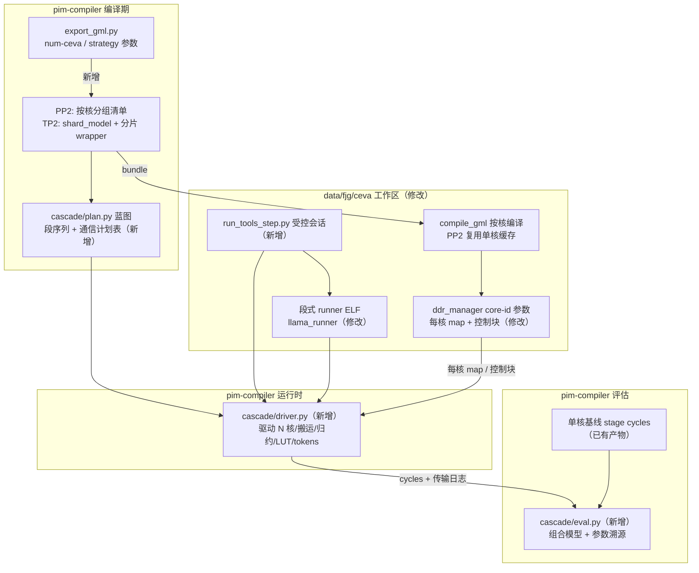

# 技术设计文档：多 CEVA 级联仿真与 Llama2 7B 全流程性能评估

> 文档编号：design-multi-ceva-cascade-20261114
> 创建日期：2026-11-14
> 关联需求文档：request-multi-ceva-cascade-20261114（docs/request-multi-ceva-cascade-20261114.md）
> 关联项目：flagos-pim-compiler（图编译器）、FlagTree（算子编译器，本期不改）、/data/fjg/ceva（CEVA 工作区）、genesim（参考，不改）

## 一、设计概述

### 1.1 需求背景回顾

　　单 CEVA 全流程已走通：65 张 GML（tp=1 完整单层）→ 厂商 GC → 单核 DDR 布局 → 单 TCS 仿真进程（1 个 NPM 核）→ stage 级 cycles 判定与 token 对拍。需求要求扩展到多 CEVA 级联（多进程形态，每进程 1 个 NPM 核），建立编排器（任务拆分、映射、内存分配、通信编排、并行调度）与组合评估模型（单核实测 cycles 之上叠加核间依赖、通信与并行代价），先 PP2 走通再 TP2 拿并行收益，调优链路本期不接。

### 1.2 设计目标

　　对应需求三大核心目标：其一，2 个 CEVA 仿真器进程级联走通 Llama2 7B 全流程并输出与单核基线严格一致的 tokens（PP2）；其二，在 pim-compiler 建立多核编排器，编译期产多核蓝图、运行时驱动两核并行执行；其三，建立组合评估模型，在单核实测数据基础上给出多核整体性能（偏差 ≤20%、方向正确、按核数参数化）。

### 1.3 设计范围

- 包含范围：多进程驱动底座、段式 runner、多核 DDR 布局、PP2/TP2 切分导出、编排器（蓝图+驱动）、一键入口与干跑、组合评估模型。
- 不包含范围：调优链路接入、4 核以上实测、张量 batch、厂商 GC/仿真器内核算法修改、`/home/jgfeng/ceva` 任何改动（只读）。

## 二、现状基线

　　为支撑多核级联，现有代码已具备单核全链路与关键接口原语，但编排、切分、多进程控制全部缺失。单核链路的调用链是：`run_full_pipeline.py:730-749` 的 `run_ceva` 调 `export_gml.py --ceva-reference --use-opcompiler` 产出 65 图 bundle，再调工作区 `run_all.sh --gml-bundle` 完成 GC、DDR 布局、仿真与判定。核心代码如下所示。

**导出侧（tp=1，无切分概念）**：`bundle_targets`（`gml_bridge/ceva.py:906-916`）枚举 32 prefill + 32 decode + 1 lm_head；`_stage_module`（`ceva.py:701-717`）每图恰好包一层（`model.model.layers[spec.layer_id]`），形状唯一来源是 `CompileSlots.from_config`（hidden=4096、heads=32、seq=1024）；权重 bin 由 `_weight_tensor`（`gml_bridge/export.py:1360-1380`）按参数张量自身形状落盘，切片后自动跟随；厂商对齐硬门禁 `align_to_vendor/check_fields`（`ceva.py:791-795`）要求逐节点与厂商同名图一致。`gml_bridge/sharding.py:79-120` 的 `local_shapes()` 已实现 ShardStrategy→本地宽度换算，但全仓零生产调用（接口已备、零接线）。

**仿真侧（单进程一次跑完）**：`run_tools.py:31-199` 用 ceva_budi 打开 1 个 controller 会话 + 4 个 VPU 会话，同步 `resume()` 阻塞到 app 结束。ceva_budi 的 `Target` 已暴露分步控制原语（`/home/jgfeng/ceva/Ceva-Toolbox/V26/CEVA-NeuProM/cevatools/bin/ceva_budi.py`）：`halt()/resume(is_async=False)/state()`（0=停 1=跑 3=错）、`read_mem(mem_space,addr,size)/write_mem(mem_space,addr,value)`（mem_space 1=数据、2=External I/O；`run_tools.py:27-29` 的 `write_mem_range` 只是定义了 space 2 写法、当前流程没有调用，运行中写入可见性仍需 M0 验证）、`set_wp/set_symbol_bp`。runner（`src/llama_runner/src/llama2_npm_app.cpp`，491 行）在 controller 上单体跑完 prompt→lm_head→argmax→decode 循环，段边界天然存在（run_prompt 后 L327、每次 run_decode 后 L400、每次 lm_head+argmax 后 L418-451），步间唯一数据是 embedding 行（LUT，L384/446），TIMER_read64 埋点齐（prompt/decode_i/lm_head_i/argmax_i/full_execution）。`ddr_manager`（`llama2_ddr_manager.py:587` 行）从 `START_ADDRESS=0x100000000`（L7）起单一游标顺序分配 prompt→decode→lm_head→inputs→outputs，无容量检查；`RUN_DIR/gmls` 前缀假设散布在 `compile_gml.py`（L89/L122/L132/L257）、`run_all.sh`（L86/L206）、`verify_run.py`（L213）四处。tokens 判定：`verify_run.py:42-48` 从 `run/argmax_results.bin`（小端 uint16）读，与 baseline 逐个比。

**编排与评估侧（无既有实现）**：genesim 编排器（`runtime/executor.py` 的 ExecutionPlan 命令表、`comm/plan.py` 的 CommSegment/五类通信）只在 genesim/NumpyBackend 路径使用、CEVA 路径没有调用方，可借鉴结构；多 DPU 整体评估代码不存在（`comm/plan.py:347-375` 的 `plan_cost` 仅单条目、测试消费）。

　　两处口径实证：其一，每核 DDR 上限——`Npm-vpu_npm-controller_Core_memDef.xml` 两段 DDR 合计约 3.79GiB（最大单区约 1.92GiB）、`NPMEngine.xml` 写 DDR 3983MB（约 3.7GiB），但单核实跑在 0x100000000 以上装载约 8.9GiB 成功，这些数字是 GC 硬件画像口径、不构成 TCS 装载上限；每核约 4.1~4.5GiB 虽低于单核已验证的 8.9GiB 装载量，但超过厂商 4GiB `core_id<<32` 窗口，因此全局布局步长不能用 4GiB，M0 需实测每进程装载上限。其二，频率——`cnnha_upd_b.cfg:15` `frequencyOfNPM=1250`（MHz），是评估模型 cycles→秒 的换算参数来源。

## 三、总体设计

### 3.1 总体设计概述

　　要解决的问题是把「一个仿真进程一次跑完一个完整模型」改造成「多个仿真进程按编排器的段计划交替/并行推进、host 在段间搬运数据」，并让编译器产出这份段计划、让评估模型消费执行记录。当前不足是：无多进程控制原语的封装、runner 无段式模式、DDR 布局单核硬编码、导出无切分概念、无整体性能归集。技术路线是「编译期蓝图 + 运行时段驱动 + 事后组合评估」三层解耦：编译期把策略翻译成确定性的段序列与搬运表（蓝图），运行时只机械执行蓝图并记录时间线，评估模型用同一套蓝图语义组合实测数据。关键子问题与方法如下表。

| 关键子问题 | 方法 |
|---|---|
| 跨进程分步驱动 | 每核一个受控仿真会话（ceva_budi `resume(is_async=True)`+`state()`+`read/write_mem`），DDR 控制块 + app 自旋轮询做段同步（借鉴 `npmc_app.cpp:588-592` 的 mailbox 轮询模板）；host 写命令、app 写完成标志 |
| PP2 切分 | 65 张单层图与 GC 产物完全复用，只按层分组生成每核 map（子集 + 按核基址），层边界 hidden 经 host 交接，lm_head+argmax 归末核 |
| TP2 切分 | 每层拆 attn/mlp 两段分片子图（归约点即图边界），o/down 行切部分和由 host 归约后回写两核；lm_head 列切、host 拼接后 argmax |
| 通信编排 | `CascadeTransfer` 计划表（字节/地址/触发段/类型），driver 执行时逐条记录实测时间线 |
| 整体评估 | 组合式关键路径模型：每核分段 busy cycles（实测或单核外推）+ 解析通信项 `λ+bytes/W`，按策略结构（PP 串行链 / TP 层同步 max）递推端到端 |

　　总体流程与各部分新增/修改/原有属性如图 1 所示。



图 1　多 CEVA 级联总体框架（实线为数据流）

　　图 1 中编译期产物（蓝图、每核 bundle、每核 map）全部落盘归档，运行时与评估只读这些产物，保证任何性能数字可追溯到运行目录。

### 3.2 与现有逻辑的衔接

　　接入点有三处。第一，导出入口：`export_gml.py` 的 `build_parser`（365-399 行）加 `--num-ceva`（默认 1）与 `--strategy`（`single|pp2|tp2`，默认 single），`_main_ceva`（501-517 行）把它们传给 `export_ceva_bundle`；single 时行为与现状逐字节一致。第二，全流程入口：`run_full_pipeline.py` 的 `run_ceva`（730-749 行）加同名参数，`num_ceva==1` 走现有 `run_all.sh` 路径不变，`>=2` 改调工作区新脚本 `run_cascade.sh`，干跑用 `--dry-run` 在布局与蓝图生成后止步。第三，工作区执行链：`run_cascade.sh` 复用 `01_env_check`，用扩展后的 `02_build_runner` 同时构建原 ELF 与 `Llama2StepRunner.elf`，按核循环调用 `compile_gml.py`（加 `--gmls-name`，PP2 两核指向同一 bundle 子集可全量复用单核 GC 缓存）与 `06_ddr_memory.sh`（透传 `--core-id/--cores/--strategy` 给 ddr_manager），再由 pim-compiler 的 driver 拉起 `run_tools_step.py` 会话执行；结束时调用 `check_orig.sh` 做第 7 步原始目录快照对比，`08_result.sh` 透传多核参数判定。数据流：蓝图给出每核段序列与控制块地址 → driver 写命令块 → 段式 runner 执行并在控制块回 cycles/token → driver 读结果、按通信计划把数据写入对端核 → 循环至 EOS 或步数上限 → driver 落盘 tokens 与每核计数 → `verify_run.py`（加 `--logs` 合并多核日志）判定 → `eval.py` 归集。

### 3.3 模块划分与职责边界

　　涉及三处代码：pim-compiler 新增 `cascade/` 包（`plan.py` 蓝图、`driver.py` 运行时、`eval.py` 评估，三者职责与 `comm/plan.py`+`comm/lowering.py` 的「计划/执行」拆分同构）；`gml_bridge/ceva.py` 扩展多核导出；`/data/fjg/ceva` 承担仿真侧适配（受控会话工具、段式 runner、ddr_manager 多核化、run_cascade 脚本、verify_run 多核日志）。边界约定：切分决策（哪层哪核、切多宽）只在 pim-compiler，工作区不重复表达策略；仿真控制原语（会话、读写、轮询）只在工作区，driver 通过子进程 JSON 行协议调用；tokens 与性能计数等权威产物一律由 host（driver）统一落盘，runner 只向控制块回写，避免多写者。FlagTree 与 genesim 本期零改动。

## 四、模块详细设计

　　整体问题按数据流拆为九个功能点：4.1-4.2 建驱动底座（R1），4.3 多核布局（R2），4.4-4.5 多核导出（R3），4.6-4.7 编排器（R4/R5），4.8 入口（R6），4.9 评估模型（R7）。

### 4.1 受控仿真会话与 DDR 控制块

　　编排器需要「写命令、等完成、搬数据」三个原语，而现有 `run_tools.py` 只会一次性同步跑完。新增 `/data/fjg/ceva/src/automation/run_tools_step.py`：单个 TCS 进程的常驻受控会话，stdin/stdout 按 JSON 行协议服务命令——`{"op":"write","space":2,"addr":A,"hex":".."}`、`{"op":"read",...}`、`{"op":"resume"}/{"op":"state"}`，大块数据走 `write_file/read_file` 文件通道（见下），内部即 ceva_budi 的 `write_mem/read_mem/resume(is_async=True)/state()`（`ceva_budi.py` L288-570 已验证存在），启动参数与 `run_tools.py:199-214` 的 `-tcs/-vpu/-n/-elf/-cmd` 相同但 ELF 换段式 runner。段同步用 DDR 控制块而非 halt：多核模式下每核 DDR 基址前 8KiB 保留给 64B 控制块（布局见下），app 自旋轮询 `go` 字段（模板抄 `npmc_app.cpp:588-592` 的 `while((status&0x2)==0){}` 改为读 DDR 字），host 写命令用 `write_mem(space=2)`、等完成轮询 `read_mem` 读 `done`。备选机制（控制块写不进运行中的仿真时）：`set_wp` 在 `go` 地址设写 watchpoint 停核、host 写后 `resume`——M0 探针两者都测，主选前者（不令断点、app 侧语义与厂商 mailbox 模式同构）。控制块 C 布局与 Python 侧镜像如下。

```c
struct ControlBlock {          /* ddr_manager 固定分配，每核一块，64B */
    volatile uint32_t go;      /* 0: host 写 1 启动一段，runner 执行前清零 */
    uint32_t cmd;              /* 4: 1=prompt_layers 2=decode_layers 3=lm_head 4=attn_shard 5=mlp_shard 6=head_shard */
    uint32_t layer_lo, layer_hi; /* 8,12 */
    uint64_t in_addr, out_addr;/* 16,24: 本段 hidden 输入/输出 DDR 地址（64 位） */
    uint32_t line_idx;         /* 32: decode 步序（cos/sin/mask 偏移索引） */
    volatile uint32_t done;    /* 36: runner 写 1，host 读后清零 */
    uint32_t cycles_lo, cycles_hi; /* 40,44: 本段 busy cycles（TIMER_read64 差值） */
    uint32_t token;            /* 48: cmd=3 时有效，argmax 结果（cmd=6 的 logits 走 out_addr） */
    uint32_t pad[3];           /* 52..63: 补足 64B */
};
_Static_assert(sizeof(struct ControlBlock) == 64, "control block must be 64B");
```

　　`in_addr/out_addr` 必须用 64 位：DDR 基址从 `0x100000000` 起，32 位装不下；C 侧用上表的固定偏移和 `_Static_assert`，Python 侧按 `<IIIIQQIIIIIIIII`（4×u32 + 2×u64 + 5×u32 + 3×u32 = 64B）镜像，两边偏移逐字段核对。prompt hidden 8MiB 等大块不走 JSON `hex` 字段（会变成 16MiB 字符串），改走 `{"op":"read_file","space":2,"addr":A,"size":N,"path":P}`/`{"op":"write_file",...}` 的文件通道，内部按 64KiB 分块调 `read_mem/write_mem`；控制块与 token 仍走 JSON 行协议。

### 4.2 段式 runner

　　现有 runner 在 controller 上单体跑完整个模型，无法接受段调度。改造 `llama2_npm_app.cpp` 增加段式模式（CMake 加目标 `Llama2StepRunner.elf`，与现有 ELF 共源码、`-DSTEPWISE=1` 区分，新目标复用现有 ELF 的 `XM`/TIMER 编译定义，否则 `#ifdef XM` 的 TIMER 埋点会被编译掉、控制块 cycles 恒为 0；现有 `Llama2Runner.elf` 构建路径不动）：保留 `readregIniFile/readInputsIniFile/readOutputsIniFile` 与 KV 向量组装（L232-292）、`setWeightsRegistry/initDevice`（L294-295）与三个 run 函数的层循环体，把 main 的 prompt→decode 大循环（L305-452）换成控制块驱动的外层循环——轮询 `go`，按 `cmd` 分发到「跑 `layer_lo..layer_hi` 的 prompt 子图」「跑 decode 子图（sin/cos/mask 按 `line_idx*4096*2` 偏移，沿用 L38-45）」「lm_head+argmax（结果写 `token`）」，每段用现有 TIMER 埋点法记 busy cycles 到控制块，段末置 `done`。层循环体直接复用 `run_prompt/run_decode/run_lm_head` 的逐层 `executeSubgraph` 与 hidden swap 逻辑（`llama2_npm.cpp:9-157`），仅把层范围与输入地址参数化。STEPWISE 下 `run_decode` 的 `embeddings` 参数改由控制块 `in_addr` 传入（host 已把 embedding 行写在首核输入区），不再调用 `LUT(embed_weights, token)`，`main` 里对 `embed_weights` 的存在性检查在 STEPWISE 模式移除。PP2 的 prompt 段输入/输出是 8MiB（1024×4096 fp16），decode 段是 8KiB（1×4096）；`out_addr` 按层数奇偶取 `run_prompt` swap 后的最终 hidden 缓冲，段末写回控制块。KV 向量按本核局部层号 0..N-1 组装，`cache_layers` 等于本核图数。本功能点对应 R1/R4，代码位于 `/data/fjg/ceva/src/llama_runner/`。

### 4.3 多核 DDR 布局与控制块分配

　　布局器需要为每核生成互不重叠的子图/输入/输出映射并预留控制块。`llama2_ddr_manager.py` 加四个 CLI 参数：`--cores K`（默认 1）、`--core-id N`（默认 0）、`--strategy single|pp2|tp2`、`--gmls-name`（默认 `gmls`）。行为：核 N 的起始地址 = `0x100000000 + N * CORE_STRIDE`，`CORE_STRIDE` 暂定 8GiB（每核约 4.1~4.5GiB 超过厂商 4GiB `core_id<<32` 窗口，4GiB 步长会让核 0 的数据压到核 1 基址；多进程下地址空间虽独立，全局账面无重叠仍按 8GiB 留够）；多核模式下 `[base, base+0x2000)` 整体保留给控制块（64B 控制块放在 `base+0x1000` 页内），数据游标从 `base+0x2000` 起；单核默认不保留、起始地址仍是 `base`，保证旧输出不变；控制块地址写入新产物 `control_map.ini`；pp2 下按 `--core-id` 过滤 prompt/decode 阶段的层子集（目录名 `model_layers_{i}_` 的 i 落在本核层段），模型初始 hidden 只进首核，lm_head 权重与末核的 hidden 交接缓冲只进末核（末核的 `hidden_states` 是 host 交接目标，不是初始输入文件），KV 条目按本核局部层号重编号为 `key_cache_0..N-1/value_cache_0..N-1`（runner 的 `v_key_cache[i]` 按 vector 位置索引，不能保留绝对层号 16..31；现有 `DECODES=32` 重复逻辑 L425-427 改为按本核层段重编号）；首核用 8KiB 的 `embedding_row` 缓冲替代 250MiB（262,144,000B）的 `embed_weights`，末核不装 embedding（LUT 移 host，见 4.6）；tp2 下两核各指向自己的 `gmls_core{N}` 目录（图不同、无缓存复用），KV/中间态/输出尺寸按分片图 IO 重新核，不能直接套 32 头全宽数值（head 输出每核 16000 fp16）。容量核对新增：分配结束后把最终游标与 `base + TCS_LIMIT` 比较，`TCS_LIMIT` 取 M0 实测的每进程装载上限（至少 8.9GiB），超限直接报错（现状无任何容量检查）。单核默认参数下输出与现状一致（起始地址、条目集合均不变）。本功能点对应 R2，代码位于 `/data/fjg/ceva/src/ddr_manager/llama2_ddr_manager.py:484-535`（主流程）与 `L425-427`（KV）。

### 4.4 PP2 分组导出

　　PP2 的切分只是「归属」而非「图结构」，65 张单层图与厂商对齐门禁全部复用。`export_ceva_bundle` 加 `strategy` 参数（默认 None=single）：pp2 时不改 targets 枚举与 `export_ceva_graph`（65 图照常导出、`bundle.json` schema 不变），只在 manifest 追加 `cascade` 节（`{"strategy":"pp2","num_cores":2,"core_layers":[[0,16],[16,32]],"lm_head_core":1}`），层段划分复用 `ShardStrategy.stage_of_layer` 的均分规则（`graph/strategy.py:78-88`）。清单校验与 `bundle_complete` 零改动（仍按 65 图口径）；GC 编译照旧一次全量（两核共用编译产物，`compile_gml.py` 加 `--gmls-name` 仅为 tp2 备用）。本功能点对应 R3（PP2 半），代码位于 `gml_bridge/ceva.py:1034-1088`。

### 4.5 TP2 分片导出

　　TP2 改变图结构：GML 的算子集没有归约算子（现有 65 图与厂商 GML 的 op 清单无 reduce/all_reduce），o/down 行切的部分和必须出图由 host 归约，因此每层拆两段；`sharding.py:10-18` 另外说明切分只通过形状表达、GML 没有切分/放置字段。`export_ceva_bundle` 的 tp2 路径：先 `shard_model(model, tp_width, core_id)`——新函数，在 `load_vendor_checkpoint`（`ceva.py:175-201`）之后对七个投影按 `local_shapes(strategy, ...)`（`sharding.py:79-120`）切片（q/k/v/gate/up 取列块、o/down 取行块、lm_head 列切块），每核导出 `AttnShardLayer`/`MlpShardLayer`/`HeadShardLayer` 三类新 wrapper（结构参照 `_LayerBody.project/finish` 拆开：attn 段含 RMSNorm1+q/k/v+SDPA+o_proj 行切，mlp 段含 RMSNorm2+gate/up+silu·mul+down 行切，head 段含 norm+列切投影），`slots` 按核 `dataclasses.replace(slots, heads=16)`；但 `slots.heads` 只影响 `_stage_module` 的样例输入与 `dq_layout` 的 KV 槽位，`_LayerBody.project` 里 `nh = hidden.shape[2] // head_dim`（4096/128=32）和 `finish` 里 `reshape(1, T, hidden.shape[2])` 仍按全宽算，新 `AttnShardLayer` 必须显式用 `local_heads=16` 和本地宽度 2048 做 q/k/v 的 `view` 与 o_proj 输入的 `reshape`，`MlpShardLayer` 同理用 `gate_out/up_out/down_in` 本地宽度，否则分片权重 2048 宽装不进 32×128 的 view（这是 TP2 导出最先会撞的错）。目标枚举变为每核 32×2 decode + 32×2 prefill + 1 head（共 129 图/核），输出 `out_dir/core{N}/` 各带标准 `bundle.json`；TP2 的 `targets` 要从 `(stage, layer_id)` 扩成 `(stage, layer_id, shard_kind)`，`bundle_subdir` 加 `_attn`/`_mlp` 目录后缀，`manifest["graphs"]` 的去重键加 `shard_kind`（否则同层两段会互相覆盖），`bundle_complete` 对 tp2 按每核 129 个 key 核对，PP2 的 65 图 schema 不变。分片图的 `CevaGraphSpec` 由新 `shard_ceva_spec(stage, layer_id, shard_kind, core_id, slots, local_shapes)` 构造，定义 attn/mlp/head 的 IO 名与形状（attn/mlp 输出 partial 按阶段：prefill 8MiB、decode 8KiB；KV 槽 16 头；head 输出 16000 fp16），`bind_boundaries`/`write_ceva_io_info` 消费同一 spec；不能沿用厂商 65 图的 spec。厂商对齐链路对分片图不适用：`export_ceva_graph` 加 `vendor_align=False` 分支，`vendor` 直接置空、不调用 `parse_vendor_graph`，并跳过 `align_to_vendor/check_fields/publish_vendor_labels`（这三步依赖厂商同名图）；`renumber_vendor_order/apply_vendor_conventions` 仍保留（只做编号与设备约定，不依赖参考图）。`verify_gml_artifact.py` 对 tp2 bundle 跳过所有依赖 vendor 节点的检查（含 bin 尺寸与参考一致，`1026-1041` 行），改为核间一致性检查（两核同位置图的结构化字段对称、宽度之和等于全宽）。bin 生成零改动（`_weight_tensor` 按切片后参数自动出本地形状）。本功能点对应 R3（TP2 半）+R5 导出侧，代码位于 `gml_bridge/ceva.py`（wrapper 与 bundle 流程）与 `scripts/verify_gml_artifact.py`。关键代码对比如下。

```python
# 原有（ceva.py:1051，单核槽位）
slots = CompileSlots.from_config(model.config, max_seq=1024)
# 目标（tp2 每核）
slots = dataclasses.replace(CompileSlots.from_config(model.config, max_seq=1024),
                            heads=num_heads // tp_width)
```

### 4.6 编排器蓝图与 PP2 驱动

　　编排器是核心新增，分编译期蓝图与运行时驱动两层。`cascade/plan.py` 定义三个 dataclass（`CascadeSegment`：seg_id/core_id/kind/layer 范围/出入地址；`CascadeTransfer`：xfer_id/源目的核/nbytes/源目的地址/kind（hidden_handoff、all_reduce、logits_gather、embedding、token）/after_seg 触发段；`CascadeBlueprint`：strategy/num_cores/每核基址/segments/transfers/control_addrs + `plan_text()` 可读文本）与 `from_bundle(bundle_path, maps_dir)` 构造器——从 bundle 的 cascade 节与每核 map.ini 推导段序列（PP2 每步：core0 段→hidden 交接→core1 段→lm_head 段→token 交接→embedding 回写）与搬运表（prompt hidden 8MiB、decode hidden 8KiB、token 2B、embedding 行 8192B）。`cascade/driver.py` 的 `run_pp2(blueprint, sessions, steps)`：循环执行段——写命令块（`write_mem`）、置 go、轮询 done（每 200ms `read_mem`）、读 cycles/token；hidden 交接用 `read_mem(space=2)` 从源核 out_addr 读——prompt 段 8MiB、decode 段 8KiB，大块走 4.1 的文件通道分块——再 `write_mem` 写对端 in_addr；LUT 在 host 做——从本机 `inputs/embed_weights.bin` 文件按 `token*8192` 切行（与设备读同一文件、逐字节一致），写入 core0 输入区；token 序列与每核分段 cycles 由 driver 统一落盘 `run/argmax_results.bin`（小端 uint16，`read_tokens` 即 `verify_run.py:42-48` 零改动）与 `run/performance_counters_core{N}.txt`（沿用 `stage: N cycles` 格式，stage 名带段号）；每次搬运记录 `(xfer_id, bytes, t_host)` 到 `run/transfer_log.jsonl`。PP2 数值链路 = 单核的逐层串行拆成两核 + host 搬运，中间无算术改动，tokens 应逐位等于单核基线。本功能点对应 R4，代码位于 pim-compiler 新增 `cascade/plan.py`、`cascade/driver.py`。

### 4.7 TP2 驱动与 host 归约

　　TP2 的两核在每个 decode 步内并行执行同层分片，prompt 阶段也按层跑 attn/mlp 两段分片（hidden 与部分和是 8MiB），归约点由 host 闭环。`run_tp2(blueprint, sessions, steps)` 的 decode 每层执行：并行下发 attn_shard 段到两核（各自命令块置 go）、双核都 done 后各读 8KiB 部分和（4096 个 fp16）、numpy 相加得 attn_out、与残差 x 相加得 x'、把 x' 写回两核 mlp 段输入区（每核 8KiB），mlp 段同理得下一层 x（每段一次 host 归约：读两核各 8KiB、写回两核各 8KiB）；prompt 阶段把同一流程的 hidden 和部分和换成 8MiB（1024×4096 fp16），首 token 的 head 段同样列切后拼接。decode 的 head 段后拼接两核各 16000 个 fp16 logits 成 32000 维、numpy argmax 得 token。归约与残差用 numpy fp16（`np.float16` 显式 dtype，保留 fp16 舍入；host 的两项相加顺序与设备单核的累加顺序不同），数值漂移由「前若干 token 一致」口径覆盖。并行时间线验收数据来自驱动记录：每段的 host 下发/完成时刻戳与控制块 busy cycles 落 `run/segment_timeline_core{N}.jsonl`，两核同层段执行区间重叠由该文件直接判读。本功能点对应 R5，代码位于 `cascade/driver.py`（与 4.6 同文件，预计合计超 400 行时按 pp/tp 拆子模块）。

### 4.8 全流程入口与干跑

　　把上述环节串成一条命令。`run_full_pipeline.py` 的 `parse_args` 加 `--num-ceva`（默认 1）与 `--strategy`（默认 single）；`run_ceva`（730-749 行）在 `num_ceva>=2` 时改调 `bash run_cascade.sh -n <run> --cores N --strategy S --steps K [--dry-run]`（工作区新脚本）：干跑模式顺序执行导出（带策略）→ `verify_gml_artifact` → 每核 `compile_gml`（pp2 复用单核缓存；tp2 只做命令/清单核对或复用已有缓存，冷启动 GC 不算干跑）→ 每核 ddr_manager → `cascade/plan.py` 蓝图生成与打印 → 终止（不启动仿真）；实跑模式续接 driver（经 `python -m cascade.driver`）→ `08_result.sh` 判定 → `python -m cascade.eval`。`scripts/run_ceva_pipeline.sh` 只透传新参数（18 行 exec 行不变语义）。本功能点对应 R6，代码位于 `scripts/run_full_pipeline.py`、`/data/fjg/ceva/run_cascade.sh`（新增）。

### 4.9 组合评估模型

　　评估模型回答「单核实测数据如何组合出多核整体结论」。`cascade/eval.py` 输入：每核 `performance_counters_core{N}.txt`（分段 busy cycles）、`transfer_log.jsonl`（实测字节数）、蓝图（段结构与计划字节）、`segment_timeline`（实测并行区间）；输出 `results/cascade_eval.json` 与可读文本——端到端总时间（秒，`cycles/1250MHz`，频率来源 `cnnha_upd_b.cfg:15` 写入参数溯源节）、tokens 吞吐、相对单核加速比、通信与依赖代价占比、逐核 busy/idle。组合公式按策略结构递推：PP2 为串行链 `T=Σ_step(T_c0_seg+T_xfer+T_c1_seg+T_xfer)`（prompt 步的 hidden 交接 8MiB、decode 步 8KiB，`bytes` 按蓝图取值）；TP2 为层内两段同步 `T=Σ_layer(max(T_attn_c0,T_attn_c1)+T_ar_attn+max(T_mlp_c0,T_mlp_c1)+T_ar_mlp)+T_head`，其中每次传输 `T_xfer=λ+bytes/W`（λ、W 为链路参数，初始 assumption 标注，后续用级联实测标定），`T_ar` 按阶段取字节：prompt 每段读两核各 8MiB、写回两核各 8MiB，decode 各 8KiB；另含 numpy fp16 相加与残差。两种运行模式：**实测模式**（输入用级联实测 cycles、实测传输时间与字节，给出该次运行的结构分解）与**预测模式**（输入用单核基线 stage 级 cycles 按层均分外推每核分段，TP2 再按 `ir_cost` 的 flops 比例外推分片宽度缩放，传输用 `T_xfer` 解析式，成熟度标 assumption）；验收判据用预测模式对实测端到端（driver 记录的从首段下发到末 token 的墙钟时间；实测模式合成总时间只作为结构分解，必须与墙钟闭合）的偏差 ≤20% 且方向正确（TP2 加速、PP2 串行代价如实），标定与验证用不同运行。本功能点对应 R7，代码位于 pim-compiler 新增 `cascade/eval.py`。

## 五、改动汇总

　　涉及两个改动仓库（pim-compiler、/data/fjg/ceva 工作区）与一个只读参考（/home/jgfeng/ceva），FlagTree 与 genesim 零改动；pim-compiler 新增 cascade 包三文件，gml_bridge 与脚本为扩展修改，工作区为适配修改。

### 5.1 文件级改动清单

| 文件路径 | 改动类型 | 改动内容简述 | 影响范围 | 优先级 |
|----------|----------|--------------|----------|--------|
| pim-compiler/cascade/__init__.py | 新增 | 包标记（`python -m cascade.driver` 需要） | 导入 | P0 |
| pim-compiler/cascade/plan.py | 新增 | 蓝图三 dataclass、from_bundle 构造、plan_text | driver/eval/干跑消费 | P0 |
| pim-compiler/cascade/driver.py | 新增 | PP2/TP2 驱动、控制块协议、LUT/归约、产物落盘 | 依赖 plan 与 run_tools_step | P0（PP2）/P1（TP2） |
| pim-compiler/cascade/eval.py | 新增 | 组合模型、预测/实测双模式、参数溯源 | 消费 run 产物 | P0 |
| pim-compiler/gml_bridge/ceva.py | 修改 | export_ceva_bundle 加 strategy；tp2 的 shard_model/三类分片 wrapper/vendor_align=False 分支；pp2 的 cascade 节 | 导出链；single 路径逐字节不变 | P0 |
| pim-compiler/scripts/verify_gml_artifact.py | 修改 | tp2 bundle 跳过依赖 vendor 节点的检查、加核间一致性检查 | 仅 tp2 分支 | P1 |
| pim-compiler/scripts/export_gml.py | 修改 | --num-ceva/--strategy 透传 | 入口 | P0 |
| pim-compiler/scripts/run_full_pipeline.py | 修改 | run_ceva 分派多核路径、--dry-run 透传 | 入口；num-ceva=1 行为不变 | P0 |
| pim-compiler/scripts/run_ceva_pipeline.sh | 修改 | 透传新参数（"$@" 已透传则零改动，核对） | 入口 | P0 |
| /data/fjg/ceva/src/automation/run_tools_step.py | 新增 | 受控会话（JSON 行协议 + 大块文件通道：write/read/write_file/read_file/state/resume） | driver 的唯一仿真控制通道 | P0 |
| /data/fjg/ceva/src/llama_runner/（app/cpp+CMake） | 修改 | STEPWISE 模式与 Llama2StepRunner.elf；控制块循环、段分发、cycles/token 回写 | 现有 ELF 构建不动 | P0 |
| /data/fjg/ceva/src/ddr_manager/llama2_ddr_manager.py | 修改 | --cores/--core-id/--strategy/--gmls-name；按核基址与层过滤；控制块保留与 control_map.ini；首核 embedding_row 替代 embed_weights；TP2 尺寸按分片 IO；容量核对 | 单核默认输出不变 | P0 |
| /data/fjg/ceva/scripts/compile_gml.py | 修改 | --gmls-name 参数化四处 gmls 前缀 | 默认 gmls 不变 | P1 |
| /data/fjg/ceva/scripts/06_ddr_memory.sh | 修改 | 透传 --cores/--core-id/--strategy 与每核输出目录 | 默认单核不变 | P0 |
| /data/fjg/ceva/scripts/08_result.sh | 修改 | 透传 --logs/--cores，合并多核 counter 后判定 | 默认单核不变 | P0 |
| /data/fjg/ceva/scripts/02_build_runner.sh | 修改 | 构建 Llama2StepRunner.elf（CMake 新目标） | 原 ELF 构建不动 | P0 |
| /data/fjg/ceva/run_cascade.sh | 新增 | 多核全流程编排（复用 01/02，按核 04/06，driver，08，末尾 check_orig 快照） | 新入口，run_all.sh 不动 | P0 |
| /data/fjg/ceva/scripts/verify_run.py | 修改 | --logs/--cores 合并多核 run.log、performance_counters、inputs_map 的 token 与性能检查 | 默认单核行为不变 | P1 |

### 5.2 新增/修改的数据结构

　　`CascadeSegment(seg_id, core_id, kind, layer_lo, layer_hi, in_addrs, out_addrs)`、`CascadeTransfer(xfer_id, src_core, dst_core, nbytes, src_addr, dst_addr, kind, after_seg)`、`CascadeBlueprint(strategy, num_cores, core_base_addrs, segments, transfers, control_addrs)` 均为 frozen dataclass；地址字段一律 Python int（对应 C 侧 uint64_t），`core_base_addrs` 按 `0x100000000 + N*8GiB` 给出每核基址。`ControlBlock` 为 C struct/Python struct 镜像（布局见 4.1，`go/done` 语义：host 写 1 启动、runner 清零，缺省全零等价「无段待执行」）。`bundle.json` 的 `cascade` 节为可选键，缺失即单核行为（等价改动前）。

### 5.3 接口变更

　　`export_ceva_bundle(model, reference_root, out_dir, targets, *, use_opcompiler, strategy=None)`（新 kwarg 默认 None=旧行为；`targets` 元素 single/pp2 为 `(stage, layer_id)`、tp2 为 `(stage, layer_id, shard_kind)`）；`ddr_manager` 与 `compile_gml` 新 CLI 参数均有默认值等于旧行为；`run_tools_step.py` 为全新进程接口无兼容问题；`verify_run.py --logs` 缺省走原单日志路径。

## 六、实施计划

### 6.1 阶段划分与依赖

　　M0 探针（约 2 天）：单层图双进程——验证 `write_mem(space=2)` 运行中写 64B 控制块（`uint64_t` 地址字段）、`read_mem` 读 app 写回的 done/cycles、段式 runner 最小循环、8MiB prompt hidden 与 8KiB decode hidden 的跨进程搬运（走文件通道分块）、4.5GiB 级装载与每进程 TCS 上限、8GiB 核间步长；产出机制选型结论（控制块 vs watchpoint 备选）。M1 PP2 全链路（约 1 周）：4.3/4.4/4.6/4.8 + 段式 runner 完整化，跑通 2 CEVA PP2 出 tokens。M2 TP2（约 1.5 周，前置 M1）：4.5/4.7，先单图过 GC 探路（attn 分片 decode 图 1 张 + prefill 图 1 张测时长/磁盘），再全量导出与驱动。M3 评估（约 3 天，可与 M2 并行开发）：4.9，用 M1 运行做实测模式、M2 运行做预测验证。

### 6.2 每阶段的回归门槛

　　每阶段合入前：`python -m pytest tests/ -x -q -k "not llama2_7b"` 全绿（基线 2145 通过/1 已知抖动/9 跳过，抖动单跑通过不计回归）；`export_gml.py` 无参数路径与 `run_full_pipeline.py --backend ceva --num-ceva 1` 干跑输出与改动前一致（bundle 逐字节比对）；工作区 `check_orig` 快照对比干净。M1 里程碑加跑 2 CEVA PP2 实测（约 7h+GC）；M2 加跑 TP2 实测与 `llama2_7b` 慢用例（约 2.5h）。

## 七、验证与测试方案

　　验证分四层：单元测试（纯函数，pytest 秒级）、集成干跑（不启仿真，数十分钟）、端到端实测（小时级，里程碑执行）、性能判据（评估模型专项）。

### 7.1 单元测试清单

　　`tests/test_cascade_plan.py`：`from_bundle` 对 pp2 bundle 产出段数 = 步数×(2 层段+head 段) 与交接表字节数（prompt hidden 8MiB、decode hidden 8KiB、token 2B、embedding 行 8KiB）；tp2 蓝图每层 2 段 2 归约（decode 各读两核 8KiB、写回两核 8KiB；prompt 各读两核 8MiB、写回两核 8MiB）；`plan_text()` 可打印；`ControlBlock` 为 64B、`in_addr/out_addr` 为 64 位且偏移与 Python 镜像一致（round-trip 一个 0x100000000 以上的地址）。`tests/test_ceva_export.py` 扩展：pp2 的 cascade 节层段均分且 lm_head 归末核；tp2 的 `shard_model` 切片形状等于 `local_shapes`（q/k/v 出维 2048、o 入维 2048、lm_head 出维 16000）、`slots.heads==16`，且 attn shard 能导出成功、q/k/v 的 view 为 `[1,T,16,128]`、o_proj 输入 reshape 为 `[1,T,2048]`（防 `slots.heads` 与 wrapper 本地头数脱节）。`tests/test_ddr_multi.py`（工作区 pytest）：两核 map 同名条目地址区间不相交、控制块落在保留页、容量超限报错、单核默认输出与旧输出一致。`tests/test_cascade_eval.py`：PP2 串行链公式手推值断言（给定 3 段 cycles 与 2 次搬运的算例）；TP2 层内两段 `max+allreduce`（attn/mlp 各 8KiB 读 + 8KiB 写回）断言；预测模式对合成数据的偏差计算。

### 7.2 集成验证

　　`run_cascade.sh --dry-run`（pp2 与 tp2 各一次）：退出码 0 且产物齐全（每核 map.ini、control_map.ini、蓝图文本、compile_manifest）、GC 缓存复用率 100% 的可达口径为「同一 run 目录重复执行（65 图全部 `already_compiled`）或 `--cache-from` 指向输入摘要与 GC 环境一致的既有 run（全部经只读复制复用）」；全新 run 目录是冷编译，不作为干跑判据（依据见 §8 第 9 条）。布局无重叠（复用 7.1 的核对函数跑在产物上）。driver 的控制块协议用 mock 会话（本地 echo 进程）回归：段下发→done→cycles 读取→搬运记录全链 JSON 落盘。

### 7.3 验收标准

　　对应需求第五节：R1 双进程并行驱动与跨核搬运演示（M0 产物）；R2 两核 map 无重叠+容量核对；R3 pp2 bundle 过清单校验、tp2 每核子图过 GC；R4 PP2 tokens 与 ours_e2e 基线 11 token 逐个严格一致；R5 TP2 tokens 前 ≥4 一致且 `segment_timeline` 两核同层区间重叠；R6 一条命令出判定报告、单核路径回归不变；R7 预测模式对实测端到端偏差 ≤20%、TP2 方向加速、参数溯源落盘。无效验收情形沿用需求定义（假并行、不可溯源、自标定自验证）。

## 八、对需求文档的修正记录

1. 需求待确认 1（每核 DDR 上限）→ 实测修正：`Npm-vpu_npm-controller_Core_memDef.xml` 两段 DDR 合计约 3.79GiB（最大单区约 1.92GiB）、`NPMEngine.xml` 写 3983MB（约 3.7GiB），但单核实跑装载约 8.9GiB 成功——这些数字属 GC 画像口径而非 TCS 装载上限；每核约 4.1~4.5GiB 虽低于单核已验证的 8.9GiB 装载量，但超过厂商 4GiB `core_id<<32` 窗口，全局布局步长改为 8GiB，容量按 M0 实测的每进程装载上限核对（不再用 `(N+1)<<32` 的 4GiB 窗口）。M0 仍做装载确认。
2. 需求待确认 4（评估口径）→ 设计钉死：端到端总时间（秒）口径，频率取 `cnnha_upd_b.cfg:15` 的 `frequencyOfNPM=1250` 并写入参数溯源；加速比与偏差比例不受频率绝对值影响。
3. 需求 R2「地址空间无重叠」→ 设计明确为双保险：多进程地址空间本就独立；全局账面无重叠按 `N*8GiB` 平移（每核 4.1~4.5GiB 超过厂商 4GiB 窗口，不能用 `N<<32`），容量按 M0 实测的每进程上限核对。
4. 需求 R3「行切投影后标注归约点」→ 具体化为「每层拆 attn/mlp 两段子图、归约点即图边界、host 归约」，依据是 GML 的算子集无 reduce/all_reduce（现有 65 图 op 清单），且 `sharding.py:10-18` 说明切分只通过形状表达。
5. 设计 4.2 的 KV 快照口径修正（2026-11-17 实测）：缓存张量是 **int8 `1×32×1024×128`**（GML `IO_info.txt`：`dtype=int8, size=4194304`），头部块 128KB 但行步是 **128B**，不是原设想的 fp16 512 行（256B）。按错误口径做跨进程恢复会让 decode 的 KV 全部错位（prompt token 正确、decode token 全错）；正确实现见实施文档 16.1/16.2。
6. 需求 R2/设计 4.3 的「全局账面无重叠、按 8GiB 步长分核」修正（2026-11-17 M0 与 pp2_v3 实测）：多进程路线下每个 TCS 进程地址空间完全独立，**核间必须同基址**（`0x100000000`；分核偏移会在对端进程实测 12GB+ 地址时崩溃），pp2_v3 两核 control 均为 `0x100001000`。原「两核 map.ini 地址空间无重叠」的字面判据按现口径无法满足，R2 验收改写为「**每核产物落在各自 TCS 装载窗口内（上限 9GiB，M0 实测）且进程间无地址依赖**」；同基址的适用条件是每进程 1 核，若回到单进程多核则仍需 `core_id<<32` 隔离。
7. 设计 5.1 的 `verify_run.py`/`08_result.sh` 多核日志合并项修正（2026-11-17 实施决策）：改为独立脚本 `/data/fjg/ceva/scripts/verify_cascade.py`——级联产物没有设备 run.log/run_info.txt（host 驱动器是唯一权威写者），检查面收敛为 tokens 语义 + baseline 对拍 + 每核性能归集；不复用 verify_run 是为了避免动单核判定路径（单核行为零回归的约束优先）。verdict 格式与 verify_run 兼容，全流程入口解析不受影响。
8. 设计 4.1/4.2 的段同步机制修正（2026-11-14~17 M0 实测）：DDR 控制块轮询方案不成立——`setExternalMemoryBaseAddress` 手动写不入 DDR、`loadBinMapToMemory` 会清零控制块区域；实际机制是**命令经 argv 传入、一段一个完整 app 执行（load→execute→return=EndOfExecution）**，host 用同步 resume 的墙钟与 app 写出的 `stepwise_output.bin`/`stepwise_cycles.txt` 取结果（详见实施文档第十一、十六节）。TP2 运行时同口径（2026-11-18 实现：cmd=4/5/6 分片段 + 按层 KV 快照 + 两核进程并行下发，见实施文档第八节修复记录）。
9. 设计 3.2/4.8/7.2 的「PP2 复用单核 GC 缓存、干跑 65 图全部 already_compiled」口径修正（2026-11-18 round03 实测与登记）：原播种方案（软链复用 ours_e2e 的 gmls）会让 `compile_gml` 的清单维护写穿软链污染归档 manifest，已撤回；GC 缓存清单以 run 目录为键（`run_key` 含 run_dir、`already_compiled` 只查本 run 的 gmls），跨 run 天然不共享，全新 run 目录必然冷编译（runs/pp2_r6/logs/04_gc.log 实测零 already 命中）。修正后的复用机制是 `compile_gml --cache-from <run>`（run_cascade.sh 透传同名参数，run 名自动解析到 runs/<名>）：源清单同图条目的输入摘要与 GC 环境一致、源 Registry 摘要相符时**复制**（非软链，源 run 只读不受写穿）Registry 产物进本 run 并在清单登记 `cache_from` 溯源，不一致的图自动回退冷编译；7.2 的干跑判据相应改写为「同 run 重跑或 `--cache-from` 全量命中」。同条登记：设计 5.1 列的 `06_ddr_memory.sh` 透传项不实施——该脚本是 run_all.sh 单核链路的包装，多核参数由 run_cascade.sh 直接传给 `llama2_ddr_manager.py`（行为等价、少一层无谓转发），单核链路不受影响。

## 九、待确认事项

1. `write_mem` 对运行中仿真的外部 DDR 实时可见性（控制块主选机制的前提）：M0 探针判定；不可行则切 watchpoint 备选，不影响其余设计。M0 同时定量每进程 TCS 装载上限（单核 8.9GiB 已成功，每核 4.1~4.5GiB 需确认）和 8MiB prompt hidden 的搬运耗时（JSON hex 改文件通道后）。
2. TP2 分片图的 GC 成本与兼容性（尤其 prefill 分片图的历史级 15-17G 中间态）：M2 前置单图探针实测；若磁盘/时长超界，按「decode 分片先行、prefill 分片排期」降级并与用户确认。
3. TP2 tokens「前若干一致」的具体数量（建议 ≥4）：TP2 首跑后按实际漂移定稿。
4. 预测模式的单核分项来源粒度（stage 级均分 vs standalone 单层实测）：M3 时按 ≤20% 判据的达成情况选择，选择写入评估输出的溯源节。
5. 段式 runner 的 app 侧自旋对仿真速度的影响（busy-wait 是否显著拖慢整体墙钟）：M0 顺带测量，若影响大改中断等待（mailbox watermark 机制）。
