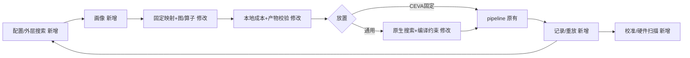

# 技术设计文档：PIM 编译调优全流程闭环

> 文档编号：design-tune-loop-20261109
> 创建日期：2026-11-09；本次修订：2026-11-09
> 关联需求文档：[request-tune-loop-20261109.md](request-tune-loop-20261109.md)
> 关联项目：flagos-pim-compiler（G）、genesim（S）、FlagTree（F）
> 状态：代码核查后的实施设计，尚未实现或完成端到端验收。R7 的独立观测与合格阈值仍待提供。

## 一、设计概述

### 1.1 需求背景回顾

　　已有PIM AI编译框架和单次GeneSim链路，尚未走通“搜索→图编译→算子编译→仿真→性能→迭代”。需要统一软硬件参数，并为厂商提供可追溯的配置比较。

### 1.2 设计目标

　　真实运行外层图/算子/硬件候选及通用PIM原生放置搜索，保证各阶段同画像、同编译产物，输出可重放性能。以独立证据验证准确性，提供轮数、时间、策略范围配置及示例。

| 原始目标 | 需求/优先级 | 落点 |
| --- | --- | --- |
| 1 闭环 | R6/P0 | §4.7～4.8 |
| 2 策略覆盖/硬件建议 | R2/P0、R8/P1 | §4.2～4.3、4.10 |
| 3 图/算子支持优化 | R3～R4/P0 | §4.4～4.5 |
| 4、6 编译与PIM/CEVA一致 | R5/P0 | §4.6 |
| 5 准确通用 | R7/P0 | §4.9；实测未齐备不关闭 |
| 7 配置/示例 | R1/P0、R9/P1 | §4.1、4.11 |

### 1.3 设计范围

- 包含范围：Llama2-7B/小模型、通用PIM/CEVA64/128核、分层搜索、缓存续跑/重放、校准接入、硬件分析。
- 不包含范围：新模型/算子/pass、多节点、张量批处理、功耗/面积、预测器训练/界面；CEVA engine调度、W4A8和混合精度遗留问题继续披露。

## 二、现状基线

　　已有单次编译/仿真和通用搜索，缺少外层循环与编译约束。本轮是文件核查，未重跑长测试。核心代码如下所示；G/S/F为文首仓库简称。

| 位置 | 当前事实与缺口 |
| --- | --- |
| G scripts/run_full_pipeline.py:118,181,815 | 共享目录，A2仅fusion-from |
| G scripts/export_pp_placement.py:49,175 | 硬编码tasklet/预算、prefill16/max_seq64 |
| G runtime/compile.py:296、exec_plan_gen.py:384 | 有统一编译入口，但默认tasklet4阻断搜索 |
| G genesim_bridge/placement_export.py:286；cost_extractor.py:665 | B路未传硬件；精化末尾回写吸收列表 |
| G opcompiler_bridge/driver.py:118,950 | 指纹漏源码、工具仅size/mtime；force未贯通 |
| S src/autotune/placement.py:595,727,1311 | 八移动，能力检查/物化缺编译约束 |
| S src/scheduler/gene_sim_scheduler.py:4102,7022,7817 | TP展开/通信补边，最终验证另计 |
| S scripts/calibrate.py:1436 | DMA未使用留出，拟合不能替代端到端验证 |

　　已有关键契约保持字段兼容：

```python
@dataclass(frozen=True)
class PIMHardwareConfig:
    num_dpus: int; num_tasklets: int
    mram_bytes_per_dpu: int; wram_bytes_per_dpu: int; dma_align: int

@dataclass(frozen=True)
class HwBudget:
    mram_bytes: int; align: int; sys_reserve_bytes: int

@dataclass(frozen=True)
class PartitionPlan:
    num_dpus: int; num_stages: int
    weight_rules: tuple[tuple[str, Literal["col", "row"]], ...] = ()
    dpu_ids: tuple[int, ...] | None = None
    dpu_to_cluster: tuple[tuple[int, int], ...] | None = None
    source: str = ""
    model_id: str = ""
```

　　placement已有分片/本地形状/融合/内核字段（G placement_export.py:590）；CEVA禁止autotune但允许部分核（S config_loader.py:2012、export_fixed_pu_mapping.py:249）。已读取资源目录的`GeneSim 详细设计-2026.9.3.docx`，§3.3/4.6仍描述退火，策略清单以当前代码为准。代价模型文档中区间倍率/HOST开销“固定”的说法已过时，S config_loader.py:1871、backend/comm_lib.py:214已有配置读取。

## 三、总体设计

### 3.1 总体设计概述(包含总体流程图或者框架图)

　　采用外层离散候选TuneState(strategy,op,profile)与可选内层放置搜索。外层真实编译并最小化pipeline总时延；小空间枚举，大空间复用SA/GA/Tabu。HardwareProfile统一参数，编译/仿真内容键隔离产物，内层约束分片/融合/通信，最终映射可重放。计时仍用指令周期、链路服务/排队和事件流水，准确性另由独立证据判断。



### 3.2 与现有逻辑的衔接

　　从export_pp_placement.main抽出候选导出，继续调用compile_llama2。模型加载复用，step_a_model_ir新增可选输出路径；精化同时传placement/fusion-from。顺序为输入快照→计划/编译→成本与吸收回填→原子发布→配置核验→放置/仿真→记录。旧单次CLI默认值不变。

```bash
# 以下均为待实现入口
python scripts/tune_pipeline.py --config examples/tune/quick.yaml
python scripts/tune_pipeline.py --config examples/tune/strategy.yaml --resume
python scripts/tune_pipeline.py --evaluate-candidate test-results/tune-quick/best.json --cache-mode strict
python scripts/tune_sweep.py --config examples/tune/hardware_sweep.yaml --best test-results/tune-quick/best.json
```

### 3.3 模块划分与职责边界

　　G contracts负责画像；tune的config/candidate/steps/loop/report依次负责解析、搜索协议/键、候选执行、预算续跑、结果，校准/扫描各一文件。S负责生效配置、编译放置约束、通信物化和映射重放，复用算法与成熟度。F复用现有pass，仅回归；不新建插件/注册框架。

## 四、模块详细设计

　　配置/画像生成候选，图/算子同预算编译，成本回填后冻结；GeneSim在固定分片/内核上搜索合法映射，外层记录最终pipeline指标供报告/校准/扫描复用。

### 4.1 统一调优配置与命令行

　　新增 `load_config(path, overrides) -> TuneConfig`，使用冻结 dataclass 与现有 PyYAML。R1 的 CLI 提供 `--config/--max-evaluations/--max-time-s/--algorithm/--profile/--cache-mode/--dry-run/--resume/--output-dir`；另提供单候选和序列重放入口，三种运行方式互斥。合并覆盖后写 `effective_config.yaml`，未知键、非法算法参数、布尔冒充整数、非有限数、空范围在编译前报错。

```yaml
version: 1
run_name: quick
model:
  model_dir: null
  ir: null
  prefill_seq_len: 128
  max_seq: null
  trace: {path: null, num_requests: 1,
          synthetic: {seed: 0, num_requests: 10}}
profile: {path: "../../contracts/profiles/ceva_64core_4e.json"}
space:
  strategy: {enabled: true, num_dpus: [8], num_stages: [2, 4]}
  op: {enabled: true, num_tasklets: [4]}
  hardware: {enabled: false, fields: {}}
placement:
  enabled: false
  algorithm: simulated_annealing
  evaluation_backend: pipeline
  validation_backend: pipeline
  objective_metric: total_time_s
  objective_weights: {compute: 0.5, communication: 0.25, memory: 0.25}
  max_evaluations: 2
  max_time_s: 0
  max_proposals: null
  seed: 0
  moves: {max_segment_ops: 8, max_layer_block_layers: 4, weights: {}}
  algorithm_params: {}
search:
  algorithm: enumerate
  seed: 0
  max_evaluations: 2
  max_time_s: 0
  max_proposals: null
  layer_weights: {strategy: 0.4, op: 0.4, hardware: 0.2}
  algorithm_params: {}
cache: {mode: fast}
simulation: {use_cost_sidecar: false}
calibration: {validation_report: null}
sweep:
  fields: {}
  core_policy: fixed_dpus
  knee_improvement_threshold: 0.05
  pareto: {resource: total_physical_memory_bytes, direction: minimize}
output: {dir: "../../test-results/tune-quick"}
```

　　所有用户路径相对 YAML 所在目录解析；画像内的基配置路径相对画像文件。`model_dir=null` 使用 `paths.json`，`ir=null` 从该模型生成快照，不能使用与模型身份不明的默认 IR。trace.path 与 synthetic 二选一；已有 trace 只取前 num_requests 条，生成轨迹也先保存再取观测窗口。`max_seq=null` 由所选请求完整上下文上界推导，显式值不足即拒绝；prefill 长度必须覆盖所选请求的提示长度。上述形状和请求快照入内容键。

　　关闭某层表示冻结该层，配置必须只含一个值；未列出的硬件字段继承画像。范围先支持显式离散列表；连续区间由用户给出采样点，不增加隐含采样策略。dry-run 只检查输入、列合法组合/计数及拒绝原因，不加载 7B 权重、不编译或仿真。

```python
# 原有：多个 CLI 与环境变量分别确定参数
# 目标：一次解析后只有一个生效对象
cfg = load_config(args.config, cli_overrides(args))
inputs = snapshot_inputs(cfg.model)
validate_workload_bounds(cfg.model, inputs.trace)
write_effective_config(cfg, inputs)
```

### 4.2 硬件画像单一真源

　　R2/R5由画像派生PIMHardwareConfig、HwBudget、固定映射和GeneSim覆盖值。容量为整数字节，GiB仅在边界除以2**30；逻辑DPU对应ClusterPU。通用多TensorPU仍按floor(cluster_bytes/tensors_per_cluster)核验单PU容量，不能重复使用全簇预算。

| 画像字段 | 消费位置 | 键 |
| --- | --- | --- |
| num_pim_devices/clusters_per_device/tensors_per_cluster | system设备数、pim层级；DPU≤总簇数 | compile+sim |
| cluster_memory_bytes/sys_reserve_bytes | HwBudget物理/预留、编译MRAM、pim.cluster_memory_capacity_gb、CEVA local_memory_bytes/sys_reserve_bytes | compile+sim |
| wram_bytes_per_dpu/dma_align/compiler_target | 编译预算/HwBudget.align；target固定pim:v1，与pim_type不同 | compile+sim |
| clock_period_ns/multipliers/cycle_costs/zone_cycle_factors | pim时钟、tensor_pu_config.multipliers、pim_trace_cycle_costs、zone_cycle_factors | sim |
| tile_size/mac_width/chunk_size/max_bulk_transfer_bytes/bytes_per_element/use_long_loop_counts | pim.compile对应项，影响轨迹生成/绑定 | sim |
| links/host_relay_overhead_ns/inter_cluster_communication | comm_config链路/中转、pim通信模式 | sim |
| cpu_model/ceva/parameter_sources | 对应段及ceva.parameter_sources | sim；资源变更也改compile |

　　bytes_per_element须匹配模型dtype，不能独立搜索精度；模板块不覆盖实际内核块。adders、latency_hiding、comm_overlap及运行形状旧开关无实际读取，不开放。CEVA单设备、64/128核、每簇一TensorPU，允许部分核；engine不等于tasklet。三份基线分别取S conf/sim.yaml、ceva_64core_4e.yaml、ceva_128core_4e.yaml，假设来源不升级。

　　编译字段摘要compile_profile_sha256写placement；完整profile_sha256写仿真manifest/契约。时钟扫描只核对sidecar编译字段相等，不要求完整画像相等。基配置内容、来源另入sim_key，路径/时间戳不入语义键。

```python
# 原有：分开写死预算；目标：共同派生
hardware = profile.to_pim_hardware_config(strategy.num_dpus, op.num_tasklets)
hw = profile.to_hw_budget()
assert hw.mram_bytes == hardware.mram_bytes_per_dpu
assert hw.align == hardware.dma_align
```

### 4.3 分层候选空间与原生策略覆盖

　　R2的CandidateSpace实现S src/autotune/api.py：initial_state属性、key(state)、propose(state,rng)/recombine(a,b,rng)→Proposal或None。用G llama_strategy()检查层数/头数/TP，再查硬件幂次、容量和资源。枚举按数值元组排序；邻居一次改一字段，启用层权重归一化；交叉不合法即拒绝。full_m/n/k由形状派生，WRAM只在硬件层定义。

　　外层复用create_search_algorithm和AutotuneRunner；enumerate共享Objective与预算。内层把§4.1 placement全部字段映射autotune，algorithm_params进入algorithms.<algorithm>；时延方向minimize、效率maximize，显式覆盖基配置。效率仅允许pipeline/pipeline。

　　八类移动固定为op_relocate、op_swap、connected_segment_relocate、attention_branch_relocate、kv_group_pack_or_spread、layer_block_relocate、layer_boundary_shift、pim_rebalance_or_swap。逐类测试提案，日志含类型/合法性/真实评估数；非零权重不代表实际覆盖。

```python
# 原有：入口只构造PlacementState；目标：外层状态也实现相同协议
@dataclass(frozen=True)
class TuneState:
    strategy: StrategyChoice
    op: OpKnobs
    profile: HardwareProfile
```

### 4.4 图编译步骤复用与候选导出

　　R3从G export_pp_placement.py:126抽出导出函数，仍调compile_llama2。先用候选画像生成实际PartitionPlan，再构造策略；不能事后补未使用的计划。旧main保留原默认值。

　　临时目录的placement新增compiler{strategy,hardware,compile_profile_sha256,physical_mram_bytes,reserved_mram_bytes,usable_mram_bytes}。成本精化回填absorbed_ops后归档内核、重写路径、算哈希/校验，写artifacts.json再原子重命名整个目录。发布后只读；失败目录不可命中。

```python
# 原有：main内固定prefill16/max_seq64并写共享目录
# 目标：候选注入；返回PlacementExportResult
export_placement_for_strategy(model, ir_path, out_dir,
    strategy=strategy, plan=plan, hw=hw, hardware=hardware,
    prefill_seq_len=prefill, max_seq=max_seq, profile=profile,
    force_compile=strict)
# 新函数默认参数：profile=None、force_compile=False；
# prefill_seq_len/max_seq必填。精化和回填之后才发布目录。
```

### 4.5 算子编译参数、形状与成本精化

　　R4先修G runtime/compile.py:296两处调用，传hardware.num_tasklets。OpCompileRequest.num_tasklets改int|None=None，取硬件值；显式不一致报错，旧导出的4保持不变。

　　A路linear用flatten_leading_dims得到M/K，权重(N,K)得到N，校验K一致。a_path_passes新增full_m/n/k，只修改-pim-tile-to-budget（F Passes.td:167），不是convert；全为-1保留原字符串。缓存复用arg_shapes，无需重复字段。

　　B路除driver还须修_attach_bpath_pimir→_bpath_pimir，把hardware送入with_budget和降级；独立缓存包含文本、硬件、target、pass和工具内容。target固定并校验pim:v1。成本export_costs_to_genesim→capture_kernels/run_and_capture→lower_ttir/oplevel_to_pimir统一传硬件，DMA过滤也不再读全局配置。

　　S refine_ir_with_flagtree.py新增--profile/--force-compile，调优同时传placement/fusion-from，核对sidecar硬件并按本地形状精化。旧无画像命令不变，实际pimir/oplevel档位入键。成本sidecar覆盖默认关闭，启用时文件/开关入sim_key；代表性最大访存不等于逐阶段流量。

　　strict将force_compile贯穿图测量、placement A/B和成本，落到compile_op(force=True)，B独立缓存也重编。driver._compiler_fingerprint改内容摘要，覆盖driver/pipeline/mlir_layout/内核源码和实际编译/翻译/链接工具；禁止仅size/mtime。已加载旧库不能靠刷新摘要冒充新工具，工具变化须新进程。

```python
# 原有
build_execution_plan(..., hardware=hardware)
expanded, _ = _run_oplevel_triton_opt(_module(body))
# 目标
build_execution_plan(..., hardware=hardware, num_tasklets=hardware.num_tasklets)
expanded, _ = _run_oplevel_triton_opt(with_budget(_module(body), hardware),
                                     hardware=hardware)
result = compile_op(request, force=force_compile)
```

### 4.6 GeneSim 配置、最终放置与一致性校验

　　R5用GeneSimConfig.override().resolved_config()生成候选YAML，显式写IR/trace/请求数、placement/cost、pipeline、use_compiler_local_shapes=true、require_compiler_pimir=true、结果/轨迹目录和报告。新增scheduler.hardware_profile_file/sha256；S src/hardware_profile.py在main配置校验后比对环境覆盖后的生效值，dry-run同样执行。契约含schema_version/profile_sha256/扁平期望值，文件摘要与画像摘要分开，避免自引用。

　　运行前核对编译画像、容量/策略/计划映射、内核/工具哈希、原IR编号/类型及成本；运行后确认输入未变和轨迹覆盖。只允许pimir及有宿主证据的absorbed，template/unknown为零；空目录不通过。CEVA禁搜且映射等于编译映射。

　　通用PlacementProblem增加逐op_id编译支持集，绕过普通PIM白名单对有效编译扩展节点的误拒。这些节点只可迁到兼容PIM；融合宿主与absorbed不可拆；TP子节点保持形状/分片顺序/内核。八类提案保留，非法者仿真前INVALID。每次从未附加通信边的展开图物化，依实际资源重建集合通信和relay端点、再检查容量；不沿用旧端点或累积边。

　　新增scheduler.effective_placement_file（缺省空）。严格重放从原IR+sidecar重建TP展开图，核对execution_graph_sha256，再应用保存映射并关闭搜索；不能重新输入已展开的effective.ir。所有模式输出effective_placement.json，含版本、原输入摘要、展开图摘要、执行op_id→{node_id,vpu_id,attached_pu_id}。基础图摘要覆盖形状/分片/内核/融合/逻辑通信，不含位置或合成relay。relay按稳定逻辑边身份产生确定编号和派生位置；基础映射应用后重建relay与stage_view，再核对final_graph_sha256及全部最终映射，避免新旧节点集合错位。

　　pipeline内层最优与重放按同一目标比：效率比utility、时延比total_time_s。predictor分列代理分数和pipeline时延，外层用后者；检查点和元数据必须存在且入键。S predictor/dataset.py:1011仍固定100ns HOST特征，其他中转值拒绝predictor。内层基线计预算，最终pipeline另记validation_evaluations=1。

```python
# 原有：materialize只改资源，通信未同步
placed_ir = problem.materialize(state)
# 目标：搜索评分和最终重放共用此物化入口
placed_ir = materialize_compiler_placement(state, compiled_graph)
validate_compiler_units(placed_ir, compilation_contract)
rebuild_collective_edges(placed_ir)
validate_capacity(placed_ir)
result = run_pipeline(placed_ir)
assert result["result_producer"] == "pipeline_simulator"
```

### 4.7 迭代闭环、缓存与确定性续跑

　　R6的compile_key含模型/config/IR内容、dtype、prefill/max_seq、策略/计划/算子、编译画像、精化档位、G/F源码/工具；sim_key加完整画像、S源码、生效配置、trace窗口、内层策略/种子/预算、predictor、成本开关/报告。路径按角色规范化、文件内容另哈希，换输出目录不改键。

　　fast校验清单后复用完整编译缓存，新sim_key仍仿真；相同成功sim_key可复用。strict用独立attempt重编/仿真，保留旧结果。非法候选免费；进入编译后失败消耗一次，非正/非有限时延为ERROR。失败响应本轮稳定复用，显式重放才重试。

　　responses.jsonl按Objective调用序号保存key、Evaluation原记账标志和事件进度，同key首次评估/后续命中分别记录。恢复用原种子/原总评估与提案预算从头运行算法，逐调用校验并返回原响应，尾部才执行新项；逻辑次数包含历史，实际次数另计。比较稳定事件，排除elapsed_s/墙钟/本次实际次数；恢复含INVALID/ERROR的缓存。顺序不符拒绝；已完成/预算耗尽直接汇总，不构造Budget(0)。

　　外层算法max_time_s=0，由loop的observer/Objective单调时钟门控：总预算减历史活动耗时，重放/离线等待不计。每次新提案/评估前检查，耗尽发内部停止信号并汇总，当前项可结束；内层独立用原生预算。墙钟限制只能恢复历史前缀，不保证不同机器同一截断点。

　　执行前记started/attempt，完成后记响应和事件。崩溃于执行后未提交窗口，校验可恢复产物后补记，否则重跑并记录额外尝试，不能保证跨进程只执行一次。日志半行截断至末尾换行，完整坏行拒绝。

```python
# 原有设计：按key复用并改变记账，影响GA/Tabu恢复
return journal[state_key].as_evaluation(evaluator_invoked=False)
# 目标：按调用恢复原响应；实际执行次数另记
if journal.has_call(call_index):
    saved = journal.read_call(call_index)
    assert saved.state_key == space.key(state)
    return saved.evaluation
check_live_budget()
return evaluate_and_append(state)
```

### 4.8 结果输出与严格复现

　　R6逐轮记录§5.2字段并flush，完成记录fsync；摘要来自完整日志。best含完整候选、输入身份、最终映射和复现命令，并列按candidate_id排序；全失败无best且CLI非零。

```text
<output>/ effective_config.yaml, inputs/, responses.jsonl, rounds.jsonl, best.json, summary.md
  cache/compile/<compile_key>/ partition_plan.json, placed.ir, placement.json,
    refined.ir, cost.json, pimir/<sha256>.mlir, artifacts.json
  sim/<sim_key>/<attempt>/ config.yaml, hardware_contract.json, manifest.json,
    effective_placement.json, effective.ir.json, pim_traces/,
    results/{summary,autotune_metrics}.json
```

　　evaluate-candidate重编后应用原最终映射；replay-rounds按首次真实评估顺序复跑，失败项也记录状态变化。total_time_s相对误差≤1e-9；重新搜索是另一项确定性验证。

```python
# 原有：覆盖共享summary；目标：每轮引用独立attempt
append_round(record)
write_best(min(successful_records, key=lambda r: (r.score, r.candidate_id)))
```

### 4.9 代价模型校准与结果分级

　　R7新增校准适配器，不更换计时公式。输入含sample_id/dataset_id、来源/证据、目标/内核/配置身份、phase/kind/shape/dtype、单位和正observed；按身份和来源排除训练/留出重复，禁止改名两用。predicted由模型生成。

　　S calibrate.py:1436的DMA只拟合训练集，适配器用冻结系数预测留出；gemm-mac要求DMA参数、mac_width/tile_size，内含2048B搬运和2B元素假设（:95），不匹配即拒绝；pim-ops复用config/validation-golden。只更新实际拟合字段及适用证据为fitted，其他假设保留。

　　微基准不能转换成schema11已验证报告。端到端报告另绑定本轮IR/placement/trace/cost哈希；scope包含目标、配置/使用核数、engine、执行范围、dtype/layout、成本/计时/请求边界、通信、主机和形状。遵循S _ceva_validation_scope_error完整契约；样本含operator/phase/kind/stage/shape/dtype/predicted/observed/error/relative_error，主机沿用现有证据节。现有checker仅核对通信参数，新增communication_validation逐点样本/分组统计/阈值，由适配器在生成passed前核验；不声称现有成熟度已验证通信实测误差。输入/放置变化不能沿用旧报告。

　　error=observed-predicted，relative_error=abs(error)/observed；按prefill/decode、计算/DMA/主机/通信分组复算median、最近秩p90（索引ceil(0.9*n)-1）和max。缺独立数据/用户阈值不生成passed；无适用报告、假设来源、超范围或非pipeline均model_prediction。扫描新值无适用证据须降assumption，通用PIM不套CEVA验证等级。

　　继续披露本地DMA与计算不重叠、原生代理拆分、warm_predeployed不含冷启动等边界；记录实际后端/库身份入sim_key。严格重放只证明确定性。

```python
# 原有设计：拟合报告改字段即升级schema11
# 目标：独立证据满足当前契约后才生成验证报告
fit = fit_supported_method(training, profile)
heldout = predict_with_frozen_parameters(validation_samples, fit)
report = build_validation_report(artifacts, observations, thresholds)
# 缺观测/阈值仅保存拟合与误差，不生成passed。
```

### 4.10 硬件敏感性与厂商建议

　　R8逐字段替换best画像并共用Objective。core_policy=fixed_dpus保持使用核数；use_all_clusters令num_dpus=总簇数，固定stage/tasklet并校验TP合法性。报告分别列物理/使用核；非法点保留原因。容量/层级/WRAM重编，时钟/周期/链路只重仿真。

　　连续值给ΔT/T0、ΔT/Δx、弹性(ΔT/T0)/(Δx/x0)，零分母标不可计算；离散值给分组差分。仅资源方向明确且相邻翻倍时，以(Tprev-Tnext)/Tprev<threshold判断拐点；时钟周期下降才表示更快。Pareto两轴默认总时延/总物理容量（设备×簇×簇容量），均最小化，也可选物理核数；同负载/来源/成熟度组内，两轴不差且至少一轴更好才支配。输出sweep.jsonl、sensitivity.json、pareto.csv/svg、report.md，独立复算；写明固定/重编项、范围、来源及相关性不代表因果。

```python
# 原有：直接改YAML不能判断重编；目标：共享候选键
record = objective.evaluate(replace(best.state, profile=profile, strategy=strategy))
assert (record.compile_key != best.compile_key) == compile_fields_changed
```

### 4.11 示例与用户文档

　　R9新增quick/strategy/hardware_sweep.yaml和docs/tune-usage.md。quick为两个CEVA候选、一个真实请求；strategy演示三算法/tasklet/八移动；sweep演示核政策/容量/链路。说明环境/输入、所有CLI、双层预算、续跑重放、字段/失败/成熟度；干净目录实际执行后记录机器、候选/请求数和耗时，不虚构估计。

```bash
# 原有：一次链路；目标：新入口闭环（命令细节见§3.2）
python scripts/run_full_pipeline.py --num-stages 4
python scripts/tune_pipeline.py --config examples/tune/quick.yaml
```

## 五、改动汇总

　　实现涉及 G 的画像、候选、编译调用和报告，S 的生效配置、放置语义和重放；F 复用已有 pass，仅验证参数落地。本次评审只修改本设计文档，下面是待实施清单。

### 5.1 文件级改动清单

| 文件路径 | 类型 | 修改与影响范围 | 优先级 |
| --- | --- | --- | --- |
| G contracts/hardware_profile.py、contracts/profiles/{generic,ceva_64core_4e,ceva_128core_4e}.json | 新增 | 画像/转换/摘要，R2/R5 | P0 |
| G tune/{config,candidate,steps,loop,report}.py、tune/__init__.py、scripts/tune_pipeline.py | 新增 | 配置、候选、执行、日志、报告及CLI，R1/R3/R6 | P0 |
| G runtime/compile.py、runtime/exec_plan_gen.py | 修改 | tasklet同源与强制标志，R3/R4 | P0 |
| G scripts/{export_pp_placement,run_full_pipeline}.py | 修改 | 注入候选/输出路径，保持旧默认，R3/R5 | P0 |
| G contracts/op_contract.py、opcompiler_bridge/{driver,pipeline}.py | 修改 | tasklet/形状/硬件/force/内容指纹，R4 | P0 |
| G genesim_bridge/{placement_export,cost_extractor,flagtree_driver}.py | 修改 | B路硬件、缓存、成本回填，R3～R5 | P0 |
| S scripts/refine_ir_with_flagtree.py | 修改 | profile/force参数，R4 | P0 |
| S src/hardware_profile.py | 新增 | 生效画像校验，R5 | P0 |
| S src/{config_loader,main}.py | 修改 | 画像/最终映射配置、摘要，R5 | P0 |
| S src/autotune/placement.py、src/scheduler/gene_sim_scheduler.py | 修改 | 编译约束、通信物化、映射重放，R2/R5 | P0 |
| G tune/calibration.py、scripts/calibrate_profile.py | 新增 | 拟合适用性、留出与报告，R7 | P0 |
| G tune/sweep.py、scripts/tune_sweep.py | 新增 | 扫描/敏感性/Pareto，R8 | P1 |
| G examples/tune/{quick,strategy,hardware_sweep}.yaml、docs/tune-usage.md | 新增 | 示例与用户说明，R9 | P1 |
| G tests/test_hardware_profile.py、tests/test_tune_{config,candidate,loop,report,calibration,sweep}.py | 新增 | §7.1逻辑与反例 | P0/P1 |
| G tests/test_{opcompiler_linear,opcompiler_ops,genesim_bridge,placement_export,genesim_simulation}.py | 修改 | §7.1真实产物与兼容性 | P0 |
| S tests/sim/test_{hardware_profile,tune_placement_audit}.py | 新增 | §7.1画像/放置/重放 | P0 |
| F | 无修改 | 回归现有预算分块与形状提示 | P0 |

### 5.2 新增/修改的数据结构

　　画像使用 frozen dataclass，必填字段无隐式默认，三份画像完整给出；Mapping加载时复制，候选通过replace修改。下面紧凑列出全部字段（容量B、时间ns、带宽Gbit/s）。

```python
@dataclass(frozen=True)
class LinkSpec:
    name: str; src_domain: str; dst_domain: str
    bandwidth_gbps: float; latency_base_ns: float
    is_full_duplex: bool = True
    intra_cluster_only: bool = False
    inter_cluster_only: bool = False

@dataclass(frozen=True)
class CevaProfile:
    engines_per_core: int; target_name: str; local_memory_bytes: int

@dataclass(frozen=True)
class HardwareProfile:
    version: int; name: str; compiler_target: str; pim_type: str
    num_pim_devices: int; clusters_per_device: int; tensors_per_cluster: int
    cluster_memory_bytes: int; sys_reserve_bytes: int
    wram_bytes_per_dpu: int; dma_align: int
    clock_period_ns: float; multipliers: int
    cycle_costs: Mapping[str, float]; zone_cycle_factors: Mapping[str, float]
    tile_size: int; mac_width: int; chunk_size: int
    max_bulk_transfer_bytes: int; bytes_per_element: int
    use_long_loop_counts: bool; inter_cluster_communication: str
    host_relay_overhead_ns: float; links: tuple[LinkSpec, ...]
    cpu_model: Mapping[str, float]
    parameter_sources: Mapping[str, Mapping[str, str]]
    base_genesim_config: str
    ceva: CevaProfile | None = None
```

| 结构 | 字段与默认语义 |
| --- | --- |
| TuneConfig | version:int、run_name:str、profile_path:Path；§4.1其余各配置段分别定义同名dataclass，不以裸dict传结构化状态 |
| StrategyChoice / OpKnobs | num_dpus:int、num_stages:int必填；num_tasklets:int=4继承旧导出 |
| PlacementExportResult | placed_ir/sidecar/partition_plan:Path、pimir_paths:tuple[Path,...]，均为本次目录 |
| RoundRecord | sequence:int，candidate_id/compile_key/sim_key/cache/status/result_maturity:str，state:TuneState，score:float或None，metrics/stop_reasons:Mapping，elapsed_s/search_elapsed_s:float，inner_evaluations/validation_evaluations:int，artifacts:ArtifactManifest，failure:str或None；失败score=null |
| ArtifactManifest | version:int、compile_key:str、inputs/files:tuple[ArtifactEntry,...]；Entry含role/path/sha256:str，路径相对产物根，完成后创建 |
| ResponseRecord | call_index/event_cursor:int、state_key:str、evaluation:Evaluation；SUCCESS/INVALID/ERROR映射到ok/invalid/error，inf显式编码，不写JSON Infinity |
| EffectivePlacement | schema_version:int、inputs_sha256/execution_graph_sha256/final_graph_sha256:str、targets:tuple[ExecutionTarget,...]；Target含执行op_id和资源三元组 |

　　GeneSim三个新增文件/摘要配置项默认空，画像文件与摘要成对；force_compile默认false，可选硬件默认None均保持旧入口。PartitionPlan/PIMTensorSpec/ExecutionPlan字段不变，OpCompileRequest的None只表示取hardware.tasklet。

### 5.3 接口变更

　　新导出接口见§4.4。compile_llama2/build_execution_plan及测量/导出/成本链新增force_compile=False；export_placement_to_genesim增加profile=None，成本/lower/capture增加hardware=None；a_path_passes增加full_m/n/k=-1。step_a_model_ir增加out_path=None，verify_trace_provenance增加trace_dir/allowed_sources=None，旧默认均兼容。

　　S validate_hardware_profile未配置返回None；materialize_compiler_placement为搜索和重放共用入口。签名及所有调用方同批修改。

## 六、实施计划

### 6.1 阶段划分与依赖

　　0画像/配置/快照→1图导出、tasklet/形状/force/缓存→2成本回填/发布/校验→3通用约束/通信/重放和CEVA→4外层搜索/续跑/双候选→5校准/扫描/示例/最终回归。R7独立实测达标另行关闭。

### 6.2 每阶段的回归门槛

　　阶段0纯逻辑；1真实A/B与旧CLI；2失败发布/篡改；3八移动/TP/融合/通信重放；4假时钟算法与真实pipeline；5三示例及§7.2全部命令。日常跑not llama2_7b，仅最终跑7B/全模型，不沿用16秒/232例的历史估计。

## 七、验证与测试方案

　　单元层检查配置、内容键、预算和统计；真实编译层检查 A/B 参数确实进入产物；跨仓层检查输入/放置/轨迹；最终以原命令和真实双候选验证兼容与闭环。准确性另需独立观测，测试中的假步骤只能验证控制流。

### 7.1 单元测试清单

　　文件均在G tests/，标S的在S tests/sim/；下列用例名为待新增或扩展。

| 文件 / 用例 | 操作与可核对结果 |
| --- | --- |
| test_hardware_profile.py / units_capacity | 8e9 B与8 GiB分别转7.450580596923828/8 GiB；64核上8 DPU合法、65拒绝；单TensorPU超限拒绝 |
| test_tune_config.py / early_failure | 未知字段/移动、bool整数、负预算、缺画像、trace双来源、max_seq不足均报字段错误，编译次数0；合法CLI覆盖落盘 |
| test_tune_candidate.py / algorithms | 两次同种子枚举/SA/GA/Tabu序列一致；时延方向minimize、效率maximize，算法参数真实下发 |
| test_opcompiler_linear.py / tasklet_shape | tasklet=4/8均过图编译；(2,16)/(4,16)得到full-m=2,n=4,k=16；WRAM改变真实分块 |
| test_opcompiler_ops.py / bpath_profile | 请求与placement两种B路改硬件并设置相反环境；均用请求预算，最终sidecar内核/缓存正确 |
| test_placement_export.py / publish | prefill128/max_seq256按256规划KV；成本回填后失败无完整缓存；成功摘要包含absorbed_ops |
| test_tune_loop.py / cache_layers | 改pass源码或同尺寸同mtime二进制，内外缓存均失效；strict全部编译force=True且保留旧结果 |
| 同上 / resume_order | 三算法各6评估，GA初始化/Tabu邻域中断，含重复key与失败；恢复调用顺序/逻辑计数/最优相同，已提交项不实际重复 |
| 同上 / deadline_crash | 假时钟在基线前/候选后耗尽，不发新任务；完成响应前崩溃可补记或明确重跑；半行截断、完整坏行拒绝 |
| test_tune_report.py / replay_empty | 并列稳定排序；全失败无best且非零；相同映射严格重放total_time_s相对误差≤1e-9 |
| test_genesim_bridge.py / local_cost | placement+fusion同时下发，改变硬件/DMA，本地形状与融合正确、全成本链同源 |
| S test_hardware_profile.py / tampering | 分别改画像/容量1B/DPU/PIM哈希/IR编号类型/环境覆盖，均启动前失败；未配置契约保持旧行为 |
| S test_tune_placement_audit.py / moves | 每类适用小图只启一种权重，八类均有提案日志；合法提案消费编译产物，非法有原因 |
| 同上 / units_collectives | TP+扩展PIM算子+融合图迁GPU/拆融合被拒；合法跨簇重建relay无重复边，本地形状/内核不变 |
| 同上 / effective_replay | 原IR+sidecar重建后应用保存映射得同分数；改子编号/图摘要拒绝；CEVA禁搜且映射相等 |
| test_genesim_simulation.py / coverage | unknown/template/空轨迹目录失败；absorbed必须有宿主及执行覆盖 |
| test_tune_calibration.py / evidence | 重复留出样本、GEMM方法不适配、错产物hash拒绝；DMA冻结系数验证；微基准不能自动passed |
| 同上 / statistics_sources | 非等距样本可复算median/p90/max；假设、扫描无证据新值、超范围均model_prediction |
| test_tune_sweep.py / keys_pareto | 时钟只改sim键且完整画像更新；容量重编；核数遵守政策；四点手算前沿/拐点一致 |

### 7.2 集成验证

　　干净目录运行quick得两条成功记录、独立attempt/产物/排序；resume不重复已完成评估，strict真实重编并应用保存映射。三算法各做最小真实搜索；通用含TP/集合通信，CEVA测部分核；搜索与最终验证次数分列。

　　以下为实施后的最终门禁，本轮未执行。每个新shell先激活环境，路径从paths.json解析。

```bash
# 图编译器仓库：日常回归
source "$(python3 -c 'import json; print(json.load(open("paths.json"))["pytorch_env_script"])')"
python -m pytest tests/ -q -k "not llama2_7b"
python scripts/export_gml.py --layers 1 --seq-len 16 --out-dir /tmp/gml_out

# 图编译器仓库：只在最终阶段执行
python -m pytest tests/ -q -k "llama2_7b"
python scripts/export_gml.py --seq-len 128 --out-dir /tmp/gml_full
python scripts/run_full_pipeline.py --num-stages 4
python scripts/run_full_pipeline.py --backend ceva --run-name tune_loop_final --decode-steps 10

# 同一shell，从图编译器仓库进入GeneSim
TUNE_GENESIM_ROOT=$(python3 -c 'import json; print(json.load(open("paths.json"))["genesim_root"])')
cd "$TUNE_GENESIM_ROOT"
./run.sh --test
```

　　GeneSim另按[代价模型文档第七节](cost-model-config-20261105.md#七评估方法)完整代码块依次执行model_parser、seed=0的10请求trace、seq-len=128的TTIR/PIMIR两次精化和`./run.sh`；保留用户原命令，不以新调优测试代替。

　　完整GML需约13GB内存；厂商CEVA验证不能替代GeneSim准确性。保留GML/Numpy对拍/通用/UPMEM回归；相同环境旧默认产物排除路径/时间戳后内容一致。

### 7.3 验收标准

　　R1～R9按§1.2/7.1/7.2逐项验收；每个开放参数证明产物或生效配置变化。至少两个真实候选，画像一致、轨迹覆盖、映射可重放、失败隔离。只跳过仿真、缺内核或空轨迹均不通过。

　　排名用最终pipeline时延，保留效率/容量/原生目标。1e-9只验确定性；独立留出、用户阈值、适用范围和本轮产物绑定齐备才关闭目标5。测试保存命令、工具、耗时与通过/失败/跳过数，未来用例不得记已通过。

## 八、对需求文档的修正记录（如有）

　　本次不改需求文件。技术前提修正如下，不减少原始目标：

1. “GeneSim仅加审计”→还需编译能力/融合/通信/重放→S placement.py:595/727、scheduler:4102/7022。
2. “详细设计不存在”→找到并读取同目录带日期DOCX，当前三算法/八移动以代码为准。
3. “形状提示新增缓存字段”→arg_shapes已覆盖，补tile pass与工具内容指纹→G driver:118/150、F Passes.td:167。

　　本设计自身的修正记录：

| 旧结论 | 错误与修正 |
| --- | --- |
| tasklet/B路已贯通 | runtime默认4、导出B路缺硬件；§4.5逐层接通 |
| 图导出即发布 | 精化仍回填；§4.4回填后发布 |
| strict只绕外缓存 | 内层仍命中；force贯穿全部编译 |
| 完整画像hash写编译缓存 | 时钟复用冲突；分编译/仿真摘要 |
| 按key回放、扣剩余预算 | 改变算法状态；按调用/原记账恢复 |
| 最终IR直接重放 | TP编号失配；从原IR重建并应用映射 |
| 拟合转换即验证 | 缺独立观测/产物身份；分开拟合和验证 |
| 扫描保留来源等级 | 新值无证据；降assumption |

## 九、待确认事项

1. 目标5缺median/p90/max阈值、最小测点集、独立校准/留出观测，阻塞准确性验收，不阻塞机制设计。
2. CEVA 每核“8 GB”的字节口径仍待确认；当前按代码的 8,000,000,000 B 并标 assumption，不当成 8 GiB。
3. 示例预算仅供冒烟，正式默认值/耗时待交付环境实测。
4. predictor检查点/误差无交付证据，示例默认pipeline；不兼容画像的predictor组合前置拒绝。

　　本轮仅评审设计；实现与端到端验证按第六、七节后续执行。
