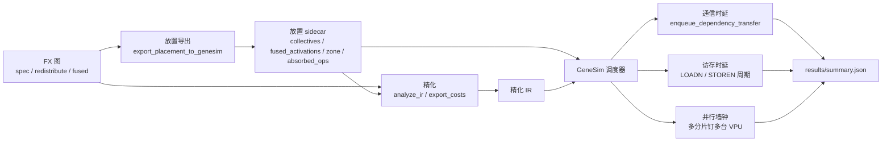
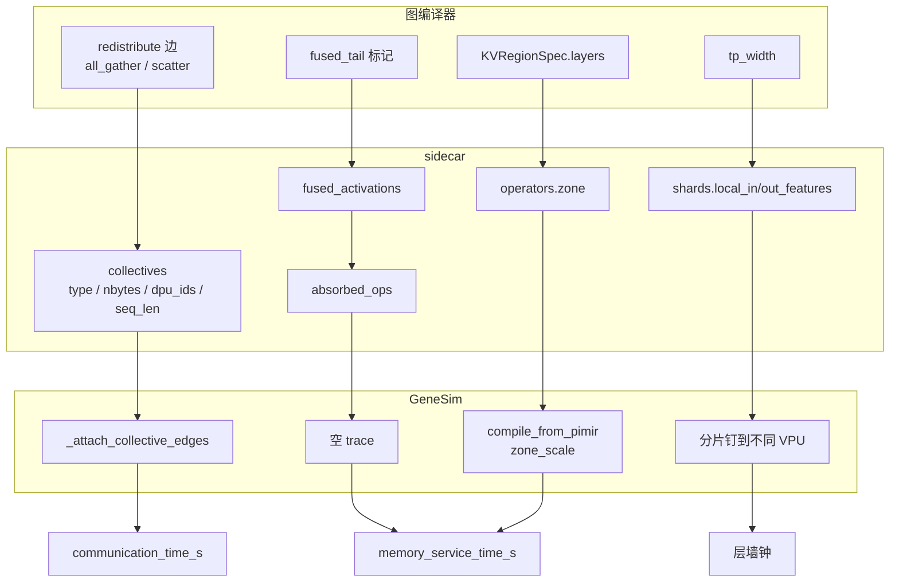
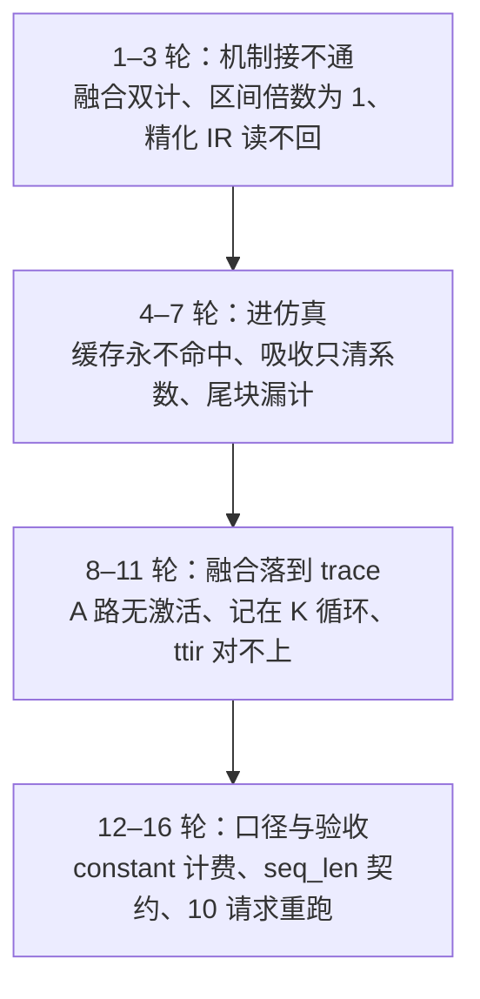

# 实施进展文档：IR 驱动的端到端代价评估补全

> 文档编号：implement-ir-cost-20261012
> 创建日期：2026-10-12
> 最近更新：2026-10-15
> 关联需求文档：docs/request-ir-cost-20261012.md
> 关联设计文档：docs/design-ir-cost-20261012.md
> 关联项目：flagos-pim-compiler、genesim
> FlagTree：本轮不改，工作区干净

## 一、修改概述

Llama2 7B 已经能按 `genesim/docs/llama-2.md` 跑通仿真，但图编译器的三类决策——跨 DPU 通信、算子融合、内存三区——没有进入 GeneSim 的计时。换一种切分或融合方案，仿真报告不变。本轮把这三类决策接到 GeneSim 现有公式的输入上，不另起一套评分。

做了四件事：

1. 把图上未展开的 `all_gather` 与 `scatter` 写成放置 sidecar 的边，仿真侧落成依赖边，进入原有通信时延公式。
2. 搬运指令按操作数身份（激活、权重、输出）和算子级区间（权重、KV、激活）分档计周期，使访存时延随区间变化。
3. 融合清单从图上的标记写出，被吸收节点系数清零、仿真侧发空 trace，融合开关反映到访存项。
4. 张量并行宽度决定单分片形状与落点，并行性由层墙钟低于各分片时延之和体现。

FlagTree 仓没有改动。算子编译器产出的 PIMIR 仍由本仓 `analyze_ir` 扫描，本轮只在文本上标注融合激活，不改方言与 pass。

实施结论：按需求文档现在写定的验收口径，三条目标均已达成。十六轮评审共 109 条问题，106 条已修复，2 条确认不成立不修，1 条部分修复后其余写入豁免。10 请求模型级验证于 2026-10-15 08:15 按当前代码重跑。



---

## 二、代价模型：设计思路与实现

### 2.1 原则

不另立公式。GeneSim 已有计算、访存、通信三条计时路径，本轮只替换它们的输入。PIM 时延由指令 trace 的周期决定，不读 flops；flops 只进 GPU 与 CPU 的 roofline、放置粗估和跑完后的 MFU。

### 2.2 公式（源码原文口径）

**PIM 访存**（`pim_trace_loader.py` 默认周期表，区间倍数写进指令 `src2`）

```
LOADN  周期 = 12 + 字节数 × 0.125 × 倍数
STOREN 周期 = 10 + 字节数 × 0.1   × 倍数
时延        = 总周期 × clock_period_ns × 1e-9
```

`clock_period_ns` 配置为 0.63。倍数相对默认每字节周期：权重 1、KV 2、激活 2；`src2` 取倍数的两倍以便装进整数（2 / 4 / 4）。没写 `src2` 的旧 trace 按单一周期计，与改动前逐条一致。倍数不得低于 1：默认表的每字节周期就是配置的峰值带宽速率，低于它仿真会报「访存时延掉到峰值带宽下界之下」。倍数不得高于权重的 2 倍：超过它，字节减半就盖不住区间变慢，违反访存反倒挂判据。

**通信**（`comm_lib.py`）

```
时延 = latency_base_ns × 1e-9 + 字节数 / (bandwidth_gbps × 1e9 / 8)
```

本轮只提供字节数。带序列维的边系数为 `nbytes / seq_len`，挂在 `Tq` 上，decode 步（`Tq = 1`）只收 `1 / seq_len` 份；不带序列维的边（token id、attention mask）`seq_len` 显式为 null，按常量计。每个参与者各发一份，跨设备字节 = 参与者数 × 当次 forward 的字节。

**计算（PIM）**

不走 GPU roofline。矩阵乘运算数精确等于 `2MNK`，落到 trace 的 MAC 循环次数上。放大 K 推的是计算周期，不是 sidecar 里的 flops。

**GPU roofline**（`gpu_backend.py`，本轮不作为 PIM 验收口径）

```
t_compute = flops / (peak_flops × precision_factor × efficiency_compute)
t_memory  = data_bytes / (peak_bandwidth × efficiency_memory)
latency   = max(t_compute, t_memory) + 10µs
```

这条公式本轮豁免：PIM 时延由 trace 周期决定，不消费这些输入。

**系数拟合**（`cost_extractor._fit_coeffs`）

prefill 与 decode 两个测量点，GEMM 按 `Tq`、其余按 `Tq(Tp+Tq)`：

```
a = (y1 - y2) / (t1 - t2)
b = y1 - a × t1
```

斜率或截距为负时退化为过较大测量点的原点直线。

**对外指标**

```
throughput_tokens_per_s = processed_tokens / total_time_s
processed_tokens        = prompt_tokens + generated_tokens
total_time_s            = 所有请求完成时刻的最大值
```

切分与放置的变化经常先出现在 `communication_time_s`、`memory_service_time_s`、`average_ttft_s` 和 `efficiency_metrics` 上，而被墙钟掩盖。`total_time_s` 含连续准入与流水重叠，需求规定只作观察、不作比例断言。

### 2.3 四项代价如何进入公式



| 维度 | 输入 | 消费点 | 输出字段 |
|---|---|---|---|
| 计算 | 算子形状 → MAC 循环次数 | PIM trace 周期 | 逐算子计算周期 |
| 访存 | 搬运字节 × 区间倍数；融合清单 | `LOADN` / `STOREN` 的 `src2`；被吸收算子空 trace | `memory_service_time_s` |
| 通信 | 未展开的 `all_gather` / `scatter` | 依赖边 → `enqueue_dependency_transfer` | `communication_time_s` |
| 并行 | `tp_width` → 单分片形状与 DPU 落点 | 放置 + 流水线调度 | 层墙钟低于各分片时延之和 |

`all_reduce` 不进补边清单：GeneSim 已由 `_attach_reduce_node` 覆盖收集方向，再写会双计。`local_slice` 留在 DPU 内部，不产生通信。

### 2.4 实现要点

**补边。** 设计写在 `_expand_multi_shard_operators` 之后，但展开时 `vpu_id` 还是 -1，边两端落在同一台 VPU 上，计时会跳过。实际放在放置完成之后。每个参与 DPU 配一个落在 GPU 上的中转节点，挂到该 DPU 上拓扑序最早的算子、归入其所在层。一条集合通信的参与者可以跨层，合并成一个中转节点会逼出反向跨层依赖，stage 划分直接报错。中转节点不计时延，代价已在通信时延里算过。

**区间。** 指令编码没有区间字段，配置表无法按段生效。倍数写进原来空闲的 `src2`。解析时 `_DMA_LOAD_RE` 额外提取 `base_arg`：0 激活、1 权重、2 输出。缺身份时按算子级 `zone`（来自内存规划的 KV 规格），再缺按单一周期。生成端与求值端共用 `pim_isa.py` 的同一张表。

**融合。** 清单来自图上 `FUSED_TAIL_META_KEY`，不能从模型 IR 的形状猜。放置导出在写 sidecar 前先跑一次 `fuse_for_pim`。精化时按清单把被吸收节点系数清零，并把编号回写成 `absorbed_ops`；仿真侧对它们发空 trace——留空而不是不编，因为执行侧仍会走到这些算子。编号在张量并行展开时随 `pimir_path`、`zone` 一起继承给分片。A 路 kernel 由 Triton 生成、带不出激活，`mark_fused_activation` 把 `activation = #pim.act_spec<kind = silu>` 标到 `tt.dot` 上；分块 GEMM 的激活按最后一次写回计一次，不记在 K 循环里的 `tt.dot` 上。内部标记写精化 IR 前去掉，否则 `Operator.from_dict` 会因未知字段抛错。

**序列长度。** 导出图必须带 `input_ids` 且该节点有 `val`，否则分别报「没有 input_ids」与「没有 val」。带序列维的边写导出长度，不带的边显式写 null。缺这个键的是旧 sidecar，调度器直接报错，避免把激活边整份按常量计。

---

## 三、改了哪些文件与核心函数

按 `git diff HEAD --numstat`（2026-10-15）：本仓 11 个已跟踪文件 +980 / -29，genesim 13 个已跟踪文件 +1061 / -101。另新增 3 个测试文件。FlagTree 无改动。

### 3.1 flagos-pim-compiler

| 文件 | 改动 | 核心函数 |
|---|---|---|
| `genesim_bridge/placement_export.py` | sidecar 写 `collectives`、`fused_activations`、算子 `zone`；不带序列维的边写 `seq_len: null` | `export_placement_to_genesim`、`_graph_seq_len`、`_export_seq_len`、`_fused_activations`、`_mark_kv_zone` |
| `genesim_bridge/cost_extractor.py` | 按融合清单清零被吸收节点；本地分片路径也补融合写回 | `export_costs_to_genesim`、`_net_data_bytes`、`_mark_fused_activations`、`_record_absorbed_ops` |
| `genesim_bridge/ir_cost.py` | 折进主算子的激活按写回张量记一次；尾块每层循环向上取整 | `analyze_ir`、`mark_fused_activation`、`fused_act_spec_attr`、`has_fused_act_spec` |
| `genesim_bridge/op_classify.py` | 配方传入 `activation`，补 A 路 `build` | `matmul_kernel` 配方、`GEMM_SILU` |
| `opcompiler_bridge/oplevel_kernel.py` | B 路矩阵乘改走激活属性 | `matmul_kernel` |
| `scripts/refine_ir_with_flagtree.py` | 新增 `--fusion-from`，透传融合清单 | 命令行入口 |
| `scripts/export_pp_placement.py` | 导出前运行融合；把 KV 规格传给放置导出 | 导出入口 |
| `scripts/run_full_pipeline.py` | 放置导出提到精化之前，精化带上放置 sidecar | `step_bcd_export`、`step_a2_refine_pimir_ir` |
| `docs/spec-index.md` | 「代价模型当前不实现」改为指向本需求文档 | 第 26 行 |
| `tests/test_placement_export.py` | 补边、融合清单、KV 区间、`tp_width` 字节比例、`seq_len` 契约 | 见第四节 |
| `tests/test_genesim_bridge.py` | 两路对照跳过带融合角色的算子 | `test_pimir_sidecar_agrees_with_ttir_on_flops` |
| `tests/test_ir_cost_eval.py` | 新增：融合、吸收、四项来源、精化读回 | 见第四节 |

### 3.2 genesim

| 文件 | 改动 | 核心函数 |
|---|---|---|
| `src/scheduler/gene_sim_scheduler.py` | 放置后补依赖边；读 `zone` / `absorbed_ops`；缺 `seq_len` 键报错；模板路径把 `default_zone` 传给认识该参数的编译函数 | `_attach_collective_edges`、`_join_layer_of`、trace 缓存签名 |
| `src/pim/pimir_trace.py` | 解析保留 `base_arg`；展开按区间发指令；折激活只记最后一次写回 | `parse_pimir`、`compile_from_pimir`、`_bulk_zoned` |
| `src/pim/pim_isa.py` | 区间倍率表与编码函数收拢到一处 | `ZONE_FACTORS`、`ZONE_OF_ARG`、`zone_scale`、`zone_scale_for` |
| `src/pim/pim_compiler.py` | 手写模板搬运带身份；`compile_gemv_score` / `compile_gemv_context` 接收 `default_zone` | `_emit_bulk_transfer`、`compile_gemm`、`compile_gemv_score`、`compile_gemv_context` |
| `src/pim/pim_trace_loader.py` | 求值端按 `src2` 取每字节周期 | `estimate_cycle_breakdown` |
| `src/backend/gpu_backend.py` | 通信中转节点不计时延 | `GPUModel` 对中转算子的启动开销 |
| `scripts/refine_ir_with_flagtree.py` | 新增 `--fusion-from`（与本仓那份同步） | 命令行入口 |
| `docs/llama-2.md` | 第四步补上 `--fusion-from`；TTIR 对照侧同步带同一份清单 | 工作流说明 |
| `tests/sim/test_collective_edges.py` | 新增：补边、隔离性、反倒挂、四种 IR | 见第四节 |
| `tests/sim/test_zone_cycles.py` | 新增：身份、区间、KV 默认档、反倒挂边界 | 见第四节 |
| `tests/sim/test_pimir_trace.py` | 两路对照逐项一致；尾块口径；折激活只记最后一次写回 | 见第四节 |
| `tests/sim/test_pipeline_execution.py` | 层墙钟小于各分片时延之和 | `test_tp_shard_layer_makespan_is_below_the_serial_sum` |
| `tests/sim/test_pim_compiler.py` | 模板搬运指令携带操作数身份 | 模板编码断言 |
| `tests/sim/test_scheduler.py` | 区间变化重编；缓存复用；被吸收算子零周期 | trace 缓存签名 |
| `tests/sim/test_compiler_placement.py` | 分片继承吸收标记 | `test_shards_inherit_the_absorbed_flag` |

### 3.3 FlagTree

无改动。需求写明本轮不把代价数值写回方言。融合激活属性只带 `kind`，给正则消费，不进 MLIR verifier。

---

## 四、做了哪些测试、实际通过了哪些、用什么命令验证

### 4.1 验证命令

每个新 shell 先：

```bash
source /media/disk/fengjingge/src/flagOS/flagOS-installed/pytorch/env-pytorch.sh
```

| 范围 | 命令 | 最新结果（2026-10-15） |
|---|---|---|
| 本仓回归 | `python -m pytest tests/ -q -k "not llama2_7b"` | 1347 通过、2 跳过、49 剔除，无失败 |
| genesim 回归 | `cd /media/disk/fengjingge/src/genesim && python -m pytest tests/sim -q` | 749 通过、1 跳过，无失败 |
| 1 请求对照 | `python scripts/run_full_pipeline.py --num-stages 4 --num-dpus 8 --max-requests 1 --log-dir /tmp/r14_rerun` | 见 4.3 |
| 10 请求验收 | 同上，`--max-requests 10`，日志 `/tmp/r15_rerun` | 见 4.3 |

`llama2_7b` 那组太慢，单次验证不跑。全量 pytest 另有 34 条既有失败，源于该组污染 GML 导出，不是本轮回归。仿真产物写在固定路径 `pim_traces/` 与 `results/`，不能并发。

### 4.2 新增与改动的测试（当前条数）

| 文件 | 条数 | 覆盖 |
|---|---|---|
| `tests/test_ir_cost_eval.py` | 30 | 融合开关、被吸收节点、精确字节、四种 IR 字段、精化读回、ttir 与 pimir 运算数 |
| `tests/test_placement_export.py` | 40 | 只导出两类边、融合清单来自图、KV 区间、切分轴宽度之和、`tp_width` 字节比例、`seq_len` 契约 |
| `genesim/tests/sim/test_collective_edges.py` | 21 | 补边字节、all_reduce 不双计、随 `Tq` 伸缩、缺键报错、null 按常量、隔离性、反倒挂、四种 IR 时延 |
| `genesim/tests/sim/test_zone_cycles.py` | 18 | 身份保留、激活贵过权重、区间改变数值、KV 默认档、访存反倒挂、K 与字节翻倍、模板路径带区间 |

与需求第五节判据的对应（设计 7.1 列出的测试名全部存在且通过）：

| 判据 | 测试 |
|---|---|
| 运算数精确等于 `2MNK` | `test_four_dimensions_come_from_distinct_inputs` |
| 激活区周期不低于权重区 | `test_activation_zone_costs_more_than_weight` |
| 访存反倒挂 | `test_halving_bytes_offsets_the_slower_zone` |
| 通信时延增长比例落在 (1, 2] | `test_comm_latency_grows_within_bound` |
| 通信反倒挂 | `test_halving_bytes_beats_a_larger_base_latency` |
| 去掉边只改通信 | `test_dropping_edges_only_changes_communication` |
| 只放大 K，通信不变 | `test_widening_only_k_raises_compute_not_communication` |
| 层墙钟低于各分片之和 | `test_tp_shard_layer_makespan_is_below_the_serial_sum` |
| `tp_width` 翻倍，单分片字节下降比例落在 (1, 2] | `test_tp_width_doubling_shrinks_shard_bytes_within_bound` |
| 融合省掉的字节等于被吸收张量 | `test_fusion_saves_exactly_the_absorbed_tensor_bytes` |
| 四种 IR 时延不全相同 | `test_four_ir_kinds_move_distinct_latency_terms` |
| 切分轴宽度之和等于全局 | `test_shard_widths_sum_to_the_global_width` |
| KV 写回不进通信项 | `test_kv_writeback_never_enters_the_communication_account` |
| 手写模板与 PIMIR 周期一致 | `test_agrees_with_the_handwritten_template_on_the_same_shape` |
| K 翻倍与字节翻倍，逐算子时延比例落在 (1, 2] | `test_doubling_k_and_bytes_keeps_operator_latency_within_bound` |

### 4.3 模型级数字（当前代码，2026-10-15）

**1 请求对照**（07:18–07:23，`/tmp/r14_rerun/`）

| 字段 | 融合开、补边开 | 融合关 | 补边关 |
|---|---|---|---|
| `memory_service_time_s` | 1207.1944 | 1227.6151 | 1207.1944 |
| `communication_time_s` | 0.9468 | 0.9468 | 0.9230 |
| `total_time_s` | 670.1379 | 680.3421 | 670.1379 |
| `throughput_tokens_per_s` | 1.1863 | 1.1685 | 1.1863 |
| `average_ttft_s` | 612.2888 | 621.6239 | 612.2888 |
| `completed_requests` | 1 | 1 | 1 |

融合只动访存项（-20.4207 秒），通信项逐位不变。补边只动通信项（+0.0238 秒），访存项逐位不变。墙钟在补边这一项上不变，流水线把这点时间重叠掉了。

**10 请求验收**（08:15，`/tmp/r15_rerun/`）

7138 条 trace 全量重编（0 reused）：pimir 7074、absorbed 64。放置 sidecar 118 条边全部带 `seq_len`（109 条有长度、9 条显式 null），32 条融合、32 条吸收。

| 字段 | 当前代码 | 第十二轮口径（常量计费） |
|---|---|---|
| `completed_requests` | 10 | 10 |
| `processed_tokens` | 8084 | 8084 |
| `total_time_s` | 2673.6312 | 2629.8036 |
| `throughput_tokens_per_s` | 3.0236（= 8084 / 2673.6312，已核对） | 3.0740 |
| `communication_time_s` | 19.6679 | 20.1285 |
| `memory_service_time_s` | 12283.5129 | 12283.5129 |
| `average_ttft_s` | 1708.2567 | 1708.2567 |
| `efficiency_metrics.compute.system_mfu` | 0.001015 | — |
| `efficiency_metrics.communication.efficiency` | 0.1238（ideal 19.6679 / actual 158.8848） | — |
| `efficiency_metrics.memory.efficiency` | 0.8111（ideal 9963.1636 / actual 12283.5129） | — |

访存项与首 token 时延逐位不变。通信项降 0.4606 秒：边从常量改为随 `Tq` 伸缩后，decode 步只收每 token 的那一份。墙钟涨 43.83 秒，含连续准入与流水重叠，需求 2.4 只作观察。

---

## 五、十六轮评审：关键信息与修复结论

十六轮共 109 条问题。严重 18、高 24、中 36、低 31。已修复 106，确认不成立不修 2（第六轮第 5 条：sidecar 的 `absorbed` 有消费方；第十二轮第 4 条：对照表数字与盘上产物逐位相符），部分修复 1（第一轮第 8 条：隔离性已补，roofline 放大写入豁免）。



### 5.1 按轮次

| 轮次 | 日期 | 条数 | 关键结论 |
|---|---|---|---|
| 1 | 10-12 | 9 | 融合激活未计入主算子；两路对照因模板无身份不可比；跨仓导入测试。机制层面未接通。 |
| 2 | 10-12 | 11 | `GEMM_SILU` 缺 A 路；区间倍数仍为 1，访存周期不变；模型级未重跑。 |
| 3 | 10-12 | 12 | 精化 IR 带着融合标记，GeneSim 读回抛错；融合开关不可构造；KV 区间不可达；中转节点跨层反向依赖让仿真直接报错。 |
| 4 | 10-13 | 8 | 同形状投影的测量缓存互相污染；缺身份时不该默认落到激活档。 |
| 5 | 10-13 | 6 | `default_zone` 不进缓存签名，区间变化不重编；导出前没跑融合 pass，真实链路清单恒为空。 |
| 6 | 10-13 | 6 | KV 区间登记落在早退分支里，开关关掉就丢；尾块按小数趟计，IR 与 trace 字节对不上。第 5 条不修。 |
| 7 | 10-13 | 6 | 缓存签名整数键过 json 变字符串，缓存永不命中；融合只清系数，被吸收算子仍编完整 trace。 |
| 8 | 10-14 | 5 | 真实链路 A 路 kernel 带不出激活，折了等于没折；补边字节与 `plan_cost` 口径不同需记录。 |
| 9 | 10-14 | 4 | 第八轮改走 B 路导致计算项归零、dtype 变成 int8，改回 A 路 `tt.dot` 只标属性。 |
| 10 | 10-14 | 5 | 折激活记在 K 循环的 `tt.dot` 上，IR 比 trace 多 256 倍；改为按写回张量计一次。 |
| 11 | 10-14 | 5 | ttir 侧 A 路没有 `dma_store`，融合算子两层运算数对不上，对照改为跳过融合角色、同一份文本锁死两边。 |
| 12 | 10-14 | 5 | 补边按常量计，每个 decode 步都收 prefill 的整份字节；改为挂在 `Tq` 上。第 4 条不修。 |
| 13 | 10-14 | 5 | 缺 `seq_len` 键的旧 sidecar 会静默按常量计；改为直接报错。10 请求数字仍早于代码。 |
| 14 | 10-14 | 15 | 导出器省略 `seq_len`、调度器缺键报错，两边测试互锁；多种判据测的不是要求的量；本地分片路径丢掉融合加项；模板路径丢掉 KV 区间。 |
| 15 | 10-15 | 4 | 10 请求未按当前代码重跑，三处文档互相矛盾；`input_ids` 两种失败报成一句。已重跑。 |
| 16 | 10-15 | 3 | 全部是文档：10 请求表缺 `efficiency_metrics`、改动统计漏文件、历史段落仍标「当前代码」。无代码缺陷。 |

### 5.2 按主题归并的修复

**通信。** 补边只含 `all_gather` 与 `scatter`，`all_reduce` 不双计。中转节点按源算子所在层插入，不计时延。带序列维的边随 `Tq` 伸缩，不带的边显式写 null。旧 sidecar 缺键直接报错。

**访存区间。** 倍数从 1 改为权重 1、KV / 激活 2，写进 `src2`。生成端与求值端共用一张表。缺身份且无算子级区间时按单一周期。KV 归属来自内存规划，登记不放在早退分支。模板退回路径也吃 `default_zone`。缓存签名覆盖 `zone_factors`、`zone_of_arg`（字符串键）、`default_zone`、`absorbed`。

**融合。** 清单来自图上标记，导出前跑融合 pass。被吸收节点清零并回写 `absorbed_ops`，仿真发空 trace，分片继承吸收标记。A 路用 `act_spec` 标注，按最后一次写回计一次。本地分片路径也补融合写回。内部标记写盘前去掉。

**计费口径。** 每层循环尾块向上取整，与 trace 同口径。报告的趟数与成本同口径。整笔搬运拒绝小数字节。

**文档与验收。** GPU roofline 手算、两路对照的 roofline 半条、「三区之和等于总搬运」写入需求判据表豁免。账目改为切分轴宽度之和。10 请求与两组 1 请求对照按当前代码重跑。

### 5.3 相对设计的偏差（实现时已记录）

| 设计原文 | 实际 | 原因 |
|---|---|---|
| 补边写在展开函数之后 | 写在放置完成之后 | 展开时 `vpu_id` 为 -1，边不计时 |
| 周期分档写进 `conf/sim.yaml` | 倍数写进指令 `src2` | 指令没有区间字段 |
| 并行「不改代码」 | 补了层墙钟测试 | 既有测试不断言墙钟 |
| 每个参与者各发一份完整张量 | 带序列维的边先除以 `seq_len` 再挂 `Tq` | 否则 decode 步按 prefill 整份计 |

这些偏差已回写进设计文档第八节。

---

## 六、当前还存在的问题

按需求文档现在写定的验收口径，功能缺口已经闭环。下面几条不是未修的评审问题，而是口径边界和后续可选项。

**1. 并行性的两段证据没有接上。** `tp_width` 翻倍会让导出的单分片字节下降，四个分片钉在四台 VPU 上时墙钟低于串行——这两条各自为真。但层墙钟测试的时延是手填的 3 / 5 / 4 / 6 秒，不读 `tp_width`，也不读导出的分片宽度。把切分导出改坏，墙钟那条测试不会失败。若要让「并行」名副其实，只需补一条测试：同一张图按 `tp_width` 4 与 1 各导出一次，用导出的分片形状和 DPU 落点跑流水线。这是测试，不改生产代码。

**2. 墙钟在融合这一项上不单调。** 1 请求时 `total_time_s` 下降，10 请求时微升（+43.83 秒，约 1.7%）。墙钟含连续准入与流水重叠，需求 2.4 已规定只作观察。决策的可见处是 `memory_service_time_s` 这类分项字段。要对准入顺序不敏感的口径，不在本轮范围。

**3. 区间分档没有实测依据。** 权重 1、KV 与激活 2，是上下界推出来的，不是测出来的。KV 与激活数值相同，KV 档在数字上和激活档分不开，只有单独调档时才看得出差别。需求只要求「常驻区间 ≤ 反复搬运区间」，两者相同是允许的。有实测后再改这一处；下界（不得低于峰值带宽）与上界（不得高于权重的 2 倍）是硬的。

**4. 被吸收算子仍留在图里。** 服务时间为零，但调度仍会走到它们。去掉节点会牵动依赖链，代价与收益不成比例，本轮不改。

**5. 三条判据是豁免，不是通过。** GPU roofline 手算与受限放大、两路对照里 roofline 的那半条、「三区字节之和等于总搬运」。理由：PIM 时延由 trace 周期决定；区间逐段落在指令上，没有可对的汇总。账目锁的是切分轴宽度之和，不是字节之和——未切分一侧的激活在各片重复出现，字节之和本来就大于全局。

**6. 仓库里没有硅片数据。** 验收证明的是评估与 GeneSim 自身的细粒度仿真自洽，不得写成符合实际芯片运行。

FlagTree 仓保持干净，与需求「本轮不改」一致。
