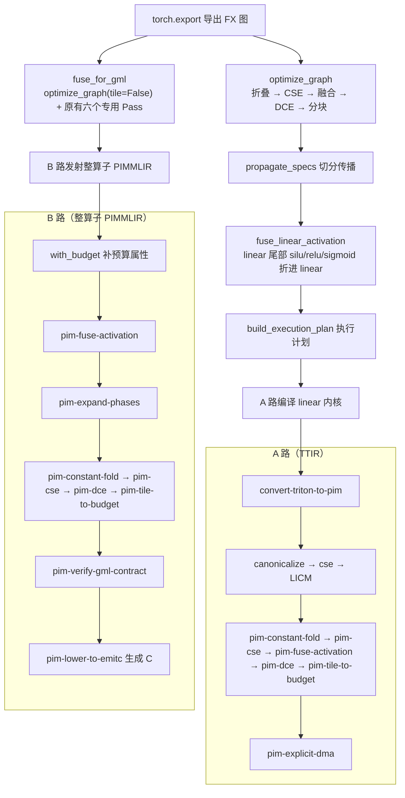
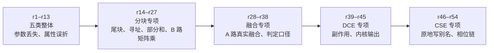

# 实施文档：两层编译器五类通用优化 Pass

> 文档编号：implement-opt-passes-20261016
> 创建日期：2026-10-16，重写日期：2026-10-26
> 关联需求：`docs/request-opt-passes-20261016.md`
> 关联设计：`docs/design-opt-passes-20261016.md`
> 关联文档：`docs/exec-plan-waw-20261022.md`（执行计划写后写依赖）
> 本文覆盖三个仓库截至 2026-10-26 的全部未提交修改，并收录第 1 至 54 轮评审的核心结论（评审原文已删除）。

## 一、修改概述

本次在两层编译器里都补齐了五类通用优化：常量折叠、公共子表达式消除（CSE）、算子融合、死代码消除（DCE）、分块。它们默认生效，覆盖四条通路：

| 通路        | 输入                                              | 入口                                 | 五类优化的位置                                                                 |
| ----------- | ------------------------------------------------- | ------------------------------------ | ------------------------------------------------------------------------------ |
| 执行路径    | `torch.export` 导出的 FX 图                       | `runtime/compile.py::compile_llama2` | 导出后、切分传播前调`optimize_graph`；切分传播后再调 `fuse_linear_activation`  |
| GML 路      | 同上                                              | `gml_bridge/export.py::fuse_for_gml` | 开头调`optimize_graph(tile=False)`，只跑折叠、CSE、DCE，原有六个专用 Pass 不变 |
| 算子层 A 路 | Triton 生成的 TTIR（多算子、带循环）              | `opcompiler_bridge/driver.py`        | 转 PIM 之后、显式 DMA 之前                                                     |
| 算子层 B 路 | 图编译器发射的整算子 PIMMLIR（每函数一条`pim.*`） | `opcompiler_bridge/driver.py`        | 融合在相位展开之前，其余四类在展开之后、契约校验之前                           |

一句话结论：五类优化在两层都已实现并接入四条通路，A、B 两路的 Pass 顺序收拢到 `opcompiler_bridge/pipeline.py` 一处；2026-10-25 的全量回归 `python -m pytest tests/ -q -k "not llama2_7b"` 全部通过，FlagTree TritonPIM 的 68 条 lit 全部通过；2026-10-26 重跑有 1 条 GeneSim 成本对照用例失败，已修（见第八节第 1 条）。有五格在真实输入上没有作用对象，改在合成输入上验证，需求方已确认接受（见第七节）。`llama2_7b` 一组按约定没有跑。

## 二、涉及的三个代码仓库

1. **FlagTree 算子编译器仓库**

   - 路径：`/media/disk/fengjingge/src/flagOS/flagOS-installers/FlagTree`
   - 定位：底层算子编译器，把 PIMMLIR 逐步 lowering 成 C 代码，最终生成 numpy、GeneSim 两种后端。
   - 评估作用：输出 PIMMLIR 算子级属性（运算类型、规模、数据布局、访存模式等）。
   - 本次改动：新增三个 Pass（常量折叠、CSE、DCE）与共用的纯性判定，改造融合与分块，降到 C 时支持分块矩阵乘与融合激活。10 个文件修改 `+1105 / -37`，新增 4 个源文件（692 行）与 23 个 lit 用例。
2. **pim-compiler 集成仓库（图编译器，主工作目录）**

   - 路径：`/media/disk/fengjingge/src/flagOS/flagos-pim-compiler`
   - 定位：上层图编译器，负责大模型加载、图级优化、生成 PIMMLIR。
   - 评估作用：输出图 IR 级信息（算子拓扑、融合情况、并行策略、内存调度等）。
   - 本次改动：新增图层五个 Pass、两路管线真源；接入执行路径与 GML 路；为让分块后的图能走通，改了切分传播、通信计划、内存规划和执行计划。38 个文件修改 `+3421 / -196`（代码约 `+1030 / -171`，测试约 `+2390 / -25`），新增 `graph/opt_passes.py`（1047 行）、`opcompiler_bridge/pipeline.py`（99 行）、两个测试文件（3663 行）和两份真实内核样本。
3. **GeneSim 仿真仓库**

   - 路径：`/media/disk/fengjingge/src/genesim`
   - 定位：存算一体架构模拟器，做算子级与模型级仿真验证。
   - 评估作用：代价评估模型的核心载体，接收编译器 IR 输入，输出综合代价值。
   - 本次改动：只改测试与文档，不改仿真核心（需求边界）。`tests/sim/test_pimir_trace.py` 把五处写死的图编译器路径收成 `_analyze_ir()`，按 `PIM_COMPILER_ROOT` 或两种常见目录布局查找；`docs/llama-2.md` 补一条 `torch-geometric==2.8.0.post1` 安装命令。`+31 / -15`。

## 三、总体流程

顺序的依据：

- 五类内部固定为「折叠 → CSE → 融合 → DCE → 分块」。折叠产出的常量是 CSE 的合并对象；融合与 CSE 只改用户不删节点，残留由 DCE 统一清；分块要按化简后的最终形状算预算。
- B 路融合必须在相位展开之前且只跑一次。展开后相位链里也有 `pim.lut`，再融合会拆掉一相，契约校验因相位编号空档失败。
- B 路折叠、CSE、DCE 必须在展开之后。展开前每个函数只有一条 `pim.*`，没有可优化的对象。
- A 路在五类之前先跑上游 `canonicalize`、`cse`、`loop-invariant-code-motion`。前两个处理 PIM Pass 不覆盖的 `arith`；循环不变量外提放在分块前，因为分块会重建循环。
- GML 路不跑分块和通用融合：GML 按整块算子编码 contraction 与缓冲名，切块会改掉这些字段；通用融合换出的合并节点是 Python 闭包，`from_fx` 不认，被吃掉的计算会静默消失。

## 四、修改原理

### 4.1 图层（`graph/opt_passes.py`，操作 torch.fx 图）

设计上的关键判断：执行路径 `build_execution_plan` 只读 `node.target` 逐节点发命令，不读融合标记等 meta。所以图层五类都通过**改图**生效，不新增 `node.meta` 键（唯一例外是复用已有的 `FUSED_TAIL_META_KEY`，见融合）。

| Pass     | 函数                     | 做什么                                                                           | 判定依据与边界                                                                                                                                                                                                                                                                                                                                                 |
| -------- | ------------------------ | -------------------------------------------------------------------------------- | -------------------------------------------------------------------------------------------------------------------------------------------------------------------------------------------------------------------------------------------------------------------------------------------------------------------------------------------------------------- |
| 常量折叠 | `fold_constants`         | 输入全是`get_attr` 或字面量的算子求值，换成 `_folded_*` 常量节点                 | 只折`FOLDABLE` 表里有实际计算的逐元素算子；形状类不折（会改变切分传播看到的节点）；结果超过 `FOLD_MAX_ELEMENTS = 4096` 不折；随机、写内存算子不折                                                                                                                                                                                                              |
| CSE      | `eliminate_common`       | `(target, 参数结构)` 相同的纯算子只留第一个                                      | 纯性按 aten schema 判定（`Node.is_impure()`），不查名单；字面量连类型入键（`1` 与 `1.0` 不合并）；被原地写过的缓冲及其视图、多输出算子经 `getitem` 取出后被写的、经张量列表参数被写的都不合并（`_alias_root`、`_written_nodes`）；折叠出的常量按类型、形状、字节合并，模型参数不按值合并（`_folded_key`）；形状类算子只在无流水并行时合并（`merge_shape_ops`） |
| 融合     | `fuse_elementwise`       | 单用户的纯算子与后接纯逐元素算子换成一个合并节点                                 | 合并节点是 Python 闭包，`partition` 判为主机节点，执行时发 `host_op` 在主机上按 aten 求值；多用户、消费者含归约或形状变化、专用融合已覆盖的链（RMSNorm、rope、门控）不碰                                                                                                                                                                                       |
| 设备融合 | `fuse_linear_activation` | 切分传播之后，把 linear 的单用户尾部激活折进 linear，写`FUSED_TAIL_META_KEY`     | 只认`LINEAR_TAIL_ACTIVATIONS`（silu、relu、sigmoid）；带 bias 的不折；中间可穿过浮点转换；必须在传播之后，因为部分和不能直接过激活                                                                                                                                                                                                                             |
| DCE      | `eliminate_dead`         | 复用`Graph.eliminate_dead_code` 删除不可达节点                                   | `is_impure_node` 沿用 FX 判定，保住写内存、随机、运行期断言；导出器插的 `_assert_tensor_metadata` 只核对编译期已知信息，按死代码删                                                                                                                                                                                                                             |
| 分块     | `tile_graph`             | 工作集超过 WRAM 预算的`linear`、`matmul` 拆成若干子块节点，再用 `cat` 或相加拼回 | 工作集 = 输入 + 权重 + 输出 + bias 等常驻输入；候选是 2 的幂切分，选预算内块数最少的；超过`MAX_TILE_BLOCKS = 512` 块不切；子块特征数不小于张量并行宽度；后接可折激活的 linear 不切 K；右操作数带 batch 维的 `matmul` 不切                                                                                                                                      |

分块评估模型（`_tile_plan`）图层与算子层共用同一规则：候选必须让单块工作集不超预算，选块数最少者；原样已在预算内、没有候选、或块数超上限时不改。

### 4.2 分块后图能走通所需的配套修改

图层分块会在权重与 linear 之间插切片、在输出处插 `cat` 或相加。为此改了下游几处：

| 模块                                           | 修改                                                                                                                                                                                                                                  | 原因                                                                                                                                       |
| ---------------------------------------------- | ------------------------------------------------------------------------------------------------------------------------------------------------------------------------------------------------------------------------------------- | ------------------------------------------------------------------------------------------------------------------------------------------ |
| `graph/spec_prop.py`                           | 新增`_consumers_through_slices`、`_weight_slice_spec`、`_row_slice_linear`、`_stacked_cat_spec`、`_aligned_cat_spec` 等                                                                                                               | 权重切片要保持权重的切分布局；按行切的权重沿 K 切开后，一段 K 只落在部分台上，部分和只标在这些台上、最后归约一次；`cat` 拼部分和前要先归约 |
| `comm/plan.py`                                 | `local_slice` 的目标台允许是源台的子集                                                                                                                                                                                                | 行切权重的 K 段只落在部分台，激活也只切给这些台                                                                                            |
| `memory/mem_planner.py`                        | 同一条重分布边挂在多个消费者上时，落地缓冲只记一份，生命周期并到最后一个读者                                                                                                                                                          | 原先按消费者各记一份，缓冲被提前复用，后面的读者读到被覆盖的数据                                                                           |
| `runtime/exec_plan_gen.py`                     | 新增`_weight_slice_local_bounds`（权重切片下标换算到本地并夹到本地长度）；命令加写后写依赖；绑定值转 torch（`_as_torch`）；payload 下发 `activation`；`cat` 实参不贴编码                                                              | 见`docs/exec-plan-waw-20261022.md`：旧计划只记写后读和读后写，复用同一块激活缓冲时旧写者晚跑会覆盖新值，tp4 小模型 KV 区偶发不一致         |
| `runtime/compile.py`                           | 调`optimize_graph` 与 `fuse_linear_activation`；内核占用探针带上 activation；切片回溯改用 `all_input_nodes`                                                                                                                           | 分块后投影输出是`cat` 的列表参数，要连列表里的节点一起回溯                                                                                 |
| `runtime/kernels.py`                           | linear numpy 镜像按 payload 的 activation 补激活；编译请求带 activation；补`_to_copy` 内核                                                                                                                                            | 执行路径数值与 A 路编译内核一致                                                                                                            |
| `opcompiler_bridge/kernel_src.py`、`driver.py` | linear 内核加`ACTIVATION` 常量，在累加器写回前算 silu、relu、sigmoid；表外激活直接报错                                                                                                                                                | 设备融合的 A 路落地                                                                                                                        |
| `graph/fuse_pim.py`                            | 新增`is_float_cast`、`_real_users`                                                                                                                                                                                                    | 融合判定穿过浮点转换和导出器断言                                                                                                           |
| `contracts/`                                   | `op_semantics.py` 增 `FOLDABLE`、`ELEMENTWISE`；`fusion_contract.py` 增 `LINEAR_TAIL_ACTIVATIONS`；`unified_ir.py` 登记 `fuse_linear_activation` 为生产者、`exec_plan_gen` 为消费者；`ir_payloads.py` 读 B 路的 `pim.tile-wram-bytes` | 契约表是全仓唯一真源                                                                                                                       |

### 4.3 算子层（FlagTree `lib/Dialect/TritonPIM/Transforms/`，操作 MLIR）

上游 `canonicalize`、`cse` 对 PIM 算子不生效：`PIMOps.td` 没有 `hasFolder`，`matmul`、`eltwise`、`lut` 也没标 `Pure`。所以三个通用 Pass 手写，纯性按性质表判定（`PimPure.h::isPurePim`）。

| Pass                   | 文件                          | 做什么                                                                                                                                                         | 判定依据与边界                                                                                                                                                                                                                                                                                                                                                          |
| ---------------------- | ----------------------------- | -------------------------------------------------------------------------------------------------------------------------------------------------------------- | ----------------------------------------------------------------------------------------------------------------------------------------------------------------------------------------------------------------------------------------------------------------------------------------------------------------------------------------------------------------------- |
| `-pim-constant-fold`   | `ConstantFold.cpp`（新增）    | 操作数全是`arith.constant` 的算子算出结果换成常量                                                                                                              | `pim.eltwise` 的 add、sub、mul、div、max、min；`pim.lut` 的 relu、exp、sqrt、reciprocal、silu；A 路整数 `arith` 加减乘；浮点 f16、f32，整数只 i32；带缩放、截断、查表配置、收缩编码、折入激活等改变数值的属性一律不折；`sigmoid`、`tanh`、`gelu` 等没有与硬件表对齐的编译期求值，不折                                                                                   |
| `-pim-cse`             | `PimCSE.cpp`（新增）          | 同一基本块内算子名、属性、操作数、结果类型都相同的纯算子合并                                                                                                   | 带内存副作用、带区域的不合并；整算子函数里没人用的张量结果是内核输出，不参与；相位算子按数据流并成链，**只整条合并到另一条等长的链上**，只有前缀相同的链（如 Q、K 两路 rope）一相都不合并；配对先于合并确定（`pairWholeChains`），结果不随链的排列变化                                                                                                                  |
| `-pim-dce`             | `PimDCE.cpp`（新增）          | 结果全部无用户的纯算子多轮删除                                                                                                                                 | 整算子函数里产出张量的`pim.*` 保留（可能是内核输出或带外读取的中间值），内核输出按 `pim-lower-to-emitc` 的同一判据认定；A 路内核输出走 `tt.store`，无用户的纯算子不论方言都删；`dma_store`、`kv_cache` 有副作用保留                                                                                                                                                     |
| 共用判定               | `PimPure.h`（新增）           | `isPurePim`、`isOperatorLevelFunc`                                                                                                                             | 三个新 Pass 与`LowerPIMToEmitC.cpp` 共用整算子函数判据：第一个参数是元素非指针的整块张量或 `!pim.memdesc`                                                                                                                                                                                                                                                               |
| `-pim-fuse-activation` | `FuseActivation.cpp`（修改）  | B 路：主算子判定从`matmul/conv/eltwise` 三个名字改为「带 `activation` 属性位」；A 路：新增 `tt.dot` 后激活链识别                                               | A 路的`tt.dot` 没有 activation 属性位，Triton 展开的激活保持 arith/math 形态，按结构识别：与 0 取大是 relu；`0-x → exp → 1+e → 1/(1+e)` 是 sigmoid；再乘回链根是 silu。匹配后在 `tt.dot` 上写 `#pim.act_spec` 并删整条链；激活写在 K 循环内的不融合                                                                                                                  |
| `-pim-tile-to-budget`  | `TileToBudget.cpp`（修改）    | 保留`tt.dot` 路径；新增 `tileWholeMatmuls`（B 路整算子 `pim.matmul` 按形状选 tile 写 `tile` 属性）与 `tileGenericLoops`（无 `tt.dot` 时按 `scf.for` 重建循环） | 通用循环：边界必须是编译期常量，从预算内最大 2 的幂 tile 向下回退取第一个整除跨度的，不生成尾块；带`iter_args`、带掩码、原步长不为 1、嵌套循环、grid 内核、认不出的寻址形态都保持原样，超预算时给 `left this loop untiled` 诊断；重建结果验证不过整体撤回。B 路矩阵乘：tile 必须整除 M、N 与组宽，输出块按两个 f32 累加器计；模块头只在各矩阵乘 tile 与字节数都相同时写 |
| 降到 C                 | `LowerPIMToEmitC.cpp`（修改） | 带`tile` 的 `pim.matmul` 生成块循环，组内按 K 块分段累加；`tt.dot` 上的融合激活在累加器写回前补 `pim_lut_*`                                                    | 同一输出元素的加法顺序与不分块相同，结果逐位一致；可融合的激活（`relu_x` 除外）都有 C 实现                                                                                                                                                                                                                                                                              |

其余 FlagTree 修改：`PIMOps.td` 给 `pim.matmul` 加可选 `tile` 属性，`Ops.cpp` 补校验；`Passes.td` 声明三个新 Pass；`CMakeLists.txt` 加入三个 cpp；`python/src/passes.cc` 加 `add_constant_fold`、`add_pim_cse`、`add_pim_dce`；`pim_sidecar.py` 按 A 路同一顺序内联五类 Pass。

### 4.4 管线统一（`opcompiler_bridge/pipeline.py`，新增）

改前同一份 Pass 列表抄在四处且互不一致。改后：

| 接口                                  | 说明                                                                  | 调用点                                                                                    |
| ------------------------------------- | --------------------------------------------------------------------- | ----------------------------------------------------------------------------------------- |
| `OPT_PASSES`                          | 五类固定顺序                                                          | A 路直接展开                                                                              |
| `a_path_passes(hardware, target=...)` | convert → canonicalize → cse → LICM →`OPT_PASSES` → explicit-dma | `driver.py`                                                                               |
| `b_path_passes()`                     | fuse → expand-phases → fold → cse → dce → tile → verify         | `driver.py`、`phase_source.py`（去掉分块，只抽相位）、`genesim_bridge/flagtree_driver.py` |
| `with_budget(mlir_text, hardware)`    | 给 B 路模块头补 WRAM、MRAM 预算与 DMA 对齐                            | B 路分块读这些属性                                                                        |

`genesim_bridge/flagtree_driver.py` 的 A 路用进程内绑定 `passes.pim.add_*`，参数形式与命令行不同，所以按同一顺序内联，由测试钉住两边一致；它还在抓 A 路内核前把 autotune 候选限制在 WRAM 预算内。FlagTree `pim_sidecar.py` 不引用本仓，同样内联并由测试钉住。

### 4.5 GeneSim 成本旁支（`genesim_bridge/`）

| 文件                                                        | 修改                                                                                                                                                                 |
| ----------------------------------------------------------- | -------------------------------------------------------------------------------------------------------------------------------------------------------------------- |
| `cost_extractor.py`                                         | 新增`_measure_gemm_linear`：ttir、pimir 两级 GEMM 都用本仓 linear 内核（ttir 取 `_make_ttir`，pimir 经 `compile_op`），激活随请求下发，由 `-pim-fuse-activation` 真正折进 `tt.dot`                       |
| `ir_cost.py`                                                | 删除`mark_fused_activation`：原先用正则把激活属性贴到 `tt.dot` 上，现在由 Pass 真实融合，不再事后贴                                                                  |
| `placement_export.py`                                       | 删除`_annotate_linear_activation`；分块后权重经切片才到 linear 子块，改用 `_consumers_through_slices` 找激活，同一权重的多个子块只记一条                             |
| `op_classify.py`、`oplevel_kernel.py`、`oplevel_emitter.py` | B 路发射器把激活发成矩阵乘唯一用户的独立`pim.lut`（`trailing_activation`），不再预写 activation 属性，由算子层融合折回；带 bias 的 linear、addmm、带池化的主算子不发 |

## 五、核心文件与函数清单

### 5.1 flagos-pim-compiler

| 文件                                                                                                            | 类型 | 核心函数或内容                                                                                                                                                                                                    |
| --------------------------------------------------------------------------------------------------------------- | ---- | ----------------------------------------------------------------------------------------------------------------------------------------------------------------------------------------------------------------- |
| `graph/opt_passes.py`                                                                                           | 新增 | `optimize_graph`、`fold_constants`、`eliminate_common`、`fuse_elementwise`、`fuse_linear_activation`、`eliminate_dead`、`tile_graph`、`_tile_plan`、`_apply_plan`、`_alias_root`、`_written_nodes`、`_folded_key` |
| `opcompiler_bridge/pipeline.py`                                                                                 | 新增 | `OPT_PASSES`、`a_path_passes`、`b_path_passes`、`with_budget`                                                                                                                                                     |
| `runtime/compile.py`                                                                                            | 修改 | `compile_llama2` 接入两步优化                                                                                                                                                                                     |
| `gml_bridge/export.py`                                                                                          | 修改 | `fuse_for_gml` 开头调 `optimize_graph(tile=False)`                                                                                                                                                                |
| `graph/spec_prop.py`                                                                                            | 修改 | 权重切片、行切部分和、`cat` 规格（`+480` 行，最大的配套改动）                                                                                                                                                     |
| `runtime/exec_plan_gen.py`                                                                                      | 修改 | `_PlanBuilder.append` 写后写依赖、`_weight_slice_local_bounds`、`_fused_activation_of`                                                                                                                            |
| `runtime/kernels.py`                                                                                            | 修改 | linear 镜像与编译请求带 activation、`_to_copy` 内核                                                                                                                                                               |
| `memory/mem_planner.py`                                                                                         | 修改 | 重分布缓冲按边合并生命周期                                                                                                                                                                                        |
| `comm/plan.py`                                                                                                  | 修改 | `local_slice` 目标台可为源台子集                                                                                                                                                                                  |
| `graph/fuse_pim.py`                                                                                             | 修改 | `is_float_cast`、`_real_users`                                                                                                                                                                                    |
| `contracts/op_semantics.py`、`fusion_contract.py`、`unified_ir.py`、`ir_payloads.py`                            | 修改 | 见 4.2                                                                                                                                                                                                            |
| `opcompiler_bridge/driver.py`、`phase_source.py`、`kernel_src.py`、`oplevel_kernel.py`、`oplevel_emitter.py`    | 修改 | 见 4.2、4.4、4.5                                                                                                                                                                                                  |
| `genesim_bridge/flagtree_driver.py`、`cost_extractor.py`、`ir_cost.py`、`op_classify.py`、`placement_export.py` | 修改 | 见 4.4、4.5                                                                                                                                                                                                       |
| `docs/pim-compiler-v0.0.9.md`                                                                                   | 修改 | 补`torch-geometric` 安装命令                                                                                                                                                                                      |
| `tests/test_opt_passes.py`                                                                                      | 新增 | 图层 97 条用例                                                                                                                                                                                                    |
| `tests/test_opt_passes_ir.py`                                                                                   | 新增 | 算子层 A、B 两路 49 条用例，含 lit 套件包装                                                                                                                                                                       |
| `tests/data/real_kernels/*.ttir`                                                                                | 新增 | 两份 FlagGems 真实无点积内核样本                                                                                                                                                                                  |
| 其余 17 个`tests/test_*.py`                                                                                     | 修改 | 新增 63 条用例，覆盖切分传播、执行计划、内存规划、A 路 linear、发射器、GeneSim 桥接等                                                                                                                             |
| `docs/exec-plan-waw-20261022.md`                                                                                | 新增 | 写后写依赖的独立说明                                                                                                                                                                                              |

### 5.2 FlagTree

| 文件                                                                                              | 类型            | 核心内容                                                                                                 |
| ------------------------------------------------------------------------------------------------- | --------------- | -------------------------------------------------------------------------------------------------------- |
| `lib/Dialect/TritonPIM/Transforms/ConstantFold.cpp`                                               | 新增            | `evalEltwise`、`evalLut`、`evalArith`、`evalDenseInt` 与各类「属性不改变数值」判定                       |
| `lib/Dialect/TritonPIM/Transforms/PimCSE.cpp`                                                     | 新增            | `sameStructure`、`phaseChains`、`alignedChains`、`pairWholeChains`、`planMerges`                         |
| `lib/Dialect/TritonPIM/Transforms/PimDCE.cpp`                                                     | 新增            | `operatorOutputOwner`、`mayBeOperatorOutput`                                                             |
| `lib/Dialect/TritonPIM/Transforms/PimPure.h`                                                      | 新增            | `isPurePim`、`isOperatorLevelFunc`                                                                       |
| `lib/Dialect/TritonPIM/Transforms/FuseActivation.cpp`                                             | 修改            | `matchTtirActivation`、`matchSigmoidFrom`、`activationChainRoot`、`chainInRootBlock`                     |
| `lib/Dialect/TritonPIM/Transforms/TileToBudget.cpp`                                               | 修改            | `tileWholeMatmuls`、`tileGenericLoops`、`rebuildLoopBody`、`stepInvariant`、`bodyHasEffect`（`+672` 行） |
| `lib/Dialect/TritonPIM/Transforms/LowerPIMToEmitC.cpp`                                            | 修改            | 分块矩阵乘块循环、`pim_lut_*` C 实现                                                                     |
| `include/triton/Dialect/TritonPIM/IR/PIMOps.td`、`lib/Dialect/TritonPIM/IR/Ops.cpp`               | 修改            | `pim.matmul` 可选 `tile` 属性与校验                                                                      |
| `include/triton/Dialect/TritonPIM/Transforms/Passes.td`、`CMakeLists.txt`、`python/src/passes.cc` | 修改            | 声明、构建、Python 绑定                                                                                  |
| `python/triton/backends/pim_sidecar.py`                                                           | 修改            | 五类 Pass 内联进 sidecar                                                                                 |
| `test/Dialect/TritonPIM/*.mlir`                                                                   | 新增 22、修改 1 | 常量折叠 2、CSE 2、DCE 2、融合 2、降到 C 1、分块 13                                                      |

### 5.3 GeneSim

| 文件                            | 类型 | 内容                                |
| ------------------------------- | ---- | ----------------------------------- |
| `tests/sim/test_pimir_trace.py` | 修改 | 新增`_analyze_ir`，替换五处写死路径 |
| `docs/llama-2.md`               | 修改 | 补安装命令                          |

## 六、评审核心内容（第 1 至 54 轮）

2026-10-16 到 10-25 共做了 54 轮评审，累计约 190 条问题（严重约 40、高约 50、中约 65、低约 35，同一问题跨轮重复提出的按一条计）。每条都按「先写能复现的测试、确认失败、再修」处理；不成立的也补了测试钉住。评审重点随轮次推进：

### 6.1 按主题归纳的关键问题与处理

| 主题               | 评审发现的关键问题（轮次）                                                                                                                                                                                                                                                                                                                                                   | 最终处理                                                                                                                                                                      |
| ------------------ | ---------------------------------------------------------------------------------------------------------------------------------------------------------------------------------------------------------------------------------------------------------------------------------------------------------------------------------------------------------------------------- | ----------------------------------------------------------------------------------------------------------------------------------------------------------------------------- |
| 图层常量折叠       | 关键字参数被丢，`add(alpha=2)` 折出错值、`pow` 崩溃；带点的参数名被漏判为常量（r11）                                                                                                                                                                                                                                                                                         | 已修复：参数与关键字一起求值，常量按节点类型判定                                                                                                                              |
| 图层 CSE           | 键不含关键字参数（r1）；`1` 与 `1.0` 被合并（r46）；按名单判纯不通用（r48）；结果被原地写的 `clone` 被合并（r49）；经 `split`、`unbind` 视图（r50）、经 `sort`、`max.dim` 多输出（r51）、经张量列表参数（r52）写入时保护失效；折叠出的相同常量不合并（r52）                                                                                                                  | 全部修复：键含类型与关键字；纯性改按 aten schema；`_alias_root` 一律穿过 `getitem` 回溯到生产者；`_written_nodes` 展开容器；`_folded_key` 只合并折叠常量                      |
| 图层融合           | 闭包丢消费者字面量与关键字（r1、r2、r6）；RoPE 排除过宽（r4）；GML 路通用融合吃掉专用链，计算从产物静默消失（r28）；融合后重分布边指向已删节点，执行计划`KeyError`（r30）；判断「linear 后接激活」的几处口径反复不一致，`aten.to.dtype` 未覆盖（r33–r37）；带 bias 的 linear 被折（r37）                                                                                    | 全部修复：GML 路不跑通用融合；`_retarget_edges` 同步改边；`is_float_cast`、`_real_users`、`_linear_blocks` 统一口径；带 bias 不折                                             |
| A 路真实融合       | 默认通路无调用点下发 activation，A 路融合恒为 0（r28、r29）；fp32 linear 折激活后 C 缺函数定义（r31）；K 循环内的激活被当成可融合，静默算错（r38）；分块重建 dot 丢属性无测试（r38）                                                                                                                                                                                         | 已修复：执行路径`fuse_linear_activation` 写标记，编译请求带 activation，内核在累加器上算；降到 C 补激活定义；循环携带值的累加器不融合；补测试                                 |
| B 路融合           | 发射器预写 activation，融合 Pass 空转（r6、r7、r29）；`addmm` 操作数取错、bias 被丢、池化静默消失（r32、r33）；降级侧缺 gelu、relu 等 C 实现（r28、r30）                                                                                                                                                                                                                     | 已修复：发射器改发独立`pim.lut` 由 Pass 折回；带 bias、带池化、addmm 不发；补 C 实现                                                                                          |
| 图层 DCE           | 手写名单替代`is_impure()`，随机与断言算子被误删（r39）；GML 路删导出断言后缓冲命名错位（r18）                                                                                                                                                                                                                                                                                | 已修复：沿用`Node.is_impure()`，只例外 `_assert_tensor_metadata`；r18 那条复测不复现，序号前移不破坏契约，补测试钉住                                                          |
| 算子层 DCE         | 「无用户张量即内核输出」套到 A 路导致 A 路不删（r39）；只保留`pim.*` 输出，非 pim 输出算子被删（r42）；整算子函数判据只看首参是否张量（r42）                                                                                                                                                                                                                                 | 已修复：按函数形态区分；内核输出与降到 C 同一判据；`isOperatorLevelFunc` 排除指针张量                                                                                         |
| 算子层常量折叠     | 忽略 activation、fpsuScale 等属性，折错（r6）；改成「有属性就跳过」后过宽（r7–r10）；不查`table` 操作数与 `mode`、不校验结果类型、漏看 datapath（r11）；`Passes.td` 说明与实现不符（r12）                                                                                                                                                                                   | 已修复：逐项判断「属性是否改变数值」，只记账的相位、fpsu、`combineMode` 放行；补类型校验与说明                                                                                |
| 算子层 CSE         | 带区域的算子被合并（r46）；内核输出被合并、降到 C 后输出被换掉（r47）；只扫一遍（r47）；多结果算子不参与（r48）；Q、K 两路 rope 共享前缀被合并，契约校验报相位重号（r52）；相位链合并依赖排列顺序（r53、r54）；相位链合并缺数值对拍（r53）                                                                                                                                   | 全部修复：带区域、内核输出不合并；命中即替换；相位链只整条合并，配对由`pairWholeChains` 先确定，结果与排列无关；补降到 C 对拍                                                 |
| 图层分块           | 工作集只算输出，与算子层口径差上千倍（r14）；尾部行被丢、三维输入出负维度（r16）；float16 提升后按 2 字节算（r16）；行切权重下发全局下标，读到别台的行（r4、r5、r8）；float16 部分和过类型转换报错、`cat` 读归约前缓冲、batch matmul 工作集低估（r18）；列切沿 K 多插收集（r19）；7B 投影拆出上万块（r20）；分块与门控融合冲突（r32、r33）；float16 逐段相加误差 0.25（r15） | 已修复：工作集三块之和；行窗口按坐标换算；按实际字节计；`_weight_slice_local_bounds` 平移并夹到本地；子块先提升到 float32 再相加；加 512 块上限；后接可折激活的 linear 不切 K |
| 切分传播与通信     | 分块后`cat` 逐段 `all_gather`，通信量远超预期（r5）；K 段只在部分台时目标集合错误（r19）                                                                                                                                                                                                                                                                                     | 已修复：`_aligned_cat_spec` 保持对齐切分不聚合；`local_slice` 允许目标是源子集                                                                                                |
| 算子层通用循环分块 | `tt.dot` 文本判断让无点积 kernel 被跳过（r14）；尾块越界、带掩码循环非法 IR、原步长大于 1 改变访问集合（r16）；嵌套循环悬垂引用崩溃、不回退更小 tile、grid 内核被改写（r17）；循环体含 `tt.reduce` 被拉长、多条地址链行距不同（r20、r21）；循环不变的首维为 1 张量被拉长（r22、r23）；`i32` 归纳变量步长类型不符（r26）；超预算不切时没有诊断（r14、r16、r18）               | 已修复：无条件加入分块；不生成尾块，按整除回退；掩码、步长、嵌套、grid、归约、多行距、不变量等形态保持原样并诊断；重建验证失败整体撤回                                        |
| B 路分块           | B 路不含分块，与覆盖 A、B 两路的目标冲突（r16、r17）                                                                                                                                                                                                                                                                                                                         | 已实现：`tileWholeMatmuls` 按形状切整算子 `pim.matmul`，降到 C 生成块循环，结果逐位一致                                                                                       |
| B 路分块细节       | 模块头只取第一个矩阵乘的 tile（r22–r24）；`-1` 占位被写进模块头（r24）；误用 DMA 对齐判据（r25–r27）                                                                                                                                                                                                                                                                       | 已修复：只在各矩阵乘 tile 与字节数一致时写模块头；改用独立标记；B 路不查对齐                                                                                                  |
| 管线统一           | 两路列表抄四处（r1）；A 路`canonicalize` 抢先折掉常量（r13）；`flagtree_driver.py` 的 autotune 预算过滤不在设计里（r27）                                                                                                                                                                                                                                                     | 已修复：`pipeline.py` 唯一真源，测试钉住 sidecar 与 genesim 驱动；过滤逻辑补进设计 5.1                                                                                        |
| GeneSim 成本       | 成本精化没用上真实融合结果，A 路仍用正则贴属性（r30）；分块后激活判定找不到 linear（r35）                                                                                                                                                                                                                                                                                    | 已修复：pimir 级 GEMM 走本仓内核由 Pass 融合；判定穿过切片                                                                                                                    |
| 测试方法           | 手跑 RUN 行没有 pipefail，吞掉失败（r25）；多处用例名实不符、只有结构断言没有数值对拍（r11、r17、r33、r41、r47、r53）                                                                                                                                                                                                                                                        | 已修复：lit 改用构建目录自带 lit 并纳入 pytest；补数值对拍与变异对照                                                                                                          |

### 6.2 确认后不改代码或接受为例外

| 事项                                      | 轮次                                 | 结论                                                                                                     |
| ----------------------------------------- | ------------------------------------ | -------------------------------------------------------------------------------------------------------- |
| 五格默认通路改动数为 0                    | r8、r9、r25、r26、r39–r41、r46、r47 | 需求方 2026-10-25 确认接受，写入需求第五节第 3 条与设计 7.3（见本文 7.3）                                |
| GML 路不分块、不跑通用融合                | r6、r7、r17、r28                     | 打开分块后 7 个 GML 契约用例失败，与「不改写现有 GML 字段」冲突；`tile=False` 是这一处例外，不是通用开关 |
| 通用融合闭包在主机执行，不登记设备内核    | r1、r6、r28                          | 评审确认接受；真正的设备融合由`fuse_linear_activation` 负责                                              |
| 右操作数带 batch 的 matmul 不切           | r19                                  | 按用户决定写成设计边界                                                                                   |
| 后接可折激活的 linear 不切 K              | r33                                  | 按用户决定：激活必须作用在归约后的完整结果上                                                             |
| A 路尾块 IR 不带掩码                      | r20                                  | 不成立：降到 C 时按真实上界夹住，实测不越界，补测试钉住                                                  |
| 写后写依赖与 GeneSim 测试改动不属于本需求 | r22–r24、r43–r45                   | 不改代码，提交时单独拆分（见第九节）                                                                     |

### 6.3 最后几轮的结论

r50 到 r54 只评 CSE，每轮都是「上一轮修复确认，又发现一个新的变种」：多输出视图、非视图多输出算子、容器写参数、相位链共享前缀、链排列顺序。r54 提出的两条（属性相同但操作数中途分歧的链、A 路 256×256 用例缺失）已在 2026-10-25 修复，lit 68/68 与当时的全量回归通过。r54 之后没有新一轮评审，所以目前没有已知的未关闭评审问题，但也没有评审给出「无阻塞问题」的明确结论。

## 七、测试验证

### 7.1 命令与结果

所有命令先 `source "$(python3 -c 'import json; print(json.load(open("paths.json"))["pytorch_env_script"])')"`。

| 验证项              | 命令                                                                                                                                                                          | 结果                                                                                                                                                                                                                                  |
| ------------------- | ----------------------------------------------------------------------------------------------------------------------------------------------------------------------------- | ------------------------------------------------------------------------------------------------------------------------------------------------------------------------------------------------------------------------------------- |
| 全量回归（不含 7B） | `python -m pytest tests/ -q -k "not llama2_7b"`                                                                                                                               | 2026-10-26 实测：1640 passed、1 failed、2 skipped、49 deselected，耗时 8 分 30 秒。失败的是`test_genesim_bridge.py::test_pimir_sidecar_agrees_with_ttir_on_flops`，原因见第八节第 1 条。2026-10-25 最后一次记录是 1641 passed、0 失败 |
| 本次新增用例        | `python -m pytest tests/test_opt_passes.py tests/test_opt_passes_ir.py -q`                                                                                                    | 随全量回归一起通过（97 + 49 条）                                                                                                                                                                                                      |
| FlagTree lit        | 由`tests/test_opt_passes_ir.py::test_flagtree_pim_lit_suite_passes` 调构建目录自带 lit：`python3 -c "from lit.main import main; main()" -q -j1 $BUILD/test/Dialect/TritonPIM` | 68/68 通过（2026-10-25）；2026-10-26 单独重跑该用例通过                                                                                                                                                                               |
| 绑定新鲜度          | `python -m pytest tests/test_genesim_bridge.py::test_inprocess_libtriton_is_not_behind_triton_opt -q`                                                                         | 2026-10-26 单独重跑通过                                                                                                                                                                                                               |
| 7B 端到端           | `python -m pytest tests/ -q -k "llama2_7b"`                                                                                                                                   | **未执行**：按用户约定单次验证不跑这一组                                                                                                                                                                                              |

FlagTree 改动后的重编与同步方法：在构建目录 `flagOS-installed/flagTree/build/flagtree-cmake` 下先 `source env-flagtree.sh`，再用 ninja 编 `bin/triton-opt` 与 `libtriton.so`，把 `libtriton.so` 拷到 pytorch 与 flagTree 两个环境。`ninja check` 在本机会因 `/dev/shm` 被占满报 ENOSPC，所以 lit 用 `-j1` 或私有 `/dev/shm` 跑，这是环境绕行。

### 7.2 验收矩阵（15 格）

每格有结构断言、数值对拍与反例（动态输入不折、多用户不融合、有副作用不删、预算内不拆）。

| Pass     | 图层                                                                                             | A 路（TTIR）                                                                                       | B 路（展开后的 pim.*）                                                                                |
| -------- | ------------------------------------------------------------------------------------------------ | -------------------------------------------------------------------------------------------------- | ----------------------------------------------------------------------------------------------------- |
| 常量折叠 | 合成图触发（`test_fold_constant_chain`）；真实图 0，**例外**                                     | 合成 TTIR 触发；真实 kernel 0，**例外**                                                            | 合成 IR 触发（`test_b_path_folds_constant_eltwise`）；真实展开 0，**例外**                            |
| CSE      | 合成图触发；无流水并行时真实图合并各层重复的 rope 形状算子；GML 路与流水并行时为 0（不跨 stage） | 真实触发：64×64、256×256 linear 合并重复的`tt.expand_dims`、`pim.convert_layout`、`arith.muli`   | 合成 IR 触发，含相位链整条合并与降到 C 逐位对拍；真实产物 0，**例外**                                 |
| 融合     | 合成图触发（`test_fuse_unlisted_elementwise`）；真实图每层门控 silu 折进 linear                  | 真实触发：linear 带`activation=silu` 时激活链折进 `tt.dot`（`test_a_path_fuses_silu_into_tt_dot`） | 真实触发：发射器独立`pim.lut` 跑完 B 路后折回主算子（`test_unfused_activation_survives_full_b_path`） |
| DCE      | 真实图触发：删导出断言与无用户`arange`（`test_real_llama_graph_dce_removes_export_asserts`）     | 真实触发：门控 linear 融合后残留的常量被删（`test_a_path_dce_triggers_on_real_gated_linear`）      | 合成 IR 触发；真实展开 0，**例外**                                                                    |
| 分块     | 合成图与压小预算的小模型触发；默认预算 0，**例外**                                               | 真实触发：64×64 kernel 改写出两层`scf.for` 并写 `pim.tile-*`；通用循环在合成 IR 上验证            | 合成超预算`pim.matmul` 写 tile 并生成块循环，降到 C 后与不分块逐位一致                                |

### 7.3 默认通路上改动数为 0 的五格（需求方已确认）

| 格                 | 实测依据                                                                                                                         | 日期       |
| ------------------ | -------------------------------------------------------------------------------------------------------------------------------- | ---------- |
| 三层常量折叠       | 图层可折节点输入全是激活或参数；A 路 16、64、128、256 四个尺寸都没有两个操作数都是常量的`arith`；B 路展开后没有 `arith.constant` | 2026-10-20 |
| 图层分块           | 默认 65536 字节下 7B 四种投影要切 2048 到 32000 块，超过 512 上限，交给 A 路`tt.dot` 分块；回归小模型投影都在预算内              | 2026-10-23 |
| B 路 DCE           | 一层 Llama 的 B 路产物（decode 54 个、prefill 74 个算子）中无用户结果全是内核输出或带外读取的量化缩放，`-pim-dce` 前后逐字节相同 | 2026-10-25 |
| B 路 CSE           | 一层 Llama 发射器产物（prefill 20、decode 15 个函数）同一函数内没有结构相同的算子                                                | 2026-10-25 |
| 图层 CSE 的 GML 路 | 真实图里重复的只有 rope 形状类算子，GML 路不合并形状类                                                                           | 2026-10-25 |

另外，A 路通用循环分块在 FlagGems 缓存的 179 个真实无点积内核上没有作用对象（177 个没有 `scf.for`，2 个边界是运行期值），只在合成 IR 上验证；A 路真实触发的是 `tt.dot` 路径。

### 7.4 验证方法上的约定

- 每个修复先写能复现问题的测试，确认修复前失败，再改代码。
- 新用例在当前代码上直接通过时，做变异对照：临时破坏被测逻辑并重编，确认用例转红，再还原。
- 图层正向用例都用具体张量跑优化前后的图，`torch.equal` 对拍；B 路降到 C 后与不跑该 Pass 的结果逐位对拍。

## 八、遗留问题

1. **GeneSim 两路成本对照测试失败（2026-10-26 新发现，已修）。** `test_pimir_sidecar_agrees_with_ttir_on_flops` 原报 `op 4 prefill flops 两层不一致`（4194304 对 4295491584）。

   - 已修：A 路分块重建循环后，内层循环边界常量（如 `%c4096_i32_8`）定义在外层循环体内，`genesim_bridge/ir_cost.py::analyze_ir` 只在最外层收常量，内层循环按 1 次计，pimir 侧 GEMM 低估约 1000 倍。现改为每一行都收常量（`ir_cost.py` 一行改动，`tests/test_ir_cost.py::test_inner_loop_bounds_defined_in_outer_body_are_folded` 钉住）。两侧产物带同一份融合清单成对重出后，PIMIR 侧算子 notes 为 0 条，op 4 prefill 为 4294967296，等于 2×128×4096×4096；TTIR 侧 0 个算子数值变化。
   - 已修：修完循环次数后仍有 448 处不一致（224 个 GEMM × prefill/decode），因为两侧测的不是同一个 kernel：pimir 侧走本仓 linear 内核，ttir 侧抓 FlagGems 的 `linear_kernel`（prefill 多 128×4096，decode 按 BLOCK_M=32 填充，约 32 倍）。现在 ttir 级 GEMM 也走本仓 linear 内核（`_measure_gemm_pimir` 改名 `_measure_gemm_linear`，按 `ir_level` 取 TTIR 或 pimir），由 `tests/test_genesim_bridge.py::test_ttir_gemm_measures_the_same_linear_kernel_as_pimir` 钉住。两侧成对重出后，op 4 两侧 prefill 都是 4294967296、decode 都是 33554432，两侧算子 notes 都是 0 条，`test_genesim_bridge.py` 59 条全部通过。代价：ttir 级 GEMM 不再反映 FlagGems 实跑的 kernel，只作 pimir 的同内核对照。
2. **五格默认通路上改动数为 0**（7.3），只在合成输入上证明 Pass 本身正确。真实产物出现可作用对象时同一 Pass 生效；B 路 DCE 的依据是「无用户张量都是内核输出或带外读取」，一旦出现第三类无用户张量需重判。
3. **A 路可折激活只有 silu、relu、sigmoid。** gelu、tanh、leaky_relu 没有与 `runtime/kernels.py` 对齐参数的编译期求值，不折；带 bias 的 linear 两条路上都不折尾部激活；激活写在 K 循环内的 TTIR 不融合，且 `-pim-lower-to-emitc` 降不下这种形态。
4. **`relu_x` 没有 C 实现**，独立 `pim.lut relu_x` 降级报错，由 lit 负例钉住。
5. **图层分块的限制**：后接可折激活的 linear 不切 K，WRAM 极小时整块交给 A 路；只认 linear 与激活间的浮点转换。
6. **通用循环分块不生成尾块**：跨度不能被任何预算内 2 的幂 tile 整除时保持原循环并给诊断；带 `iter_args`、带掩码、原步长不为 1、嵌套循环的都不改写。
7. **编译内核在小分片上挑不出分块**：tp4_pp1、tp2_pp2 的小分片（如 M=4、N=64、K=16，256 字节 DMA 对齐）下 A 路选不出合法 tile，是既有限制，相关端到端用例只覆盖 tp1_pp4。
8. **B 路发射器跳过的形态**：带 bias 的 linear、addmm、带池化的主算子、标量或广播的逐元素主算子在 B 路没有产物，要看 `skipped` 才知道。
9. **GeneSim 成本口径变化**：pimir 级 GEMM 改走本仓内核后成本数字会变，与旧精化产物不能直接比较，全流程精化需重跑一次。
10. **写后写依赖略降并发**：数值不变，部分命令多一些等待。
11. **测试耗时**：新增低 WRAM 夹具让 `test_strategy_sweep.py` 多约 2 分钟；全量回归约 10 分钟。
12. **环境依赖**：改 FlagTree 后必须重编并同步两份 `libtriton.so`，否则绑定新鲜度用例失败；`ninja check` 因 `/dev/shm` 被占满无法直接用。

## 九、改动量

| 仓库                | 修改文件             | 新增文件                                                       | 行数                                       |
| ------------------- | -------------------- | -------------------------------------------------------------- | ------------------------------------------ |
| flagos-pim-compiler | 38（`+3421 / -196`） | 代码 2（1146 行）、测试 2（3663 行）、样本 2（180 行）、文档 4 | 代码约`+2180 / -171`，测试约 `+6050 / -25` |
| FlagTree            | 10（`+1105 / -37`）  | 源文件 4（692 行）、lit 22                                     | 合计约`+3526 / -37`（含 lit）              |
| GeneSim             | 2（`+31 / -15`）     | 0                                                              | `+31 / -15`                                |

代码量偏大的两处：`graph/spec_prop.py`（`+480`）是分块后行切部分和与切片规格传播所必需；`TileToBudget.cpp`（`+672`）包含 B 路矩阵乘分块与通用循环重建两条新路径。测试行数约为代码的 2.5 倍，主要是 54 轮评审每条问题都补了复现用例。

提交时建议拆成三个提交：五类优化 Pass 本体（含分块配套与 FlagTree 改动）；执行计划写后写依赖（`runtime/exec_plan_gen.py` 的 `_PlanBuilder.append`、对应用例、`docs/exec-plan-waw-20261022.md`）；GeneSim 仓的测试与文档。GeneSim 仓的 `.venv` 不提交。
