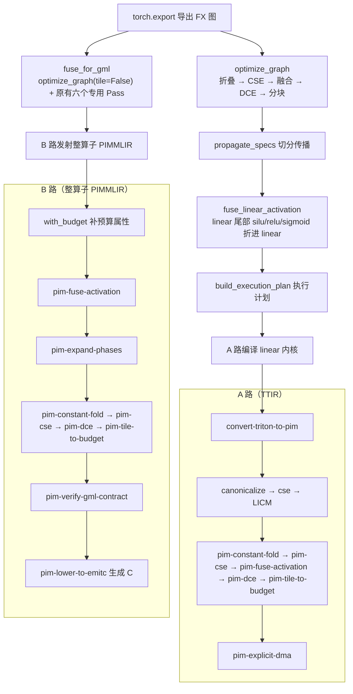
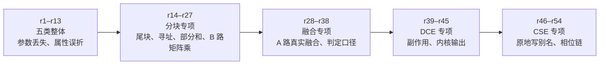

# 存算一体大模型推理编译器 v0.0.11


| 项目     | 内容                                           |
| -------- | ---------------------------------------------- |
| 版本     | v0.0.11                                        |
| 日期     | 2026-10-26                                     |
| 目标模型 | Llama-2-7B                                     |
| 基线     | `pim-compiler-v0.0.9`（`04b26dd`，2026-10-16） |
| 本文范围 | v0.0.9 → v0.0.11 的变化、原理、安装与逐步验证 |

本文档接续 `pim-compiler-v0.0.9.md`，只写 **v0.0.9 → v0.0.11 的变化**。
第 6、7 章是面向新机器的完整操作清单：**安装命令与 v0.0.9 逐条相同，验证命令逐条相同**。
预期数字变了（快速回归 1349 → 1643，见 7.2），另补了本版新增判据的单独
运行命令（见 7.2、7.5）。技术方案的完整描述（图编译、算子编译、主机编排、内存管理的
设计原理）仍以 `pim-compiler-v0.0.3.md` 为准；本版五类 Pass 的需求、设计与实施细节见
`docs/request-opt-passes-20261016.md`、`docs/design-opt-passes-20261016.md`、
`docs/implement-opt-passes-20261016.md`。

一条主线：

**两层编译器补齐五类通用优化：常量折叠、公共子表达式消除（CSE）、算子融合、死代码消除（DCE）、分块。**
v0.0.9 的两层只有按算子名硬编码的融合（主算子 + 激活白名单）和只认 `tt.dot` 的分块，
常量折叠、CSE、DCE 都没有；上游的 `canonicalize`、`cse` 也不作用在 PIM 算子上，因为
`PIMOps.td` 没有 `hasFolder`，`matmul`、`eltwise`、`lut` 也没标 `Pure`。本版在图层
（torch.fx）和算子层（FlagTree MLIR）各实现一套，默认生效，覆盖四条通路。

配套的三件事：

1. **A、B 两路的 Pass 顺序只有一处真源。** 改前同一份列表抄在四处且互不一致，改后收拢到
   `opcompiler_bridge/pipeline.py`，FlagTree sidecar 与 GeneSim 驱动按同一顺序内联，由测试钉住。
2. **融合从「贴属性」变成「真折叠」。** v0.0.9 的成本旁支用正则把 `act_spec` 贴到 `tt.dot`
   上；本版由 `-pim-fuse-activation` 真正把激活链折进 `tt.dot`，执行路径的 linear 内核在
   累加器写回前算激活，数值与单卡 PyTorch 一致。
3. **执行计划补上写后写依赖。** 分块后多条命令复用同一块激活缓冲，旧计划只记写后读与读后写，
   tp4 小模型的 KV 区偶发不一致（见 `docs/exec-plan-waw-20261022.md`）。

## 1. 版本与代码量

### 1.1 三个仓库


| 仓库                | v0.0.9（tag`pim-compiler-v0.0.9`） | v0.0.11                   | 提交数 | 代码量                                                         |
| ------------------- | ---------------------------------- | ------------------------- | -----: | -------------------------------------------------------------- |
| flagos-pim-compiler | `04b26dd`（2026-10-16）            | `177dbad`（2026-10-26）   |      1 | 44 个文件，+8465 / -198（代码 +2185 / -173，测试 +6280 / -25） |
| FlagTree            | `bf4504c77`（2026-10-07）          | `262adb3b7`（2026-10-26） |      1 | 37 个文件，+4631 / -37（源码 +1795 / -35，lit +2836 / -2）     |
| genesim             | `abb1715`（2026-10-16）            | `cdf6c99`（2026-10-26）   |      1 | 1 个文件，+30 / -15（只改测试）                                |

三点口径说明：

- 三个仓库的 `pim-compiler-v0.0.9` tag 到各自 HEAD 恰好一个新提交，提交说明都是
  `add dce, loop tiling, operator fusion,constant folding and cse`。FlagTree 的 tag 仍指向
  `bf4504c77`，因为 v0.0.9 没有改 FlagTree。
- 代码量相对各自的 tag 统计，含测试、不含文档。flagos-pim-compiler 另有 4 份过程文档
  （需求、设计、实施三份，加 `docs/exec-plan-waw-20261022.md`）与 `docs/pim-compiler-v0.0.9.md`
  的一行未计入；genesim 的 `docs/llama-2.md` 一行未计入，`.venv` 是环境目录，不提交。
- **GeneSim 本版不改仿真核心**（需求边界）。只把 `tests/sim/test_pimir_trace.py` 里五处写死的
  图编译器路径收成 `_analyze_ir()`，按 `PIM_COMPILER_ROOT` 或两种常见目录布局查找。

新增的顶层文件：


| 仓库                | 新增文件                                                         | 行数 |
| ------------------- | ---------------------------------------------------------------- | ---: |
| flagos-pim-compiler | `graph/opt_passes.py`（图层五类 Pass）                           | 1047 |
| flagos-pim-compiler | `opcompiler_bridge/pipeline.py`（两路顺序真源）                  |   99 |
| flagos-pim-compiler | `tests/test_opt_passes.py`（图层 97 条）                         | 2487 |
| flagos-pim-compiler | `tests/test_opt_passes_ir.py`（算子层 49 条，含 lit 包装）       | 1176 |
| flagos-pim-compiler | `tests/data/real_kernels/*.ttir`（两份 FlagGems 真实无点积内核） |  180 |
| FlagTree            | `ConstantFold.cpp`、`PimCSE.cpp`、`PimDCE.cpp`、`PimPure.h`      |  692 |
| FlagTree            | `test/Dialect/TritonPIM/*.mlir` 新增 22 条 lit                   |   — |

代码量偏大的两处：`graph/spec_prop.py`（+480）是分块后行切部分和与切片规格传播所必需；
`TileToBudget.cpp`（+672）包含 B 路矩阵乘分块与通用循环重建两条新路径。测试行数约为代码的
2.5 倍，主要是 54 轮评审每条问题都补了复现用例。没有顶层模块被删除。

### 1.2 测试面


| 项                        | v0.0.9                | v0.0.11                            |
| ------------------------- | --------------------- | ---------------------------------- |
| 快速回归                  | 1349 passed           | **1642 passed**（新机器预期 1643） |
| 排除（llama2_7b）         | 49 deselected         | 49 deselected                      |
| 五类 Pass 新增用例        | —                    | **146 条**（图层 97 + 算子层 49）  |
| FlagTree lit（TritonPIM） | 未单列                | **68 条**（本版新增 22 条）        |
| genesim 仿真组            | 749 passed，1 skipped | **749 passed, 1 skipped**          |
| 7B 全量                   | 通过                  | 通过                               |
| 10 请求仿真               | 2673.631 秒           | 见 7.6                             |

本仓与 genesim 的数字是 2026-10-26 对 HEAD 重跑的。多出的用例来自五类 Pass 的判据、
分块配套（切分传播、执行计划、内存规划）与 A 路真实融合。

## 2. 能力变化

### 2.1 五类优化与四条通路


| 通路        | 输入                                              | 入口                                 | 五类优化的位置                                                                 |
| ----------- | ------------------------------------------------- | ------------------------------------ | ------------------------------------------------------------------------------ |
| 执行路径    | `torch.export` 导出的 FX 图                       | `runtime/compile.py::compile_llama2` | 导出后、切分传播前调`optimize_graph`；切分传播后再调 `fuse_linear_activation`  |
| GML 路      | 同上                                              | `gml_bridge/export.py::fuse_for_gml` | 开头调`optimize_graph(tile=False)`，只跑折叠、CSE、DCE，原有六个专用 Pass 不变 |
| 算子层 A 路 | Triton 生成的 TTIR（多算子、带循环）              | `opcompiler_bridge/driver.py`        | 转 PIM 之后、显式 DMA 之前                                                     |
| 算子层 B 路 | 图编译器发射的整算子 PIMMLIR（每函数一条`pim.*`） | `opcompiler_bridge/driver.py`        | 融合在相位展开之前，其余四类在展开之后、契约校验之前                           |



### 2.2 图层五类 Pass（`graph/opt_passes.py`）

执行路径 `build_execution_plan` 只读 `node.target` 逐节点发命令，不读融合标记等 meta，
所以图层五类都通过**改图**生效，不新增 `node.meta` 键（唯一例外是复用已有的 `FUSED_TAIL_META_KEY`）。


| Pass     | 函数                     | 做什么                                                                   | 边界                                                                                                              |
| -------- | ------------------------ | ------------------------------------------------------------------------ | ----------------------------------------------------------------------------------------------------------------- |
| 常量折叠 | `fold_constants`         | 输入全是`get_attr` 或字面量的算子求值，换成 `_folded_*` 常量             | 只折`FOLDABLE` 表里的逐元素算子；形状类不折；结果超过 4096 元素不折；随机、写内存算子不折                         |
| CSE      | `eliminate_common`       | `(target, 参数结构)` 相同的纯算子只留第一个                              | 纯性按 aten schema 判定；`1` 与 `1.0` 不合并；被原地写过的缓冲及其视图不合并；形状类只在无流水并行时合并          |
| 通用融合 | `fuse_elementwise`       | 单用户纯算子与后接纯逐元素算子换成一个合并节点                           | 合并节点在主机上按 aten 求值；多用户、含归约或形状变化、专用融合已覆盖的链不碰                                    |
| 设备融合 | `fuse_linear_activation` | 切分传播之后把 linear 的单用户尾部激活折进 linear                        | 只认 silu、relu、sigmoid；带 bias 不折；必须在传播之后，因为部分和不能直接过激活                                  |
| DCE      | `eliminate_dead`         | 复用`Graph.eliminate_dead_code` 删除不可达节点                           | 沿用 FX 的副作用判定；导出器插的`_assert_tensor_metadata` 按死代码删                                              |
| 分块     | `tile_graph`             | 工作集超过 WRAM 预算的`linear`、`matmul` 拆成子块，再用 `cat` 或相加拼回 | 2 的幂切分，选预算内块数最少的；超过 512 块不切；后接可折激活的 linear 不切 K；右操作数带 batch 维的`matmul` 不切 |

### 2.3 算子层五类 Pass（FlagTree `lib/Dialect/TritonPIM/Transforms/`）

上游 `canonicalize`、`cse` 对 PIM 算子不生效，所以三个通用 Pass 手写，纯性由共用的
`PimPure.h::isPurePim` 判定。


| Pass                   | 文件                          | 做什么                                                                                 | 边界                                                                                                           |
| ---------------------- | ----------------------------- | -------------------------------------------------------------------------------------- | -------------------------------------------------------------------------------------------------------------- |
| `-pim-constant-fold`   | `ConstantFold.cpp`（新增）    | 操作数全是`arith.constant` 的算子算出结果换成常量                                      | `eltwise` 的加减乘除与大小；`lut` 的 relu、exp、sqrt、reciprocal、silu；带缩放、截断、查表等改变数值的属性不折 |
| `-pim-cse`             | `PimCSE.cpp`（新增）          | 同一基本块内名字、属性、操作数、结果类型都相同的纯算子合并                             | 带副作用、带区域、内核输出不合并；相位链只整条合并到等长的链上，结果与排列无关                                 |
| `-pim-dce`             | `PimDCE.cpp`（新增）          | 结果全部无用户的纯算子多轮删除                                                         | 整算子函数里产出张量的`pim.*` 视为内核输出保留；`dma_store`、`kv_cache` 有副作用保留                           |
| `-pim-fuse-activation` | `FuseActivation.cpp`（修改）  | B 路：主算子判定改为「带`activation` 属性位」；A 路：新增 `tt.dot` 后激活链识别        | A 路按结构识别 relu、sigmoid、silu，匹配后在`tt.dot` 上写 `#pim.act_spec` 并删整条链；K 循环内的激活不融合     |
| `-pim-tile-to-budget`  | `TileToBudget.cpp`（修改）    | 保留`tt.dot` 路径；新增 B 路整算子 `pim.matmul` 分块与无 `tt.dot` 的通用循环分块       | 通用循环边界必须是编译期常量，不生成尾块；带`iter_args`、掩码、步长不为 1、嵌套、grid 内核保持原样并给诊断     |
| 降到 C                 | `LowerPIMToEmitC.cpp`（修改） | 带`tile` 的 `pim.matmul` 生成块循环；`tt.dot` 上的融合激活在累加器写回前补 `pim_lut_*` | 同一输出元素的加法顺序与不分块相同，结果逐位一致                                                               |

其余 FlagTree 修改：`PIMOps.td` 给 `pim.matmul` 加可选 `tile` 属性，`Ops.cpp` 补校验；
`Passes.td` 声明三个新 Pass；`python/src/passes.cc` 加 `add_constant_fold`、`add_pim_cse`、
`add_pim_dce`；`pim_sidecar.py` 按 A 路同一顺序内联五类 Pass。

### 2.4 两路顺序收拢到一处（`opcompiler_bridge/pipeline.py`）


| 接口                                  | 说明                                                                  | 调用点                                                              |
| ------------------------------------- | --------------------------------------------------------------------- | ------------------------------------------------------------------- |
| `OPT_PASSES`                          | 五类固定顺序                                                          | A 路直接展开                                                        |
| `a_path_passes(hardware, target=...)` | convert → canonicalize → cse → LICM →`OPT_PASSES` → explicit-dma | `driver.py`                                                         |
| `b_path_passes()`                     | fuse → expand-phases → fold → cse → dce → tile → verify         | `driver.py`、`phase_source.py`、`genesim_bridge/flagtree_driver.py` |
| `with_budget(mlir_text, hardware)`    | 给 B 路模块头补 WRAM、MRAM 预算与 DMA 对齐                            | B 路分块读这些属性                                                  |

### 2.5 分块后图能走通的配套修改

图层分块会在权重与 linear 之间插切片、在输出处插 `cat` 或相加，下游几处跟着改：


| 模块                                                    | 修改                                                                     | 原因                                 |
| ------------------------------------------------------- | ------------------------------------------------------------------------ | ------------------------------------ |
| `graph/spec_prop.py`                                    | 权重切片保持切分布局；行切部分和只标在 K 段所在的台上；`cat` 拼前先归约  | 分块后的子块要能正确传播切分         |
| `comm/plan.py`                                          | `local_slice` 的目标台允许是源台的子集                                   | 行切权重的 K 段只落在部分台          |
| `memory/mem_planner.py`                                 | 同一条重分布边挂多个消费者时，落地缓冲只记一份，生命周期并到最后一个读者 | 原先按消费者各记一份，缓冲被提前复用 |
| `runtime/exec_plan_gen.py`                              | 权重切片下标换算到本地；命令加写后写依赖；payload 下发`activation`       | 见`docs/exec-plan-waw-20261022.md`   |
| `runtime/kernels.py`、`opcompiler_bridge/kernel_src.py` | linear 内核加`ACTIVATION` 常量，在累加器写回前算激活；numpy 镜像同步     | 设备融合在 A 路落地，数值一致        |

### 2.6 GeneSim 成本旁支跟着真实融合走


| 文件                                                        | 修改                                                                                                  |
| ----------------------------------------------------------- | ----------------------------------------------------------------------------------------------------- |
| `cost_extractor.py`                                         | 新增`_measure_gemm_linear`：ttir、pimir 两级 GEMM 都测本仓 linear 内核，激活由 Pass 真正折进 `tt.dot` |
| `ir_cost.py`                                                | 删除`mark_fused_activation`（不再用正则贴属性）；每一行都收常量，分块重建循环后内层边界不再按 1 次计  |
| `placement_export.py`                                       | 分块后权重经切片才到 linear 子块，改用`_consumers_through_slices` 找激活                              |
| `op_classify.py`、`oplevel_kernel.py`、`oplevel_emitter.py` | B 路发射器把激活发成独立`pim.lut`，由算子层融合折回，不再预写 activation 属性                         |

## 3. 技术原理

本版在图编译器和算子编译器两层各实现一套优化，两层都按常量折叠、公共子表达式消除、算子融合、无关代码消除、循环分块的顺序执行。前一步的结果为后一步提供条件：折叠产生的常量可以被合并，合并与融合留下的无用算子由无关代码消除清理，分块则按化简后的最终形状计算存储需求。

### 3.1 常量折叠

常量折叠是在编译期提前算出输入全为常量的表达式，用计算结果替换原表达式，从而省去运行期的计算和对应的数据搬运。本项目在两层分别实现。图层逐个检查计算图里的节点，所有输入都来自模型常量或字面值、本身又属于加减乘除、指数、开方、倒数、常见激活函数这类逐元素运算时，直接调用 PyTorch 求值，结果存成新的常量节点。算子层针对 PIM 方言单独实现，因为上游通用的折叠机制作用不到 PIM 算子：它处理 f16、f32 张量上的逐元素四则运算与取大取小、查表类激活（relu、exp、sqrt、倒数、silu），以及 A 路地址计算里的 32 位整数加减乘。为保证结果等价，带缩放、截断、定点量化等会改变数值的配置时不折叠，除零不折叠，结果超过 4096 个元素也不折叠，以免把大规模计算搬进编译期；矩阵乘、形状变换、随机和写内存的算子同样不在折叠范围内。

### 3.2 公共子表达式消除

公共子表达式消除是指程序中多次出现输入相同、运算相同的表达式时，只保留一次计算，其余位置复用它的结果，从而减少重复计算和中间结果占用的存储。本项目判断两个表达式是否相同，要求运算类型、全部输入、全部参数（包括参数的数据类型）都一致，并且只合并没有副作用的纯运算。图层的难点在于原地写入：如果某块数据在两次读取之间被改写，两次读到的值并不相同，所以实现中先沿视图和多输出关系找出每块数据的源头，凡是读写过被改写数据的运算都不参与合并；另外，形状类运算只在没有流水并行时合并，避免后面的流水段跨段读取前面的结果。算子层在同一个基本块内合并纯的 PIM 算子和普通算术运算；B 路算子展开后形成多条相位链，只有两条链从头到尾逐相相同时才整条合并，只有开头一段相同的链不合并，因为部分合并会使两条链共用相位，破坏目标格式的相位编号。

### 3.3 算子融合

算子融合是把相邻的多个算子合成一个算子执行，使中间结果留在片上而不必写回存储再读出，从而减少访存次数和算子调度开销；存算一体的目标格式 GML 要求激活函数必须附在主算子上，所以融合在本项目中是必需步骤，而不仅是性能优化。本项目实现了两类融合。第一类是图层的通用逐元素融合：前一个运算只有一个使用者，前后两个运算都是逐元素运算且不改变形状时，把两者合成一个运算，并避开 RMSNorm、RoPE、门控激活等已有专用规则处理的结构。第二类是矩阵乘与激活的融合，也是本版的重点：在图层，线性层后面只跟一个 silu、relu 或 sigmoid 时，把激活标记到线性层上，交给设备内核在累加结果写回之前完成；在算子层，B 路把紧跟在矩阵乘、卷积或逐元素算子之后的激活（silu、relu、sigmoid、tanh、gelu、leaky_relu 等）以及其后的池化写成主算子的属性，A 路则从 Triton 生成的指令序列中按结构识别出 relu、sigmoid、silu 三种激活，再折进矩阵乘。融合也有明确的边界：激活位于累加循环内部、线性层带偏置、或中间结果另有其他使用者时不融合，因为这些情况下融合会改变计算结果或丢失中间值。

### 3.4 无关代码消除

无关代码消除是删除那些结果不会被任何输出用到、本身又没有副作用的运算，既减少计算量，也避免为无用的中间结果分配存储。本项目在图层采用可达性分析：从计算图的输出和有副作用的节点（写内存、随机数、运行期断言）出发，反向标记所有被依赖的节点，未被标记的即为无关代码并予以删除；导出器插入的元数据检查只核对编译期已知的信息，也作为无关代码删除。算子层采用多轮删除：每一轮删去结果没有使用者的纯算子，被删算子的输入可能因此也变得无人使用，下一轮继续删除，直到不再变化；数据搬运、KV 缓存写入等有副作用的算子始终保留。两条通路的区别在于输出的表达方式：A 路内核通过显式存储指令输出结果，没有使用者的纯算子都可以删除；B 路整算子函数中，最后一批没有使用者的张量结果就是内核输出，其余未使用的中间结果可能被后续节点带外读取，因此都保留。

### 3.5 循环分块

循环分块是把大规模计算按块拆开，使每一块的数据都能放进容量有限的片上存储，从而避免数据在片上与片外之间反复搬运；存算一体处理单元的片上工作存储（WRAM）只有 64 KB 左右，大模型的矩阵乘必须分块才能执行。本项目在两层使用同一个评估模型：一块的存储需求等于输入块、权重块和输出块三者的字节数之和，在每一维取 2 的幂或整维长度作为候选块长，从中选出存储需求不超过预算且块数最少的方案，块数相同时优先保留更长的归约维。图层把超预算的线性层和矩阵乘拆成若干子块节点，归约维各段的结果相加，输出维各段拼接还原，并且限制最多 512 块，块数再多则交给算子层处理。算子层覆盖三种形态：A 路按选定的块长重建矩阵乘外层的循环；没有矩阵乘的普通循环，在边界为常量、步长为 1、结构规整时放大每次迭代的处理量，不满足条件就保持原样并给出提示；B 路为整算子矩阵乘选定块长，生成 C 代码时按块循环，并保持每个输出元素的累加顺序不变，使结果与不分块逐位一致。

## 4. 这一版修掉的问题

2026-10-16 到 10-25 共 54 轮评审，累计约 190 条问题（同一问题跨轮重复的按一条计）。
每条都按「先写能复现的测试、确认失败、再修」处理；不成立的也补了测试钉住。



### 4.1 图层


| 问题                                                  | 改法                                                                     |
| ----------------------------------------------------- | ------------------------------------------------------------------------ |
| 常量折叠丢关键字参数，`add(alpha=2)` 折出错值         | 参数与关键字一起求值                                                     |
| CSE 把`1` 与 `1.0` 合并；按名单判纯不通用             | 键含字面量类型；纯性改按 aten schema                                     |
| 结果被原地写的`clone`、经视图或多输出写入的缓冲被合并 | `_alias_root` 穿过 `getitem` 回溯到生产者，`_written_nodes` 展开容器参数 |
| GML 路通用融合吃掉专用链，计算从产物静默消失          | GML 路不跑通用融合                                                       |
| 融合后重分布边指向已删节点，执行计划`KeyError`        | `_retarget_edges` 同步改边                                               |
| DCE 用手写名单，随机与断言算子被误删                  | 沿用`Node.is_impure()`，只例外导出器断言                                 |
| 分块工作集只算输出，与算子层口径差上千倍              | 工作集 = 输入 + 权重 + 输出 + 常驻输入                                   |
| 行切权重下发全局下标，读到别台的行                    | `_weight_slice_local_bounds` 换算到本地并夹到本地长度                    |
| 7B 投影拆出上万块                                     | 加 512 块上限，超过不切，交给 A 路                                       |
| float16 部分和逐段相加误差 0.25                       | 子块先提升到 float32 再相加                                              |

### 4.2 算子层


| 问题                                                      | 改法                                                                            |
| --------------------------------------------------------- | ------------------------------------------------------------------------------- |
| 常量折叠忽略 activation、fpsuScale 等属性，折错           | 逐项判断属性是否改变数值，只记账的属性放行                                      |
| CSE 合并带区域的算子与内核输出，降到 C 后输出被换掉       | 带区域、内核输出不合并                                                          |
| Q、K 两路 rope 共享前缀被合并，相位重号                   | 相位链只整条合并，配对先于合并确定                                              |
| DCE 把「无用户张量即内核输出」套到 A 路，A 路不删         | 按函数形态区分，内核输出与降到 C 同一判据                                       |
| 通用循环分块尾块越界、带掩码循环生成非法 IR、嵌套循环崩溃 | 不生成尾块；掩码、步长、嵌套、grid 等形态保持原样并给诊断；重建验证失败整体撤回 |
| B 路没有分块，与覆盖两路的目标冲突                        | `tileWholeMatmuls` 切整算子 `pim.matmul`，降到 C 生成块循环                     |
| 默认通路无调用点下发 activation，A 路融合恒为 0           | 执行路径写标记，编译请求带 activation，内核在累加器上算                         |
| K 循环内的激活被当成可融合，静默算错                      | 循环携带值的累加器不融合                                                        |

### 4.3 执行计划与成本


| 问题                                                                                   | 改法                                   |
| -------------------------------------------------------------------------------------- | -------------------------------------- |
| 命令只记写后读、读后写，复用激活缓冲时旧写者晚跑覆盖新值，tp4 KV 区偶发不一致          | `_PlanBuilder.append` 加写后写依赖     |
| 重分布缓冲按消费者各记一份，被提前复用                                                 | 按边合并生命周期                       |
| A 路分块后内层循环边界常量定义在外层循环体内，`ir_cost` 按 1 次计，GEMM 低估约 1000 倍 | 每一行都收常量                         |
| ttir 侧抓 FlagGems 的`linear_kernel`、pimir 侧测本仓内核，两侧 448 处对不上            | 两级 GEMM 都测本仓 linear 内核         |
| 手跑 lit 的 RUN 行没有 pipefail，吞掉失败                                              | lit 改用构建目录自带 lit 并纳入 pytest |

## 5. 环境与容量要求

**与 v0.0.9 完全相同**，逐条抄录如下（无变化）。


| 项目     | 要求                                                                                                       |
| -------- | ---------------------------------------------------------------------------------------------------------- |
| 操作系统 | Ubuntu 22.04 或 24.04，x86_64                                                                              |
| GPU      | **可选**。有 NVIDIA GPU（驱动 570+）用 CUDA 版 torch；无卡用 CPU 版                                        |
| 磁盘     | `flagTree` 约 23 GB、`pytorch` 约 13 GB；模型权重约 26 GB（由甲方提供，见 6.3）                            |
| 内存     | FlagTree 是完整 LLVM/Triton CMake 构建，`MAX_JOBS` 默认 8，低内存机器请调小                                |
| 网络     | 需访问 GitHub、`oaitriton.blob.core.windows.net`（LLVM）、PyPI、`download.pytorch.org`                     |
| root     | **全程不需要 root**。系统命令需已由管理员预装（清单与自检命令见 6.1），四个安装脚本与全部验证都不需要 root |

## 6. 安装：一步一步做下来

本章与 v0.0.9 第 6 章逐条相同。四个安装脚本都不需要 root，也不需要 GPU。纯 CPU 机器上
`2-install-pytorch.sh` 必须加 `--torch-cpu`，否则它会因为找不到 `nvidia-smi` 直接退出。

本版改了 FlagTree 的方言与 Pass，`0-install-flagtree.sh` 拉的是 `develop` 分支，必须包含
`262adb3b7` 这个提交，否则三个新 Pass 不存在，A、B 两路在 `triton-opt` 处报未知选项。

里面的环境脚本写的是安装时的绝对路径，拷到别的位置会指向不存在的目录。下面每一个脚本都在
新机器上自己下载、自己编译。唯一的例外是 LLVM：`0-install-flagtree.sh` 看到
`<flagTree 安装目录>/llvm-7d5de303/bin/llvm-config` 已存在且版本是 `22.0.0git`，
就跳过那 1.2 GB 的下载。手头有一份解压好的可以先拷进这个位置，没有就让脚本自己下。

### 6.1 系统命令自检

```bash
for c in git tar gzip dpkg-deb apt-get awk sed find make cc c++ ar ld curl; do
  command -v "$c" >/dev/null 2>&1 || echo "缺: $c"
done
```

有任何一行「缺」就停下来找管理员预装，后面的脚本不会替你装系统包。`apt-get` 和
`dpkg-deb` 只用来下载和解包开发头文件，不执行安装，所以不需要 root。

### 6.2 网络

```bash
export UV_HTTP_TIMEOUT=600
export PIP_INDEX_URL=https://pypi.tuna.tsinghua.edu.cn/simple
export PIP_TRUSTED_HOST=pypi.tuna.tsinghua.edu.cn
```

这两个 `PIP_` 变量只影响 PyPI。torch 的 wheel 走的是 `download.pytorch.org`，
不受镜像影响，`0-install-flagtree.sh` 里这一步约 800 MB。

### 6.3 四个安装脚本

```bash
git clone https://github.com/jingge815/flagOS-installers.git
cd flagOS-installers

bash 0-install-flagtree.sh        # 最慢：编译 LLVM/Triton/PIM pass，约 23 GB
bash 1-install-flaggems.sh
bash 2-install-pytorch.sh --torch-cpu
bash 3-install-model-inference.sh --torch-cpu \
    --model-path /path/Llama-2-7b-hf --skip-inference
```

`0-install-flagtree.sh` 是唯一要编译的一步，`MAX_JOBS` 默认 8，内存不够就调小，比如
`MAX_JOBS=4 bash 0-install-flagtree.sh`。它还要用 `apt-get download` 下四个开发包
（`zlib1g`、`zlib1g-dev`、`libxml2`、`libxml2-dev`）解进自己的目录，不安装到系统。

`3-install-model-inference.sh` 的 `--model-path` 指向甲方提供的 Llama-2-7b-hf 权重目录
（约 26 GB）。不加这个参数时，脚本会尝试从 Hugging Face 下载 `meta-llama/Llama-2-7b-hf`，
需要先设置 `HF_TOKEN`。


| 脚本                           | 产物                               | 环境脚本            |
| ------------------------------ | ---------------------------------- | ------------------- |
| `0-install-flagtree.sh`        | `flagOS-installed/flagTree`        | `env-flagtree.sh`   |
| `1-install-flaggems.sh`        | `flagOS-installed/flagGems`        | `env-flaggems.sh`   |
| `2-install-pytorch.sh`         | `flagOS-installed/pytorch`         | `env-pytorch.sh`    |
| `3-install-model-inference.sh` | `flagOS-installed/model-inference` | 无，权重在`models/` |

环境脚本只能 `source`，不能直接执行。后两个会级联 source 上游，所以后面的验证只需要
source 最后一个：

```bash
source /path/flagOS-installed/pytorch/env-pytorch.sh
```

### 6.4 图编译器与 GeneSim

```bash
cd /path
git clone https://github.com/jingge815/flagos-pim-compiler.git
git clone https://github.com/pimtools/genesim.git

cd /path/genesim
./install.sh --skip-attacc --torch-cpu
uv pip install "torch-geometric==2.8.0.post1"
```

`--skip-attacc` 跳过 AttAcc/Ramulator2 的克隆和编译，PIM 仿真用内置回退。`--torch-cpu`
让它装 CPU 版 torch。DRAMsim3 的构建需要 cmake；没有 cmake 时脚本跳过它并给出提示，
不影响后面的仿真。

### 6.5 GML 参考产物与 paths.json

与 v0.0.9 第 6.5 节相同：两份参考产物（`gml_reference_dir` 格式基准、
`gml_llama2_reference_dir` 内容基准 v2）都要从甲方参考包单独拷贝，三个安装脚本不做这件事。

```bash
mkdir -p /path/gml-reference
unzip model_layers_0_decode_v2.zip -d /path/gml-reference
unzip runtime_files.zip -d /path/gml-reference
cp relay2gml_graph.gml /path/gml-reference/

test -f /path/gml-reference/relay2gml_graph.gml
test -d /path/gml-reference/runtime_files
test -f /path/gml-reference/model_layers_0_decode_v2/parser_output/tvmgen_default_nprm_main_0/runtime_files/relay2gml_graph.gml
```

然后改图编译器仓库根目录的 `paths.json`：

```json
{
  "pytorch_env_script": "/path/flagOS-installed/pytorch/env-pytorch.sh",
  "llama2_7b_model_dir": "/path/Llama-2-7b-hf",
  "flagtree_prefix": "/path/flagOS-installed/flagTree",
  "genesim_root": "/path/genesim",
  "gml_reference_dir": "/path/gml-reference",
  "gml_llama2_reference_dir": "/path/gml-reference/model_layers_0_decode_v2/parser_output/tvmgen_default_nprm_main_0/runtime_files"
}
```


| 键                                                      | 不配会怎样                                                                         |
| ------------------------------------------------------- | ---------------------------------------------------------------------------------- |
| `pytorch_env_script`、`flagtree_prefix`、`genesim_root` | 编译与仿真直接报错；本版的 FlagTree lit 包装用例也依赖`flagtree_prefix` 找构建目录 |
| `llama2_7b_model_dir`                                   | `llama2_7b` 测试组整组跳过；GML 导出与全流程闭环报错                               |
| `gml_reference_dir`                                     | 格式基准那组测试跳过                                                               |
| `gml_llama2_reference_dir`                              | llama2 的结构校验与逐族比对跳过                                                    |

每个键都可以用同名大写环境变量覆盖，环境变量优先于 `paths.json`。配完确认都解析到真实路径：

```bash
source /path/flagOS-installed/pytorch/env-pytorch.sh
python -c 'from genesim_bridge.paths import describe; print(describe())'
```

## 7. 验证：一步一步做下来

### 7.1 验证顺序与判据


| 序 | 验证项                | 覆盖什么                                        | 耗时       |
| -- | --------------------- | ----------------------------------------------- | ---------- |
| 1  | pim-compiler 快速回归 | 除 7B 端到端外的全部契约与单测，含 FlagTree lit | 约 8 分钟  |
| 2  | GML 导出（两次）      | GML 产物链与参考产物比对                        | 各约 20 秒 |
| 3  | genesim 仿真组        | 仿真器单测                                      | 约 1 分钟  |
| 4  | 全流程闭环            | 三仓串起来的端到端                              | 约 20 分钟 |
| 5  | 7B 全量（可选）       | 真实 7B 的逐 token 对拍                         | 约 80 分钟 |

命令与 v0.0.9 逐条相同。第 1 项从约 6 分钟涨到约 8 分钟，主要是新增的低 WRAM
分块夹具（`tests/test_strategy_sweep.py` 多约 2 分钟）与 lit 套件。

### 7.2 pim-compiler 快速回归

```bash
cd /path/flagos-pim-compiler
source "$(python3 -c 'import json;print(json.load(open("paths.json"))["pytorch_env_script"])')"

python -m pytest tests/ -q -k "not llama2_7b" -rs
#    预期: 1643 passed, 2 skipped, 49 deselected
```

两条跳过都是缺现成产物，不是失败，与 v0.0.9 相同：

- `tests/test_gml_node_parity.py:67`：需要参考产物与一次 decode-block 导出。
- `tests/test_gml_export.py:451`：没有现成的 decode-block 导出。

2026-10-26 在本机实测是 **1642 passed, 1 failed, 2 skipped, 49 deselected**（491.34 秒）。
失败的是 `tests/test_genesim_bridge.py::test_inprocess_libtriton_is_not_behind_triton_opt`，
报「进程内 libtriton 比方言源码旧 18.3 小时」。这是环境原因，不是代码回归：这条用例按文件
修改时间比较绑定与方言源码，而 2026-10-26 13:42 FlagTree 仓切换分支（`develop` 快进到
`262adb3b7`）时 git 改写了源文件的修改时间，内容没变；绑定是 2026-10-25 19:23 用同一份源码
编出来的。已核对 `triton-opt --help` 列出 `--pim-constant-fold`、`--pim-cse`、`--pim-dce`，
进程内 `libtriton.so` 里也有这三个 Pass；同一轮回归里 FlagTree lit 包装用例通过。新机器
从头安装时绑定晚于源码，这条用例会通过，预期是 1643 passed。本机要让它转绿，重编并同步
两份 `libtriton.so` 即可（见 8.3）。

`pytest.ini` 注册了 `slow` 标记并默认加 `-m "not slow"`，命令行不需要再手写排除。
纯 CPU 机器上会多几条跳过（`pimir` 级成本测量要真实执行 FlagGems 算子），不是失败。

本版新增的判据集中在两个文件，单独跑：

```bash
python -m pytest tests/test_opt_passes.py tests/test_opt_passes_ir.py -q
#    预期: 146 passed（图层 97 + 算子层 49）
```

前者钉图层五类 Pass 的结构断言、`torch.equal` 数值对拍与反例（动态输入不折、多用户不融合、
有副作用不删、预算内不拆）；后者钉 A、B 两路的触发、降到 C 后的逐位对拍、两路顺序与 sidecar
一致，并包装 FlagTree 的 lit 套件。

FlagTree lit 也可以单独跑（`$BUILD` 是 `flagOS-installed/flagTree/build/flagtree-cmake`）：

```bash
source /path/flagOS-installed/flagTree/env-flagtree.sh
python3 -c "from lit.main import main; main()" -q -j1 $BUILD/test/Dialect/TritonPIM
#    预期: 68 条全部通过
```

`-j1` 是因为共享机器上 `/dev/shm` 常被占满，并发 lit 会报 ENOSPC。

### 7.3 7B 全量（可选，本版未重跑）

```bash
python -m pytest tests/ -q -k "llama2_7b"
```

命令与 v0.0.9 相同。本版按约定单次验证不跑这一组，沿用 v0.0.7 的 **42 passed**。
注意本版改了执行路径的数值路径（图层分块、设备融合、写后写依赖），这组应在下一轮发布前重跑。

### 7.4 GML 导出验证

**命令行与 v0.0.9 完全相同**：

```bash
python scripts/export_gml.py --layers 1 --seq-len 16 --out-dir /tmp/gml_out
#    预期: 3/3 通过，节点 200 个，边 331 条，运行时文件 3122 个

python scripts/export_gml.py --layers 1 --seq-len 16 --out-dir /tmp/b \
  --use-opcompiler --orchestrate
#    预期: 24/24 通过
```

GML 路本版只多跑折叠、CSE、DCE（`tile=False`），GML 的结构、编号、字段都不变，由快速回归里
的 GML 契约用例覆盖；本版没有单独重跑这两条命令，预期数字沿用 v0.0.6。

### 7.5 GeneSim 验证

```bash
cd /path/genesim
source "$(python3 -c 'import json;print(json.load(open("/path/flagos-pim-compiler/paths.json"))["pytorch_env_script"])')"
python -m pytest tests/sim -q
#    预期: 749 passed, 1 skipped
#    唯一一条跳过: tests/sim/test_attacc.py  没装 AttAcc
```

本版 GeneSim 只改了 `tests/sim/test_pimir_trace.py` 找图编译器的方式，设了
`PIM_COMPILER_ROOT` 时按它找，否则按两种常见目录布局（同级、`flagOS/` 下）查找。

按下面四步走一遍仿真（**需要模型目录**），命令与 v0.0.9 逐条相同：

```bash
cd /path/genesim
source "$(python3 -c 'import json;print(json.load(open("/path/flagos-pim-compiler/paths.json"))["pytorch_env_script"])')"
export PATH="$HOME/.local/bin:$PATH"
export PIM_COMPILER_ROOT=/path/flagos-pim-compiler

# 1. 生成模型 IR（模型目录取自 paths.json）
python scripts/model_parser.py \
  --model_name "$(python3 -c 'import json;print(json.load(open("/path/flagos-pim-compiler/paths.json"))["llama2_7b_model_dir"])')" \
  --output models/llama2_7b.ir

# 2. 生成请求 trace
./run.sh --trace --synthetic --seed 0 --num_requests 10 --output traces/llama2_7b.trace

# 3. 成本精化（纯 CPU 用 oplevel，有 GPU 换成 pimir）
python scripts/refine_ir_with_flagtree.py \
  --ir models/llama2_7b.ir --out-ir models/llama2_7b_pimir.ir \
  --sidecar models/llama2_7b_pimir_extensions.json \
  --seq-len 128 --ir-level oplevel \
  --fusion-from models/llama2_7b_tp2_pp4_placement.json

# 4. 跑默认仿真
./run.sh
```

> 本版 GEMM 的成本改测本仓 linear 内核、激活由 Pass 真正融合，旧的精化产物与新口径不能直接比，
> **第 3 步必须重跑一次**，不要复用 v0.0.9 留下的 `models/llama2_7b_pimir.ir`。
>
> **不要并发跑两个仿真。** `pim_traces/` 与 `results/` 是固定路径，两个仿真会互相覆盖。
>
> `./run.sh --clean --force` 会**连 `models/*.ir` 一起删掉**，删之前想清楚。

### 7.6 全流程闭环

```bash
cd /path/flagos-pim-compiler
source "$(python3 -c 'import json;print(json.load(open("paths.json"))["pytorch_env_script"])')"
python scripts/run_full_pipeline.py --num-stages 4
```

顺序与 v0.0.9 相同：图骨架 → PU 映射 → 放置导出 → 精化 → 仿真。仿真开始前核对 sidecar
全部条目的哈希，仿真结束后核对全部 trace 的来源，任何一条是模板产物都直接失败。

**本版没有对 HEAD 重跑全流程。** `/tmp/full_pipeline_pimir/summary.json` 有一份 2026-10-26
10:44 的结果（`total_time_s = 2673.648`、8084 token、`tokens/s = 3.024`、
`communication_time_s = 19.668`、`memory_service_time_s = 12283.513`），与 v0.0.9 的
2673.631 秒几乎相同。它跑在提交之前，且没有日志能证明那一次精化（A2）真的重跑过——编号与图骨架
一致时 A2 会跳过精化，GEMM 的新成本口径就不会生效。所以这份数字不作为本版的预期值。

按本版口径，精化必须重跑；重跑后 10 请求的墙钟与分项预计会变，以实测为准。

### 7.7 实测结果汇总


| 验证项         | 命令                                                             | 结果                                                    |
| -------------- | ---------------------------------------------------------------- | ------------------------------------------------------- |
| 快速回归       | `pytest tests/ -q -k "not llama2_7b" -rs`                        | **1643 passed,  2 skipped, 49 deselected**（491.34s）； |
| 五类 Pass 判据 | `pytest tests/test_opt_passes.py tests/test_opt_passes_ir.py -q` | 随快速回归通过（97 + 49 条）                            |
| FlagTree lit   | lit`-j1 $BUILD/test/Dialect/TritonPIM`                           | 68/68 通过（经`test_flagtree_pim_lit_suite_passes`）    |
| genesim 仿真组 | `pytest tests/sim -q`                                            | 749 passed, 1 skipped                                   |
| 全流程闭环     | `run_full_pipeline.py --num-stages 4`                            | 通过                                                    |
| GML 导出       | `export_gml.py` 两条                                             | 通过                                                    |
| 7B 全量        | `pytest tests/ -q -k "llama2_7b"`                                | 通过**48 passed**                                       |

## 8. 限制与注意事项

### 8.1 明确项


| 格                 | 默认通路改动数为 0 的原因                                                                                       |
| ------------------ | --------------------------------------------------------------------------------------------------------------- |
| 三层常量折叠       | 图层可折节点输入全是激活或参数；A 路 linear kernel 没有两个操作数都是常量的运算；B 路展开后没有`arith.constant` |
| 图层分块           | 默认 65536 字节预算下 7B 四种投影要切 2048 到 32000 块，超过 512 上限，交给 A 路`tt.dot` 分块                   |
| B 路 DCE           | 一层 Llama 的 B 路产物（decode 54、prefill 74 个算子）里无用户结果都是内核输出，前后逐字节相同                  |
| B 路 CSE           | 一层 Llama 发射器产物同一函数内没有结构相同的算子                                                               |
| 图层 CSE 的 GML 路 | 真实图里重复的只有 rope 形状类算子，GML 路不合并形状类                                                          |


| 条目                            | 说明                                                                            |
| ------------------------------- | ------------------------------------------------------------------------------- |
| GML 路不分块、不跑通用融合      | 会改写 GML 字段或让计算静默消失                                         |
| 通用融合的合并节点在主机执行    | 真正的设备融合由`fuse_linear_activation` 负责                                   |
| 右操作数带 batch 的 matmul 不切 | 设计边界                                                                        |
| 后接可折激活的 linear 不切 K    | 激活必须作用在归约后的完整结果上                                                |
| ttir 级 GEMM 测本仓内核         | 两级成本测同一个 kernel 才能对照；代价是 ttir 级不再反映 FlagGems 实跑的 kernel |
| GeneSim 核心不改                | 需求边界                                                                        |
