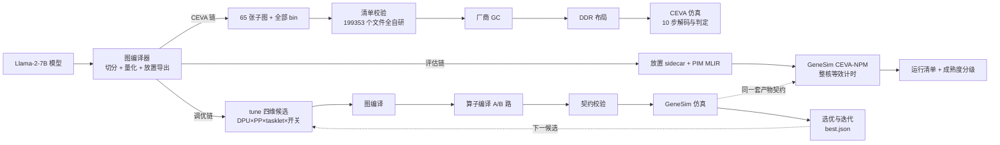

# 存算一体大模型推理编译器 v0.0.12


| 项目     | 内容                                           |
| -------- | ---------------------------------------------- |
| 版本     | v0.0.12                                        |
| 日期     | 2026-11-13                                     |
| 目标模型 | Llama-2-7B                                     |
| 基线     | `pim-compiler-v0.0.11`（`177dbad`，2026-10-26） |
| 本文范围 | v0.0.11 → v0.0.12 的变化、原理、安装与逐步验证 |

　　本文档接续 `pim-compiler-v0.0.11.md`，只写 **v0.0.11 → v0.0.12 的变化**。第 6、7 章仍是面向新机器的完整操作清单：安装命令与 v0.0.11 逐条相同，验证在原有项目之外新增两项——CEVA 全流程（见 7.4）与编译调优一键闭环（见 7.5）。三个特性的需求、设计、实施与评审细节见 `docs/techdoc-ceva-llama2-7b-20261104.md`、`docs/techdoc-ceva-genesim-hw-align-20261109.md`、`docs/techdoc-tune-loop-20261112.md`，调优命令手册见 `docs/tune-user-guide-20261113.md`。技术方案的完整描述（图编译、算子编译、主机编排、内存管理的设计原理）仍以 `pim-compiler-v0.0.3.md` 为准。

　　一条主线，三个特性：

　　**一、支持 CEVA 后端：自研编译产物走厂商工具链完成全流程推理。** 图编译器把 Llama-2-7B 展开成 65 张 CEVA 子图（32 张 prefill、32 张 decode、1 张输出头），重新生成全部配套 `bin`（199353 个文件全部自研产出，不复制厂商字节），经厂商 GC、DDR 布局工具和 CEVA 仿真器完成 10 步解码。判定报告 21 项通过、1 项告警（词元从第 8 个起合法分叉），各阶段周期与厂商基线偏差在 ±20% 内。入口是一条命令：`scripts/run_ceva_pipeline.sh --run-name ours_e2e --decode-steps 10`。

　　**二、GeneSim 评估配置拟合 CEVA。** GeneSim 新增 CEVA-NPM 后端与五份场景（1/64/128 核 × 每核 4/1 engine），按整核等效建模：一个核就是一个调度单位，成本来自算子编译器真实 PIM MLIR 的指令流乘以逐原语周期表；每核容量以整数字节为唯一真源，图编译器与仿真器共用同一预算；结果按证据强度分级，参数来源台账区分实测与假设，未独立验证前只标 `model_prediction`。

　　**三、打通基础版编译调优 → 图编译 → 算子编译 → GeneSim 的全流程闭环。** 新增 `tune` 调优包与一键脚本：外层搜索四维候选（DPU 数 × 流水段数 × tasklet 数 × 编译优化开关），每个候选真实走一遍图编译、算子编译与仿真，按仿真总时延选优；产物按内容键缓存，支持续跑、严格复跑与硬件扫描。真实四维 16 候选全部成功，最优配置把单请求仿真时延从 27.5 秒降到 7.6 秒。

　　配套的四件事：

1. **硬件画像成为唯一参数源。** 新增 `contracts/hardware_profile.py` 与三份基线画像，编译相关字段的摘要与完整画像的摘要分开：只扫时钟等仿真参数时复用编译产物，改容量、DPU 数或优化开关必然重编。
2. **放置 sidecar 升级并带产物门禁。** sidecar 升到 version 4（字节预算）与 version 5（编译契约）；GeneSim 侧 `run_manifest` 升级为统一产物核验库，仿真启动前核对工具链身份、内容哈希、编译路由与预算属性，运行清单归档全部输入的 SHA256。
3. **FlagTree 两处修改。** 提交 `0d7273bac` 为输出头打通八位权重与 `fixed2float` 契约；工作区改动让 EmitC 降级按 tasklet 切分输出行，使调优参数真实进入生成代码。
4. **GeneSim 性能日志扩展与旧支线删除。** 仿真总结补齐模型身份、三级 PIM 拓扑与逐请求上下文；图编译器删除自研 `orchestrator/` 支线，层内编排交给厂商 GC。

## 1. 版本与代码量

### 1.1 三个仓库

　　三个仓库各自从 v0.0.11 基线前进：图编译器四个提交（纯 CPU 修复 `bf5b8a5`、CEVA 全流程 `1226e96`、成本模型配置文档 `f918586`、GeneSim 对齐 `df9b05c`），调优特性在工作区尚未提交；GeneSim 两个提交（性能日志扩展 `34481fe`、CEVA 后端 `3844941`），调优配套在工作区；FlagTree 一个提交（八位权重与 `fixed2float`），tasklet 切分在工作区。代码量相对各自的 v0.0.11 基线统计，含测试、不含文档，如下表所示。


| 仓库                | v0.0.11               | v0.0.12                         | 提交数 | 代码量（不含文档）                                                          |
| ------------------- | --------------------- | ------------------------------- | -----: | --------------------------------------------------------------------------- |
| flagos-pim-compiler | `177dbad`（2026-10-26） | `df9b05c` + 工作区（2026-11-13） |    4 | 已跟踪约 90 个文件 +7400 / −5200；新增未跟踪源码与测试约 19000 行            |
| genesim             | `cdf6c99`（2026-10-26） | `3844941` + 工作区（2026-11-13） |    2 | 约 90 个文件 +32300 / −1200，其中 5 个新文件约 4100 行                       |
| FlagTree            | `262adb3b7`（2026-10-26） | `0d7273bac` + 工作区（2026-11-13） |    1 | 10 个文件 +131 / −13；工作区另有 1 个文件 +20 / −5                          |

　　三点口径说明：

- 图编译器的调优特性（`tune/` 包、硬件画像、四个调优脚本与全部调优测试）尚未提交，统计时并入「新增未跟踪」一栏；genesim 的画像契约、校准证据与放置审计同理。
- genesim 的增量集中在 CEVA 后端与统一产物核验：`gene_sim_scheduler.py`（累计约 +4200）、`run_manifest.py`（新增 597 行后又扩 899 行）、`pimir_trace.py`（约 +1400）、`ceva_validation.py`（新增 1553 行），测试净增约 1.4 万行。
- FlagTree 的提交只改方言校验与相位展开共 10 个文件；tasklet 切分（`LowerPIMToEmitC.cpp`）属调优特性，在工作区。

　　新增的顶层文件集中在 CEVA 导出、硬件画像与调优三处，如下表所示。


| 仓库                | 新增文件                                                              | 行数 |
| ------------------- | --------------------------------------------------------------------- | ---: |
| flagos-pim-compiler | `gml_bridge/ceva.py`（CEVA 65 图导出、浮点还原、写盘与摘要）          | 1088 |
| flagos-pim-compiler | `contracts/ceva.py`、`contracts/pwla.py`（图契约与分段线性激活表）    |  245 |
| flagos-pim-compiler | `quant/calibration.py`（整模型标定与静态入口缩放）                    |  135 |
| flagos-pim-compiler | `scripts/run_ceva_pipeline.sh`（CEVA 一键入口）                       |   18 |
| flagos-pim-compiler | `contracts/hardware_profile.py` 与 `contracts/profiles/` 三份基线画像 | 1359 |
| flagos-pim-compiler | `tune/` 包 10 个文件（配置、候选、执行、日志、报告、校准、扫描）      | 6919 |
| flagos-pim-compiler | `genesim_bridge/refine_profile.py`（成本精化前置契约）                |  386 |
| flagos-pim-compiler | `scripts/tune_pipeline.py` 等 4 个调优脚本与 `examples/tune/` 示例    | 1016 |
| flagos-pim-compiler | `tests/test_tune_*.py` 10 个 + `tests/test_hardware_profile.py`       | 9332 |
| genesim             | `conf/ceva_*.yaml` 五份场景                                           | 1688 |
| genesim             | `src/run_manifest.py`（运行清单，后扩为统一产物核验）                 | 1496 |
| genesim             | `src/hardware_profile.py`、`src/ceva_validation.py`、`src/numeric_utils.py` | 1935 |

　　代码量偏大的三处：`tune/steps.py`（约 1700 行）承载单候选从编译到仿真的全部步骤与原子发布协议，是调优闭环的核心；genesim 的 `gene_sim_scheduler.py` 在原有调度之上叠加了 CEVA 门禁、成熟度、放置重放与主机编排指标；`gml_bridge/ceva.py` 要同时完成三类图导出、厂商结构对齐与逐字节量化写盘。测试行数约为代码的 1.6 倍，主要来自 68 轮评审（见第 4 章）每条问题都补了复现用例。删除方面，图编译器移除了自研 `orchestrator/` 支线的 9 个文件（约 3200 行）与配套测试，属预期清理而非功能回退。

### 1.2 测试面


| 项                        | v0.0.11                | v0.0.12                                          |
| ------------------------- | ---------------------- | ------------------------------------------------ |
| 快速回归                  | 1643 passed            | **2145 passed**（新机器预期 2146，见 7.2）       |
| 排除（llama2_7b）         | 49 deselected          | 49 deselected                                    |
| CEVA 导出与量化判据       | —                      | **272 条**（10 个测试文件）                      |
| 调优与画像判据            | —                      | **435 条**（10 个调优文件 + 画像）               |
| FlagTree lit              | 68 条（TritonPIM）     | **265 条**（全套，含输出头正负例）               |
| genesim 仿真组            | 749 passed，1 skipped  | **1574 passed, 1 skipped**（2026-11-13 实测）    |
| CEVA 全流程               | —                      | **通过**（21 项通过、1 项告警，见 7.4）          |
| 调优 16 候选闭环          | —                      | **16/16 成功**（见 7.5）                         |
| 7B 全量                   | 通过                   | 本版未重跑（见 7.6）                             |

　　本仓与 genesim 的数字是 2026-11-13 对当前工作区重跑或引用最近一轮评审记录的。多出的用例来自 CEVA 导出与量化、GeneSim 的 CEVA 后端与产物契约、调优全链路三处；数字与 v0.0.11 不可直接对比的项（全流程时延、调优分数基准）在第 7、8 章单独说明。

## 2. 能力变化

### 2.1 三条新链路总览

　　本版把同一套图编译与算子编译能力接到三个不同的下游：CEVA 仿真器走厂商工具链，评估链走 GeneSim 的 CEVA-NPM 后端，调优链在前两者之上做外层搜索。三条链路的输入、入口与执行方如下表所示。


| 链路         | 输入                                             | 入口                                        | 执行方                                   |
| ------------ | ------------------------------------------------ | ------------------------------------------- | ---------------------------------------- |
| CEVA 全流程  | 厂商量化权重（反量化作浮点检查点）+ 参考产物      | `scripts/run_ceva_pipeline.sh`              | 厂商 GC、DDR 工具、CEVA 仿真器           |
| CEVA 评估    | 模型 IR、请求轨迹、放置 sidecar、PIM MLIR         | genesim `./run.sh`（默认 `ceva_64core_4e.yaml`） | GeneSim CEVA-NPM 后端                 |
| 编译调优     | `examples/tune/*.yaml` 调优配置 + 真实请求轨迹    | `scripts/tune_oneclick.sh`                  | `tune` 包驱动三仓                       |

　　三条链路共享图编译器与算子编译器的产物出口：放置 sidecar（version 4/5）同时声明字节预算、编译契约与每条 PIM MLIR 的哈希，GeneSim 与调优器都从它做归属核对；硬件画像同时派生编译契约（`PIMHardwareConfig`）与仿真覆盖值，保证「编译用的参数」与「仿真用的参数」是同一份。整体关系如图所示。



### 2.2 CEVA 全流程：自研 GML 与全部 bin（`gml_bridge/ceva.py`）

　　CEVA 链路的边界是：我方生成正确的编译产物，厂商工具链负责层内编排与硬件执行。厂商产物只用两种用途——结构契约（运行器按名字绑定的输入输出表）和浮点检查点（厂商权重带 Hadamard 旋转与归一化折叠，直接复现不了，就反量化成浮点装回模型，再由我方量化器重新量化）。入口脚本固定三步，每步失败即终止，如下表所示。


| 步骤 | 命令（由脚本内部调度）                                            | 做什么                                                                 |
| ---- | ----------------------------------------------------------------- | ---------------------------------------------------------------------- |
| 1    | `scripts/export_gml.py --ceva-reference ... --use-opcompiler`      | 装 vendor 浮点检查点，逐图导出 65 张子图与全部 `bin`，写 `bundle.json` |
| 2    | `scripts/verify_gml_artifact.py ... --ceva-manifest ...`           | 清单校验：全部文件 `generated`、尺寸与摘要一致、引用集合闭合           |
| 3    | 工作区 `run_all.sh -n <实验名> --gml-bundle ... -s <步数>`         | 厂商 GC 出 Registry、DDR 布局、CEVA 仿真、词元与来源判定              |

　　第一步内部又分五个环节。首先 `load_vendor_checkpoint()` 把厂商四位权重的码值与缩放反量化成浮点装入模型；然后固定 6 条标定语料做整模型标定，得到每层 K/V 的 int8 缩放与输出头的静态入口缩放；其次三类包装器把 HF 层包成运行器兼容的签名——prefill 层输出 K/V 缓存首写、decode 层用 `index_copy` 原地更新 `position` 处的缓存行、输出头走整型静态量化加 `fixed2float`；再次每张图过 `torch.export`、专用融合与 FlagTree 相位展开，相位结果与静态表对拍；最后按厂商规则重编号节点、对齐逐字段，我方量化器写盘全部 `bin`，运行时缓冲只按尺寸写零。数值口径如下表所示。


| 数据         | 量化格式                                        | 说明                                                     |
| ------------ | ----------------------------------------------- | -------------------------------------------------------- |
| 模型权重     | int4、每组 128 元素、fp16 缩放                  | 缩放取「正峰/7 与负峰/8 的较大者」，次正规保护乘进落盘缩放 |
| 输出头权重   | int8、per-tensor，缩放 = absmax/128             | 定点累加，FPSU 出口 `fixed2float` 转回浮点                |
| KV 缓存      | int8、每层 K/V 各一个缩放                       | 进出共用，与同层 prefill/decode 标定一致                  |
| 激活         | 硬件逐组动态量化 + PWLA 查找表                  | PWLA 表 288 字节，与厂商逐字节一致                        |
| 动态缓冲     | 按声明尺寸写零                                  | 标定样本不冒充运行时数据                                  |

　　第二步的判据有三层：每个文件 `role=generated`（出现 `imported` 即失败）；每个 `bin` 与厂商同节点同字段文件尺寸相同（GC 按尺寸分配 DDR）；完整包必须覆盖参考目录全部 65 图。第三步里厂商 GC 每图产出一个 Registry，DDR 布局前用外来 Registry 拦截检查保证只引用本次编译产物；仿真在厂商工具链仿真器（TCS）里加载运行器与向量核两个映像执行，判定脚本核对仿真正常结束、词元数量与词表范围、Registry 来源与性能偏差，结论写 `results/verdict.txt`。

　　FlagTree 的配套修改（提交 `0d7273bac`）：`FpsuMode` 枚举追加 `fixed2float`，权重绑定放宽到 8 位（仅静态量化路径）；`MatmulOp` 校验器要求 int8 权重必须显式定点累加加 `fixed2float`，缺省或冲突直接拒绝；相位展开不再覆盖算子显式声明的 FPSU 模式；EmitC 降级遇到 `fixed2float` 明确报错（该模式只用于生成 GML 硬件属性）。没有这些改动，输出头的数值口径会在算子编译层被静默改回浮点。

　　配套删除：自研 `orchestrator/` 支线（l2 分配、层展开、net 配置等 9 个文件）整体删除，层内编排交给厂商 GC，旧的 `diff_prepare_out` 比较工具与专用测试一并移除。

### 2.3 GeneSim 的 CEVA-NPM 后端（genesim `3844941` + 图编译器 `df9b05c`）

　　GeneSim 原来只有「内存侧 PIM」画像（HBM/DIMM，8 设备 × 8 簇 × 16 TensorPU，成本来自 bank 并行模型）。本版新增第三种 `pim_type: CEVA-NPM`：近存处理器侧的整核建模——一个 ClusterPU 加一个 TensorPU 表示一个核，物理 engine 数只记入画像不拆成调度槽。五份场景覆盖单核校准与产品预测，如下表所示。


| 场景文件                    | 核数 | engine | 用途           |
| --------------------------- | ---: | -----: | -------------- |
| `ceva_single_core_4e.yaml`  |    1 |      4 | 单核校准       |
| `ceva_64core_4e.yaml`       |   64 |      4 | 预测（默认）   |
| `ceva_64core_1e.yaml`       |   64 |      1 | 产品假设       |
| `ceva_128core_4e.yaml`      |  128 |      4 | 预测           |
| `ceva_128core_1e.yaml`      |  128 |      1 | 产品假设       |

　　每份场景是完整独立的 YAML，不依赖继承。`ceva` 专有段记录执行范围（`npm_core`）、每核 engine 数、目标名、每核本地内存字节数（8,000,000,000）与系统预留，并带**参数来源台账**：每个关键参数登记来源（实测 / 假设）、证据、单位与适用范围——时钟 0.63 ns、逐原语周期单价（约 35 项，如 LOAD 12 周期、STORE 10、MAC 1、REDUCE 20）、链路带宽、每核 8 GB 口径等当前多为假设值，这是结果成熟度判定的依据。

　　计时路径的根本变化：CEVA 后端不再消费手写模板或 bank 模型，而是把算子编译器产出的 PIM MLIR 编译成指令轨迹（`pimir_trace.py` 的 `compile_from_pimir`），由内置 `CEVANPMPIMCore` 按配置周期表逐条求值；找不到某算子的轨迹直接报错，不静默回退。相位工作量按混合进制固定循环精确计量（超 14 位立即数再套一层循环，乘积精确等于工作量，不截断）；轨迹模板登记张量轴绑定，运行时按实际查询行数与 KV 长度重建形状再解析求周期，使解码时延随真实序列长度变化。

　　图编译器侧的配套（提交 `df9b05c`）：`export_pp_placement.py` 新增 `--mram-bytes` 与 `--sys-reserve-bytes`，放置 sidecar 升到 version 4，写出物理容量、系统预留与可用量；GeneSim 加载时逐项核对，保证两侧用同一份字节预算。`run_full_pipeline.py` 全流程接入 CEVA 场景。

　　此外两个配套能力。其一，GeneSim 的性能日志扩展（提交 `34481fe`）：仿真总结由只报时延指标，扩展为同时报告模型身份（参数量、层数、注意力头）、三级 PIM 拓扑（设备 × ClusterPU × TensorPU 实际创建数）与逐请求上下文（输入输出词元数、首字时延、平均出字时延、prompt 预览），总结与日志一起写入 `results/genesim.log`。其二，产物门禁与运行清单：配置、模型 IR、放置 sidecar、请求轨迹与全部 PIM MLIR 在首次读取时登记 SHA256，运行结束前复核，输入被改写则本次结果作废；结果目录归档 `run_manifest.json`，记录全部输入哈希与工具链身份；结果成熟度按证据分级，缺独立验证报告或参数来源为假设时保持 `model_prediction`。

### 2.4 编译调优全流程闭环（`tune/` 包，工作区）

　　调优把「候选配置 → 图编译 → 算子编译 → GeneSim 仿真 → 性能数据 → 下一候选」做成闭环。外层搜索维护四层候选状态 `TuneState`，每层是一个搜索维度，如下表所示（quick 示例的取值）。


| 维度             | 配置位置                       | quick 取值  | 生效位置                                        |
| ---------------- | ------------------------------ | ----------- | ----------------------------------------------- |
| DPU 数           | `space.strategy.num_dpus`      | [4, 8]      | 图切分 TP/PP、sidecar 的 `dpu_ids`              |
| 流水段数 PP      | `space.strategy.num_stages`    | [2, 4]      | TP 宽度 = DPU 数 / 段数                         |
| tasklet 数       | `space.op.num_tasklets`        | [4, 8]      | A/B 路 PIM MLIR 模块属性、EmitC 切分、仿真成本  |
| 编译优化开关     | `space.optimization.field`     | cse 开/关   | A/B 路 Pass 列表、缓存键、sidecar 记录          |

　　四维各两档共 16 个候选，枚举一遍即搜索空间耗尽；外层算法还支持模拟退火、遗传算法与禁忌搜索（复用 GeneSim 的搜索实现），通用 PIM 场景另有内层放置搜索（三算法、八类移动，带编译语义约束；CEVA 场景强制关闭内层、保持一对一映射）。

　　每个候选的执行是一条真实流水线：`build_candidate()` 复用生产入口 `export_placement_for_strategy()` 做图编译（不另写调优专用路径），产物原子发布到 `cache/compile/<compile_key>/attempt-<id>/`；算子编译 A 路按候选形状与开关过滤 Pass，B 路多 DPU 时模块头写出 `pim.num-dpus`、`pim.num-tasklets` 与复制档属性；`verify_compiled()` 在仿真前核对 sidecar 工具链、硬件、策略、映射与优化开关同候选逐项一致；仿真按 tasklet 并行度缩放矩阵算子的计算周期（访存周期不缩放，DMA 是共享资源）；分数取 `results/summary.json` 的 `total_time_s`，写回轮次日志与 `best.json`。

　　候选身份用内容键绑定：`compile_key` 覆盖模型、原始 IR、轨迹窗口、策略、tasklet、开关、编译画像与源码工具链内容，四层任一取值变化必然重编；`sim_key` 再加上完整画像与仿真配置。缓存分两档：`fast` 复用完整产物，`strict` 强制重编，用于严格复跑验证确定性（实测相对容差 1e-9 内同分）。续跑以响应日志为唯一提交点，逐条回放已提交响应，孤儿轮次移入隔离文件并重跑。

　　调优的三个旁路入口：`scripts/calibrate_profile.py` 用 CEVA 实测样本拟合画像周期参数（训练与留出集按测点身份互斥，报告经 GeneSim `ceva_validation` 唯一契约校验，缺独立实测或用户阈值时拒绝写回）；`scripts/tune_sweep.py` 在 best 之上扫描硬件字段（核数、容量、时钟、跨簇路由），只改仿真参数时复用编译产物；`--replay-rounds` 离线重放轮次日志。

### 2.5 调优对已有模块的配套修改

　　调优特性要求「同一套参数贯穿编译与仿真」，因此对已有模块的修改都围绕参数同源与容量口径，如下表所示。


| 模块                             | 修改                                                                       | 原因                                                     |
| -------------------------------- | -------------------------------------------------------------------------- | -------------------------------------------------------- |
| `contracts/op_contract.py`       | 新增 `PimOptimizations` 四开关；`PIMHardwareConfig` 加编译目标与开关字段    | 开关随编译请求走，进缓存键与 sidecar                     |
| `genesim_bridge/placement_export.py` | sidecar 升 schema 5（`compiler` 块 + 每条 PIM MLIR 的 A/B 路由）；新增候选导出 `export_placement_for_strategy()` | 调优与旧命令行共用唯一图编译入口                         |
| `opcompiler_bridge/pipeline.py`  | A/B 路 Pass 列表按开关剔除；A 路分块支持 `full-m/n/k` 形状提示              | 开关真实生效；分块按真实形状而非局部形状                 |
| `opcompiler_bridge/driver.py`    | 工具链身份改内容哈希（`triton-opt`、`libtriton`、`mlir-translate`、`gcc`）  | 路径与时间戳不参与身份，GeneSim 按内容核对               |
| `memory/mem_planner.py`          | 新增逐 TensorPU 常驻分配台账（KV 按层与请求峰值分开记账）                   | 与 GeneSim 容量审计同一口径，逐 PU 核验                 |
| `runtime/compile.py`             | `compile_llama2()` 支持 `force_compile` 与逐请求 KV 峰值                   | 严格档不走缓存；容量按真实请求算                         |
| `genesim_bridge/cost_extractor.py`、`flagtree_driver.py` | 成本测量链优先消费请求级硬件与开关                                | 消灭第二份参数源                                         |
| FlagTree `LowerPIMToEmitC.cpp`（工作区） | EmitC 降级按 `rowsPerTasklet`/`tilesPerTasklet` 静态切 M          | tasklet 真实进入 B 路生成代码，各 tasklet 只算自己的行   |

## 3. 技术原理

　　三个特性各有一条原理主线：CEVA 全流程靠「浮点检查点统一权重坐标系」接上厂商工具链；GeneSim 拟合靠「真实指令轨迹乘周期表」把硬件参数变成仿真结果；调优闭环靠「内容键与产物契约」证明仿真消费的就是本轮编译产物。三者共用一个思想：参数与产物都要有可复算的身份，身份不一致就拒绝，而不是靠路径或时间戳推断。

### 3.1 自研产物加厂商执行工具链

　　让厂商 GC 接受我方的 GML，难点不在图格式而在数值与来源的可信。权重坐标系问题这样解决：厂商权重的 Hadamard 旋转与归一化折叠无法从 HF 原始权重复现，于是把厂商量化权重反量化成浮点检查点装回模型，我方量化器在这个统一坐标系上重新量化写盘——厂商文件只参与检查点构造与结构核对，不进入交付包，从原理上消除厂商字节混入。数值策略由图结构决定而非参数名决定：V 投影沿布局算子追踪到 KV 缓存写入者来识别（改名不失效），输出头用「结果就是图输出的那个 linear」标记静态量化，单行与多行几何由查询长度区分。

　　产物的来源可信靠双层摘要：导出侧 `bundle.json` 逐图记录两端编译器源码摘要、浮点检查点与标定结果的联合摘要（`generation_digest`），中断续导时任一图口径不一致就拒绝，避免 prefill 写入与 decode 读取用不同的缓存缩放；GC 侧编译清单记录全部输入、Registry 与编译环境摘要，三类摘要一致才允许复用旧 Registry，DDR 布局前再拦一次外来 Registry。词元判定分两档：自研包默认告警档，允许因标定差异产生的合法词元分叉，但仿真正常结束、65 图编译、Registry 来源、EOS 语义等必需检查一项不能少；严格档要求与厂商基线逐词元一致。

### 3.2 GeneSim 按 CEVA 硬件参数仿真

　　评估链要回答「这套编译产物放到 CEVA 硬件上多快」。GeneSim 的做法是把硬件参数全部变成配置：核数、engine 数、时钟、逐原语周期表、区间倍率（权重/KV/激活三类数据区间的周期加权）、链路带宽与中转开销，每项都登记来源。计时的根基是真实指令轨迹：PIM MLIR 里的 DMA 体量与循环嵌套原样进入仿真器，让算子编译器的分块选择真正到达计时层，而不是被手写模板的固定 tile 约掉。工作量按混合进制循环精确表达——每个数位一层循环、超限再套一层，乘积精确等于 M×N×K 级别的工作量，杜绝「大矩阵小矩阵代价相同」的截断；运行时按请求的实际查询长度与 KV 长度解析模板，解码时延随序列长度变化。

　　两个口径统一值得一提。容量口径：每核字节数是整数真源，GiB 字段的换算值必须逐字节相等，图编译器按同一预算导出放置，仿真加载时逐项核对，避免 8 GB 与 8 GiB 两套数字。映射口径：逻辑 DPU 与物理核是一对一映射，拒绝取模换算与重复映射，编译器怎么切、仿真就怎么放。结果按证据分级：只有独立验证报告逐点核对通过、参数来源全部实测或拟合、后端是真实轨迹时才标 `validated_in_scope`；当前多数参数仍是假设，所以结果保持 `model_prediction`，这是有意保守——没有证据的数字不冒充已验证。

### 3.3 调优闭环与产物契约

　　调优的前提是「分数可比」：不同候选的分数必须来自同一负载、同一套编译与仿真参数，否则选优无意义。因此闭环的第一根柱子是单一硬件画像：`HardwareProfile` 冻结 dataclass 是唯一参数源，编译相关字段的摘要（进 `compile_key`）与完整画像摘要（进 `sim_key`）分开——扫时钟只换仿真配置可复用编译产物，改容量或开关必然重编。第二根柱子是四层候选与内容键：`TuneState` 的四层取值连同输入快照一起哈希成 `compile_key`，不同候选不可能复用彼此的产物；输入快照在编译发布、仿真启动、缓存读取与重放时都按磁盘当前字节复核，内存对象不是信任锚点。第三根柱子是编译—仿真产物契约：画像契约 schema 3 绑定编译键、图策略、计划映射与四类产物摘要，GeneSim 的统一入口 `verify_compiled_artifact()` 一次核对工具链、引用哈希、A/B 路由与预算属性——证明「仿真的就是本轮编译和调优结果」。

　　tasklet 的贯通是本特性的代表性难点：搜索这个维度必须让它同时进入 B 路 IR、生成代码与仿真成本。三段实现——B 路模块头写 `pim.num-tasklets` 与复制档属性，FlagTree EmitC 按 tasklet 静态切分输出行，GeneSim 把矩阵算子计算周期按有效并行度（tasklet 数与行数或块数取小）缩放。实施中踩过两个坑：第一版只改了效率指标入口而仿真执行走另一条入口，分数逐位不变；第二版把访存周期一起缩放，被峰值带宽下界拒绝——DMA 是共享资源，不随 tasklet 数翻倍。最终两条周期估算入口同源，访存保持原值。

## 4. 这一版修掉的问题

　　2026-10-27 到 11-13 共 68 轮评审、累计约 267 条问题（同一问题跨轮重复按一条计）：CEVA 全流程 11 轮 58 条，GeneSim 对齐 34 轮 95 条，调优闭环 23 轮 114 条。每条都按「先写能复现的测试、确认失败、再修」处理。代表性的问题与修法分三组列在下面。

### 4.1 CEVA 全流程


| 问题                                                           | 改法                                                                 |
| -------------------------------------------------------------- | -------------------------------------------------------------------- |
| 写盘按语义绑定厂商文件，图重新生成、数据却是厂商字节           | 厂商权重只做浮点检查点，全部 `bin` 由我方量化器重新生成              |
| 只有单行 decode 几何，prefill 多行归约与逐层缓存缺失           | 三类包装器构造真实图，`index_copy` 表达缓存原地更新                  |
| 相位展开把输出头的显式定点模式覆盖回浮点                       | FlagTree 校验器强制 int8 权重显式 `fixed2float`，展开不覆盖显式声明  |
| V 投影按名字识别，改名后量化路径失效                           | 沿数据流追踪到 KV 缓存写入者，覆盖缓存 DMA 与直接输出两种拓扑        |
| 标定样本被写进动态缓冲，冒充运行时数据                         | 按字段语义识别运行时缓冲，统一写零                                   |
| 局部续导混用不同源码或标定口径                                 | 逐图摘要，任一图口径不一致拒绝续导                                   |
| 旧 Registry 在输入变化后被复用                                 | 全输入 + Registry + GC 环境三类摘要一致才允许复用                    |
| 共享目录被其他用户写入导致总流程误判                           | 写权限归因：只豁免当前用户无权限造成的变化                           |

### 4.2 GeneSim 对齐 CEVA


| 问题                                                           | 改法                                                                 |
| -------------------------------------------------------------- | -------------------------------------------------------------------- |
| 纯 PIM 场景下模型出入口与 TP 归约没有执行资源                  | CPU 加入候选资源，只承接边界、归约与中转节点                         |
| 4 engine 直接映射 4 个 TensorPU，引入编译产物不支持的核内并发  | 整核等效：一核一 TensorPU，engine 数只入画像；一对一映射拒绝取模     |
| GiB 字段与字节真源给出两套容量，图编译器还固定 4 GiB           | 整数 `local_memory_bytes` 为真源，sidecar v4 写物理量/预留/可用      |
| 相位对任意矩阵只发一条 MAC，超立即数还截断，大小形状同价       | 混合进制固定循环，乘积精确等于工作量；24 位长循环拒绝越界            |
| 运行时按符号维重复整条轨迹，解码时延放大 128 倍                | 模板登记轴绑定，运行时按实际形状重建再解析求周期                     |
| 空报告或改文件仍能宣称「已校准」                               | 快照登记与结束复核；报告契约逐点核对，证据不足保持 `model_prediction` |
| 通信字节数大整数溢出、系数下溢成零成本                         | 字节量/序列长/每 token 系数统一数值契约，生产端消费端同一入口        |
| 预检与首次读取之间有改写窗口                                   | 单次读取登记不可变快照，运行结束前复核                               |

### 4.3 调优闭环


| 问题                                                           | 改法                                                                 |
| -------------------------------------------------------------- | -------------------------------------------------------------------- |
| tasklet 改了 B 路文本与仿真成本都不变，搜索维度形同虚设         | 三段贯通：B 路属性 + EmitC 切 M + 仿真按有效并行度缩计算周期         |
| 优化 Pass 列表固定在代码里，不同开关组合的产物无法区分         | `PimOptimizations` 随编译请求走，进缓存键、sidecar 与仿真前核对      |
| 同硬件不同 TP/PP 的候选可交换产物仍通过校验                    | 画像契约 schema 3 绑定完整候选身份；输入按磁盘字节全生命周期复核     |
| 外置产物反推不出工具链身份，伪造摘要可绕过                     | 编译期显式声明 + 消费端按本机权威路径核对内容哈希                     |
| 快速档只凭 summary 命中，残缺目录被当完整缓存                  | 响应是唯一提交点；必需角色完成协议；坏目录改名隔离                    |
| 校准报告调优侧「通过」、GeneSim 判「缺证据」，两套契约分裂     | GeneSim `ceva_validation` 唯一契约；同类别联合拟合、字段一次写回      |
| 扫描不核对 best 的负载与画像，跨负载结论混入                   | `verify_best_reference()` 用 best 自己的配置重算内容键并核对输入      |
| 续跑把异配置或 fast↔strict 切换的旧结果当回放                  | 恢复前逐调用核对响应与轮次；孤儿轮次隔离重跑                         |

## 5. 环境与容量要求

　　基础环境与 v0.0.11 完全相同；本版因 CEVA 链路新增三项要求，一并列出。


| 项目     | 要求                                                                                                       |
| -------- | ---------------------------------------------------------------------------------------------------------- |
| 操作系统 | Ubuntu 22.04 或 24.04，x86_64                                                                              |
| GPU      | **可选**。有 NVIDIA GPU（驱动 570+）用 CUDA 版 torch；无卡用 CPU 版（A 路成本提取自动走前端只编译）       |
| 磁盘     | `flagTree` 约 23 GB、`pytorch` 约 13 GB；模型权重约 26 GB；**CEVA 链路另需至少 130 GB**（单个产物包约 55 GB） |
| 内存     | FlagTree 是完整 LLVM/Triton CMake 构建，`MAX_JOBS` 默认 8，低内存机器请调小                                |
| 网络     | 需访问 GitHub、`oaitriton.blob.core.windows.net`（LLVM）、PyPI、`download.pytorch.org`                     |
| CEVA 工具链 | 甲方交付的厂商工作区（GC、DDR 工具、运行器与仿真器）；**仿真需厂商 license 服务器可达**                  |
| root     | **全程不需要 root**。系统命令需已由管理员预装（清单与自检命令见 6.1），全部验证都不需要 root               |

　　CEVA 全流程一次完整运行约 10 小时（65 图 GC 编译占大头，prefill 每图中间产物约 16 GB，编完只留 Registry）；调优 16 候选是 16 次完整「图编译 + 算子编译 + 仿真」的真实成本；GeneSim 评估链单请求仿真在分钟级。

## 6. 安装：一步一步做下来

　　6.1 到 6.5 与 v0.0.11 第 6 章逐条相同，此处照抄关键命令；6.6 是本版新增的 CEVA 工作区。四个安装脚本都不需要 root，也不需要 GPU。纯 CPU 机器上 `2-install-pytorch.sh` 必须加 `--torch-cpu`。

　　本版改了 FlagTree 的方言与 Pass，`0-install-flagtree.sh` 拉的是 `develop` 分支，必须包含 `0d7273bac` 这个提交，否则输出头的 `fixed2float` 校验不存在，CEVA 导出在相位展开处报错。调优特性要求的 EmitC tasklet 切分目前在工作区（`LowerPIMToEmitC.cpp`），新机器安装后需要同步这份改动并重编 `triton-opt`。

### 6.1 系统命令自检

```bash
for c in git tar gzip dpkg-deb apt-get awk sed find make cc c++ ar ld curl; do
  command -v "$c" >/dev/null 2>&1 || echo "缺: $c"
done
```

　　有任何一行「缺」就停下来找管理员预装，后面的脚本不会替你装系统包。

### 6.2 网络

```bash
export UV_HTTP_TIMEOUT=600
export PIP_INDEX_URL=https://pypi.tuna.tsinghua.edu.cn/simple
export PIP_TRUSTED_HOST=pypi.tuna.tsinghua.edu.cn
```

### 6.3 四个安装脚本

```bash
git clone https://github.com/jingge815/flagOS-installers.git
cd flagOS-installers

bash 0-install-flagtree.sh        # 最慢：编译 LLVM/Triton/PIM pass，约 23 GB
bash 1-install-flaggems.sh
bash 2-install-pytorch.sh --torch-cpu
bash 3-install-model-inference.sh --torch-cpu \
    --model-path /path/Llama-2-7b-hf --skip-inference
```

　　环境脚本只能 `source`，不能直接执行。后面的验证只需要 source 最后一个：

```bash
source /path/flagOS-installed/pytorch/env-pytorch.sh
```

### 6.4 图编译器与 GeneSim

```bash
cd /path
git clone https://github.com/jingge815/flagos-pim-compiler.git
git clone https://github.com/pimtools/genesim.git

cd /path/genesim
./install.sh --skip-attacc --torch-cpu
uv pip install "torch-geometric==2.8.0.post1"
```

### 6.5 GML 参考产物与 paths.json

　　两份 GML 参考产物（`gml_reference_dir` 格式基准、`gml_llama2_reference_dir` 内容基准 v2）从甲方参考包拷贝，然后改图编译器根目录的 `paths.json`。本版新增三个 CEVA 键，完整示例如下：

```json
{
  "pytorch_env_script": "/path/flagOS-installed/pytorch/env-pytorch.sh",
  "llama2_7b_model_dir": "/path/Llama-2-7b-hf",
  "flagtree_prefix": "/path/flagOS-installed/flagTree",
  "genesim_root": "/path/genesim",
  "gml_reference_dir": "/path/gml-reference",
  "gml_llama2_reference_dir": "/path/gml-reference/model_layers_0_decode_v2/parser_output/tvmgen_default_nprm_main_0/runtime_files",
  "ceva_workspace": "/path/ceva",
  "ceva_reference_dir": "/path/ceva-reference/GMLs",
  "ceva_embedding": "/path/embed_torch.pth"
}
```


| 键                                    | 不配会怎样                                                       |
| ------------------------------------- | ---------------------------------------------------------------- |
| `pytorch_env_script`、`flagtree_prefix`、`genesim_root` | 编译与仿真直接报错                              |
| `llama2_7b_model_dir`                 | `llama2_7b` 测试组整组跳过；GML 导出与全流程闭环报错              |
| `gml_reference_dir`                   | 格式基准那组测试跳过                                             |
| `gml_llama2_reference_dir`            | llama2 的结构校验与逐族比对跳过                                  |
| `ceva_workspace`                      | CEVA 全流程（7.4）无法启动                                       |
| `ceva_reference_dir`、`ceva_embedding` | CEVA 导出缺少结构契约与浮点检查点材料，导出直接报错              |

　　每个键都可以用同名大写环境变量覆盖，环境变量优先于 `paths.json`。配完确认都解析到真实路径：

```bash
source /path/flagOS-installed/pytorch/env-pytorch.sh
python -c 'from genesim_bridge.paths import describe; print(describe())'
```

### 6.6 CEVA 工作区（本版新增）

　　CEVA 工作区是甲方交付的厂商工具链包，含图编译器 GC、DDR 布局工具、运行器、CEVA 仿真器（TCS）、基线产物与参考目录。整体拷贝到一台 Linux 机器的目录（本机为 `/data/fjg/ceva`），把该目录配成 `paths.json` 的 `ceva_workspace`；参考 65 图目录配 `ceva_reference_dir`（只读契约来源）；厂商已旋转的 embedding 文件配 `ceva_embedding`。运行前确认厂商 license 服务器可达（GC 与仿真都要 license），且工作区所在磁盘有至少 130 GB 余量。两个已知的厂商工具坑已由流程内部规避，无需人工干预：GC 的 `test_app` 会截断含 `data` 的路径（编译经 `/tmp` 软链进行）；GC 会写工作目录（每图用独立工作副本隔离）。

## 7. 验证：一步一步做下来

### 7.1 验证顺序与判据


| 序 | 验证项                | 覆盖什么                                        | 耗时          |
| -- | --------------------- | ----------------------------------------------- | ------------- |
| 1  | pim-compiler 快速回归 | 全部契约与单测，含 CEVA 导出、调优与画像        | 约 25 分钟    |
| 2  | GeneSim 仿真组        | 仿真器单测，含 CEVA 后端与产物契约              | 约 2 分钟     |
| 3  | 调优一键闭环（新增）  | 候选→图编译→算子编译→仿真→选优全链路            | 约 75 分钟    |
| 4  | CEVA 全流程（新增）   | 65 图导出、厂商 GC、DDR、仿真与判定             | 约 10 小时    |
| 5  | GML 导出与全流程闭环  | GML 产物链、三仓串起来的端到端                  | 各约 20 分钟  |
| 6  | 7B 全量（可选）       | 真实 7B 的逐 token 对拍                         | 约 80 分钟    |

### 7.2 pim-compiler 快速回归

```bash
cd /path/flagos-pim-compiler
source "$(python3 -c 'import json;print(json.load(open("paths.json"))["pytorch_env_script"])')"

python -m pytest tests/ -q -k "not llama2_7b" -rs
#    预期: 2146 passed, 9 skipped, 49 deselected
```

　　2026-11-13 在本机实测是 **2145 passed, 1 failed, 9 skipped, 49 deselected**（25 分 28 秒）。失败的是 `tests/test_opcompiler_linear.py::test_cache_key_lock_serializes_processes`：它用 `fork` 起两个子进程验证缓存锁互斥，全量运行时前序测试已在进程内留下 torch 与 Triton 的线程，fork 出的子进程可能撞上父进程持有的锁而死等，队列超时后用例报 `queue.Empty`，退出阶段还要再等这批死锁子进程（本次多挂了约 17 分钟）。单独复跑该用例 1.49 秒通过，属已知的 fork 抖动而非代码回归；新机器从头安装时若同样抖动，单独复跑该用例即可转绿。彻底修法（fork 前清线程或改 spawn）记录在遗留问题，本版未动。

　　九条跳过都不是失败：五条 `pimir` 级成本测量与一条 Triton 原生内核对照需要 GPU、一条缺现成 decode-block 导出、一条缺参考产物、一条 FlagTree 构建目录或 lit 不在位。

　　本版新增的判据集中在四组文件，单独跑：

```bash
# CEVA 导出与量化（272 条）
python -m pytest tests/test_ceva_export.py tests/test_quant_weights.py \
  tests/test_quant_calibration.py tests/test_runtime_files.py \
  tests/test_runtime_files_phases.py tests/test_gml_from_fx.py \
  tests/test_verify_layers.py tests/test_phase_plan.py \
  tests/test_phase_source.py tests/test_pwla.py -q

# 调优与画像（435 条）
python -m pytest tests/test_hardware_profile.py tests/test_tune_config.py \
  tests/test_tune_candidate.py tests/test_tune_inputs.py tests/test_tune_steps.py \
  tests/test_tune_loop.py tests/test_tune_report.py tests/test_tune_calibration.py \
  tests/test_tune_sweep.py tests/test_tune_compile_bridge.py -q

# 放置 sidecar 契约（schema 5）
python -m pytest tests/test_placement_export.py -q

# B 路 tasklet 与 numpy 镜像对拍
python -m pytest tests/test_opcompiler_ops.py -q
```

　　纯 CPU 机器上会多几条跳过（`pimir` 级成本测量要真实执行 FlagGems 算子），不是失败。`pytest.ini` 默认排除 `slow` 标记，命令行不需要再手写。

### 7.3 GeneSim 仿真组

```bash
cd /path/genesim
source "$(python3 -c 'import json;print(json.load(open("/path/flagos-pim-compiler/paths.json"))["pytorch_env_script"])')"
python -m pytest tests/sim -q
#    预期: 1574 passed, 1 skipped（没装 AttAcc），约 90 秒
#    官方入口等价: ./run.sh --test sim
```

　　注意 GeneSim 的 `run.sh` 默认场景已切到 `conf/ceva_64core_4e.yaml`（帮助文本仍写旧配置，属已知滞后）；要跑通用 PIM 场景显式加 `--config conf/sim.yaml`。按 v0.0.11 第 7.5 节的四步（模型 IR → 请求轨迹 → 成本精化 → 仿真）仍可走通，精化一步本版支持 `--profile` 传硬件画像（见 `docs/tune-user-guide-20261113.md`）。

### 7.4 CEVA 全流程（本版新增）

```bash
cd /path/flagos-pim-compiler
bash scripts/run_ceva_pipeline.sh --run-name ours_e2e --decode-steps 10
```

　　脚本自动加载编译环境，依次执行图编译导出、清单校验、厂商 GC、DDR 布局与 CEVA 仿真。判据是退出码 0 且判定报告显示通过：

```bash
cat /path/ceva/runs/ours_e2e/results/verdict.txt
#    预期: 结论: PASS（全部必需检查通过），无 [FAIL] 和 [SKIP]
```

　　本机实测（实验 `ours_e2e`）：65/65 图编译；产物包 199353 个文件全部 `generated`；21 项检查通过、1 项告警——词元从第 8 个起与厂商基线分叉（我方标定与厂商不同所致，属告警档允许的合法分叉），前 7 个词元一致，解码文本为 `\nI am fine. I am doing my homework`；各阶段周期与厂商基线的偏差为 prompt +7.7%、输出头 +12.8%、逐步 decode +1.8% 到 +8.5%，均在 ±20% 告警线内。产物与日志位置：GML/bin 包在 `<ceva_workspace>/bundles/<实验名>`，GC、仿真与判定在 `<ceva_workspace>/runs/<实验名>`，编排日志在 `test-results/ceva-<实验名>`。

　　需要严格逐 token 对拍时加 `--token-check strict`；只验到产物清单（不跑 10 小时仿真）可以单独执行第 1、2 步对应的 `export_gml.py --ceva-reference ... --use-opcompiler` 与 `verify_gml_artifact.py`。

### 7.5 编译调优一键闭环（本版新增）

```bash
cd /path/flagos-pim-compiler
scripts/tune_oneclick.sh --output-dir /data/fjg/tmp_test/   # 结果写在指定目录
scripts/tune_oneclick.sh                                     # 默认 quick，结果在 test-results/tune-quick-4d/
```

　　一键脚本自动激活环境，先 dry-run 检查候选组合，再正式调优。默认 quick 配置（CEVA 64 核、四维 16 候选、1 个真实请求）的本机实测结果如下：16/16 候选成功，停止原因为搜索空间耗尽，16 轮累计约 75 分钟（每轮含一次完整图编译、算子编译与仿真）；最优候选 `tp4_pp2_dpu8_tl8_opt1011`（8 DPU、2 段流水、每 DPU 8 tasklet、cse 关闭），单请求仿真总时延 7.595 秒，最差候选（1×TP、4 段、4 tasklet）27.506 秒。单维影响的量级：tasklet 4→8 平均降 0.84 秒，DPU 4→8 平均降 9.49 秒，PP 2→4 平均升 9.49 秒，cse 开关在本负载不影响分数。

　　结果目录的产物：`best.json`（最优候选、内容键与复现命令）、`summary.md`（16 候选排序与真实搜索覆盖）、`rounds.jsonl` / `responses.jsonl`（逐轮记录与提交点）、`effective_config.yaml`（唯一生效配置）、`cache/compile/`（16 个编译键的产物目录）、`sim/`（逐候选的仿真目录与运行清单）。配套的三个复核命令：

```bash
# 续跑（已提交的候选回放，只补新评估）
python scripts/tune_pipeline.py --config examples/tune/quick.yaml \
  --output-dir test-results/tune-quick-4d --resume

# 严格复跑（强制重编，分数应在相对容差 1e-9 内一致）
python scripts/tune_pipeline.py --evaluate-candidate \
  test-results/tune-quick-4d/best.json --cache-mode strict

# 轮次重放（离线核对轮次日志）
python scripts/tune_pipeline.py --replay-rounds --output-dir test-results/tune-quick-4d
```

　　完整字段说明、约束与常见报错见 `docs/tune-user-guide-20261113.md` 与 `docs/tune-usage.md`；另外两份示例 `examples/tune/strategy.yaml`（通用 PIM、内层放置搜索）与 `examples/tune/hardware_sweep.yaml`（硬件字段扫描）可 dry-run 检查。

### 7.6 GML 导出与 GeneSim 全流程闭环

　　GML 导出命令与 v0.0.11 完全相同，本版 GML 路只多跑折叠、CSE、DCE，结构、编号、字段都不变，由快速回归里的 GML 契约用例覆盖，预期数字沿用 v0.0.6：

```bash
python scripts/export_gml.py --layers 1 --seq-len 16 --out-dir /tmp/gml_out
#    预期: 3/3 通过，节点 200 个，边 331 条，运行时文件 3122 个

python scripts/export_gml.py --layers 1 --seq-len 16 --out-dir /tmp/b \
  --use-opcompiler --orchestrate
#    预期: 24/24 通过
```

　　GeneSim 全流程闭环命令不变，但数字与 v0.0.11 **不可直接对比**：GeneSim 默认场景已切到 CEVA 64 核、逐请求串行执行。`df9b05c` 时的实测（10 请求、8084 token）：`total_time_s = 7117.25`、`tokens/s = 1.136`、7138 条轨迹全部来自真实编译产物（0 条模板）；v0.0.11 的 2673.63 秒是通用 PIM 画像下的数字。7B 全量本版未重跑（约 2.5 小时子集 + 80 分钟全量），沿用 v0.0.7 的通过结论，本版改了执行路径与成本口径，应在下一轮发布前重跑。

### 7.7 实测结果汇总


| 验证项            | 命令                                                             | 结果                                                    |
| ----------------- | ---------------------------------------------------------------- | ------------------------------------------------------- |
| 快速回归          | `pytest tests/ -q -k "not llama2_7b" -rs`                        | **2145 passed, 1 failed（fork 抖动）, 9 skipped**, 49 deselected |
| CEVA 导出与量化   | `pytest tests/test_ceva_export.py ... tests/test_pwla.py -q`     | 272 passed                                              |
| 调优与画像        | `pytest tests/test_hardware_profile.py tests/test_tune_*.py -q`  | 435 passed                                              |
| FlagTree lit      | lit 全套 `build/flagtree-cmake/test`                             | 265/265 通过                                            |
| genesim 仿真组    | `pytest tests/sim -q`                                            | **1574 passed, 1 skipped**（89.9 秒）                  |
| CEVA 全流程       | `run_ceva_pipeline.sh --run-name ours_e2e --decode-steps 10`     | **通过**（21 项通过、1 项告警；周期偏差 ±20% 内）       |
| 调优一键闭环      | `tune_oneclick.sh`（quick 四维）                                 | **16/16 成功**，最优 7.595 秒；严格复跑 1e-9 一致       |
| GML 导出          | `export_gml.py` 两条                                             | 通过（预期数字沿用 v0.0.6）                             |
| GeneSim 全流程    | `run_full_pipeline.py --num-stages 4`                            | 通过（7117 秒，CEVA 64 核口径，与 v0.0.11 不可比）      |
| 7B 全量           | `pytest tests/ -q -k "llama2_7b"`                                | 本版未重跑                                              |

## 8. 限制与注意事项

　　三个特性的边界按影响排列；均已记录在对应技术文档的遗留问题清单中。


| 特性     | 条目                                                                                   | 说明                                                                 |
| -------- | -------------------------------------------------------------------------------------- | -------------------------------------------------------------------- |
| CEVA 链路 | 词元从第 8 个起与厂商基线分叉                                                          | 我方标定与厂商不同；告警档放行合法性检查，严格档会失败               |
| CEVA 链路 | 通用性指规则不按层号或参数名写死，不等于支持任意模型                                    | 本期只验收 Llama2 7B 固定流程（固定 prompt、单核 4 engine、贪心解码） |
| CEVA 链路 | 一次完整运行约 10 小时、至少 130 GB 磁盘、需厂商 license                                | 复核已有日志约半分钟，不必重复仿真                                   |
| 评估链   | 结果成熟度全部为 `model_prediction`                                                     | 时钟、周期表、8 GB 口径等多为假设值，缺独立实测与用户阈值           |
| 评估链   | 整核等效是首期近似：engine 级调度与核内重叠未建模；多核互连是共享链路假设               | 4e 只记物理 engine 数；秒级数字依赖假设时钟                         |
| 评估链   | 通用路径仍保留超 4095 次循环的兼容截断；`run.sh` 帮助文本与默认配置不一致               | 不改变通用与 UPMEM 行为的取舍                                        |
| 调优链   | 校准机制完成但目标未关闭（缺独立实测与阈值）；`loop_tiling` 不宜作搜索维度              | 开关层一次只扫一个字段；多字段需多次运行隔离输出目录                 |
| 调优链   | tasklet 收益只体现在矩阵计算周期（访存不缩放）；B 路切分仅覆盖 `pim.matmul`             | 保守口径，待实测收紧                                                 |
| 调优链   | CEVA 128 核整轮（约 10 小时）与 7B 子集未执行                                           | 128 核画像只有配置与单测覆盖                                         |
| 测试     | 缓存锁互斥用例在全量回归中偶发 fork 死锁（单独复跑即过，退出阶段会多挂十几分钟）         | 已知抖动；彻底修法（fork 前清线程或改 spawn）本版未动               |
| 全局     | 仿真时延类数字与 v0.0.11 不可直接对比                                                   | 场景切到 CEVA 64 核、逐请求串行；调优分数基准随成本模型变化         |
