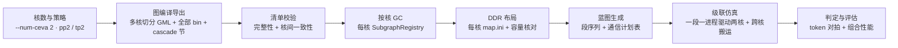

# 存算一体大模型推理编译器 v0.0.13


| 项目     | 内容                                            |
| -------- | ---------------------------------------------- |
| 版本     | v0.0.13                                        |
| 日期     | 2026-11-19                                     |
| 目标模型 | Llama-2-7B                                     |
| 基线     | `pim-compiler-v0.0.12`（`a94534f`，2026-11-13） |
| 本文范围 | v0.0.12 → v0.0.13 的变化、原理、安装与逐步验证 |

　　本文档接续 `pim-compiler-v0.0.12.md`，只写 **v0.0.12 → v0.0.13 的变化**。第 6、7 章仍是面向新机器的完整操作清单：安装命令与 v0.0.12 逐条相同，验证在原有项目之外新增多 CEVA 级联一组（见 7.3 至 7.5）。本特性的需求、设计、实施与评审细节见 `docs/request-multi-ceva-cascade-20261114.md`、`docs/design-multi-ceva-cascade-20261114.md`、`docs/implement-multi-ceva-cascade-20261114.md` 与三轮评审记录，交付级汇总见 `docs/techdoc-multi-ceva-cascade-20261119.md`。技术方案的完整描述（图编译、算子编译、主机编排、内存管理的设计原理）仍以 `pim-compiler-v0.0.3.md` 为准。

　　一条主线，一个特性，分三层落地：

　　**支持多 CEVA 级联：把已走通的单 CEVA 全流程扩展为 2 个 CEVA 仿真器进程级联。** 编译期，图编译器按策略切分导出——PP2 复用 65 张整层图、只在 `bundle.json` 追加 cascade 节，TP2 为每核导出 129 张分片图（两核 258 张全部通过厂商 GC）；蓝图构造器从 bundle 与每核 DDR 布局推导出段序列与通信计划表。运行时，host（主机侧）编排器以「一段一进程」驱动 2 个 TCS（厂商工具链仿真器）进程，经输入文件、输出文件与 KV 快照三条文件通道完成跨核交接——PP2 真机跑完 prompt 加 10 步 decode，11 个 tokens 与单核基线逐位一致，并支持断点续跑。评估期，组合评估模型在每核实测 cycles 之上叠加通信与并行代价：PP2 组合设备时间 0.648 秒（1250 MHz）、预测偏差 0.9%（标定与验证同源，不作验收依据）、相对单核加速 1.358 倍。

　　配套的四件事：

1. **一条命令入口。** `scripts/run_ceva_pipeline.sh --run-name <名> --num-ceva 2 --strategy pp2 --decode-steps 10`；不带 `--num-ceva` 时单核行为逐参数不变；`--dry-run` 干跑到蓝图为止，不启动仿真。
2. **清单校验扩展核间一致性。** `verify_gml_artifact.py` 对 TP2 两核 bundle 核对键集合、尺寸一致与分片区间互补（`shard_range`）。
3. **CEVA 工作区适配（`/data/fjg/ceva`，未提交）。** 段式 runner（STEPWISE 模式与 KV 快照）、多核 DDR 布局、JSON 行协议受控仿真会话、多核 token 判定脚本与 `run_cascade.sh` 六步编排。
4. **FlagTree 与 genesim 零改动。** 分片只改变喂给算子编译器的本地形状，编译口径不变；genesim 本期仅作评估模型的设计参考。

## 1. 版本与代码量

### 1.1 一个提交与一个工作区

　　本版只有图编译器一个提交：级联特性整体落库为 `856ebc6`（2026-11-19）。v0.0.12 时在工作区的调优特性已随基线 `a94534f` 落库，因此级联是本版唯一增量。CEVA 工作区（`/data/fjg/ceva`）的仿真侧适配仍在 `1a056c2` 之上的工作区、未提交；FlagTree 与 genesim 经核对零改动。代码量不含文档，如下表所示。


| 仓库                | v0.0.12                 | v0.0.13                        | 提交数 | 代码量（不含文档）                          |
| ------------------- | ----------------------- | ------------------------------ | -----: | ------------------------------------------- |
| flagos-pim-compiler | `a94534f`（2026-11-13） | `856ebc6`（2026-11-19）        |      1 | 19 个文件 +3988 / −41                       |
| CEVA 工作区         | `1a056c2`               | `1a056c2` + 工作区（2026-11-19） |    0 | 11 个文件 +983 / −52，另有 18 个新增文件    |
| FlagTree、genesim   | —                       | 零改动                         |      0 | —                                           |

　　新增的顶层文件集中在 `cascade/` 包、级联测试与工作区编排脚本，如下表所示。


| 仓库                | 新增文件                                                                | 行数 |
| ------------------- | ------------------------------------------------------------------------ | ---: |
| flagos-pim-compiler | `cascade/plan.py`（蓝图三结构、`from_bundle`、可读文本）                 |  291 |
| flagos-pim-compiler | `cascade/driver.py`（段式进程编排、PP2/TP2 驱动、断点续跑）              |  724 |
| flagos-pim-compiler | `cascade/eval.py`（组合评估、链路标定、标定溯源）                        |  483 |
| flagos-pim-compiler | `cascade/layer_scaling_llama2_pp2.json`（层标定默认系数，带来源声明）    |   13 |
| flagos-pim-compiler | `tests/test_cascade_{plan,driver,eval}.py`（级联三件套 40 例）           | 1197 |
| CEVA 工作区         | `run_cascade.sh`、`src/automation/run_tools_step.py`、`scripts/verify_cascade.py` 等 | — |
| CEVA 工作区         | `tests/test_{ddr_multi,run_tools_step,verify_cascade,run_cascade,pp2_tokens_flow}.py` | — |

　　代码量说明：`cascade/driver.py` 一个文件同时承载 PP2 串行与 TP2 并行两套编排，是运行时的核心；工作区 C++ 侧（`src/llama_runner/` 四个文件）承载 STEPWISE 段式模式、cmd 命令分发与 KV 快照，是设备侧大头；修改量最大的既有文件是 `gml_bridge/ceva.py`（+363），接入策略参数、cascade 节与七投影分片。级联测试约 1200 行，与新增代码量级相当。

### 1.2 测试面


| 项                        | v0.0.12                            | v0.0.13                                                  |
| ------------------------- | ---------------------------------- | -------------------------------------------------------- |
| 快速回归                  | 2145 passed, 1 failed（fork 抖动） | **2213 passed, 1 failed（fork 抖动）, 9 skipped**（round03 口径） |
| 级联三件套单测            | —                                  | **40 条**（`test_cascade_*.py`）                         |
| 级联+导出+路径单测        | —                                  | **152 条**（5 个文件，2026-11-19 实测）                  |
| CEVA 工作区单测           | —                                  | **76 条**（多核布局、受控会话、多核判定）                |
| 多 CEVA PP2 全流程        | —                                  | **通过**（11/11 token 逐位一致，见 7.5）                 |
| TP2 分片图过 GC           | —                                  | **通过**（两核 258 图清单 complete）                     |
| TP2 全流程                | —                                  | 未执行（见 7.6）                                         |
| 7B 全量                   | 本版未重跑                         | 未重跑                                                   |

　　本版发布前上述验证已全部人工复核通过。全量回归沿用 round03 实测口径（2026-11-18，提交前工作区；最终提交对级联用例有小幅合并，154 收敛为 152，全量数字按此微调）；级联相关 5 个文件 2026-11-19 在最终提交上单独实跑 152 条全过（17.65 秒）；已知的 fork 抖动用例单独复跑即转绿，不计回归。

## 2. 能力变化

### 2.1 新链路总览

　　本版在单 CEVA 链路之上增加多核分叉：核数与策略经入口透传给图编译器，导出、清单校验、按核 GC、DDR 布局、蓝图、级联仿真、判定与评估按核组织。各链路的输入、入口与执行方如下表所示。


| 链路         | 输入                                | 入口                                                 | 执行方                           |
| ------------ | ----------------------------------- | ---------------------------------------------------- | -------------------------------- |
| 单核（回归） | 同 v0.0.12                          | `run_ceva_pipeline.sh`（不带 `--num-ceva`）          | 厂商 GC、DDR 工具、单进程仿真    |
| 多 CEVA PP2  | 策略 pp2，65 图 bundle + cascade 节 | `run_ceva_pipeline.sh --num-ceva 2 --strategy pp2`   | 工作区 `run_cascade.sh` 六步编排 |
| 多 CEVA TP2  | 策略 tp2，每核 129 张分片图         | `run_ceva_pipeline.sh --num-ceva 2 --strategy tp2`   | 同上                             |
| 干跑         | 任一多核策略                        | 同上再加 `--dry-run`                                 | 到蓝图为止，不启动仿真           |

　　多核链路的编译期产物与运行时执行全部落盘归档在 `<ceva_workspace>/runs/<run-name>/`：bundle 与清单在 `bundles/` 与 run 目录、每核布局在 `ddr_core{N}/`、蓝图文本在 `logs/blueprint.txt`、运行产物（tokens、每核分段计数、时间线、搬运日志）在 `run/`、判定与评估在 `results/`。整体关系如图所示。



### 2.2 多核切分导出（`gml_bridge/ceva.py`）

　　导出入口 `export_ceva_bundle()`（`gml_bridge/ceva.py:1282`）按策略分派三种形态：`single` 走 v0.0.12 的单核路径，`pp2` 与 `tp2` 是本版新增。全部 `bin` 仍由我方量化器生成，清单与摘要校验沿用。

　　PP2 不改编译产物：65 张整层图与单核逐字节相同，只在 `bundle.json` 追加 `cascade` 节（`ceva.py:1331`），登记策略、核数、每核层段（core0 层 0 到 15、core1 层 16 到 31）与 `lm_head` 归属（末核）。这样 GC 缓存与对拍口径可直接复用单核结论。

　　TP2 走真实分片：`shard_model()`（`ceva.py:575`）对七个投影做 TP 切片——q/k/gate/up/lm_head 列切、o/down 行切，注意力头对半、KV 头跟随切分；每层拆成 attn、mlp 两张子图（GML 算子集没有归约算子，行切投影的部分和必须出图由 host 归约），每核导出 129 张分片图到 `core{N}/` 目录。每核 `graphs` 条目额外写分片区间 `shard_range`（`dim` 取 heads/intermediate/vocab，配 `lo`、`hi`、`full`），供清单校验核对两核宽度互补。`contracts/ceva.py` 的图契约加可选 `shard_kind` 字段，缺失即单核行为。

### 2.3 级联蓝图（`cascade/plan.py`）

　　蓝图把「怎么拆、怎么传」做成编译期产物。`from_bundle()`（`cascade/plan.py:137`）读取 bundle 的 cascade 节与每核 `ddr_core{N}` 的三份 map，推导出完整段序列与搬运表：PP2 共 33 段——prompt 相 core0、core1 各一段加一个 head 段，之后每个 decode 步两核各一段加一个 head 段；TP2 每层是 attn 双核段、归约、mlp 双核段、归约。蓝图的四个结构如下表所示。


| 结构               | 位置         | 内容                                                                |
| ------------------ | ------------ | ------------------------------------------------------------------- |
| `ControlBlock`     | `plan.py:23` | 64B 控制块镜像，14 字段与 C 侧 `_Static_assert` 逐字段对齐          |
| `CascadeSegment`   | `plan.py:57` | 段号、核号、段型、层范围、输入输出 DDR 地址                         |
| `CascadeTransfer`  | `plan.py:70` | 字节数、源目的核、类型、触发段                                      |
| `CascadeBlueprint` | `plan.py:84` | 策略、核数、每核 DDR 基址（两核同为 `0x100000000`）与上面两个列表   |

　　`plan_text()`（`plan.py:256`）把蓝图打印成可读文本归档到 `logs/blueprint.txt`；运行时的 `results/state.json` 是追加式计时日志，权威投影按归一化段名取每段最后一条作为计数与汇总依据（`plan.py:281`），断点续跑据此复用已完成段。

### 2.4 运行时编排器（`cascade/driver.py`）

　　编排器只机械执行蓝图，不携带切分知识。`SegmentProcessRunner`（`cascade/driver.py:133`）的一段等于一次完整的 app 执行：`run()`（`driver.py:179`）经工作区 `run_tools_step.py` 的受控会话拉起一个新的 TCS 进程、装载段式 ELF `Llama2StepRunner.elf`，命令经 argv 传入（map 路径、控制块地址、cmd 命令号、输入输出地址、decode 行号、KV 快照目录、分片阶段与层号），app 执行完本段子图后 `return`、程序终止即真正停核，host 用同步 resume 的墙钟计时并读取结果。

　　跨核与跨段数据全部经三条文件通道传递，不走调试器内存读写。其一，输入文件通道（host 到设备）：`write_input_file()`（`driver.py:169`）把上一段输出或 embedding 行写进下一核的输入文件，装载期由 `loadBinMapToMemory` 整块读入 DDR，写入补零到整块——prompt 相 hidden 交接 8MiB（1024 行 × 4096 维 fp16），decode 相 8KiB。其二，输出文件通道（设备到 host）：每段结束经 semihosting（半主机机制，设备侧直接读写 host 文件）把输出写到 `stepwise_output.bin`（尺寸按段型：prompt 8MiB、decode 8KiB、PP2 head 64000B、TP2 head 分片 32000B），纯执行 cycles 写 `stepwise_cycles.txt`。其三，KV 快照通道（设备到设备、跨进程）：每段结束把本核 128MB KV 区整块 dump 到 `kv_core{N}/kv.bin`，下一段进程在 `initDevice` 之前 restore 回 DDR。

　　PP2 的 token 闭环（`run_pp2_processes()`，`driver.py:292`）：prompt 相 core0 跑前 16 层输出 hidden，host 取最后一个 prompt token 所在行写 core1 输入文件；core1 跑后 16 层；head 段在 core1 执行 lm_head 输出 32000 维 fp16 logits，host 用 numpy 做 argmax 得第一个 token。decode 循环每步：host 按上一 token 从本机 `embed_weights.bin` 切出 8KiB embedding 行（查找表移到 host），core0 段先 restore KV、执行、dump KV，8KiB 输出交接 core1，head 段出 logits、argmax 得新 token，直到 EOS（token 2）或步数上限。每次搬运追加记录到 `run/transfer_log.jsonl`（字节数与 host 耗时），每段完成即写 `results/state.json`，中断后重启时已完成段直接复用。

　　TP2（`run_tp2_processes()`，`driver.py:453`）在同一执行模型上多了并行与归约：同层的 attn、mlp 两个分片段由 `execute_pair()`（`driver.py:489`）以双线程同时下发两核进程，两核完成后 host 读各自部分和按 fp16 相加再加残差（`driver.py:555`），写回两核输入文件进入下一层；head 段两核各出半宽 16000 维 logits，host 拼接后 argmax。两核同层段的提交与完成时刻记入时间线，重叠判定汇总到 `results/tp2_overlap.json`，作为并行收益的证据。TP2 的原始 prompt 输入首进相即快照到 `results/prompt_input_core0.bin`，重启一律从快照推导，避免归约写回覆盖原始输入污染断点续跑。

### 2.5 组合评估模型（`cascade/eval.py`）

　　每个仿真器只输出自己核内的 cycles，整体结论由组合评估模型给出。`compose()`（`cascade/eval.py:167`）按策略结构递推：PP2 是串行链，全部段 cycles 相加；TP2 是层内同步，同层两核段取 max 再加归约。每次传输按解析式「基础延迟 + 字节数 ÷ 带宽」计价，链路参数用本次运行的搬运记录最小二乘标定（`calibrate_link()`，`eval.py:137`；pp2_v3 用 36 个搬运点标出延迟 0.409 毫秒、带宽 4.65 GB/s）。分层 cycles 取值优先级为 app TIMER 纯执行 cycles、EndOfExecution 全局时钟减装载基线、CycleEstimation 尾值（`parse_state_cycles()`，`eval.py:41`）。

　　可信度机制有三条：每个标定参数登记来源 run（`source_runs`），与被评估 run 相交即标注 `in_sample` 并声明偏差不能作为验收依据；外部标定文件缺 `source_runs` 直接拒绝；手工周期扣减强制三字段溯源、缺一拒绝。输出同时携带芯方舟三层仿真抽象（设备、每设备运算核、引擎），2 核实测即 `[2,1,1]`，按核数参数化可外推到 8/16 核。频率取厂商配置 1250 MHz（`cnnha_upd_b.cfg`），设备时间由总 cycles 换算。

### 2.6 对已有模块的配套修改


| 模块                                    | 修改                                                                         | 原因                                 |
| --------------------------------------- | ---------------------------------------------------------------------------- | ------------------------------------ |
| `scripts/export_gml.py`                 | `--num-ceva`/`--strategy` 参数与 TP2 三元组目标；单核与策略不匹配即报错       | 策略进导出                           |
| `scripts/verify_gml_artifact.py`        | TP2 核间一致性：键集合、尺寸、`shard_range` 区间互补                          | 分片 bundle 需要核间核对             |
| `scripts/run_full_pipeline.py`          | `run_ceva` 级联分派：先补导出与清单校验再调 `run_cascade.sh`；新增 `--dry-run` | 一键入口（设计 4.8 漏两步的修正）    |
| `scripts/run_ceva_pipeline.sh`          | 透传新参数；无 `--num-ceva` 时单核透传不变；多核防呆只允许 2 核               | 入口外壳                             |
| `tests/conftest.py`、`tests/test_paths.py` | 归档树写守卫与路径打桩                                                     | 防测试把伪证据写进 runs/ 归档        |

## 3. 技术原理

　　本特性的一条原理主线：把「多个仿真器怎么协同」从运行时即兴决策变成编译期蓝图加机械执行。四个机制各回答一个问题——切分归属怎么表达（蓝图）、进程怎么驱动（段式执行）、注意力缓存怎么跨进程存活（KV 快照）、整体性能怎么从分项数据得出（组合评估）。

### 3.1 编译期蓝图与三方解耦

　　蓝图机制让导出、驱动与评估三方消费同一份语义。`from_bundle()` 从 bundle 的 cascade 节与每核 map 推导段序列与搬运表，运行时驱动不携带任何切分知识，评估模型按同一蓝图语义组合实测数据。PP2 刻意不改编译产物（65 图与单核逐字节相同），归属切分只落在 cascade 节里，GC 缓存与 token 对拍口径因此可直接复用单核结论。运行时权威产物 `state.json` 与蓝图的段名一一对应，断点续跑、判定指纹与评估取数都从它投影。

### 3.2 段式执行与文件交接

　　host 要获得段粒度的控制权，最初设计用 DDR 控制块加自旋轮询（host 写 go、app 轮询后写 done）。M0 探针逐项否定了该方案：手动写不入 DDR（raw dump 四轮验证）、装载会清零保留区、执行期间任何调试器内存访问会原生崩溃 TCS、`while(1)` 自跳转不产生停机事件。实际机制改为命令经 argv 传入、一段一个完整 app 执行、`return` 即 EndOfExecution 真正停核，结果经 semihosting 文件回传。这一机制把「跨核通信」落实为可实测的 host 文件搬运——每次搬运的字节数与耗时都进 `transfer_log.jsonl`，正是评估模型标定链路参数的数据源。DDR 基址取两核同基址 `0x100000000`：多进程下地址空间独立，按核偏移 8GiB 的方案在对端进程实测崩溃。

### 3.3 跨进程 KV 快照

　　decode 依赖 prompt 阶段写入的 KV，而每个段进程的 KV 区全零，缓存必须跨进程持久化。KV 张量的实际口径从 GML 的 `IO_info.txt` 实读确认：int8 的 `1×32×1024×128`，每头一个 128KB 块、行步 128B，快照按头块 gather/scatter。半主机文件调用按次数计费，512 个小文件的写法让单个 prompt 段 42 分钟跑不完；改为整核一个 `kv.bin`、16MiB 分块流式读写后每段只剩两次文件操作，对段设备时间近零开销。快照在每段结束 dump、下一段 `initDevice` 之前 restore（时机约束来自实测：init 之后的经 DACU 映射写不落 DDR），失败段不落盘，避免半更新的缓存覆盖上一段的有效快照。修复后的等价性证明：128MB 全量 diff 显示一步 decode 只改每个张量一行（约 9.5 万字节）。

### 3.4 组合评估与标定溯源

　　评估要回答「这套多核拆分放到真实链路上多快」，且结论必须区分实测与外推。结构代价按蓝图递推：PP2 串行链相加、TP2 层内取 max 加归约，依赖结构与并行度随策略自动变化；通信代价用解析式计价、参数从本次运行的搬运记录标定，不引入未标定的假设带宽。溯源机制保证「标定与验证不共用数据」：参数带 `source_runs`，同源即自动降级为 `in_sample` 并失去验收资格，这是需求明文规定的无效验收情形在机制层的一次性根治。当前层标定系数来自 pp2_v3 自身（`layer_scaling_llama2_pp2.json` 已声明同源），out-of-sample 验收待第二次独立运行。

## 4. 这一版修掉的问题

　　本特性实施期间共 3 轮评审（2026-11-18）、累计 22 条问题（严重 2、高 6、中 11、低 3），全部确认成立并修复，修复前均先补能复现的失败测试。代表性的问题与修法分三组列在下面；实施期连续错位的关键坑（KV 布局、计时口径）一并收入。

### 4.1 级联机制


| 问题                                                             | 改法                                                                |
| ---------------------------------------------------------------- | ------------------------------------------------------------------- |
| 段同步设计（DDR 控制块轮询）经 M0 探针证伪，级联驱动一度无解     | 改一段一进程：argv 命令、`return` 停核、semihosting 回传            |
| KV 快照布局连错三轮（连续行 → fp16 512 行 → int8 头块）          | 从 GML `IO_info.txt` 实读口径，按头块 gather/scatter                |
| 512 个小文件让单个 prompt 段 42 分钟跑不完                       | 整核一个 `kv.bin`，16MiB 分块流式，每段两次文件操作                 |
| 厂商 GC 拒绝 TP2 分片图：头数硬编码 32，分片图实际 16 头          | `apply_vendor_conventions` 的 heads 参数跟随 `spec.slots.heads`     |
| TP2 驱动未传层号，argv 落成 `"None"`、`atoi` 静默取 0 恒跑第 0 层 | 驱动按 `seg.layer_lo` 传层、缺层抛错；app 侧非数字层号显式失败      |
| TP2 prompt 相断点续跑从被归约写回覆盖的中间态起算                | 首进相快照 `prompt_input_core0.bin`，重启一律从快照推导             |
| 厂商 TIMER 是递减计数器，段式路径 `tock - tick` 下溢             | 改回 `tick - tock`，零 KV 探针抓出                                  |
| CycleEstimation 尾值不含控制器开销，prompt 段低估约 40%           | 统一 app 日志 EndOfExecution 口径，评估按三级优先取值               |

### 4.2 评估与判定


| 问题                                                             | 改法                                                                |
| ---------------------------------------------------------------- | ------------------------------------------------------------------- |
| 层标定系数由 pp2_v3 拟合后又对它报告偏差，同源自证               | `source_runs` 登记，相交即 `in_sample` 且不作验收依据               |
| 外部标定文件无来源也能生效                                       | 缺 `source_runs` 直接拒绝                                           |
| 判定报告不绑运行状态，可拿旧报告冒充本次结论                     | 判定绑定 state 指纹，head 段数与 token 数交叉核对                    |
| 加速比基线被截断，预测与实测口径不一致                           | `decode_steps` 统一口径，基线取完整运行                             |

### 4.3 测试与工程


| 问题                                                             | 改法                                                                |
| ---------------------------------------------------------------- | ------------------------------------------------------------------- |
| 单测把伪 PASS 写进 runs/ 归档树，两轮评审复发                     | 路径打桩加写守卫；fake_run 判定按命令加双前缀守卫                    |
| GC 缓存软链复用会把新字段写穿进归档 manifest                     | `--cache-from` 改为三重校验后复制，跨 run 只读复用                  |
| TP2 两核 bundle 缺宽度互补检查，切错也能过校验                   | `shard_range` 区间互补进清单校验                                    |
| 一键入口端到端实证中断于 GC（`runs/pp2_r6` 无判定报告）          | 机制被测试锁定；端到端实证转为遗留 Q8，可断点续跑                   |

## 5. 环境与容量要求

　　基础环境与 v0.0.12 完全相同（操作系统、GPU、网络、CEVA 工具链与 license、root 要求见 v0.0.12 第 5 章）；本版多核级联新增三项要求，一并列出。


| 项目      | 要求                                                                     |
| --------- | ------------------------------------------------------------------------ |
| 单核 CEVA | 同 v0.0.12：厂商工作区、license 服务器可达、磁盘至少 130 GB              |
| 多核 PP2  | 一次完整运行 host 墙钟约 9.6 小时（实测 34669 秒）、磁盘约 63 GB         |
| 多核 TP2  | 冷启动 258 图 GC 约 120 GB 加约 10 小时仿真（本版未执行）                |
| 核数      | 级联运行时只支持 2 核（入口防呆）；更大核数走评估模型参数化外推          |

　　断点续跑可显著压缩复核成本：`run_cascade.sh --cache-from <旧 run>` 三重校验后复用已编的 65 图 GC 产物；pp2_v3 曾以此方式复用 22 段、补跑 11 个 head 段，tokens 与完整运行一致。

## 6. 安装：一步一步做下来

　　6.1 到 6.6 与 v0.0.12 第 6 章逐条相同，此处照抄关键命令；6.7 是本版新增的多核工作区同步。FlagTree 本版零改动，安装要求与 v0.0.12 相同（`develop` 分支须含提交 `0d7273bac`）。

### 6.1 系统命令自检

```bash
for c in git tar gzip dpkg-deb apt-get awk sed find make cc c++ ar ld curl; do
  command -v "$c" >/dev/null 2>&1 || echo "缺: $c"
done
```

　　有任何一行「缺」就停下来找管理员预装，后面的脚本不会替你装系统包。

### 6.2 网络

```bash
export UV_HTTP_TIMEOUT=600
export PIP_INDEX_URL=https://pypi.tuna.tsinghua.edu.cn/simple
export PIP_TRUSTED_HOST=pypi.tuna.tsinghua.edu.cn
```

### 6.3 四个安装脚本

```bash
git clone https://github.com/jingge815/flagOS-installers.git
cd flagOS-installers

bash 0-install-flagtree.sh        # 最慢：编译 LLVM/Triton/PIM pass，约 23 GB
bash 1-install-flaggems.sh
bash 2-install-pytorch.sh --torch-cpu
bash 3-install-model-inference.sh --torch-cpu \
    --model-path /path/Llama-2-7b-hf --skip-inference
```

　　环境脚本只能 `source`，不能直接执行。后面的验证只需要 source 最后一个：

```bash
source /path/flagOS-installed/pytorch/env-pytorch.sh
```

### 6.4 图编译器与 GeneSim

```bash
cd /path
git clone https://github.com/jingge815/flagos-pim-compiler.git
git clone https://github.com/pimtools/genesim.git

cd /path/genesim
./install.sh --skip-attacc --torch-cpu
uv pip install "torch-geometric==2.8.0.post1"
```

### 6.5 GML 参考产物与 paths.json

　　两份 GML 参考产物与 `paths.json` 的全部键与 v0.0.12 完全相同（本版没有新增键），照 v0.0.12 6.5 节配置即可。配完确认都解析到真实路径：

```bash
source /path/flagOS-installed/pytorch/env-pytorch.sh
python -c 'from genesim_bridge.paths import describe; print(describe())'
```

### 6.6 CEVA 工作区

　　CEVA 工作区按 v0.0.12 6.6 节从甲方交付包整体拷贝并配置 `ceva_workspace`、`ceva_reference_dir`、`ceva_embedding` 三个键，确认厂商 license 服务器可达与磁盘余量。

### 6.7 CEVA 工作区多核同步（本版新增）

　　多核级联依赖 CEVA 工作区在 `1a056c2` 之上的约 29 处变更（11 个修改文件加 18 个新增文件：`run_cascade.sh`、`src/automation/run_tools_step.py`、`scripts/verify_cascade.py`、段式 runner 改造、多核 DDR 布局、5 个测试文件与探针工具），这批变更目前未提交。新机器装好 v0.0.12 的 CEVA 工作区后，须把本机 `/data/fjg/ceva` 的这批变更整目录同步过去；`run_cascade.sh` 第 1 步会用工作区交叉编译链重编段式 runner（`Llama2StepRunner.elf`）。同步后跑工作区单测确认（见 7.4）。

## 7. 验证：一步一步做下来

### 7.1 验证顺序与判据


| 序 | 验证项                    | 覆盖什么                                     | 耗时              |
| -- | ------------------------- | -------------------------------------------- | ----------------- |
| 1  | pim-compiler 快速回归     | 全部契约与单测，含级联三件套与多核导出       | 约 25 分钟        |
| 2  | 级联单测（新增）          | 蓝图、驱动、评估、多核导出、路径守卫         | 约 20 秒          |
| 3  | 工作区单测（新增）        | 多核 DDR 布局、受控会话、多核判定            | 分钟级            |
| 4  | 多 CEVA PP2 全流程（新增）| 导出→按核 GC→布局→蓝图→级联仿真→判定→评估   | 约 9.6 小时       |
| 5  | 单核 CEVA 全流程          | 不带 `--num-ceva` 单核行为不变               | 沿用 v0.0.12 结论 |
| 6  | TP2 全流程                | 并行编排与归约                               | 未执行（见 7.6）  |

### 7.2 pim-compiler 快速回归

```bash
cd /path/flagos-pim-compiler
source "$(python3 -c 'import json;print(json.load(open("paths.json"))["pytorch_env_script"])')"

python -m pytest tests/ -q -k "not llama2_7b" -rs
#    预期: 全绿（round03 口径 2213 passed, 9 skipped, 49 deselected）
```

　　round03（2026-11-18）实测 2213 passed、1 failed、9 skipped、49 deselected；唯一失败是 `tests/test_opcompiler_linear.py::test_cache_key_lock_serializes_processes` 的已知 fork 抖动（v0.0.12 7.2 有完整分析），单独复跑 1.49 秒通过，不计回归。本版新增判据集中在级联，单独跑见 7.3。

### 7.3 级联单测（本版新增）

```bash
# 级联三件套 + 多核导出 + 路径守卫（152 条）
python -m pytest tests/test_cascade_plan.py tests/test_cascade_driver.py \
  tests/test_cascade_eval.py tests/test_ceva_export.py tests/test_paths.py -q
#    预期: 152 passed（2026-11-19 实测 17.65 秒）

# 只跑级联三件套（40 条）
python -m pytest tests/test_cascade_plan.py tests/test_cascade_driver.py \
  tests/test_cascade_eval.py -q
```

　　三件套覆盖蓝图推导与可读文本、PP2/TP2 驱动（含 layer 逐层递增与 prompt 断点续跑逐字节断言）、评估组合与标定溯源；`test_ceva_export.py` 覆盖策略分派、cascade 节、七投影分片与 `shard_range` 互补。

### 7.4 CEVA 工作区单测（本版新增）

```bash
source /path/flagOS-installed/pytorch/env-pytorch.sh
cd /path/ceva && python -m pytest tests/ -q
#    预期: 76 passed（round03 口径）
```

### 7.5 多 CEVA PP2 全流程（本版新增）

```bash
cd /path/flagos-pim-compiler
bash scripts/run_ceva_pipeline.sh --run-name <名> --num-ceva 2 --strategy pp2 --decode-steps 10
```

　　脚本依次完成多核导出、清单校验、按核 GC、DDR 布局、蓝图生成、级联仿真与判定评估。判据是退出码 0 且判定报告通过：

```bash
cat /path/ceva/runs/<名>/results/verdict.txt
#    预期: 全部 [PASS]，无 [FAIL]；关键行「token 与 baseline 一致」
```

　　本机实测（实验 `pp2_v3`）：33 段蓝图全部执行，11/11 个 token 与单核基线 `[13, 29902, 626, 2691, 29889, 306, 626, 2599, 590, 3271, 1287]` 逐位一致；prompt 段每核约 2.8 到 3.1 亿 cycles，decode 段每核约 800 到 950 万 cycles（首步 360 万）；host 墙钟 34669 秒（约 9.6 小时）、磁盘约 63 GB。评估产物 `results/cascade_eval.txt` 的关键结论：组合设备时间 0.648066 秒（810082407 cycles ÷ 1250 MHz）、吞吐 16.974 tokens/s、通信代价占比 2.366%、相对单核加速 1.358 倍、预测 0.654013 秒偏差 0.9%。注意 0.648 秒是设备 cycles 换算口径，不是 host 墙钟——host 墙钟是仿真器本身的执行开销；偏差 0.9% 属 in_sample（标定与验证同源），不作验收依据。

　　复核已有日志不需重跑：判定、逐段输出、时间线与搬运日志都在 `runs/pp2_v3/`。需要重跑时，导出与清单两步可单独执行（`export_gml.py --num-ceva 2 --strategy pp2 ...` 与 `verify_gml_artifact.py`）；GC 产物可跨 run 复用（工作区 `run_cascade.sh --cache-from pp2_v3`）；干跑模式加 `--dry-run` 到蓝图为止，用于日常迭代。单核回归不带 `--num-ceva`，行为与 v0.0.12 逐参数相同。

### 7.6 TP2 与 7B 全量

　　TP2 的离线链路已验证：两核各 129 张分片图（共 258 张）全部通过厂商 GC，`bundles/tp2_e2e` 两核清单 complete；四类分片图（attn/mlp 的 prefill/decode 加 head）的核间一致性过清单校验。真机端到端未执行（258 图冷 GC 约 120 GB 加约 10 小时仿真，受长跑纪律约束），机制由级联单测锁定（layer 递增、归约、半宽拼接、时间线重叠），登记为遗留问题 Q6。7B 全量本版未重跑，沿用 v0.0.7 的通过结论。

### 7.7 实测结果汇总


| 验证项             | 命令                                                                     | 结果                                              |
| ------------------ | ------------------------------------------------------------------------ | ------------------------------------------------- |
| 快速回归           | `pytest tests/ -q -k "not llama2_7b" -rs`                                | 通过（round03 口径 2213 passed；fork 抖动单跑即过）|
| 级联单测           | `pytest tests/test_cascade_*.py tests/test_ceva_export.py tests/test_paths.py -q` | **152 passed**（2026-11-19 实测）      |
| 工作区单测         | `cd /data/fjg/ceva && pytest tests/ -q`                                  | 76 passed（round03 口径）                         |
| 多 CEVA PP2 全流程 | `run_ceva_pipeline.sh --num-ceva 2 --strategy pp2`                       | **通过**（11/11 token 逐位一致，verdict 全 PASS） |
| 官方编排器端到端   | `python -m cascade.driver --run-dir runs/pp2_v3 ...`                     | 复用 22 段补跑 11 head 段，tokens 一致            |
| 评估专项           | `python -m cascade.eval --run-dir ... --strategy pp2`                    | 组合指标齐全，偏差 0.9%（in_sample，不作验收）    |
| TP2 分片图过 GC    | `compile_gml.py`（两核 258 图）                                          | 通过（清单 complete）                             |
| TP2 真机端到端     | 同 PP2 换 `--strategy tp2`                                               | 未执行（Q6）                                      |
| 7B 全量            | `pytest tests/ -q -k "llama2_7b"`                                        | 未重跑                                            |

## 8. 限制与注意事项

　　按影响排列；编号 Q5 到 Q8 与交付技术文档的遗留问题清单一一对应。


| 领域 | 条目                                     | 说明                                                                |
| ---- | ---------------------------------------- | ------------------------------------------------------------------- |
| 级联 | 级联运行时只支持 2 核                    | 入口防呆；4/8/16 核靠评估模型参数化外推，实测另行立项              |
| 级联 | TP2 真机端到端未执行                     | 机制与离线测试就绪；258 图冷 GC 约 120 GB 加 10 小时（Q6）          |
| 级联 | 官方一键链路端到端中断于 GC              | `runs/pp2_r6` 无判定报告；可 `--cache-from pp2_v3` 续跑（Q8）       |
| 评估 | out-of-sample 偏差未验收                 | 0.9% 属 in_sample；需第二次独立 PP2 运行（Q7）                      |
| 评估 | 层标定默认系数来自 pp2_v3 自身           | `layer_scaling_llama2_pp2.json` 已声明同源                          |
| 级联 | TP2 token「前若干一致」数量未定稿        | 建议不少于 4 个，TP2 首跑后按实际漂移定稿（Q5）                     |
| 调优 | 调优链路不接入                           | CEVA 实跑一轮约 10 小时，策略手工指定                               |
| 工程 | CEVA 工作区改动未提交                    | `/data/fjg/ceva` 约 29 处变更在 `1a056c2` 之上，对外交付前需先落库  |
| 测试 | 缓存锁用例偶发 fork 死锁                 | 同 v0.0.12，彻底修法本版未动                                        |
| 全局 | 多核时延数字口径                         | 设备时间按 cycles ÷ 1250 MHz 换算；host 墙钟是仿真开销，不可混用    |
