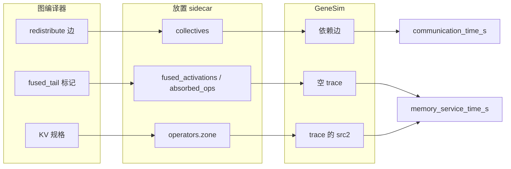

# 存算一体大模型推理编译器 v0.0.9


| 项目     | 内容                                           |
| -------- | ---------------------------------------------- |
| 版本     | v0.0.9                                         |
| 日期     | 2026-10-15                                     |
| 目标模型 | Llama-2-7B                                     |
| 基线     | `pim-compiler-v0.0.7`（`0331144`，2026-10-08） |
| 本文范围 | v0.0.7 → v0.0.9 的变化、原理、安装与逐步验证  |

本文档接续 `pim-compiler-v0.0.7.md`，只写 **v0.0.7 → v0.0.9 的变化*。
第 6、7 章是面向新机器的完整操作清单：**安装命令与 v0.0.7 逐条相同**，另补了
v0.0.7 没写的一步——GML 参考产物要单独拷贝并写入 `paths.json`（见 6.1），三个安装
脚本都不做这件事。验证命令逐条相同，只有两处跟着本版变了——精化要带上放置 sidecar
的融合清单（`--fusion-from`，见 7.5），以及全流程把放置导出挪到精化之前（见 7.6）。预期数字也变了（快速回归 1289 → 1349，
见 7.2；10 请求仿真的墙钟与分项见 7.6）。技术方案的完整描述（图编译、算子编译、主机编排、
内存管理的设计原理）仍以 `pim-compiler-v0.0.3.md` 为准。

一条主线：

**图编译器的决策进入 GeneSim 的计时。** v0.0.7 的仿真已经吃到算子级的静态量（运算数、
搬运字节、分片形状），但换一种融合、切分或内存排布，仿真报告不随之变化——报告只对算子
形状敏感，对图上的决策不敏感。本版不另起一套评分，只替换 GeneSim 原有公式的输入：跨 DPU
的通信补进依赖边，搬运按权重、KV、激活三区分档，被融合吸收的节点不再单独计费。

配套的两件事：

1. **四项代价各自有出处。** 计算看 trace 的乘加循环次数，访存看搬运字节乘区间倍数，
   通信看未展开的集合通信边，并行看张量并行宽度把分片钉到多台处理单元后的层墙钟。
   去掉任何一项的输入，只有该项归零。
2. **决策的变化落在分项上，不看墙钟。** 墙钟含流水重叠与连续准入，比例会被淹没。
   融合只动访存项，补边只动通信项，1 请求的对照里两项互不沾染。

## 1. 版本与代码量

### 1.1 三个仓库


| 仓库                | v0.0.7（tag `pim-compiler-v0.0.7`） | v0.0.9                 | 提交数 | 代码量                                        |
| ------------------- | ----------------------------------- | ---------------------- | -----: | --------------------------------------------- |
| flagos-pim-compiler | `0331144`（2026-10-08）             | `5099eff`（2026-10-15） |      1 | 12 个文件，+1954 / -31（不含文档）            |
| genesim             | `8ae9ea0`（2026-10-06）             | `e2dc8ab`（2026-10-15） |      1 | 14 个文件，+2190 / -98（不含文档）            |
| FlagTree            | `bf4504c77`（2026-10-07）           | 无改动                 |      0 | 0                                             |

三点口径说明：

- **三个仓库都有 `pim-compiler-v0.0.7` 这个 tag。** v0.0.7 文档写作时改动还在工作区，
  文档里写的哈希（`09ff9ae`、`e281b1c`、`4a56daf49`）是当时的 HEAD；交付打 tag 后三个
  tag 分别指向 `0331144`、`8ae9ea0`、`bf4504c77`。本版窗口就是这三个 tag 到各自 HEAD，
  每个仓恰好一个新提交，提交说明都是 `improve cost model for genesim`。
- 代码量相对各自的 tag 统计，含测试、不含文档。flagos-pim-compiler 另有 3 份过程文档
  （`docs/request-ir-cost-20261012.md`、`docs/design-ir-cost-20261012.md`、
  `docs/implement-ir-cost-20261012.md`）与 `docs/spec-index.md` 的一行未计入；
  genesim 的 `docs/llama-2.md` 未计入，`.venv` 是环境目录，也未计入。
- **FlagTree 本版没有改动**，方言与 pass 保持 v0.0.7 的状态。融合激活只在 PIMIR 文本上
  加一个给正则消费的属性，不进 MLIR 的校验器，也不把代价数值写回方言。

flagos-pim-compiler 的 12 个文件里，新增的是 `tests/test_ir_cost_eval.py`（955 行）；
genesim 的 14 个文件里，新增的是 `tests/sim/test_collective_edges.py`（732 行）与
`tests/sim/test_zone_cycles.py`（409 行）。没有顶层模块被删除。

### 1.2 测试面


| 项                | v0.0.7          | v0.0.9              |
| ----------------- | --------------- | ------------------- |
| 快速回归          | 1289 passed     | **1349 passed**     |
| 跳过              | 1 skipped       | 2 skipped           |
| 排除（llama2_7b） | 43 deselected   | 49 deselected       |
| genesim 仿真组    | 文档未单列      | **749 passed，1 skipped** |
| 7B 全量           | 42 passed       | 未重跑（沿用 42）   |
| 10 请求仿真       | 1438.882 秒     | **2673.631 秒**     |

本仓的数字是 2026-10-15 对当前代码重跑的（329.34 秒）。多出的用例来自本版新增的判据：
融合开关、被吸收节点、通信补边、区间分档、四种 IR 的字段归属、切分轴宽度对账。
跳过从 1 条变成 2 条，多出的是 `tests/test_gml_export.py` 在没有现成 decode-block
导出时的跳过；v0.0.7 已说明这种状态正常，1 条或 2 条都符合预期。

genesim 的 749 是 `python -m pytest tests/sim -q` 的结果（22.04 秒），唯一一条跳过是
没装 AttAcc。`./run.sh --test` 本版没有重跑，38 个文件 / 686 个用例、7 个文件 / 86 个用例、
49 个 UPMEM 用例这组数字沿用 v0.0.6。

10 请求的墙钟从 1438.882 秒涨到 2673.631 秒，**两个数不能直接比**：v0.0.7 的仿真不分
内存区间、不算未展开的集合通信，本版把这两项都计进了时延。墙钟本身含流水重叠，本版
不作比例断言，决策看的是访存与通信两个分项（见 7.6）。

## 2. 能力变化

### 2.1 未展开的集合通信补进依赖边

v0.0.7 的 GeneSim 只展开了 all-reduce 的收集方向。llama2 一次传播里 all-gather 与
scatter 共一百多条，在它的图上没有边，通信时延被漏计；而 `comm/plan.py` 的 `plan_cost`
早就从 `node.meta["redistribute"]` 算出了字节数，只是没有下游。

本版在放置 sidecar 里加一份 `collectives`，只收这两类边：

```python
# genesim_bridge/placement_export.py
entry = {
    "type": edge.type,          # 只取 all_gather 与 scatter
    "nbytes": int(edge.nbytes),
    "dpu_ids": sorted(dpus),
    "seq_len": _export_seq_len(edge, export_seq_len),  # 不带序列维的边写 null
}
```

GeneSim 侧 `_attach_collective_edges` 把它落成依赖边，时延仍由原有的
`enqueue_dependency_transfer` 计算，不在 `communication_time_s` 上做加法。三条不收：

| 边 | 为什么不收 |
| --- | --- |
| all-reduce | `_attach_reduce_node` 已覆盖收集方向，再写会双计 |
| local_slice | 留在 DPU 内部，不产生通信 |
| all-to-all | 只在测试夹具里出现，本版不处理 |

字节数按边的形状分两种口径。带序列维的边（激活张量恰有一维等于导出序列长度）系数是
`nbytes / seq_len`，挂在 `Tq` 上，decode 步只收每 token 的那一份；不带序列维的边
（token id、attention mask）显式写 `seq_len: null`，按常量计。缺这个键的是旧 sidecar，
调度器直接报错，避免把激活边整份按常量计、prefill 少算一个数量级。

当前这份 llama2 的 sidecar 是 118 条边：all-gather 109 条、scatter 9 条，全部带
`seq_len`，其中 109 条有长度、9 条显式 null。

### 2.2 搬运按内存区间分档

v0.0.7 的 PIM 访存用全局一套周期：`LOADN = 12 + 字节数 × 0.125`、
`STOREN = 10 + 字节数 × 0.1`，权重、KV、激活一个价。内存规划里这三区语义不同——
权重常驻、加载一次，KV 与激活按 token 反复搬运——但时延看不出差别。

同一个 GEMM 的 trace 里权重搬运和激活搬运交替出现，整算子套一个区间必然算错。本版
把分档放在指令上：解析 `pim.dma_load` / `pim.dma_store` 时保留 `base_arg`
（0 激活、1 权重、2 输出），展开时按它取每字节周期，倍数写进指令原来空闲的 `src2`。

```python
# genesim/src/pim/pim_isa.py
ZONE_FACTORS = {"weight": 1.0, "kv": 2.0, "activation": 2.0}
ZONE_OF_ARG = {0: "activation", 1: "weight", 2: "activation", 3: "kv"}
```

`src2` 取倍数的两倍（2 / 4 / 4）以便装进整数，没写时按单一周期计，旧 trace 与改动前
逐条一致。读 KV 缓存的算子（attention 的两次矩阵乘）在文本里没有能区分 KV 的
`base_arg`，改由放置 sidecar 的 `zone` 给算子级默认档，层号取自内存规划的 KV 规格。
当前 sidecar 里 6850 个算子条目中，2048 个标了 `kv`，其余不带区间。

倍数的两头都是硬约束，不是拍出来的：

| 边界 | 约束 | 破了会怎样 |
| --- | --- | --- |
| 下界 | 不得低于 1 | 默认每字节周期就是配置的峰值带宽速率，低于它仿真报「访存时延掉到峰值带宽下界之下」 |
| 上界 | 不得高于权重的 2 倍 | 超过它，字节数减半就盖不住区间变慢，评估值随规模倒挂 |

### 2.3 融合开关反映到访存项

v0.0.7 的融合标记（`fused_tail`）只服务于 GML 与算子编译器。被吸收的节点在仿真里
照常编出完整 trace，融合开与关的访存时延一模一样。

本版用放置 sidecar 传一份 `fused_activations` 清单，来源是图上的
`FUSED_TAIL_META_KEY`，不能从模型 IR 的形状猜——gate 投影后面接 silu 只是图的形状，
不等于图编译器真的折过。放置导出在写 sidecar 前先跑一次 `fuse_for_pim`，否则真实链路
上清单恒为空。

精化时按清单做两件事：被吸收节点的系数清零，并把编号回写成 `absorbed_ops`；仿真侧对
这些编号发空 trace。只清系数不够，PIM 时延取自 trace 周期，不跳过 trace 融合就进不了
仿真。空 trace 是留一条占住编号，不是不编——执行侧仍会走到这些算子，缺 trace 会报错。
张量并行展开时，吸收标记随 `pimir_path`、`zone` 一起继承给分片，否则展开出的新编号
会重新编出完整 trace，融合又失效。

A 路 kernel 由 Triton 生成，带不出激活。`mark_fused_activation` 把
`activation = #pim.act_spec<kind = silu>` 标到 `tt.dot` 上，放置导出另存一份
`*.silu.pimir.mlir` 给仿真编 trace。属性只带 kind，给正则消费。分块 GEMM 的激活按
最后一次写回计一次，不记在 K 循环里的 `tt.dot` 上——记在那里会按累加器类型乘内层趟数，
比 trace 多出两个数量级。

当前 sidecar 是 32 条融合、32 条吸收，对应 32 个被折进投影的 SILU。

### 2.4 并行性体现在层墙钟上

单分片的周期随形状变，那是计算维度的量，不是并行。并行要看的是多分片同时跑：
`tp_width` 增大后各分片钉在不同的处理单元上，整层墙钟低于各分片时延之和。

这件事放置和流水线调度原来就在做，本版补的是断言。
`test_tp_shard_layer_makespan_is_below_the_serial_sum` 用四个分片、时延 3 / 5 / 4 / 6 秒，
层墙钟等于最慢的 6 秒，而不是串行相加的 18 秒。单分片字节数随 `tp_width` 下降的那一半
由 `test_tp_width_doubling_shrinks_shard_bytes_within_bound` 覆盖，比例落在 (1, 2]。

### 2.5 精化挪到放置导出之后

融合清单是放置导出的产物，精化要读它。v0.0.7 的全流程先精化再导出，精化时清单还不存在，
被吸收的激活会被多算一遍。本版把顺序倒过来，并把 sidecar 路径经 `--fusion-from` 传进
精化；这份参数只取融合清单，不动形状口径（精化 IR 仍按模型级全局形状测量）。

另外加了一道检查：融合清单非空时，折激活的投影 kernel 必须带 `act_spec`，缺了就拒绝。
旧产物把同形状的 gate 与 up 编成同一份不带激活的 kernel，仿真时延取自那份 trace，
激活一分不付。

## 3. 技术原理

### 3.1 为什么不另立公式

PIM 的时延不读运算数。`PIMVPU.execute_profile` 的时延等于指令 trace 的周期乘时钟周期，
运算数只进 GPU 与 CPU 的 roofline、放置粗估和跑完后的利用率。所以只改 sidecar 里的
运算数、不改 trace 的循环次数，PIM 时延不动。

GeneSim 已有三条计时路径：通信看依赖边两端的处理单元是否不同、按边的字节数排队；
访存看 trace 里 LOADN / STOREN 的周期；计算看乘加循环的次数。三条路径都有现成的输入
位置，缺的是图编译器的决策没填进去。本版只换输入，不改公式，也不把编译器侧
`plan_cost` 算出的秒数加进去——那是主机星型拓扑的口径，与仿真的链路时延不是一回事，
两者相加没有意义。



### 3.2 为什么补边要放在放置完成之后

展开多分片算子的时候，算子的 `vpu_id` 还是 -1。这时候加的边两端落在同一台处理单元上，
`enqueue_dependency_transfer` 看到两端相同就直接跳过，边加了等于没加。所以补边放在
放置完成之后，那时每台 DPU 上的算子已经有了真实的处理单元编号。

每个参与 DPU 配一个落在 GPU 上的中转节点，挂到该 DPU 上拓扑序最早的算子、归入那个算子
所在的层。一条集合通信的参与者可以跨层，合并成一个中转节点会逼出反向的跨层依赖，
流水段划分直接报错。中转节点本身不计时延，代价已经在通信时延里算过，再计一次就是双计。

### 3.3 为什么区间倍数写进指令而不是配置

指令编码里没有区间字段，配置表按段生效不了。倍数写进 `src2` 是因为这个字段原来空闲，
生成端与求值端又能共用 `pim_isa.py` 里的同一张表，不会出现「生成时按一个价、求值时按
另一个价」。

缺身份时不能默认落到激活档。旧的 trace 文本没有 `base_arg`，一默认就让所有历史产物
集体变贵，回归对不上改动前的数字。所以缺身份且没有算子级区间时按单一周期计；只有放置
sidecar 明确给了 `zone` 才进默认档。

### 3.4 为什么融合必须跳过 trace

被吸收节点的系数清零只改导出量。PIM 时延取自 trace 周期，节点还在就还会被编出完整的
搬运与计算，融合开与关的 `memory_service_time_s` 逐位相同。要让融合进入仿真，就得让
这些节点的 trace 为空。

代价是空 trace 仍占一个编号、调度仍会走到它，只是服务时间为零。把它从依赖图里删掉
会牵动上下游，本版不做（见 8.2）。

### 3.5 为什么带序列维的边要先除以序列长度

`nbytes` 是导出时按整个序列量出来的。直接挂到 `Tq` 上，decode 的每一步都会按 prefill
的整份字节计，10 个请求的通信项会按序列长度放大。先除以导出长度再挂 `Tq`，每一步只收
当次 forward 实际的那一份。

不带序列维的边不能跟着除。token id 的长度是词表位置，attention mask 的序列维出现两次、
按平方增长，两者都不随 token 数线性变化。它们显式写 null，仿真按常量计。键必须在：
缺键与写 null 语义不同，前者是旧 sidecar，直接报错。

## 4. 这一版修掉的问题

下面每条都是开发过程中真实暴露过的失败，不是预先设计的分支。十六轮评审共 109 条，
106 条已修复，2 条确认不成立，1 条的其余部分写入了豁免（见 8.1）。

### 4.1 通信


| 问题 | 改法 |
| --- | --- |
| all-gather 与 scatter 在仿真图上没有边，通信时延被漏计 | sidecar 带这两类边，放置完成后落成依赖边 |
| all-reduce 再写一遍与归约节点双计 | 补边清单不含 all-reduce |
| 补边放在展开阶段，`vpu_id` 还是 -1，边两端同台处理单元，计时跳过 | 挪到放置完成之后 |
| 一条集合通信的参与者跨层，中转节点逼出反向跨层依赖，流水段划分报错 | 每个参与者各配一个中转节点，归入源算子所在层 |
| 中转节点自身再计一笔时延 | 中转节点不计时延 |
| 补边按常量计，decode 每步都收 prefill 的整份字节 | 带序列维的边先除以 `seq_len` 再挂到 `Tq` |
| 旧 sidecar 缺 `seq_len` 键时静默按常量计，激活边被少算一个数量级 | 缺键直接报错，要求重新导出 |

### 4.2 访存区间


| 问题 | 改法 |
| --- | --- |
| 权重、KV、激活用同一每字节周期，区间差异进不了时延 | 按 `base_arg` 取倍数，写进指令 `src2` |
| 区间倍数取 1，访存周期与改动前完全相同 | 改为权重 1、KV 与激活 2 |
| 一个算子的 trace 混合多个区间，整算子乘一个系数会算错 | 逐段搬运各自乘 |
| 缺 `base_arg` 的旧 trace 被默认落到激活档，历史产物集体变贵 | 缺身份且无算子级区间时按单一周期 |
| KV 区间的登记放在早退分支里，开关关掉就丢 | 登记挪出早退分支，层号取自内存规划的 KV 规格 |
| 手写模板的退回路径不吃 `default_zone` | 模板编译函数接收并传递该参数 |
| 区间变化不触发重编，缓存命中旧 trace | 缓存签名纳入区间表、默认档与吸收标记 |

### 4.3 融合


| 问题 | 改法 |
| --- | --- |
| 真实链路导出前没跑融合 pass，清单恒为空 | 放置导出前先跑 `fuse_for_pim` |
| 只清系数，被吸收算子仍编出完整 trace，仿真时延不变 | 回写 `absorbed_ops`，仿真发空 trace |
| 张量并行展开出的新编号丢了吸收标记，重新编出完整 trace | 分片继承吸收标记 |
| A 路 kernel 由 Triton 生成，带不出激活，折了等于没折 | 把 `act_spec` 标到 `tt.dot` 上，另存一份带激活的 PIMIR |
| 改走 B 路后计算项归零、类型变成 int8 | 改回 A 路，只标属性 |
| 折激活记在 K 循环的 `tt.dot` 上，字节数比 trace 多 256 倍 | 改为按最后一次写回计一次 |
| 同形状的两个投影一个折激活一个不折，测量缓存互相污染 | 缓存键纳入激活名 |
| 融合标记写进精化 IR，GeneSim 读回时因未知字段抛错 | 写盘前去掉内部标记 |
| 精化在放置导出之前跑，拿不到融合清单 | 全流程倒序，精化经 `--fusion-from` 读取 |
| 融合清单非空但 kernel 不带 `act_spec`，激活一分不付 | 导出时检查，缺了就拒绝 |

### 4.4 计费口径


| 问题 | 改法 |
| --- | --- |
| K 不被分块整除时按小数趟计，IR 与 trace 的字节对不上 | 每层循环向上取整，与 trace 同口径 |
| 报告的趟数与实际计费的趟数不是一个数 | 两者用同一个口径 |
| 整笔搬运出现小数字节 | 直接拒绝 |
| TTIR 侧没有 `dma_store`，融合算子的两层运算数对不上 | 对照跳过带融合角色的算子，同一份带 `act_spec` 的文本另锁两边相等 |

## 5. 环境与容量要求

**与 v0.0.7 完全相同**，逐条抄录如下（无变化）。


| 项目     | 要求                                                                                                              |
| -------- | ----------------------------------------------------------------------------------------------------------------- |
| 操作系统 | Ubuntu 22.04 或 24.04，x86_64                                                                                     |
| GPU      | **可选**。有 NVIDIA GPU（驱动 570+）用 CUDA 版 torch；无卡用 CPU 版                                               |
| 磁盘     | `flagTree` 约 23 GB、`pytorch` 约 13 GB；模型权重约 26 GB（由甲方提供，见 6.3）                                  |
| 内存     | FlagTree 是完整 LLVM/Triton CMake 构建，`MAX_JOBS` 默认 8，低内存机器请调小                                       |
| 网络     | 需访问 GitHub、`oaitriton.blob.core.windows.net`（LLVM）、PyPI、`download.pytorch.org`                            |
| root     | **全程不需要 root**。系统命令需已由管理员预装（清单与自检命令见 6.1），四个安装脚本与全部验证都不需要 root |

## 6. 安装：一步一步做下来

本章是一份独立的操作清单，照着做即可，不需要翻其他文档。四个安装脚本都不需要
root，也不需要 GPU。纯 CPU 机器上 `2-install-pytorch.sh` 必须加 `--torch-cpu`，
否则它会因为找不到 `nvidia-smi` 直接退出。

里面的环境脚本写的是安装时
的绝对路径，拷到别的位置会指向不存在的目录。下面每一个脚本都在新机器上自己下载、
自己编译。唯一的例外是 LLVM：`0-install-flagtree.sh` 看到
`<flagTree 安装目录>/llvm-7d5de303/bin/llvm-config` 已存在且版本是 `22.0.0git`，
就跳过那 1.2 GB 的下载。手头有一份解压好的可以先拷进这个位置，没有就让脚本自己下。

### 6.1 系统命令自检

```bash
for c in git tar gzip dpkg-deb apt-get awk sed find make cc c++ ar ld curl; do
  command -v "$c" >/dev/null 2>&1 || echo "缺: $c"
done
```

有任何一行「缺」就停下来找管理员预装，后面的脚本不会替你装系统包。`apt-get` 和
`dpkg-deb` 只用来下载和解包开发头文件，不执行安装，所以不需要 root。

### 6.2 网络

安装脚本的下载走 GitHub、`oaitriton.blob.core.windows.net`（LLVM，约 1.2 GB）、
`download.pytorch.org`（torch wheel）和 PyPI。跨境网络下 PyPI 建议换清华镜像，
否则构建依赖的安装会非常慢：

```bash
export UV_HTTP_TIMEOUT=600
export PIP_INDEX_URL=https://pypi.tuna.tsinghua.edu.cn/simple
export PIP_TRUSTED_HOST=pypi.tuna.tsinghua.edu.cn
```

这两个 `PIP_` 变量只影响 PyPI。torch 的 wheel 走的是 `download.pytorch.org`，
不受镜像影响，`0-install-flagtree.sh` 里这一步约 800 MB。

### 6.3 四个安装脚本

```bash
git clone https://github.com/jingge815/flagOS-installers.git
cd flagOS-installers

bash 0-install-flagtree.sh        # 最慢：编译 LLVM/Triton/PIM pass，约 23 GB
bash 1-install-flaggems.sh
bash 2-install-pytorch.sh --torch-cpu
bash 3-install-model-inference.sh --torch-cpu \
    --model-path /path/Llama-2-7b-hf --skip-inference
```

前三个没有依赖可以跳过，都会自己下载。`0-install-flagtree.sh` 是唯一要编译的一步，
`MAX_JOBS` 默认 8，内存不够就调小，比如 `MAX_JOBS=4 bash 0-install-flagtree.sh`。
它还要用 `apt-get download` 下四个开发包（`zlib1g`、`zlib1g-dev`、`libxml2`、
`libxml2-dev`）解进自己的目录，不安装到系统。镜像久了没更新时，本地索引指向的
版本已经从软件源删除，下载会返回 404；脚本遇到这种情况会改用当前索引里的文件名
重新下载，不需要 root，也不需要 `apt-get update`。

`3-install-model-inference.sh` 的 `--model-path` 指向甲方提供的 Llama-2-7b-hf
权重目录（约 26 GB，含分片权重与 `config.json`）。不加这个参数时，脚本会尝试从
Hugging Face 下载 `meta-llama/Llama-2-7b-hf`，那个仓库需要授权，得先设置
`HF_TOKEN`。`--skip-inference` 是因为这里只需要把权重就位，推理本身由第 7 章的
验证覆盖。

四个脚本的产物都在 `flagOS-installers` 同级的 `flagOS-installed/` 下：

| 脚本 | 产物 | 环境脚本 |
| --- | --- | --- |
| `0-install-flagtree.sh` | `flagOS-installed/flagTree` | `env-flagtree.sh` |
| `1-install-flaggems.sh` | `flagOS-installed/flagGems` | `env-flaggems.sh` |
| `2-install-pytorch.sh` | `flagOS-installed/pytorch` | `env-pytorch.sh` |
| `3-install-model-inference.sh` | `flagOS-installed/model-inference` | 无，权重在 `models/` |

环境脚本只能 `source`，不能直接执行。后两个会级联 source 上游，所以后面的验证
只需要 source 最后一个：

```bash
source /path/flagOS-installed/pytorch/env-pytorch.sh
```

### 6.4 图编译器与 GeneSim

```bash
cd /path
git clone https://github.com/jingge815/flagos-pim-compiler.git
git clone https://github.com/pimtools/genesim.git

cd /path/genesim
./install.sh --skip-attacc --torch-cpu
```

`--skip-attacc` 跳过 AttAcc/Ramulator2 的克隆和编译，PIM 仿真用内置回退。
`--torch-cpu` 让它装 CPU 版 torch，不拉那十几个 nvidia 包。DRAMsim3 的构建需要
cmake；没有 cmake 时脚本跳过它并给出提示，不影响后面的仿真，因为 PIM 仿真用的是
内置回退而不是 DRAMsim3。

`./install.sh` 会自己装 `uv`，用的是官方安装脚本而不是 `pip install --user`：
最小系统的 Python 不带 pip，source 过 `env-pytorch.sh` 之后又有
`PYTHONNOUSERSITE=1`，两条路都会让 `pip install --user` 失败。官方脚本把 `uv`
装到 `~/.local/bin`，脚本会把它加进 `PATH`。装完后 `uv` 建虚拟环境、装依赖，
纯 CPU 机器上 torch 取 CPU 版。

### 6.5 GML 参考产物与 paths.json

参考产物有两份，用途不同，**两份都要拷**：


| 键 | 比对什么 | 交付物里的位置 | 拷完后的检查 |
| --- | --- | --- | --- |
| `gml_reference_dir` | 格式基准。ResNet50 的 GML，74 个节点、89 条边，只用来确认结构规则本身读对了，不是内容基准 | 参考包根目录的 `relay2gml_graph.gml`，加上同级解压出的 `runtime_files/`（1171 个文件） | 目录下同时有 `relay2gml_graph.gml` 和 `runtime_files/` |
| `gml_llama2_reference_dir` | 内容基准。llama2 decode block 的 v2 产物，图头 `relay2gml_version "19.2.0"`，带动态量化与 KV cache | `model_layers_0_decode_v2.zip` 解压后的 `model_layers_0_decode_v2/parser_output/tvmgen_default_nprm_main_0/runtime_files/`（3229 个文件，含 `relay2gml_graph.gml` 与 `IO_info.txt`） | 目录下直接就是 `relay2gml_graph.gml`，不要指到它的上层 |

两份都在甲方交付的参考包里，开发机上这份参考包是
`/media/disk/fengjingge/src/xinfangzhou-resource`（约 1.5 GB，含 zip 与解压后的目录）。
**这个目录不随仓库分发**：三个安装脚本不下载它，两个 git 仓库里也没有。移交给甲方
或换机器时，把上面三样（`model_layers_0_decode_v2.zip`、`runtime_files.zip`、
根目录的 `relay2gml_graph.gml`）单独拷走。

v1（`llama2_w4a8_decode_block_0`，版本号 `"26.2.1"`）是历史对照，不作为本版的比对
基准，不必拷。`gml_llama2_reference_dir` 必须指 v2。

拷贝：

```bash
mkdir -p /path/gml-reference
unzip model_layers_0_decode_v2.zip -d /path/gml-reference
unzip runtime_files.zip -d /path/gml-reference
cp relay2gml_graph.gml /path/gml-reference/

# 两份都在位才算拷对
test -f /path/gml-reference/relay2gml_graph.gml
test -d /path/gml-reference/runtime_files
test -f /path/gml-reference/model_layers_0_decode_v2/parser_output/tvmgen_default_nprm_main_0/runtime_files/relay2gml_graph.gml
```

然后改图编译器仓库根目录的 `paths.json`。前四个键是编译与仿真必需的，后两个是
上面拷来的参考产物：

```json
{
  "pytorch_env_script": "/path/flagOS-installed/pytorch/env-pytorch.sh",
  "llama2_7b_model_dir": "/path/Llama-2-7b-hf",
  "flagtree_prefix": "/path/flagOS-installed/flagTree",
  "genesim_root": "/path/genesim",
  "gml_reference_dir": "/path/gml-reference",
  "gml_llama2_reference_dir": "/path/gml-reference/model_layers_0_decode_v2/parser_output/tvmgen_default_nprm_main_0/runtime_files"
}
```

| 键 | 不配会怎样 |
| --- | --- |
| `pytorch_env_script`、`flagtree_prefix`、`genesim_root` | 编译与仿真直接报错 |
| `llama2_7b_model_dir` | `llama2_7b` 测试组整组跳过；GML 导出与全流程闭环报错 |
| `gml_reference_dir` | 格式基准那组测试跳过，GML 导出的 dtype 覆盖检查也落到跳过 |
| `gml_llama2_reference_dir` | llama2 的结构校验与逐族比对跳过；有的测试在 `required=True` 下直接报 `未配置站点路径 gml_llama2_reference_dir` |

每个键都可以用同名大写环境变量覆盖（`GML_LLAMA2_REFERENCE_DIR` 等），环境变量优先于
`paths.json`。

另有一个可选键 `gml_ours_graph`，指向本机自己跑出来的一次 decode-block 导出
（`relay2gml_graph.gml` 的路径）。它是「我方产物」而不是参考产物，不在甲方交付包里，
第 7.4 节第一次导出之后才会有。不配时 `tests/test_gml_node_parity.py` 跳过，不影响
其余测试。

配完确认六个键都解析到真实路径：

```bash
source /path/flagOS-installed/pytorch/env-pytorch.sh
python -c 'from genesim_bridge.paths import describe; print(describe())'
```

## 7. 验证：一步一步做下来

### 7.1 验证顺序与判据


| 序 | 验证项                | 覆盖什么                       | 耗时       |
| -- | --------------------- | ------------------------------ | ---------- |
| 1  | pim-compiler 快速回归 | 除 7B 端到端外的全部契约与单测 | 约 6 分钟  |
| 2  | GML 导出（两次）      | GML 产物链与参考产物比对       | 各约 20 秒 |
| 3  | genesim 仿真组        | 仿真器单测，含本版的补边与区间 | 约 1 分钟  |
| 4  | 全流程闭环            | 三仓串起来的端到端             | 约 20 分钟 |
| 5  | 7B 全量（可选）       | 真实 7B 的逐 token 对拍        | 约 80 分钟 |

与 v0.0.7 的差别在第 3、4 项。第 3 项本版改用 `pytest` 跑仿真组，因为新增的判据都在
这里；`./run.sh --test` 的三组全套没有重跑。第 4 项从约 15 分钟涨到约 20 分钟，
10 请求这次从 07:53 跑到 08:15。

### 7.2 pim-compiler 快速回归

```bash
cd /path/flagos-pim-compiler
source "$(python3 -c 'import json;print(json.load(open("paths.json"))["pytorch_env_script"])')"

python -m pytest tests/ -q -k "not llama2_7b" -rs
#    预期: 1349 passed, 2 skipped, 49 deselected
```

两条跳过都是缺现成产物，不是失败：

- `tests/test_gml_node_parity.py:67`：需要参考产物与一次 decode-block 导出。
- `tests/test_gml_export.py:451`：没有现成的 decode-block 导出。

`pytest.ini` 注册了 `slow` 标记并默认加 `-m "not slow"`，命令行不需要再手写排除。
`1 skipped` 或 `2 skipped` 都符合预期，与 v0.0.7 相同。

纯 CPU 机器上会多几条跳过、通过数相应少几条，不是失败。`pimir` 级的成本测量要真实
执行 FlagGems 算子，没有 GPU 时 `tests/test_ir_cost_eval.py` 里 4 条测这一级的用例
跳过（`oplevel` 那一级照常跑），`tests/test_opcompiler_linear.py` 里对照 Triton 原生
内核的一条也跳过。有 GPU 的机器上这些都跑，数字回到 1349 通过、2 跳过。

本版新增的判据集中在两个文件，单独跑：

```bash
python -m pytest tests/test_ir_cost_eval.py tests/test_placement_export.py -q
#    预期: 70 passed
```

前者钉融合开关、被吸收节点、四种 IR 的字段归属与精化读回，后者钉补边清单、融合清单
来自图上的标记、KV 区间、切分轴宽度之和与 `seq_len` 契约。

### 7.3 7B 全量（可选，本版未重跑）

```bash
python -m pytest tests/ -q -k "llama2_7b"
```

命令与 v0.0.7 相同。本版改的是仿真侧的计时输入，不涉及数值对拍与退回计数，这组没有重跑，
沿用 v0.0.7 的 **42 passed**。`paths.json` 没配模型目录或目录不存在时整组跳过，不是失败。

### 7.4 GML 导出验证

**命令行与 v0.0.7 完全相同**，本版没有重跑，预期数字沿用 v0.0.6：

```bash
python scripts/export_gml.py --layers 1 --seq-len 16 --out-dir /tmp/gml_out
#    预期: 3/3 通过，节点 200 个，边 331 条，运行时文件 3122 个

python scripts/export_gml.py --layers 1 --seq-len 16 --out-dir /tmp/b \
  --use-opcompiler --orchestrate
#    预期: 24/24 通过
```

本版改的是 GeneSim 的计费输入，GML 的结构、编号、标定因子都没有动。

### 7.5 GeneSim 验证

仿真组单测（本版新增判据都在这里）：

```bash
cd /path/genesim
source "$(python3 -c 'import json;print(json.load(open("/path/flagos-pim-compiler/paths.json"))["pytorch_env_script"])')"
python -m pytest tests/sim -q
#    预期: 749 passed, 1 skipped
#    唯一一条跳过: tests/sim/test_attacc.py  没装 AttAcc
```

其中与本版直接相关的两组：

```bash
python -m pytest tests/sim/test_collective_edges.py tests/sim/test_zone_cycles.py -q
#    预期: 39 passed
python -m unittest tests.sim.test_compiler_placement
#    预期: 61 条全部通过（v0.0.7 是 60，多出的一条钉分片继承吸收标记）
```

`./run.sh --test` 的三组全套本版没有重跑，沿用 v0.0.6 的数字：sim 38 个文件 / 686 个用例、
predictor 7 个文件 / 86 个用例、UPMEM checker 49 个用例，全部通过才打
`[SUCCESS] All test suites passed.`。这组不读 `--config`，不要求 `models/*.ir`。

按下面四步走一遍仿真（**需要模型目录**）。与 v0.0.7 的差别只有第 3 步多了
`--fusion-from`，并且纯 CPU 机器上 `--ir-level` 要用 `oplevel`：`pimir` 这一级要真实
执行 FlagGems 算子来测量成本，没有 GPU 时会报「未捕获到任何 kernel」。这份放置
sidecar 由 7.6 的全流程导出，先跑过一次 7.6 才有它。

```bash
cd /path/genesim
source "$(python3 -c 'import json;print(json.load(open("/path/flagos-pim-compiler/paths.json"))["pytorch_env_script"])')"
export PATH="$HOME/.local/bin:$PATH"
export PIM_COMPILER_ROOT=/path/flagos-pim-compiler

# 1. 生成模型 IR（模型目录取自 paths.json）
python scripts/model_parser.py \
  --model_name "$(python3 -c 'import json;print(json.load(open("/path/flagos-pim-compiler/paths.json"))["llama2_7b_model_dir"])')" \
  --output models/llama2_7b.ir

# 2. 生成请求 trace
./run.sh --trace --synthetic --seed 0 --num_requests 10 --output traces/llama2_7b.trace

# 3. 成本精化。--fusion-from 只取融合清单，不给就按未融合计，被吸收的激活
#    会被多算一遍。纯 CPU 用 oplevel；有 GPU 时把 oplevel 换成 pimir，
#    那一级会真实执行算子来测成本，结果更接近硬件。
python scripts/refine_ir_with_flagtree.py \
  --ir models/llama2_7b.ir --out-ir models/llama2_7b_pimir.ir \
  --sidecar models/llama2_7b_pimir_extensions.json \
  --seq-len 128 --ir-level oplevel \
  --fusion-from models/llama2_7b_tp2_pp4_placement.json

# 4. 跑默认仿真
./run.sh
```

> 第 3 步会 import flag_gems；共享机器上 `/dev/shm` 被占满时 import 会报
> `OSError: [Errno 28]`。refine 脚本已自带处理：剩余不足 256 MB 时在 user+mount
> namespace 里把它重定向到脚本目录下的 `dev-shm/`，再重启本脚本。
>
> **不要并发跑两个仿真。** `pim_traces/` 与 `results/` 是固定路径，两个仿真会互相覆盖；
> 读写同一份 `models/llama2_7b.ir` 时，原子写只保证读不到半个文件，不保证读到的是哪一次。
>
> `./run.sh --clean --force` 会**连 `models/*.ir` 一起删掉**，删之前想清楚。

### 7.6 全流程闭环

这是「链路通没通」的唯一判据：

```bash
cd /path/flagos-pim-compiler
source "$(python3 -c 'import json;print(json.load(open("paths.json"))["pytorch_env_script"])')"
python scripts/run_full_pipeline.py --num-stages 4
```

本版的顺序是：图骨架 → PU 映射 → 放置导出 → 精化 → 仿真。精化放在放置导出之后，
融合清单才拿得到。仿真开始前仍核对 sidecar 全部条目的哈希，仿真结束后仍核对全部
trace 的来源，任何一条是模板产物都直接失败；在此之上，融合清单非空而投影 kernel
不带 `act_spec` 也会在导出阶段被拒绝。

纯 CPU 机器上精化自动改用 `oplevel`。`pimir` 这一级要真实执行 FlagGems 算子来测量
成本，没有 GPU 时会在捕获 kernel 处直接报错；`oplevel` 只编译整算子 IR、不执行，
纯 CPU 可跑。脚本检测到没有 GPU 就切换，并在日志里打印「未检测到 GPU，精化改用
oplevel」。有 GPU 的机器仍走 `pimir`，两种口径的仿真都产出 pimir trace。

10 请求的实测（2026-10-15 07:53 到 08:15，日志在 `/tmp/r15_rerun/`，数字已对过
`summary.json`）：

```text
[E] GeneSim 仿真（pimir）
    trace 来源: {'pimir': 7138}，7138 条全部现编，0 条复用
    total_time_s            = 2673.631
    处理 token              = 8084（10 个请求全部完成）
    tokens/s                = 3.024（= 8084 / 2673.631）
    communication_time_s    = 19.668
    memory_service_time_s  = 12283.513
    average_ttft_s          = 1708.257
```

放置 sidecar 的构成：118 条通信边（all-gather 109、scatter 9，全部带 `seq_len`，
9 条显式 null）、32 条融合、32 条吸收。32 个被吸收算子在 tp2 下展开成 64 个分片，
对应 64 条空 trace，其余 7074 条是 pimir 现编。

与 v0.0.7 的 1438.882 秒 / 5.618 tokens/s 不同，差在计费口径而不是性能：v0.0.7 不分
内存区间、不算未展开的集合通信。墙钟含连续准入与流水重叠，本版不作比例断言。决策看
分项，1 请求的对照（`/tmp/r14_rerun/`，三份 `summary.json` 已逐项核对）把两项拆开：

| 字段 | 融合开、补边开 | 融合关 | 补边关 |
| --- | ---: | ---: | ---: |
| `memory_service_time_s` | 1207.194 | 1227.615 | 1207.194 |
| `communication_time_s` | 0.947 | 0.947 | 0.923 |
| `total_time_s` | 670.138 | 680.342 | 670.138 |
| `throughput_tokens_per_s` | 1.186 | 1.169 | 1.186 |

融合只动访存项（-20.421 秒），通信项逐位不变。补边只动通信项（+0.024 秒），访存项
逐位不变；这一项的墙钟没变，流水线把这点时间重叠掉了。

三行最关键的：

- **7138 条 trace 全部来自 pimir，0 条复用、0 条模板**——仿真用的是这次编译的产物。
- **融合与补边各动一个分项**——1 请求对照里两项互不沾染，决策在分项上可见。
- `throughput_tokens_per_s = 8084 / 2673.631`——绝对耗时不作性能预测，适合同一口径下
  横向比较。

脚本退出码非 0 即失败，会把失败步骤的日志尾部直接贴出来。

### 7.7 实测结果汇总


| 验证项                | 命令                                                  | 结果                                                                 |
| --------------------- | ----------------------------------------------------- | -------------------------------------------------------------------- |
| 快速回归              | `pytest tests/ -q -k "not llama2_7b" -rs`             | **1349 passed, 2 skipped, 49 deselected**（329.34s）                 |
| 代价判据              | `pytest tests/test_ir_cost_eval.py tests/test_placement_export.py -q` | **70 passed**（11.79s）                              |
| genesim 仿真组        | `pytest tests/sim -q`                                 | **749 passed, 1 skipped**（22.04s）                                  |
| genesim 补边与区间    | `pytest tests/sim/test_collective_edges.py tests/sim/test_zone_cycles.py -q` | **39 passed**                                         |
| genesim 放置          | `python -m unittest tests.sim.test_compiler_placement` | **61 条通过**                                                       |
| 全流程闭环            | `run_full_pipeline.py --num-stages 4`                 | **通过**，`total_time_s = 2673.631`，`tokens/s = 3.024`，模板 0 条   |
| 1 请求对照            | 融合开/关、补边开/关各一次                            | 融合只动访存（-20.421 秒），补边只动通信（+0.024 秒）                |
| 7B 全量               | `pytest tests/ -q -k "llama2_7b"`                     | 未重跑，沿用 v0.0.7 的 **42 passed**                                 |

上表除「沿用」的三行，都是 2026-10-15 当天跑的或对过磁盘产物的。10 请求与 1 请求对照
的原始日志在 `/tmp/r15_rerun/` 与 `/tmp/r14_rerun/`，`summary.json` 的字段与上表逐位一致。

## 8. 限制与注意事项

### 8.1 明确取舍（有意为之，非缺陷）


| 条目 | 说明 |
| --- | --- |
| 不另立代价公式 | 只替换 GeneSim 原有公式的输入；`plan_cost` 的秒数是主机星型口径，不进仿真 |
| all-reduce 不进补边清单 | `_attach_reduce_node` 已覆盖，再写会双计 |
| all-to-all 不处理 | 只在测试夹具里出现 |
| KV 与激活取同一档 | 需求只要求常驻区间不贵过反复搬运的区间，两者相同是允许的 |
| 被吸收算子留在图里 | 服务时间为零，但调度仍走到它；删节点会牵动依赖链 |
| GPU roofline 的手算与受限放大 | PIM 时延由 trace 周期决定，不消费这些输入，本版豁免 |
| 「三区字节之和等于总搬运」 | 区间逐段落在指令上，没有可对的汇总；账目改为切分轴的本地宽度之和等于全局宽度 |
| 无硅片数据 | 验收证明的是评估与 GeneSim 自身的细粒度仿真自洽，不是与真实芯片一致 |
| v0.0.7 的取舍 | K < 16 退回、bfloat16 不进类型表、超 MRAM 的分批驻留不做、`slice` 只覆盖步长 1、尾块用夹取、SDPA 仍是单一设备节点，全部未动 |

### 8.2 待立项


| 条目 | 现状 |
| --- | --- |
| 并行性的两段证据没有接上 | `tp_width` 翻倍让单分片字节下降、四个分片的墙钟低于串行，两条各自为真。但层墙钟测试的时延是手填的 3 / 5 / 4 / 6 秒，不读 `tp_width`，也不读导出的分片宽度。把切分导出改坏，这条测试不会失败。补一条用导出的分片形状跑流水线的测试即可，不改生产代码 |
| 墙钟在 10 请求上不单调 | 1 请求时融合让 `total_time_s` 下降，10 请求时墙钟反而涨了 43.83 秒（约 1.7%）。墙钟含连续准入与流水重叠，本版规定只作观察；决策的可见处是 `memory_service_time_s` 这类分项 |
| 区间分档没有实测依据 | 权重 1、KV 与激活 2 是由上下界推出来的，不是测出来的。KV 与激活数值相同，只有单独调档才分得开。下界（不得低于峰值带宽）与上界（不得高于权重的 2 倍）是硬的，有实测后再改这一处 |
| 7B 全量未在本版重跑 | 本版不改数值路径与退回计数，沿用 v0.0.7 的 42 passed |
| `./run.sh --test` 未在本版重跑 | 仿真组改用 pytest 覆盖（749 passed）；三组全套的数字沿用 v0.0.6 |
| 编译缓存没有清理机制 | 与 v0.0.7 相同，缓存按编译器指纹失效，旧目录随改动累积 |

### 8.3 环境陷阱（会制造假结果）


| 陷阱 | 现象 | 规避 |
| --- | --- | --- |
| `/dev/shm` 被占满 | FlagGems 的 `LibEntry` 报 `ENOSPC` | refine 脚本已内置重定向（见 7.5） |
| 两份 `libtriton.so` 不同源 | 改了 FlagTree 只重编 `triton-opt`，进程内绑定比方言源码旧 | 本版没改 FlagTree；日后改了要同步进 PyTorch 环境的 `triton/_C/libtriton.so` |
| 并发跑仿真 | `pim_traces/` 与 `results/` 是固定路径，两个仿真互相覆盖 | 仿真串行跑，各用各的日志目录 |
| 旧 sidecar 缺 `seq_len` | 调度器直接报错，或更早的版本会静默按常量计、把激活边少算一个数量级 | 用当前代码重新导出放置 sidecar |
| 精化不带 `--fusion-from` | 按未融合计，被吸收的激活多算一遍，访存项偏大 | 先跑放置导出，再把 sidecar 传给精化 |
| 融合清单非空但 kernel 不带 `act_spec` | 同形状的投影共用一份不带激活的 kernel，激活一分不付 | 本版已在导出阶段拒绝；手动跑时按当前代码重跑放置导出 |
| 两份精化脚本 | `run_full_pipeline.py` 调的是 genesim 仓的 `scripts/refine_ir_with_flagtree.py` | 给精化加参数时两份都要改，本版的 `--fusion-from` 已同步 |

### 8.4 文档待同步项


| 位置 | 问题 |
| --- | --- |
| `docs/pim-compiler-v0.0.7.md` 第 7.2 节 | 预期仍是 1289 passed / 43 deselected，本版实测为 1349 / 49 |
| `docs/pim-compiler-v0.0.7.md` 第 7.6 节 | 全流程数字仍是 1438.882 秒 / 5.618 tokens/s；本版口径下为 2673.631 秒 / 3.024，且两者不可直接比较（见 7.6） |
| `docs/pim-compiler-v0.0.7.md` 第 1.1 节 | 三个仓库的哈希是写作时的工作区 HEAD，与后来打的 tag 不同；tag 指向见本文件第 1.1 节 |
| `docs/spec-index.md` 第 26 行 | 已由本版改为「代价模型已进入实现」，并指向 `docs/request-ir-cost-20261012.md` |
| `README.md` | 仍写「纯 CPU 的 Ubuntu 22.04」；`gml_llama2_reference_dir` 的示例仍指向 v1（`llama2_w4a8_decode_block_0`），实际应指向 v2（见 6.1） |
| `docs/pim-compiler-v0.0.5.md` 第 6 章 | `paths.json` 示例没有说明参考产物从哪拷；本文件 6.5 补了来源、拷贝命令与两个键的指向 |
| `scripts/verify_cpu_only.sh` | 仍固定 `IMAGE=pim-cputest:22.04`（与宿主机系统版本无关，属已知遗留） |
