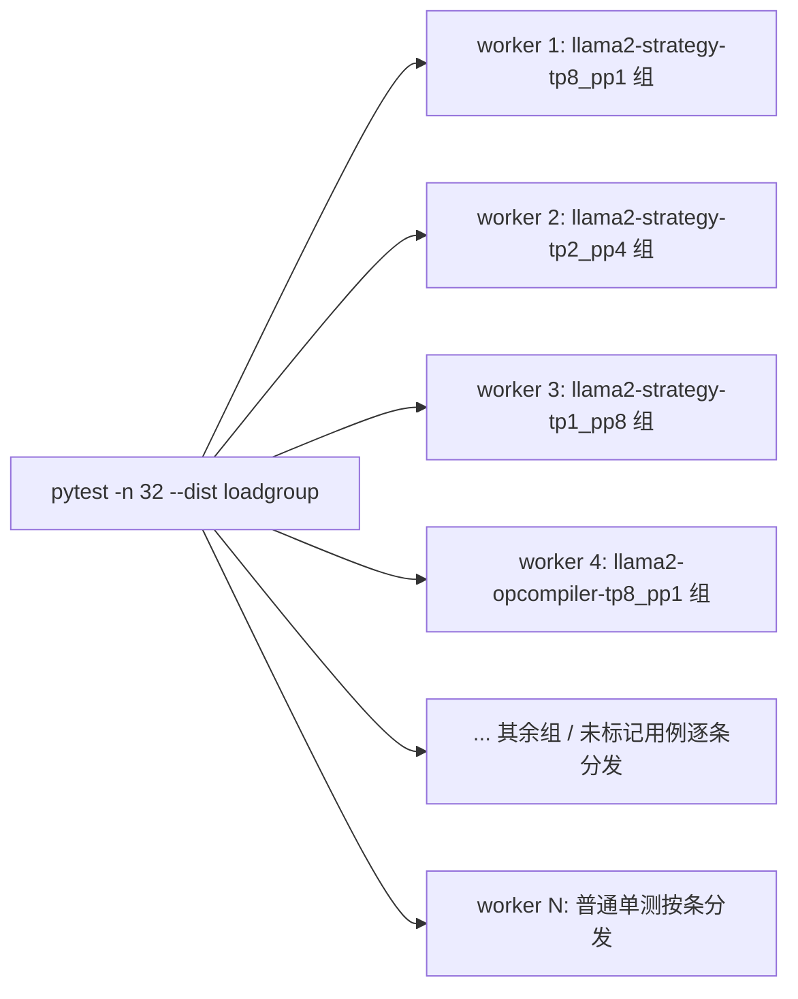

# 测试并行化改造（2026-11-20）

## 背景与测量

`python -m pytest tests/ -q -k "llama2_7b"` 串行需 30 分钟以上。先把 9 个 llama2_7b
测试文件逐个计时（9 进程并行测的，含争用噪声），找到耗时结构：

| 测试文件 | 串行耗时（约） | 大头在哪 |
| --- | ---: | --- |
| test_opcompiler_e2e_llama2_7b | 25 分钟+ | 三种切分策略串行，每个 linear 双算（编译内核 + numpy 镜像） |
| test_natural_prompt_llama2_7b | 22 分钟 | 单用例：单策略 prefill + 16 步 decode 全仿真 |
| test_strategy_llama2_7b | 21 分钟 | 三种切分策略串行（tp8_pp1 一条就要 12 分钟） |
| test_executor_llama2_7b | 3.6 分钟 | module 夹具 210 秒（export + 执行计划生成） |
| test_concurrency_llama2_7b | 3.5 分钟 | 同上 |
| test_mem_planner_llama2_7b | 28 秒 | 两次 export |
| 其余三个 | ~15 秒 | 一次 export |

cProfile 热点（test_executor 文件，268 秒）：

- `execute_plan` 179 秒：numpy 后端真实执行命令的时间（`wait` 726 万次调用只是
  `future.result()` 的等待，不是空转 bug）；
- `build_execution_plan` 42 秒：其中 `_deps_of` 的 `overlap` 被调 6700 万次，
  是读区间 × 历史写区间的 O(n²) 扫描；
- `torch.export` 单次约 10 秒，每文件 1~2 次——占比不大。

结论：**跨文件能共享的"冗余"（export、模型加载）占比小，真正的墙是各策略
各自的编译 + 仿真执行，天然互相独立，适合按策略并行**。

## 方案

用 pytest-xdist（环境里已装 3.8.0，无需新依赖）分两层并行：

- **策略级并行**（本次主要收益）：`test_strategy` / `test_opcompiler_e2e` 的参数化
  用例加 `xdist_group("llama2-<文件>-<策略名>")` 标记，tp8_pp1 / tp2_pp4 / tp1_pp8
  落到不同 worker 同时跑；同策略的多个用例（推理/KV/内存）固定同 worker，
  共享 module 级 `run_cache`，一份编译结果不重复算。
- **文件级并行**：其余 7 个 llama 文件加模块级组标记，整文件一个 worker——
  既共享 7B 模型夹具，也保证 32 worker 同时各持一份 7B 模型不会撑爆内存
  （7B fp16 约 14GB/份，分组后并发的 7B 副本 ≤ 13 份）。
- **套件级并行**：未标记的普通用例按条分发给其余 worker。

## 改动清单

| 文件 | 改动 |
| --- | --- |
| pytest.ini | `addopts` 增加 `-n 32 --dist loadgroup`；注册 `xdist_group` 标记 |
| tests/conftest.py | `_is_worker()` + `pytest_configure`（worker 内 BLAS/torch 线程限 4，防 32 worker 抢核）；报告钩子改懒注册 |
| tests/test_strategy_llama2_7b.py | 新增 `_strategy_params()`，3 个参数化用例改用它 |
| tests/test_opcompiler_e2e_llama2_7b.py | 同上 |
| 其余 7 个 test_*_llama2_7b.py | 各加一行模块级 `xdist_group` |

关键实现点：

1. **并行度可设置，默认 32**：命令行 `-n 8` 覆盖；`-n 0` 关闭并行（调试单文件时
   必须关，否则断点/PDB 进不了 worker）。
2. **报告不踩踏**：xdist 的主进程不做收集（`dsession.py` 明确禁止），原来的
   `pytest_collection_modifyitems` 建表在并行下是空的，全部报告被守卫丢弃。
   改为 `pytest_runtest_logreport` 里懒注册条目，worker 不写文件、主进程汇总
   全量写 `test-results/pytest-latest.md`。
3. **线程限流**：worker 的 `pytest_configure` 里 `os.environ.setdefault` 三个
   线程环境变量为 4（configure 先于测试模块导入 numpy/torch，时序成立）。
   主进程/串行不限。

## 已实施的测试

- `test_kv_layout_llama2_7b.py + test_comm_llama2_7b.py` 并行冒烟：11 通过，
  报告逐行完整（修复前汇总为空）。
- `test_pytest_report.py`（hermetic，拷 conftest 进临时目录串行跑）：2 通过，
  确认报告钩子改造向后兼容。
- 全量 `-k llama2_7b` 并行验证：见下方结果。

## 验证结果

`python -m pytest tests/ -q -k "llama2_7b"`，默认 32 路并行：

- **48 用例全过**，与串行基线一致（逐元素对拍判据全绿，确认并行无相互影响）；
- **总墙钟 48 分 53 秒**；累计测试执行时间约 2.2 小时被压缩进来；
- 分组按预期生效，重负载链全部重叠执行：

| 最慢的几条链 | 耗时 | 说明 |
| --- | ---: | --- |
| opcompiler_e2e tp1_pp8 | 2893 秒 | 纯流水，最后 24 分钟独占全机（其余全部跑完） |
| opcompiler_e2e tp8_pp1 | 1456 秒 | 与其他链并行 |
| opcompiler_e2e tp2_pp4 | 1406 秒 | 与其他链并行 |
| natural_prompt 单用例 | 1367 秒 | 与其他链并行 |
| strategy tp8_pp1 | 856 秒 | 与其他链并行 |

也就是说：**并行化已把除最慢单条链以外的一切全部消化，总耗时 = 最慢一条
策略链自身耗时**。串行跑这些文件是逐条累加（约 2 小时+）。

## 后续调整：tp1_pp8 移出默认回归

验证后把 `opcompiler_e2e` 的 `tp1_pp8` 参数实例加了 `slow` 标记（走仓库现成的
`-m "not slow"` 机制）：用例保留，默认命令不跑，`-m slow` 显式选中再验证。
默认 `-k llama2_7b` 子集从 48 例变 47 例，墙钟预期降到 ~25 分钟
（被次慢的 opcompiler tp8_pp1 的 1456 秒钉住）。

## 当前不足与后续方向

1. **单用例的墙还在**：并行化后总耗时 = 最慢一条策略线（本次是 opcompiler_e2e
   的 tp1_pp8，48 分钟）。要继续压需要动产品代码：
   - `compile_llama2` 里的算子内核编译逐个串行调 `compile_op`——另一条线在做的
     `opcompiler_bridge/parallel.py`（`OPCOMPILER_JOBS`）正是攻击这一段；
   - `runtime/exec_plan_gen.py` 的 `_deps_of` O(n²) 依赖扫描（单次编译约 40 秒，
     每文件 × 图数 × 策略数地重复付）；
   - opcompiler_e2e 的对拍包装把每个 linear 双算（编译内核 + numpy 镜像），
     验证语义 intentional，但占了约一半时间。
2. **worker 线程上限 4 是保守值**：长尾阶段（只剩一条链时）全机闲置、单 worker
   只有 4 线程。启动前 export `OMP_NUM_THREADS=16` 可覆盖（conftest 用
   `setdefault`，不覆盖已有值）。
3. **并行报告没有 NOT RUN 行**：主进程不收集，被 `-x` 截断的用例不会出现在
   报告里（串行模式不受影响）。
4. 默认 `-n 32` 对单文件快速迭代是负担（worker 启动开销几秒），记得用 `-n 0`。
