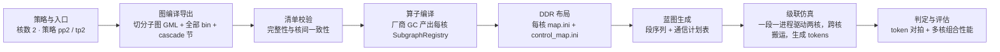
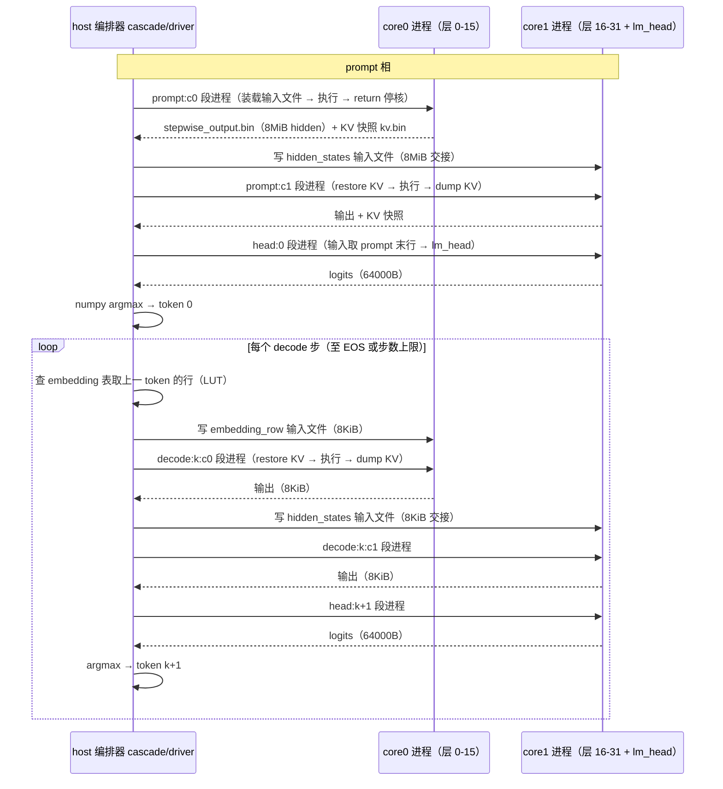

# 技术文档：多 CEVA 级联仿真与 Llama2 7B 全流程性能评估

> 文档编号：techdoc-multi-ceva-cascade-20261119  
> 创建日期：2026-11-19  
> 关联文档：request-multi-ceva-cascade-20261114、design-multi-ceva-cascade-20261114、implement-multi-ceva-cascade-20261114、review-multi-ceva-cascade-20261118-round01/02/03  
> 关联项目：flagos-pim-compiler（图编译器/编排器/评估）、FlagTree（算子编译器，本期零改动）、genesim（模拟器，本期零改动）、/data/fjg/ceva（CEVA 仿真工作区）  
> 代码基线：main @ a94534f（含未提交改动）；工作区 /data/fjg/ceva main @ 1a056c2（含未提交改动）  
> 核心目标：把已走通的单 CEVA Llama2 7B 全流程扩展为 2 个 CEVA 仿真器进程级联——编译期按策略切分导出并生成级联蓝图，运行时由 host（主机侧）编排器以「一段一进程」驱动两核、经文件通道完成跨核数据交接并生成 tokens，再由组合评估模型在每核实测数据之上叠加通信与并行代价给出多核整体性能。

## 一、概述

### 1.1 背景与问题

　　本需求的核心目标是建立多个 CEVA 仿真器级联的完整链路，覆盖「任务拆分、映射、通信编排、并行调度」的多核编排器与组合评估模型。现有基础是单 CEVA 全流程已走通：`run_ceva_pipeline.sh --run-name ours_e2e --decode-steps 10` 一条命令完成 65 张子图导出、算子编译、GML 与全部 bin 生成、厂商 GC 编译、DDR 布局与单进程仿真（`scripts/run_full_pipeline.py:772-786`）。但该链路只支持单个 CEVA 仿真器（一个 TCS 进程内的 1 个 NPM 核），缺少多核切分导出、跨核编排与整体评估能力，无法评估多核并行的收益，也无法为多核目标架构的编译决策提供性能依据。本需求在不动单核路径、不接入调优链路（CEVA 实跑一轮约 10 小时，无法逐调优候选评估）、FlagTree 与 genesim 零改动的前提下完成多核扩展。

### 1.2 方案摘要

　　围绕上述目标，总体采用「多进程级联 + 编译期蓝图 + 运行时段驱动 + 事后组合评估」三层解耦的技术路线。图编译器按 PP2/TP2 策略切分导出子图 bundle（`gml_bridge/ceva.py`），并从 bundle 的 cascade 节与每核 DDR 布局推导级联蓝图（段序列 + 通信计划表，`cascade/plan.py`）；运行时编排器按蓝图以「一段一进程」驱动 2 个 TCS 仿真器进程，经输入文件与 KV 快照文件完成跨核交接，产出 tokens 与每核分段计数（`cascade/driver.py`）；组合评估模型在每核实测 cycles 之上叠加链路通信与并行结构代价（`cascade/eval.py`）。最终 2 CEVA PP2 真机跑完 prompt 加 10 步 decode，11 个 tokens 与单核基线逐位一致。

### 1.3 完成情况

　　各需求的实现位置与验证情况见表 1。

<p align="center">表 1　需求完成情况</p>  

| 需求编号 | 需求内容 | 完成情况 | 实现位置 | 验证证据 |
|----------|----------|----------|----------|----------|
| R1 | 多进程 CEVA 级联底座 | 已完成 | `cascade/driver.py:SegmentProcessRunner`、`/data/fjg/ceva/src/automation/run_tools_step.py` | `test_cascade_driver` 与 pp2_v3 双核分段记录 |
| R2 | 多核 DDR 布局与容量核对 | 已完成 | `llama2_ddr_manager.py:540-586` | 工作区 `test_ddr_multi` |
| R3 | 图编译器多核切分导出 | 已完成 | `gml_bridge/ceva.py:1294-1415` | `test_ceva_export` 97 例；两核 bundle 过 GC |
| R4 | 编排器与 PP2 token 对拍 | 已完成 | `cascade/driver.py:292-401` | runs/pp2_v3：11/11 token 逐位一致 |
| R5 | TP2 并行编排与收益 | 部分完成 | `cascade/driver.py:453-620` | 离线测试全绿；真机端到端未跑（Q6） |
| R6 | 一键命令入口 | 部分完成 | `run_full_pipeline.py:742-770`、`/data/fjg/ceva/run_cascade.sh` | 机制被测试锁定；官方链路实证中断（Q8） |
| R7 | 多 CEVA 组合评估模型 | 部分完成 | `cascade/eval.py:167-202`、`312-397` | pp2_v3 评估产物齐全；out-of-sample 未验收（Q7） |

　　需求共 7 项，已完成 4 项，部分完成 3 项；三项缺口的机制与离线测试均已就绪，剩余工作全部是需要小时级到天级机时的真机验证（详见第八节）。本需求相关测试 230 例全部通过（复用 round03 实测口径），三轮评审 22 项问题全部确认并修复；当前遗留问题 7 条，详见第八节。

## 二、总体流程

### 2.1 端到端流程

　　本需求的核心目标是把「一个仿真进程一次跑完一个完整模型」改造成「多个仿真进程按编排器的段计划推进、host 在段间搬运数据」，并让编译器产出这份段计划、让评估模型消费执行记录。全流程从一条命令开始：`run_ceva_pipeline.sh --run-name <名> --num-ceva 2 --strategy pp2 --decode-steps 10`。首先，入口把核数与策略透传给图编译器（`scripts/run_ceva_pipeline.sh:70-71` 原样 `exec` 透传），图编译器按策略完成多核切分导出：PP2 复用 65 张整层图、只在 `bundle.json` 追加 cascade 节（`gml_bridge/ceva.py:1326-1333`），TP2 为每核导出 129 张分片图到 `core{N}/` 目录（`ceva.py:1355-1415`）；导出过程中 FlagTree 算子编译器以 `triton-opt` 二进制被调用，产出相位计划写入 GML 的相位字段（`opcompiler_bridge/phase_source.py:145-189`），全部 bin 仍由我方生成。然后，清单校验器核对 bundle 完整性（TP2 增加核间一致性检查）。其次，工作区脚本 `run_cascade.sh` 按核调用厂商 GC 把 GML 编成 SubgraphRegistry，DDR 布局器为每核生成独立的 map 与控制块地址，蓝图构造器从这两者推导出段序列与通信计划表。最后，编排器按蓝图逐段拉起仿真进程完成级联推理，判定脚本对拍 tokens，评估模型输出多核整体性能。如图 1 所示，编译期产物（bundle、每核 Registry、每核 map、蓝图）全部落盘归档，运行时与评估只读这些产物，任何性能数字都可追溯到运行目录。



<p align="center">图 1　多 CEVA 级联端到端流程</p>  

　　图 1 中「级联仿真」是本次新增的核心环节：它消费编译期的蓝图与每核产物，把两个独立的仿真器进程组织成一次完整的 Llama2 7B 推理，去掉该节点后多核链路不再成立，其余节点是既有单核链路的多核化扩展。各阶段的产物统一落在 `/data/fjg/ceva/runs/<run-name>/`：bundle 与清单在 `bundles/` 与 run 目录的 `gmls*`、每核布局在 `ddr_core{N}/`、蓝图文本在 `logs/blueprint.txt`、运行产物在 `run/`（tokens、每核计数、时间线、搬运日志）、评估产物在 `results/`（state.json、verdict.txt、cascade_eval.json）。

### 2.2 运行时数据流与 token 生成

　　级联仿真的核心问题是：两个独立的 TCS 进程各自只装载半个模型，host 如何驱动它们协同完成 prefill 与逐 token 解码。答案由三部分组成：段式执行模型、三条文件数据通道、host 侧闭环。

　　**段式执行模型**。一段等于一次完整的 app 执行：host 拉起一个新的 TCS 进程（`cascade/driver.py:205-214` 经 `run_tools_step.py` 受控会话装载段式 ELF `Llama2StepRunner.elf`），命令经 argv 传入（五个 map 路径、控制块地址、cmd 命令号、输入输出 DDR 地址、decode 行号、KV 快照目录、分片阶段与层号，`llama2_npm_app.cpp:209-245`、`502-533`），app 执行完本段子图后 `return`，程序终止即 EndOfExecution 真正停核，host 用同步 resume 的墙钟计时并读取结果（`driver.py:225-236`）。PP2 蓝图共 33 段：prompt 相 core0/core1 各一段加一个 head 段，之后每个 decode 步两核各一段加一个 head 段（`cascade/plan.py:158-194`）。

　　**三条文件数据通道**。跨核与跨段数据不走调试器内存读写，全部经文件传递。其一，输入文件通道（host 到设备）：编排器把上一段的输出或 embedding 行写进下一核的输入文件（`write_input_file`，`driver.py:169-177`），下一段进程装载时由 `loadBinMapToMemory` 按 ini 登记的尺寸整块读入 DDR，因此每次写入都补零到整块（`driver.py:391-394`）；prompt 相 hidden 交接是 8MiB（1024 行 × 4096 维 fp16），decode 相是 8KiB（1 行）。其二，设备输出文件通道（设备到 host）：每段 app 执行结束经 semihosting（半主机机制，设备侧直接读写 host 文件）把输出写到 `stepwise_output.bin`（尺寸按段型：prompt 8MiB、decode 8KiB、PP2 head 64000B、TP2 head 分片 32000B，`llama2_npm_app.cpp:704-717`），本段纯执行 cycles 写 `stepwise_cycles.txt`，host 读取后作为交接数据、归约输入或 logits。其三，KV 快照文件通道（设备到设备，跨进程）：KV cache 不在装载清单内，每个新进程的 KV 区全是零，因此段式 runner 在每段结束把本核 128MB KV 区按「张量、头、行」顺序整块 dump 到 `kv_core{N}/kv.bin`，下一段进程在 `initDevice` 之前把它 restore 回 DDR（`llama2_npm_app.cpp:429-451`、`688-691`）；KV 张量的实际口径是 int8 的 `1×32×1024×128`，每头一个 128KB 块、行步 128B。TP2 的注意力分片则按层快照为 `kv_L{n}.bin`。

　　**token 生成闭环（以 PP2 为例）**。prompt 相：core0 段跑第 0 到 15 层，输出 8MiB hidden；host 从中取出最后一个 prompt token 所在行（`head_input`，`driver.py:379-382`），补满后写 core1 的 `hidden_states` 输入文件；core1 段跑第 16 到 31 层；head 段在 core1 执行 lm_head 投影，输出全宽 32000 维 fp16 logits；host 用 numpy 做 argmax 得到第一个 token。decode 循环每步：host 按上一 token 从本机 `embed_weights.bin` 切出 8KiB embedding 行写入 core0 的 `embedding_row` 输入文件（LUT 查找表移到 host，`driver.py:34-37`、`388-389`），core0 段先 restore KV、再执行 16 层 decode 子图、最后 dump KV；8KiB 输出交接给 core1；core1 段同样推进；head 段出 logits，host argmax 得新 token；如此循环直到 EOS（token=2）或步数上限。每次搬运都追加记录到 `run/transfer_log.jsonl`（字节数与 host 耗时），每段完成即写 `results/state.json`（输出路径与计时），中断后重启时已完成段直接复用，实现断点续跑。如图 2 所示。



<p align="center">图 2　PP2 两核级联的运行时数据流与 token 生成</p>  

　　TP2 的数据流在同样的段式执行模型上多了并行与归约。两核各持半份权重（q/k/v/gate/up/lm_head 列切、o/down 行切），每个相内逐层推进：同层的 attn、mlp 两个分片段由编排器以双线程同时下发两核进程（`execute_pair`，`driver.py:489-553`），两核都完成后 host 读各自的部分和（decode 相各 8KiB、prompt 相各 8MiB），按 numpy fp16 相加再加残差得到该层输出（`reduce`，`driver.py:555-559`），再写回两核的输入文件进入下一层（`fanout`）。GML 算子集没有归约算子，行切投影的部分和必须出图由 host 归约，这正是每层拆成 attn/mlp 两段子图的原因。head 段两核各输出半宽 16000 维 logits，host 拼接成 32000 维后 argmax（`driver.py:568-583`）。两核同层段的提交与完成时刻记录在时间线里，重叠判定汇总到 `results/tp2_overlap.json`（`driver.py:425-450`），作为 R5 并行收益的证据。

### 2.3 模块关系

　　各模块的职责、改动类型与依赖关系见表 2。

<p align="center">表 2　模块关系</p>  

| 模块/文件 | 职责 | 改动类型 | 依赖的模块 |
|-----------|------|----------|------------|
| `cascade/plan.py` | 级联蓝图（段+搬运表） | 新增 | bundle cascade 节、每核 map |
| `cascade/driver.py` | 运行时编排与产物落盘 | 新增 | plan、run_tools_step、段式 ELF |
| `cascade/eval.py` | 组合评估模型 | 新增 | plan、run 产物、单核基线 |
| `gml_bridge/ceva.py` | 多核切分导出 | 修改 | sharding、FlagTree triton-opt |
| `scripts/run_full_pipeline.py` | 入口级联分派 | 修改 | export、verify、run_cascade.sh |
| `scripts/verify_gml_artifact.py` | 清单校验核间一致性 | 修改 | bundle.json |
| `run_tools_step.py`（工作区） | 受控仿真会话 | 新增 | ceva_budi |
| 段式 runner（工作区） | 按 cmd 执行段并回写 | 修改 | 每核 map、KV 快照 |
| `llama2_ddr_manager.py`（工作区） | 多核 DDR 布局 | 修改 | 按核 bundle |
| `compile_gml.py`（工作区） | 按核 GC 与缓存复用 | 修改 | 厂商 GC |
| `verify_cascade.py`（工作区） | 多核 token 判定 | 新增 | run 产物、基线 |
| `run_cascade.sh`（工作区） | 六步编排入口 | 新增 | 上述工作区模块 |
| FlagTree | 相位计划（triton-opt） | 零改动 | 被导出链调用 |
| genesim | 代价模型设计参考 | 零改动 | 无 |

## 三、核心原理

### 3.1 关键机制

　　为了达成多核级联的目标，需要同时保证四件事：切分后的子图能各自独立通过厂商 GC 并装载、host 能在段粒度驱动每个仿真器进程并在段间搬运数据、KV cache 与中间态能跨进程持久化、整体性能能从每核实测数据组合出来。现有实现里这四件事都不存在：导出无切分概念、仿真只能一次跑完、每个新进程的 KV 区全零、评估只有单核口径。总体采用「编译期蓝图 + 运行时段驱动 + 事后组合评估」三层解耦：编译期把策略翻译成确定性的段序列与搬运表，运行时只机械执行蓝图并记录时间线，评估模型用同一套蓝图语义组合实测数据。

　　**蓝图机制**旨在把「怎么拆、怎么传」做成编译期产物而非运行时即兴决策。`from_bundle` 读取 bundle 的 cascade 节（策略、核数、每核层段、lm_head 归属）与每核 `ddr_core{N}` 的三份 map，推导出完整的段序列与搬运表（`cascade/plan.py:137-155`）：PP2 每步是 core0 段、hidden 交接、core1 段、head 段、token 与 embedding 回写；TP2 每层是 attn 双核段、归约、mlp 双核段、归约。搬运表逐条记录字节数、源目的核与触发段（`CascadeTransfer`），`plan_text` 可打印成可读文本归档。这样运行时驱动不携带任何切分知识，评估模型与驱动消费同一份蓝图语义，三方解耦。

　　**段式执行与文件交接机制**旨在让 host 获得对每个仿真器进程的段粒度控制权。M0 探针证明 DDR 控制块轮询方案不成立（host 手动写不入 DDR、执行期调试器内存访问会崩溃 TCS），实际机制是命令经 argv 传入、一段一个完整 app 执行、程序终止即真正停核（`llama2_npm_app.cpp` STEPWISE 分支）。跨段数据全部走文件：输入文件在装载期进入 DDR、输出与 KV 快照经 semihosting 落盘。这一机制把「跨核通信」落实为可实测的 host 文件搬运，每次搬运的字节数与耗时都记录在 `transfer_log.jsonl`，供评估模型标定链路参数。

　　**跨进程 KV 快照机制**旨在让注意力缓存跨进程存活。段式 runner 在每段结束把本核 KV 区整块 dump、下一段启动时在 `initDevice` 之前 restore（时机约束来自实测：init 之后的经 DACU 映射写不落 DDR）。快照按 `[key_0..L-1][value_0..L-1]` 的连续布局整区一次映射、16MiB 分块读写，每段只有两次文件操作，且对映射指针直接 `fread/fwrite`，不在模拟核内 memcpy，实测对段设备时间近零开销。失败段不落盘快照，避免半更新的缓存覆盖上一段的有效快照。

　　**组合评估机制**旨在从每核实测数据得出多核整体结论。`compose` 按策略结构递推（`cascade/eval.py:167-202`）：PP2 是串行链，全部段 cycles 相加；TP2 是层内同步，同层两核段取 max 再加归约。每次传输按解析式 `λ + bytes/W` 计价，链路参数用本次运行的搬运记录最小二乘标定（`calibrate_link`，`eval.py:137-160`）。分层 cycles 取值优先级为 app TIMER 纯执行 cycles、EndOfExecution 全局时钟减装载基线、CycleEstimation 尾值（`parse_state_cycles`，`eval.py:41-109`）。每个标定参数登记来源 run，与被评估 run 相交即标注 `in_sample`、偏差不能作为验收依据；输出同时携带芯方舟三层仿真抽象（设备、每设备运算核、引擎），2 核实测即 `[2,1,1]`，按核数参数化可外推。

### 3.2 设计取舍

　　设计过程中的主要取舍见表 3。

<p align="center">表 3　设计取舍</p>  

| 取舍点 | 采用方案 | 未采用方案 | 理由 |
|--------|----------|------------|------|
| 级联形态 | 多进程，每核一个 TCS 进程 | 厂商单进程多核框架 | 每核沿用可信单核计时口径，规避厂商自述的多核并行计时不准 |
| 段同步机制 | 一段一进程 + argv 命令 | DDR 控制块轮询 | M0 实测控制块写不入 DDR、装载会清零保留区 |
| 跨核数据通道 | 输入文件 + semihosting 快照 | 调试器 read/write_mem | 执行期调试器内存访问会崩 TCS，且读不到 DMA 数据 |
| DDR 基址 | 两核同基址 0x100000000 | 按核偏移 8GiB | 多进程地址空间独立，分核偏移在对端进程实测崩溃 |
| 多核判定脚本 | 独立 verify_cascade.py | 扩展 verify_run.py | 不动单核判定路径，保证单核零回归 |
| GC 跨 run 复用 | --cache-from 校验后复制 | 软链复用既有产物 | 软链会把新字段写穿进归档 manifest |
| PP2 切分 | 65 图与单核逐字节相同，只加 cascade 节 | 重新导出每核子图 | 归属切分不改编译产物，GC 与对拍口径可复用 |

### 3.3 适用前提与边界

　　本方案的适用前提与边界如下。

- 前提：级联运行时只支持 2 核（`run_cascade.sh:36-40` 防呆）；不满足时：直接报错退出。  
- 前提：TP2 要求 hidden、kv 宽度、intermediate 均能被 2 整除（`sharding.py:100-107`）；不满足时：导出抛错。  
- 前提：评估的 out-of-sample 结论需要第二次独立运行；不满足时：偏差自动标注 in_sample、不可作验收依据。  
- 边界：调优链路不接入，策略由命令行手工指定；张量 batch 与多请求并发属另一需求。  
- 边界：同基址布局的前提是每进程 1 核；回到单进程多核则须按 `core_id<<32` 分核隔离。  

## 四、关键问题与解决方案

　　按「阻碍核心目标达成」的程度排序，实施与评审中真正踩过、解法有取舍的关键问题如下。

### 4.1 段同步机制不成立，级联驱动一度无解（来源：implement §十一、design §8.8）

　　为了让 host 在段粒度驱动仿真器，最初设计用 DDR 控制块加自旋轮询（host 写 go、app 轮询后写 done）。M0 探针逐项否定了该方案：`setExternalMemoryBaseAddress` 手动写不入 DDR（raw dump 四轮验证）、`loadBinMapToMemory` 会清零保留区、执行子图期间任何调试器 RPC 会原生崩溃 TCS、while(1) 自跳转不产生停机事件。最终机制是命令经 argv 传入、一段一个完整 app 执行、`return` 即 EndOfExecution 真正停核，结果经 semihosting 文件回传（`llama2_npm_app.cpp:209-245`）。这决定了整个运行时形态：一段一进程、文件交接、host 墙钟计时，由 M0 双进程探针与 pp2_v3 真机 33 段验证。

### 4.2 KV cache 跨进程持久化连续错位三轮（来源：implement §十五、§16.1-16.2）

　　decode 需要 prompt 阶段写入的 KV，而每个段进程的 KV 区全零，必须跨进程快照。该链路连错三轮：第一版按连续行 dump，忽略了 KV 是每头一个块的布局；第二版按 fp16 512 行（行步 256B）理解头内布局，v21 实测 decode token 仍错；最后从 GML 的 `IO_info.txt` 实读确认 KV 是 int8 `1×32×1024×128`（头块 128KB、行步 128B），按头块 gather/scatter 修复。半主机文件调用按次数计费，512 个小文件的写法让单个 prompt 段 42 分钟跑不完，改为整核一个 `kv.bin`、1MiB 流式分块后每段只剩两次文件操作。修复后 decode 首 token 29902 与基线一致，128MB 全量 diff 显示一步 decode 只改每个张量一行（约 9.5 万字节），等价于稠密证明，实现位于 `llama2_npm_app.cpp:82-153`。

### 4.3 厂商 GC 拒绝 TP2 分片图（来源：implement §九.2）

　　TP2 导出的 decode 注意力分片图过 GC 时被 test_app 拒绝。差分定位（仅修标签仍败、标签加头数后通过）确认根因是 `gml_hw_constants.py` 把 `group_attention_data_num/weight_num` 硬编码为 32 头，分片图实际 16 头、与 KV 维度对不上。修复是 `apply_vendor_conventions` 增加 heads 参数跟随 `spec.slots.heads`，单核仍为 32 不变。四类分片图（attn/mlp 的 prefill/decode 加 head）随后全部过 GC，TP2 每核 129 图清单 complete=true（`bundles/tp2_e2e`）。

### 4.4 TP2 驱动未传层号，恒跑第 0 层（来源：review round02 问题1）

　　TP2 要求两核在每个步内并行执行同层分片，但驱动侧 `execute_pair` 调 `run()` 时从未传 layer，argv[14] 落成字符串 `"None"`，app 侧 `atoi` 静默取 0——32 层蓝图每一层都跑第 0 层的分片图与第 0 层 KV，数值全错且无告警；测试替身没有 layer 形参、蓝图只有 1 层，恰好掩盖缺陷。修复按契约收紧：驱动按 `seg.layer_lo` 传层、attn/mlp 缺层直接抛 ValueError，app 侧非数字层号取 -1 显式失败退出（`driver.py:489-514`、`llama2_npm_app.cpp:531-533`），测试蓝图改 2 层并断言 layer 逐层递增（`test_tp2_reduce_and_argmax`）。

### 4.5 TP2 prompt 相断点续跑静默算错（来源：review round02 问题2）

　　断点续跑要求任何中断可恢复。TP2 的 fanout 每层把归约结果写回两核的 `hidden_states` 输入文件，原始 prompt 输入文件同时承担「设备装载源」与「host 重启推导源」两个角色，被原地覆盖后，prompt 相中途断掉再重启会从被污染的中间态起算，归约链全错。修复是首进 prompt 相把 core0 原始输入快照到 `results/prompt_input_core0.bin`，重启一律从快照取 x（`driver.py:588-594`），并补「prompt 中间层中断后续跑」离线测试，断言待跑段的输入文件与首跑逐字节一致。

### 4.6 评估标定与验证同源，偏差结论自证（来源：review round01 问题1）

　　全期只有一次 PP2 实测运行（pp2_v3），层标定系数由它拟合后又对它报告不到 1% 的偏差，链路参数也取自被评估 run 自己的搬运日志，属需求明文规定的无效验收。修复把分离做成机制：`evaluate` 登记每个标定参数的 `source_runs`，与被评估 run 相交即 `in_sample: true` 并注明不能作为验收依据（`eval.py:379-387`）；外部标定文件缺 `source_runs` 直接拒绝（`eval.py:258-268`）；手工周期扣减强制三字段溯源、缺一拒绝（`eval.py:112-126`）。out-of-sample 数字验收待第二次独立运行（Q7）。

### 4.7 段计时口径两处失真（来源：implement 17.5、§16.6）

　　性能数据依赖段计时，两处口径错误曾使其失真。其一，厂商 TIMER 是递减计数器，段式路径误写成 `tock - tick` 导致 uint64 下溢，经零 KV 探针抓出后改回 `tick - tock`（`llama2_npm_app.cpp:655-661`）。其二，`CycleEstimation.csv` 尾值只是最后一个被剖析任务的结束周期，不含控制器开销，对 prompt 段低估约 40%；与单核基线可比的口径是 app 日志的 EndOfExecution 全局时钟，runner 与驱动统一从 app 日志解析并写进 state（`driver.py:272-283`），评估按「TIMER 纯执行优先、EndOfExecution 减装载基线次之、CSV 尾值兜底」取值。

## 五、改动说明

### 5.1 改动总览

　　本次 pim-compiler 修改 10 个文件（+1253/-28 行），新增 `cascade/` 包四文件与标定数据（约 1500 行）及 3 个测试文件（1197 行）；/data/fjg/ceva 工作区修改 11 个文件（+983/-52 行），新增编排脚本、受控会话、判定脚本与 5 个测试文件；另有若干一次性实验与探针工具脚本。核心改动集中在 pim-compiler 的 `cascade/` 包（蓝图、驱动、评估三层）与 `gml_bridge/ceva.py` 的多核导出路径，工作区改动集中在段式 runner 与 DDR 布局器。genesim 与 FlagTree 经 git status 核对零改动。

### 5.2 文件改动清单

　　本次全部改动文件及其对应需求见表 4（不含 `docs/` 过程文档与运行残留产物）。

<p align="center">表 4　文件改动清单</p>  

| 文件路径 | 改动类型 | 改动内容 | 对应需求 |
|----------|----------|----------|----------|
| `cascade/__init__.py` | 新增 | 包标记（`python -m cascade.driver` 入口） | R4/R5/R7 |
| `cascade/plan.py` | 新增 | 蓝图三 dataclass、from_bundle、plan_text、权威投影 | R4/R5 |
| `cascade/driver.py` | 新增 | 段式进程编排、PP2/TP2 驱动、自检 hook、产物落盘 | R1/R4/R5 |
| `cascade/eval.py` | 新增 | 组合模型、预测模式、标定溯源、CLI | R7 |
| `cascade/layer_scaling_llama2_pp2.json` | 新增 | 层标定默认系数（带 source_runs 声明） | R7 |
| `gml_bridge/ceva.py` | 修改 | strategy 参数、cascade 节、shard_model、分片 wrapper、tp2 整包 | R3 |
| `contracts/ceva.py` | 修改 | CevaGraphSpec 加可选 shard_kind | R3 |
| `gml_bridge/from_fx.py` | 修改 | 随导出口径的小幅调整 | R3 |
| `scripts/export_gml.py` | 修改 | --num-ceva/--strategy 与 tp2 三元组目标 | R3/R6 |
| `scripts/verify_gml_artifact.py` | 修改 | tp2 核间一致性（键集合、尺寸、区间互补） | R3 |
| `scripts/run_full_pipeline.py` | 修改 | run_ceva 级联分派与 --dry-run | R6 |
| `scripts/run_ceva_pipeline.sh` | 修改 | 透传新参数，默认与旧版单核逐参数等价 | R6 |
| `tests/test_cascade_{plan,driver,eval}.py` | 新增 | 级联三件套单测（40 例） | R4/R5/R7 |
| `tests/test_ceva_export.py`、`tests/test_paths.py`、`tests/conftest.py` | 修改 | 导出/入口用例扩展与归档树写守卫 | 各项 |
| `run_cascade.sh`（工作区） | 新增 | 六步编排（环境/构建、按核 GC、布局、蓝图、仿真、判定评估） | R6 |
| `src/automation/run_tools_step.py`（工作区） | 新增 | JSON 行协议受控仿真会话 | R1 |
| `src/llama_runner/`（工作区，4 文件） | 修改 | STEPWISE 段式模式、cmd=1-6 分发、KV 快照、分片 runner | R1/R4/R5 |
| `src/ddr_manager/llama2_ddr_manager.py`（工作区） | 修改 | --cores/--core-id/--strategy、同基址布局、层过滤、容量核对 | R2 |
| `scripts/compile_gml.py`（工作区） | 修改 | --gmls-name 与 --cache-from 只读复用 | R3/R6 |
| `scripts/verify_cascade.py`（工作区） | 新增 | 多核判定（token 对拍 + run 指纹一致性） | R4/R6 |
| `scripts/pp2_tokens.py` 等 10 个（工作区） | 新增 | 退役测试工具与 M0/decode 探针（头部声明用途） | R1/R4 |
| `.gitignore`、`run_all.sh`、`07_run.sh`、`tests/test_{compile_gml,gitignore}.py`（工作区） | 修改 | 留档白名单与单核链路适配 | 各项 |
| `tests/test_{ddr_multi,run_tools_step,verify_cascade,run_cascade,pp2_tokens_flow}.py`（工作区） | 新增 | 工作区单测（76 例口径） | R1/R2/R4 |

### 5.3 核心函数清单

　　理解本次改动所需的核心函数见表 5。

<p align="center">表 5　核心函数清单</p>  

| 函数/类 | 位置 | 作用 | 调用方 |
|---------|------|------|--------|
| `from_bundle()` | `cascade/plan.py:137` | 从 cascade 节与每核 map 构造蓝图 | driver、eval、干跑 |
| `run_pp2_processes()` | `cascade/driver.py:292` | PP2 串行编排与 token 生成 | `cascade.driver` CLI |
| `run_tp2_processes()` | `cascade/driver.py:453` | TP2 并行下发、host 归约与拼接 | `cascade.driver` CLI |
| `SegmentProcessRunner.run()` | `cascade/driver.py:179` | 一段一进程拉起与结果回收 | 两个编排函数 |
| `compose()` | `cascade/eval.py:167` | 按策略结构组合端到端指标 | `evaluate` |
| `evaluate()` | `cascade/eval.py:312` | 归集实测与预测并落盘评估产物 | `cascade.eval` CLI |
| `export_ceva_bundle()` | `gml_bridge/ceva.py:1294` | 按策略分派单核/PP2/TP2 导出 | `export_gml.py` |
| `shard_model()` | `gml_bridge/ceva.py:575` | 七投影 TP 切片（列切/行切） | `_export_tp2_bundle` |
| STEPWISE `main` | `llama2_npm_app.cpp:236` | argv 协议与 cmd=1-6 段分发 | 每段 TCS 进程 |
| `run_prompt_range()` 等 5 个 | `llama2_npm.cpp:169-331` | 层范围段与三类分片段执行 | STEPWISE main |
| `ddr_manager()` | `llama2_ddr_manager.py:704` | 多核布局（同基址、层过滤、容量核对） | `run_cascade.sh` 第 3 步 |
| `reuse_from_cache()` | `compile_gml.py:98` | GC 产物跨 run 只读复用（三重校验） | `compile_gml` main |

### 5.4 数据结构与接口变更

　　为了把「一次级联运行要做什么」表达成可落盘、可打印、可复用的编译期产物，已有导出清单（bundle.json 只有 graphs 与 complete）缺少切分归属与通信语义，因此新增蓝图三结构与 bundle 的 cascade 节。

**`CascadeBlueprint`**（`cascade/plan.py:83-101`）
```python
@dataclasses.dataclass(frozen=True)
class CascadeBlueprint:
    strategy: str            # pp2 / tp2
    num_cores: int
    core_base_addrs: dict    # 每核 DDR 基址（多进程下两核同为 0x100000000）
    segments: list           # CascadeSegment：seg_id/core_id/kind/层范围/出入地址
    transfers: list          # CascadeTransfer：字节数/源目的核/类型/触发段
    control_addrs: dict      # 每核控制块地址
```

**`ControlBlock`**（`cascade/plan.py:22-53`）为 64B 控制块镜像，格式串 `<IIIIQQIIIIIIII`（14 字段 = 4×u32 + 2×u64 + 8×u32），与 C 侧 `_Static_assert(sizeof == 64)` 逐字段对齐；`go=1` 启动一段、`done=1` 表示完成，缺省全零等价「无段待执行」。

**bundle.json 的 `cascade` 节与 `shard_range`**（`gml_bridge/ceva.py:1326-1333`、`613-627`）：PP2 写 `{strategy, num_cores, core_layers, lm_head_core}`；TP2 每核 graphs 条目额外写分片区间 `{"dim": heads|intermediate|vocab, "lo", "hi", "full"}`，供清单校验核对两核宽度互补。`cascade` 为可选键，缺失即单核行为，等价改动前。

**`results/state.json`**：运行时权威产物，`done` 记录每段输出路径与计时（断点续跑依据），`timing` 为追加式日志；`authoritative_timing` 按归一化段名取每段最后一条作为计数与汇总的权威投影（`plan.py:281-291`）。默认值均等价改动前行为，单核路径调用方无需改动。

## 六、验证

### 6.1 验证环境

代码基线：pim-compiler main @ a94534f、工作区 main @ 1a056c2（均含未提交改动）；运行环境：Linux 服务器（112 核），torch 2.9.1、python 3.10.20，CEVA 工具链（TCS 仿真器、厂商 GC、交叉编译）。

### 6.2 验证命令与结果

　　为了验证「多核级联正确且单核零回归」，本项目采用四层验证：单测与全量回归覆盖机制正确性，归档真机运行覆盖端到端行为，产物只读核对覆盖文档与事实一致性，评估专项覆盖性能判据。本轮撰写未重跑任何 CEVA 仿真与测试（测试已验证通过，且当前正在运行其他 CEVA 测试），全部结论复用既有实测证据并核对归档产物。各验证项的命令与证据状态见表 6。

<p align="center">表 6　验证命令与结果</p>  

| 验证项 | 命令 | 结果 | 结论 | 证据状态与来源 |
|--------|------|------|------|----------------|
| 级联+导出+路径单测 | `python -m pytest tests/test_cascade_plan.py tests/test_cascade_driver.py tests/test_cascade_eval.py tests/test_ceva_export.py tests/test_paths.py -q` | 154 通过 / 0 失败 | 通过 | 复用已有验证（round03 实测，implement §4.1）；未提交改动基线 |
| 工作区单测 | `cd /data/fjg/ceva && python -m pytest tests/ -q` | 76 通过 / 0 失败 | 通过 | 复用已有验证（round03，implement §18.3） |
| 全量回归 | `python -m pytest tests/ -q -k "not llama2_7b"` | 2213 通过 / 1 失败 / 9 跳过 | 通过 | 复用已有验证（implement §18.3）；唯一失败为已知 fork 抖动，单跑通过 |
| PP2 真机 token 对拍 | 复现命令块（`--strategy pp2` 全流程） | 11/11 token 逐位一致，verdict PASS | 通过 | 复用已有验证（runs/pp2_v3，implement §17.12）；本次只读复核归档 `argmax_results.bin`、`verdict.txt`、`cascade_eval.txt` 与本文一致 |
| 官方编排器端到端 | `python -m cascade.driver --run-dir runs/pp2_v3 ...` | 复用 22 段补跑 11 head 段，tokens 一致 | 通过 | 复用已有验证（implement §17.14） |
| 评估模型专项 | `python -m cascade.eval --strategy pp2 ...` | 组合指标齐全，偏差 0.9% 标注 in_sample | 通过（口径受限） | 复用已有验证（implement §17.16、§18.2.1）；out-of-sample 待 Q7 |
| TP2 分片图过 GC | `compile_gml.py`（tp2 两核 258 图） | 四类分片图全部编译成功，清单 complete=true | 通过 | 复用已有验证（implement §九/十、round01 核对） |
| TP2 真机端到端 | 同 PP2 命令换 `--strategy tp2` | 未执行 | 未执行 | 长跑禁止（用户 2026-11-18 纪律）；登记 Q6，不计缺陷 |

复现命令（单次 PP2 全流程 host 墙钟约 9.7 小时、磁盘约 63G，断点续跑可用 `--cache-from pp2_v3` 复用已编的 65 图 GC 产物）：
```bash
cd /data/fjg/flagOS/flagos-pim-compiler
scripts/run_ceva_pipeline.sh --run-name <新名> --num-ceva 2 --strategy pp2 --decode-steps 10
# 单测（秒级~分钟级）
python -m pytest tests/test_cascade_plan.py tests/test_cascade_driver.py tests/test_cascade_eval.py -q
cd /data/fjg/ceva && python -m pytest tests/ -q
```

### 6.3 验收标准对照

　　逐条对照需求文档验收标准的结果见表 7。

<p align="center">表 7　验收标准对照</p>  

| 验收标准（来自需求文档） | 验证方法 | 结论 | 证据 |
|--------------------------|----------|------|------|
| R1 双进程并行驱动与跨核搬运演示 | M0 探针与 pp2_v3 分段记录 | 满足 | 6.2 第 4 条 |
| R2 两核布局窗口内核对且容量不超限 | `test_ddr_multi`（判据按 design §8.6 改写） | 满足 | 6.2 第 2 条 |
| R3 策略 bundle 过清单校验、每核子图过 GC | verify_gml_artifact 与 compile 日志 | 满足 | 6.2 第 1、7 条 |
| R4 PP2 tokens 与 ours_e2e 基线 11 token 逐个严格一致 | 归档 argmax 对拍（verify_cascade PASS） | 满足 | 6.2 第 4 条 |
| R5 TP2 tokens 前 ≥4 一致且两核同层时间线重叠 | 真机运行 | 未验证 | Q6（运行时就绪、离线断言锁定） |
| R6 一条命令完成 2 CEVA PP2 全流程并出判定报告，单核回归不变 | 官方链路执行 | 部分满足 | 机制与单核回归满足；端到端实证中断于 GC（Q8） |
| R7 预测与实测偏差 ≤20%、方向正确、参数可溯源 | 评估专项 | 部分满足 | 机制与溯源满足；in_sample 0.9% 不作验收，out-of-sample 待 Q7 |

### 6.4 评审情况

　　本需求共进行 3 轮评审，形成 22 条报告项：严重 2 条、高 6 条、中 11 条、低 3 条，全部确认成立并修复，修复前均先补失败测试再改代码。各轮核心问题及最终状态见表 8。

<p align="center">表 8　评审问题与修复状态</p>  

| 评审轮次 | 核心问题 | 修复状态 | 最终证据 |
|----------|----------|----------|----------|
| round01（10 项） | 评估标定与验证同源；一键入口未实证；单核默认被破坏；TP2 运行时缺失；伪证据脚本堆积 | 已修复（入口实证转 Q8，TP2 真机转 Q6） | in_sample 机制与 correction 溯源测试；外壳默认单核回归用例；cmd=4/5/6 与 run_tp2_processes；7 个伪证据脚本删除 |
| round02（7 项） | TP2 层号未接线；prompt 相断点续跑算错；verdict 无指纹；加速比基线截断；单测写伪 PASS 进归档树 | 已修复 | layer 递增与断点续跑逐字节断言用例；verdict 绑 state 指纹；decode_steps 统一口径；路径打桩加写守卫 |
| round03（5 项） | 伪 PASS 在仓内 runs/ 复发；GC 缓存复用缺机制未登记；外部标定缺来源强制；判定指纹强度不足；核间缺宽度互补 | 已修复 | fake_run 按命令判定加双前缀守卫；--cache-from 三重校验与设计 §8.9 登记；override 缺 source_runs 拒绝；head 段数与 token 数交叉核对；shard_range 互补检查 |

　　跨轮复发 1 项（round02 问题 5 的伪证据写入在 round03 以仓内路径复发），按行为根源收口后根治并有守卫生效用例锁定。当前未修复 0 条；三项真机验证缺口（Q6/Q7/Q8）见第八节。

## 七、与设计的差异

　　本节记录最终实现与设计文档的出入及原因，多数为 M0 实测推翻设计假设后按 design §8 登记的修正。逐条对照的结果见表 9。

<p align="center">表 9　与设计的差异</p>  

| 设计条目 | 设计方案 | 最终实现 | 差异原因 | 是否经确认 |
|----------|----------|----------|----------|------------|
| design §4.1 段同步 | DDR 控制块轮询 | 一段一进程 + argv 命令 | M0 实测控制块写不入 DDR | 是（§8.8） |
| design §4.3 DDR 基址 | 按核偏移 8GiB 全局无重叠 | 两核同基址，判据改为装载窗口内核对 | 多进程地址空间独立，偏移在对端进程崩溃 | 是（§8.6） |
| design §4.1 格式串 | 15 字段 68B | 14 字段 64B | 设计笔误，字段清单才是权威 | 否（实测尺寸矛盾，以 64B 为准） |
| design §5.1 多核判定 | 扩展 verify_run --logs | 独立 verify_cascade.py | 不动单核判定路径，零回归优先 | 是（§8.7） |
| design §3.2/§7.2 GC 复用 | 播种软链复用单核缓存，干跑判据 100% already | 播种撤回，--cache-from 校验后复制，判据改写为可达口径 | 软链会写穿污染归档 manifest；缓存以 run 目录为键 | 是（§8.9） |
| design §5.1 06_ddr_memory.sh 透传 | 包装脚本透传多核参数 | run_cascade.sh 直调 ddr_manager | 行为等价、少一层转发 | 是（§8.9） |
| design §4.6 编排形态 | 常驻会话 + 控制块驱动 | 段式进程 + 文件交接 + 断点续跑 | M0 机制转向（同 §8.8） | 是 |
| design §4.8 入口链 | run_full_pipeline 只调 run_cascade.sh | 级联分支先补导出与清单校验再调 run_cascade.sh | 原实现漏了前两步 | 是（implement §16.5） |

## 八、当前遗留问题

　　本节汇总当前尚未关闭的问题、其影响与来源，逐条状态见表 10。全部遗留项均为需要小时级到天级机时的真机验证，机制与离线测试均已就绪，受「长跑禁止」运行纪律约束未执行。

<p align="center">表 10　当前遗留问题</p>  

| 编号 | 问题描述 | 影响范围 | 来源 | 状态 |
|------|----------|----------|------|------|
| Q6 | TP2 端到端真机运行（258 图冷 GC 约 120G 加约 10h 仿真） | R5 的 token 与时间线证据 | implement §六 | 未执行（长跑禁止） |
| Q7 | 评估 out-of-sample 偏差验收（需第二次独立 PP2 运行） | R7 的 ≤20% 偏差判据 | implement §六、§18.2.1 | 未执行（长跑禁止） |
| Q8 | R6 官方链路端到端实证（runs/pp2_r6 中断于 GC，无 verdict/cascade_eval） | R6 的一键判定报告证据 | implement §六、round02 问题3 | 未执行；可 `--cache-from pp2_v3` 断点续跑 |
| Q5 | TP2 tokens「前若干一致」的具体数量未定稿 | R5 判据口径 | request §八.3 | 待 TP2 首跑后定稿 |
| L1 | 旧 tp2_e2e 清单无 shard_range 字段，重校验需按新口径重导 | 历史归档可复用性 | implement §18.2.9 | 已规避（检查面向新导出链路） |
| L2 | check_orig 快照存在 3.5 万处厂商历史产物漂移（早于本需求） | 原始目录审计基线 | implement §18.2.7/10 | 已登记，未处置 |
| L3 | --cache-from 的真实 GC 复用率与耗时收益未实测 | Q8 断点续跑成本估计 | implement §18.2.8 | 未执行（随 Q8 闭环） |
